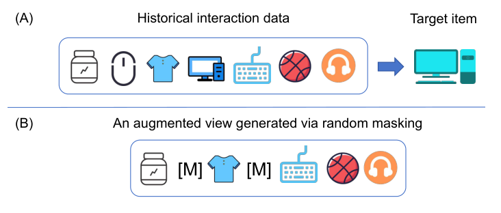
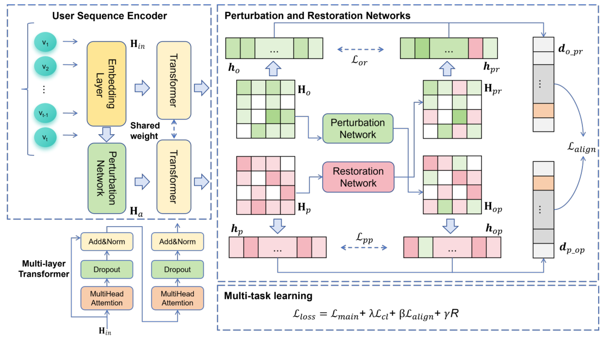
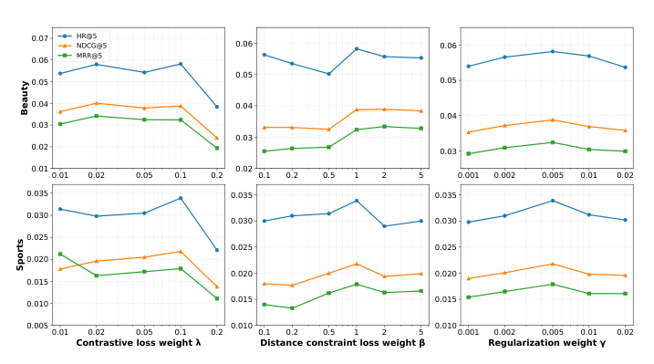
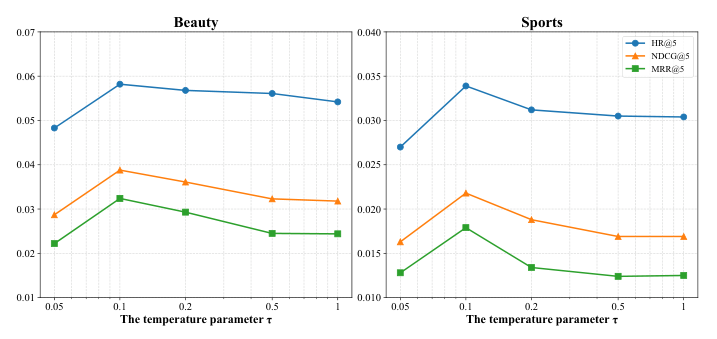
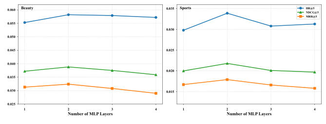

# ACLSRec：通过自适应扰动与恢复保持序列对比语义

> 论文：Adaptive Contrastive Learning in Sequential Recommendation based on Perturbation and Restoration Networks，WWW 2026。[https://doi.org/10.1145/3774904.3792207](https://doi.org/10.1145/3774904.3792207)
> 代码：https://github.com/xiaomizhou778/ACLSRec
> 更新记录：2026-11-13 统一论文-本地实验结果对照表为五列长表；2026-10-22 统一笔记顶部信息格式；保留原有阅读与复现记录，论文结果与本地结果分开。

---
# 一、文献阅读

## 1. 研究背景



**图 1：随机掩码引起的增强语义偏差**（英文原文 PDF 第 2 页）。

序列推荐系统通过建模用户历史交互序列中的时序依赖，捕捉用户动态演化的偏好。然而，用户行为序列面临两个核心挑战：

1. **数据稀疏性**：冷启动场景下交互数据稀缺，难以建模复杂的兴趣转移；
2. **隐式噪声**：误点击、行为歧义等噪声会偏置模型，导致推荐不准确。

对比学习通过自监督信号缓解稀疏与噪声问题：对用户序列施加数据增强，生成正样本对，最大化正样本相似度、最小化负样本相似度。典型增强包括随机裁剪、掩码、重排、Dropout 等。

然而，现有对比学习方法大多依赖**预定义增强策略**，忽略了原始序列与增强视图之间的**语义一致性**。论文图 1 展示了一个典型问题：原始序列包含运动与电子两个核心意图，目标物品为台式电脑。随机掩码掉关键电子物品（鼠标、台式电脑）后，增强视图过度偏向运动，导致表示偏离用户真实意图。Dropout 同样可能切断编码关键行为特征的连接，破坏时序依赖学习。

因此，不合适的增强会引入**语义偏差**，损害表示判别力，最终错误表示用户兴趣。

## 2. 研究目的

提出一种**自适应对比学习框架 ACLSRec**，通过可学习的扰动与恢复网络，动态扰动和恢复用户表示，在增强视图之间保持语义一致性，同时通过对比学习捕捉用户演化兴趣。

核心设计目标：

- 构建“原始 → 扰动 → 恢复”的闭环学习约束，克服传统增强的语义偏差；
- 在潜在空间中进行可控增强与语义感知重建；
- 保留用户行为的内在序列逻辑，同时提升对稀疏和噪声的鲁棒性；
- 不修改 backbone 架构，仅训练阶段引入额外模块。

## 3. 研究问题

论文实验围绕以下 RQ 展开：

1. **RQ1**：ACLSRec 相比 SOTA 序列推荐与对比学习基线，在多个数据集上表现如何？
2. **RQ2**：各核心组件（扰动网络、恢复网络、对比损失、距离约束、正则化）的贡献如何？
3. **RQ3**：关键超参数（对比损失权重 $\lambda$、距离约束权重 $\beta$、正则化权重 $\gamma$、温度 $\tau$）与 MLP 深度如何影响性能？

## 4. 研究方法



**图 2：ACLSRec 的序列编码、扰动恢复与多任务学习框架**（英文原文 PDF 第 4 页）。

ACLSRec 的核心思想是：**用可学习的扰动网络生成增强视图，再用恢复网络重建原始语义，通过对比学习与几何约束确保增强视图不偏离用户真实意图**。

整体框架包含三个模块：

1. **用户序列编码器**：基于 Transformer，将用户交互序列编码为表示；
2. **扰动与恢复网络**：双路径架构，一路对输入嵌入施加扰动后编码，再经恢复网络重建；另一路直接编码原始输入，并生成对比视图；
3. **多任务学习**：联合优化主推荐任务、对比损失、距离约束损失和正则化项。

关键机制：

- **双路径增强**：扰动网络 $\text{MLP}_{\theta_p}$ 对输入嵌入 $H_{in}$ 施加扰动，得到 $H_a$，再经 Transformer 编码为 $H_p$；恢复网络 $\text{MLP}_{\theta_r}$ 将 $H_p$ 重建为 $H_{pr}$。另一路直接用 Transformer 编码 $H_{in}$ 得到 $H_o$，再用同一个扰动网络生成对比视图 $H_{op}$。
- **语义一致性约束**：对比损失 $\mathcal{L}_{or}$ 拉近原始表示 $h_o$ 与恢复表示 $h_{pr}$；对比损失 $\mathcal{L}_{pp}$ 拉近两个扰动表示 $h_p$ 与 $h_{op}$。
- **距离约束**：通过跨路径对称几何距离 $\mathcal{L}_{align}$，约束扰动与恢复路径的一致性。
- **动态正则化**：根据 batch 内相似度分布动态调整正负样本边界，防止表示坍塌与过度对齐。

## 5. 研究内容（公式分析）

### 5.1 问题定义

用户集合 $U$，物品集合 $V$。用户 $u$ 的交互序列为 $s_u = [v_1^u, v_2^u, \ldots, v_{|s_u|}^u]$。下一物品预测任务：

$$
v_u^* = \arg\max_{v_t \in V} P(v_{|s_u|+1}^u = v_t \mid s_u)
$$

序列统一处理为固定长度 $T$：若 $t > T$ 保留最近 $T$ 个交互；若 $t < T$ 左侧填充占位物品。

### 5.2 用户序列编码器

**嵌入层**：物品嵌入与位置嵌入相加：

$$
E_t = W_e[v_t^u], \quad P_t = W_p[t], \quad H = [E_1+P_1; \ldots; E_T+P_T]
$$

$$
H_{in} = \text{Dropout}(\text{LayerNorm}(H))
$$

**多层 Transformer**：每层包含多头自注意力与前馈网络：

$$
\text{MH}(H^l) = \text{concat}(\text{head}_1; \ldots; \text{head}_k) W^o
$$

$$
\text{head}_i = \text{Attention}(H^l W_i^Q, H^l W_i^K, H^l W_i^V)
$$

$$
\text{Attention}(Q,K,V) = \text{softmax}\left(\frac{QK^\top}{\sqrt{d/k}}\right)V
$$

因果掩码确保位置 $i$ 只关注 $\le i$ 的位置。前馈网络：

$$
\text{FFN}(H^l) = \text{GELU}(\text{MH}(H^l)W_1 + b_1)W_2 + b_2
$$

$$
H^{l+1} = \text{LayerNorm}(H^l + \text{Dropout}(\text{FFN}(H^l)))
$$

最终用户表示为最后一行的输出：

$$
h = H^L[-1] \in \mathbb{R}^d
$$

### 5.3 扰动与恢复网络

#### 5.3.1 双路径增强架构

一路：

$$
H_a = \text{MLP}_{\theta_p}(H_{in}), \quad H_p = \text{Transformer}(H_a)
$$

恢复：

$$
H_{pr} = \text{MLP}_{\theta_r}(H_p)
$$

另一路：

$$
H_o = \text{Transformer}(H_{in}), \quad H_{op} = \text{MLP}_{\theta_p}(H_o)
$$

取各表示矩阵最后一行作为用户表示：

$$
h_* = H_*[-1], \quad * \in \{p, pr, o, op\}
$$

#### 5.3.2 对比学习

两个 InfoNCE 损失：

$$
\mathcal{L}_{or} = -\frac{1}{|U|}\sum_{u \in U} \log \frac{\exp(h_o^u (h_{pr}^u)^\top / \tau)}{\sum_{u' \in U_u} \exp(h_o^u (h_{pr}^{u'})^\top / \tau)}
$$

$$
\mathcal{L}_{pp} = -\frac{1}{|U|}\sum_{u \in U} \log \frac{\exp(h_p^u (h_{op}^u)^\top / \tau)}{\sum_{u' \in U_u} \exp(h_p^u (h_{op}^{u'})^\top / \tau)}
$$

$$
\mathcal{L}_{cl} = \mathcal{L}_{or} + \mathcal{L}_{pp}
$$

$\mathcal{L}_{or}$ 促进增强视图一致性，$\mathcal{L}_{pp}$ 增强噪声鲁棒性。

#### 5.3.3 距离约束

对表示做 L2 归一化：

$$
\hat{h}_* = \frac{h_*}{\|h_*\|_2}
$$

定义两个跨视图几何距离：

$$
d_{o\_pr} = (1 - \hat{h}_o^\top \hat{h}_{pr}) / \tau
$$

$$
d_{p\_op} = (1 - \hat{h}_p^\top \hat{h}_{op}) / \tau
$$

对称距离约束损失：

$$
\mathcal{L}_{align} = \mathbb{E}[(d_{o\_pr} - d_{p\_op})^2]
$$

#### 5.3.4 正则化约束

将 $h_o$ 与 $h_{pr}$ 堆叠为 $Z \in \mathbb{R}^{2N \times d}$，计算相似度矩阵 $S = ZZ^\top$。定义二值掩码 $M$：正样本对为 $i=j$ 或 $|i-j|=N$。

正样本相似度集合 $\sigma^+$，负样本相似度集合 $\sigma^-$。动态边界：

$$
o_{min} = \min(\min(\sigma^+), \max(\sigma^-))
$$

$$
o_{max} = \max(\min(\sigma^+), \max(\sigma^-))
$$

正则项：

$$
R = \frac{1}{|\sigma^+|}\sum_{s \in \sigma^+} \max(s - o_{min}, 0) + \frac{1}{|\sigma^-|}\sum_{s \in \sigma^-} \max(o_{max} - s, 0)
$$

### 5.4 多任务学习

主损失为下一物品预测的二元交叉熵：

$$
\mathcal{L}_{main}(s_{u,t}) = -\log \frac{\exp(h_u^o (W_e[v_{t+1}^u])^\top)}{\exp(h_u^o (W_e[v_{t+1}^u])^\top) + \sum_{v^- \in V^-} \exp(h_u^o (W_e[v^-])^\top)}
$$

总损失：

$$
\mathcal{L}_{loss} = \mathcal{L}_{main} + \lambda \mathcal{L}_{cl} + \beta \mathcal{L}_{align} + \gamma R
$$

### 5.5 算法流程

论文算法 1 概括：

```text
输入：用户序列 batch S，超参数 λ, β, γ, τ
输出：更新后的模型参数 Θ

1. 用户序列编码：H_in = EmbeddingLayer(s_i)，H_o = Transformer(H_in)
2. 生成扰动表示：H_a = MLP_θp(H_in)，H_p = Transformer(H_a)
3. 恢复与对比视图：H_pr = MLP_θr(H_p)，H_op = MLP_θp(H_o)
4. 多任务损失：计算 L_main, L_cl, L_align, R，总损失 L = L_main + λL_cl + βL_align + γR
5. 反向传播更新 Θ
```

### 5.6 复杂度分析

- Transformer 编码器：$O(T^2 d + T d^2)$；
- 对比学习：相似度矩阵 $O(B^2 d)$；
- 距离约束：$O(B d)$；
- 扰动与恢复网络：2 层 MLP，额外 $O((T d)^2)$；
- 单 batch 总训练复杂度：$O(B^2 d + B(T d)^2)$。

## 6. 实验环境、数据集、参数配置

### 6.1 数据集

本项目存有两份论文 PDF，数据集口径不同，需分别记录（详见第二模块 2.1 节）。

**扩展版（10 页，`information/论文原文/`）——四个公开数据集：Beauty、Sports、Toys、MovieLens-1M**

| 数据集 | 用户数 | 物品数 | 交互数 | 平均长度 | 密度 |
|---|---:|---:|---:|---:|---:|
| Beauty | 22,363 | 12,101 | 198,502 | 8.9 | 0.07% |
| Sports | 35,598 | 18,357 | 296,337 | 8.3 | 0.05% |
| Toys | 207,725 | 78,098 | 1,825,066 | 8.8 | 0.01% |
| ML-1M | 6,040 | 3,416 | 999,611 | 165.5 | 4.84% |

**正式版（11 页，`experiment/ACLSRec/pdf/ACLSRec.pdf`）——三个数据集，无 ML-1M**

| 数据集 | 用户数 | 物品数 | 交互数 | 平均长度 | 密度 |
|---|---:|---:|---:|---:|---:|
| Beauty | 22,363 | 12,101 | 198,502 | 8.8 | 0.07% |
| Sports | 35,598 | 18,357 | 296,337 | 8.3 | 0.05% |
| Toys | 19,412 | 11,917 | 167,597 | 8.6 | 0.07% |

> 两版的 Toys 规模相差 10.9 倍，但 Table 2 中 Toys 的指标完全相同，属论文自身的前后不一致，已在第二模块 2.1 与第 5 节讨论。
> 更正：本笔记早期版本此处把 Toys 的数量级写错（误记为两万用户级别），已按 PDF 原文更正为 207,725 / 78,098 / 1,825,066。

预处理：二值化交互，去重，按时间排序，保留 5-core 子集（迭代过滤交互数少于 5 的用户与物品）。

### 6.2 评估指标

采用 leave-one-out 划分：最后交互为测试，倒数第二为验证，其余训练。候选集为全部未交互物品。指标：

- HR@N
- NDCG@N
- MRR@N

$N \in \{5, 10\}$。

### 6.3 Baseline

**自注意力模型**：SASRec、BERT4Rec。

**传统增强对比学习**：S3Rec、CL4SRec、DuoRec。

**语义保持增强对比学习**：CFIT4Rec、MCLRec、ELCRec。

### 6.4 实现细节

- 框架：RecBole；
- 嵌入维度：64；
- Transformer：2 层，2 注意力头；
- 优化器：Adam，学习率 0.001，batch size 256；
- 早停：MRR@10 连续 10 个 epoch 未提升；
- 超参数搜索范围：
  - $\lambda \in \{0.01, 0.02, 0.05, 0.1, 0.2\}$
  - $\beta \in \{0.1, 0.2, 0.5, 1, 2, 5\}$
  - $\gamma \in \{0.001, 0.002, 0.005, 0.01, 0.02\}$
  - $\tau \in \{0.05, 0.1, 0.2, 0.5, 1\}$
- GPU：NVIDIA GeForce RTX 4060 Ti。

## 7. 完整实验结果表格

### 表 2：主实验（HR@5/10，NDCG@5/10，MRR@5/10）

| Dataset | Metric | SASRec | BERT4Rec | S3Rec | MPCL | CL4SRec | DuoRec | CFIT4Rec | MCLRec | ELCRec | ACLSRec | Improve |
|---|---:|---:|---:|---:|---:|---:|---:|---:|---:|---:|---:|---:|
| Beauty | HR@5 | 0.0369 | 0.0364 | 0.0382 | 0.0406 | 0.0547 | 0.0546 | 0.0566 | 0.0505 | 0.0582 | 0.0582 | 2.83% |
| Beauty | HR@10 | 0.0608 | 0.0583 | 0.0634 | 0.0663 | 0.0843 | 0.0786 | 0.0844 | 0.0723 | 0.0846 | 0.0846 | 0.24% |
| Beauty | NDCG@5 | 0.0213 | 0.0228 | 0.0244 | 0.0228 | 0.0345 | 0.0339 | 0.0341 | 0.0345 | 0.0388 | 0.0388 | 12.46% |
| Beauty | NDCG@10 | 0.0290 | 0.0307 | 0.0335 | 0.0311 | 0.0440 | 0.0416 | 0.0431 | 0.0415 | 0.0469 | 0.0469 | 6.59% |
| Beauty | MRR@5 | 0.0162 | 0.0175 | 0.0182 | 0.0169 | 0.0278 | 0.0271 | 0.0267 | 0.0292 | 0.0324 | 0.0324 | 10.96% |
| Beauty | MRR@10 | 0.0193 | 0.0208 | 0.0215 | 0.0203 | 0.0318 | 0.0303 | 0.0304 | 0.0321 | 0.0357 | 0.0357 | 11.21% |
| Sports | HR@5 | 0.0233 | 0.0217 | 0.0209 | 0.0248 | 0.0300 | 0.0298 | 0.0279 | 0.0282 | 0.0339 | 0.0339 | 13.00% |
| Sports | HR@10 | 0.0386 | 0.0359 | 0.0322 | 0.0396 | 0.0458 | 0.0459 | 0.0448 | 0.0434 | 0.0497 | 0.0497 | 8.28% |
| Sports | NDCG@5 | 0.0126 | 0.0143 | 0.0137 | 0.0138 | 0.0192 | 0.0172 | 0.0172 | 0.0181 | 0.0218 | 0.0218 | 13.54% |
| Sports | NDCG@10 | 0.0176 | 0.0190 | 0.0173 | 0.0186 | 0.0244 | 0.0223 | 0.0227 | 0.0230 | 0.0269 | 0.0269 | 10.25% |
| Sports | MRR@5 | 0.0091 | 0.0102 | 0.0098 | 0.0102 | 0.0122 | 0.0130 | 0.0137 | 0.0148 | 0.0179 | 0.0179 | 20.95% |
| Sports | MRR@10 | 0.0111 | 0.0123 | 0.0119 | 0.0122 | 0.0143 | 0.0151 | 0.0160 | 0.0160 | 0.0199 | 0.0199 | 24.38% |
| Toys | HR@5 | 0.0635 | 0.0371 | 0.0461 | 0.0643 | 0.0722 | 0.0717 | 0.0497 | 0.0589 | 0.0732 | 0.0732 | 1.39% |
| Toys | HR@10 | 0.0809 | 0.0524 | 0.0680 | 0.0817 | 0.0910 | 0.0900 | 0.0658 | 0.0834 | 0.0924 | 0.0924 | 1.54% |
| Toys | NDCG@5 | 0.0478 | 0.0259 | 0.0314 | 0.0446 | 0.0538 | 0.0540 | 0.0342 | 0.0402 | 0.0550 | 0.0550 | 1.85% |
| Toys | NDCG@10 | 0.0532 | 0.0309 | 0.0385 | 0.0542 | 0.0599 | 0.0599 | 0.0394 | 0.0481 | 0.0612 | 0.0612 | 2.17% |
| Toys | MRR@5 | 0.0425 | 0.0275 | 0.0335 | 0.0443 | 0.0477 | 0.0481 | 0.0291 | 0.0341 | 0.0490 | 0.0490 | 1.87% |
| Toys | MRR@10 | 0.0446 | 0.0312 | 0.0378 | 0.0456 | 0.0502 | 0.0505 | 0.0313 | 0.0373 | 0.0515 | 0.0515 | 1.98% |
| ML-1M | HR@5 | 0.1285 | 0.1121 | 0.1078 | 0.1258 | 0.1364 | 0.1318 | 0.1399 | 0.1323 | 0.1469 | 0.1469 | 5.00% |
| ML-1M | HR@10 | 0.2030 | 0.1748 | 0.1952 | 0.2079 | 0.2253 | 0.2131 | 0.2227 | 0.2183 | 0.2278 | 0.2278 | 1.11% |
| ML-1M | NDCG@5 | 0.0775 | 0.0701 | 0.0616 | 0.0773 | 0.0857 | 0.0820 | 0.0880 | 0.8573* | 0.0940 | 0.0940 | 6.82% |
| ML-1M | NDCG@10 | 0.1016 | 0.0901 | 0.0917 | 0.1036 | 0.1144 | 0.1079 | 0.1147 | 0.1123 | 0.1198 | 0.1198 | 4.45% |
| ML-1M | MRR@5 | 0.0608 | 0.0565 | 0.0587 | 0.0615 | 0.0692 | 0.0657 | 0.0710 | 0.0704 | 0.0767 | 0.0767 | 8.03% |
| ML-1M | MRR@10 | 0.0708 | 0.0646 | 0.0663 | 0.0723 | 0.0809 | 0.0762 | 0.0820 | 0.0812 | 0.0871 | 0.0871 | 6.22% |

> *原文 ML-1M NDCG@5 中 MCLRec 值为 0.8573，疑为笔误，应为 0.08573，此处保留原文。

ACLSRec 在 Sports 上提升最显著：MRR@10 +24.38%，MRR@5 +20.95%，NDCG@5 +13.54%，HR@5 +13.00%。Toys 提升较温和，约 1.3%–2.2%。

### 表 3：消融实验（Beauty、Sports）

| 配置 | Beauty HR@5 | Beauty NDCG@5 | Sports HR@5 | Sports NDCG@5 |
|---|---:|---:|---:|---:|
| (A) ACLSRec | 0.0582 | 0.0388 | 0.0339 | 0.0218 |
| (B) w/o R | 0.0567 | 0.0358 | 0.0313 | 0.0198 |
| (C) w/o L_align | 0.0495 | 0.0323 | 0.0297 | 0.0189 |
| (D) w/o L_pp 和 L_rr | 0.0384 | 0.0241 | 0.0229 | 0.0136 |
| (E) SASRec | 0.0369 | 0.0213 | 0.0233 | 0.0126 |

完整模型 (A) 最优。去掉对比损失 (D) 性能下降最大，说明扰动-恢复对比学习范式的有效性。

### 图 3：损失权重影响



**图 3：对比损失、距离约束和正则化权重的影响**（英文原文 PDF 第 8 页）。

- 对比损失权重 $\lambda$：两个数据集均在 $\lambda = 0.1$ 达到峰值，过大导致主任务被淹没；
- 距离约束权重 $\beta$：最优为 $\beta = 1$，大于 1 后性能稳健；
- 正则化权重 $\gamma$：最优为 $\gamma = 0.005$，过强欠拟合，过弱过拟合。

### 图 4：温度参数影响



**图 4：Beauty 与 Sports 上的温度参数分析**（英文原文 PDF 第 8 页）。

- $\tau = 0.1$ 时两个数据集均最优；
- 三个指标随 $\tau$ 增加先升后降，呈非单调关系。

### 图 5：MLP 深度分析



**图 5：不同 MLP 层数下的推荐表现**（英文原文 PDF 第 10 页）。

- 2 层 MLP 在所有指标上最优；
- 3 层或 4 层性能系统性下降，归因于梯度传播效率降低和信息损失。

## 8. 结果分析

1. **整体性能**：ACLSRec 在四个数据集上均取得最优，尤其 MRR 提升显著，说明其能更准确地将最相关物品排在列表顶部。
2. **消融**：对比损失贡献最大，距离约束和正则化也关键，三者互补。
3. **超参数**：对比损失权重和温度参数需精细调节，距离约束和正则化鲁棒性较强。
4. **MLP 深度**：2 层最佳，过深导致过拟合与梯度问题。
5. **语义一致性**：扰动-恢复闭环有效缓解了传统增强的语义偏差，保留了用户真实意图。

## 9. 结论

ACLSRec 针对传统对比学习增强策略引入语义偏差的问题，提出：

1. 基于扰动与恢复网络的双路径增强架构，在潜在空间中可控增强与语义重建；
2. 语义一致的自适应对比学习范式，通过 InfoNCE、距离约束和动态正则化确保增强视图不偏离原始意图；
3. 在 Beauty、Sports、Toys、ML-1M 上显著优于现有基线，验证有效性与泛化性。

---

# 二、代码复现

> **官方代码**：<https://github.com/xiaomizhou778/ACLSRec>（在 RecBole 上二次开发，模型实现在 `recbole/model/sequential_recommender/aclsrec.py`）。
> **本地副本**：`experiment/ACLSRec/`；全部训练日志在 `experiment/ACLSRec/log/ACLSRec/<数据集>/<run>/log.txt`。
> **复现结论**：Beauty / Sports / ML-1M 基本复现（MRR@10 差距 ≤1.5%）；Toys 只有正式版（167,597 交互）完整复现，排名类指标偏低 20%–31%；扩展版全量 Toys（1,825,066 交互）因规模过大未完整复现（见第 5、7 节）。本节数值全部来自本地真实日志，未做修饰。

## 0. 复现结论速览

| 数据集名 | 指标名 | 论文宣称效果 | 本地实测效果 | 差异百分比 |
|---|---|---:|---:|---:|
| Beauty | MRR@10 | 0.0357 | 0.0352 | −1.4% |
| Sports | MRR@10 | 0.0199 | 0.0196 | −1.5% |
| Toys（正式版 167,597 交互） | MRR@10 | 0.0515 | 0.0355 | −31.1% |
| Toys（扩展版全量 1,825,066 交互） | MRR@10 | 0.0515 | — | — |
| ML-1M | MRR@10 | 0.0871 | 0.0863 | −0.9% |

## 1. 运行环境与代码

| 项 | 内容 |
|---|---|
| 代码来源 | 官方仓库 `xiaomizhou778/ACLSRec`（RecBole 二次开发，仓库内自带 `recbole/`） |
| 本地目录 | `experiment/ACLSRec/` |
| 运行环境 | Windows；conda 环境 `python312`（仓库 README 指定）；PyTorch + CUDA |
| 硬件 | NVIDIA GeForce RTX 5060 Laptop GPU，8 GB 显存 |
| 入口 / 配置 | `run_seq.py`（`--model --dataset --config_files`，其余超参用 `--key=value` 追加，`Config` 会从 `sys.argv` 读取覆盖）；配置 `seq.yaml` |
| 数据划分 / 评估 | `eval_setting: TO_LS,full`（leave-one-out + 全量物品排序），指标 Recall(=HR) / MRR / NDCG，`topk: [5, 10]`，`valid_metric: MRR@10` |

相对官方代码的本地改动（均不涉及模型数学）：

| 文件 | 改动 | 原因 |
|---|---|---|
| `recbole/data/dataset/dataset.py` | 3 处 `df[col].fillna(..., inplace=True)` → `df[col] = df[col].fillna(...)` | pandas 链式赋值 FutureWarning；pandas 3.0（copy-on-write）下会静默失效、NaN 填不上 |
| `recbole/trainer/trainer.py` | 2 处 `torch.load(...)` → `torch.load(..., weights_only=False)` | PyTorch 2.6+ 默认 `weights_only=True`，加载含 Config 的 checkpoint 会失败 |
| `run_seq.py` | 新增 `--eval_only / --checkpoint` | 只评估已有 checkpoint、不重训（Beauty 两次补测用的就是它） |
| `recbole/model/sequential_recommender/aclsrec.py` | 4 处**数学等价**的性能改写（详见 6.2） | 消除对比损失的 $O(B^2)$ 访存与每 step 约 2,048 次小 kernel；实测单 epoch 从 46–54 s 降到 31 s |

### 1.1 论文公式到实际代码位置

| 论文内容 | 实际实现 |
|---|---|
| 式(2)(3)(4) 物品嵌入 + 位置嵌入 + LayerNorm + Dropout | `aclsrec.py: get_raw_embeddings()` |
| 式(6)(7)(8)(9) 因果掩码多头自注意力 + FFN | `recbole/model/layers.py: TransformerEncoder`（`n_layers=2, n_heads=2, inner_size=256`） |
| 式(10) 取最后一层最后一行作为用户表示 | `aclsrec.py: gather_indexes(out, item_seq_len - 1)` |
| 式(11)–(15) 扰动网络 / 恢复网络 / 双路径编码 | `aclsrec.py: perturb_augment()`、`reversible_augment()`、`trm_encode_sequence()` |
| 式(17)(18)(19) InfoNCE（$\mathcal{L}_{pp}$、$\mathcal{L}_{rr}$） | `aclsrec.py: info_nce()` + `_compute_contrastive_loss()`，`sim: cos`、`tau: 0.1` |
| 式(20)–(23) 距离约束 $\mathcal{L}_{align}$ | `compute_distance_alignment_loss()`（L2 归一化后 MSE） |
| 式(24)–(31) 动态对比正则 $R$ | `compute_contrastive_regularization()`（batch 内 min/max 动态边界） |
| 式(32) 主损失 | `calculate_loss()` 中的 CE：`loss_type: CE` + `training_neg_sample_num: 0` → **全库 softmax**，而非论文式(32)写的负采样形式 |
| 式(33) 总损失加权 | `total_loss = main + lmd*(L_rr+L_pp) + gamma*(R1+R2) + sim_lambda*L_align` |
| 算法 1 训练循环 | `recbole/trainer/trainer.py: _train_epoch()` |

## 2. 数据集

### 2.1 论文两个版本的数据集口径不一致（重要）

本项目里有两份论文 PDF，数据集的统计口径不同：

| 数据集 | 正式版（11 页，`experiment/ACLSRec/pdf/ACLSRec.pdf`） | 扩展版（10 页，`information/论文原文/`） |
|---|---:|---:|
| Beauty | 22,363 / 12,101 / 198,502 | 22,363 / 12,101 / 198,502 |
| Sports | 35,598 / 18,357 / 296,337 | 35,598 / 18,357 / 296,337 |
| Toys | **19,412 / 11,917 / 167,597** | **207,725 / 78,098 / 1,825,066** |
| ML-1M | 未使用 | 6,040 / 3,416 / 999,611 |

- 正式版只用了 3 个数据集（正文写 "three public datasets"），扩展版加了 ML-1M，并把 Toys 换成了 2023 版全量 5-core（规模大 10.9 倍）。两版都没有使用 Yelp（见 7.4 的更正说明）。
- **但两版 Table 2 里 Toys 的指标完全相同**（HR@10 0.0924 / NDCG@10 0.0612 / MRR@10 0.0515）。两种规模差一个数量级，不可能给出同一组数值，因此论文在这一点上前后不一致，需要作者澄清。
- 本地把两种 Toys 都跑过（见 2.2）：Toys-A 的 MRR@10 只有 0.0355，Toys-B 跑到 epoch 28 时 valid MRR@10 仅 0.0328，两者都远低于论文的 0.0515，分析见第 5 节。

### 2.2 本地实际使用的数据集

日志里 RecBole 打印的用户/物品数含 PAD 位（+1），下表已减 1 后与论文对齐。

| 数据集 | 论文规模（正式版） | 本地实际（去 PAD） | 一致性 |
|---|---|---|---|
| Beauty | 22,363 / 12,101 / 198,502 | 22,363 / 12,101 / 198,502 | 完全一致 |
| Sports | 35,598 / 18,357 / 296,337 | 35,598 / 18,357 / 296,337 | 完全一致 |
| Toys-A（正式版同版） | 19,412 / 11,917 / 167,597 | 19,412 / 11,924 / 167,597 | 用户数、交互数一致；物品多 7 个 |
| Toys-B（2023 全量） | 扩展版 207,725 / 78,098 / 1,825,066 | 192,326 / 75,856 / 1,686,250 | 用户 −7.4%、物品 −2.9%、交互 −7.6%（预处理细节不同） |
| ML-1M | 6,040 / 3,416 / 999,611 | 6,040 / 3,416 / 999,611 | 完全一致 |

数据集准备方式：

- **Beauty / Sports / ML-1M**：直接使用与论文同版的 `.inter` 文件，字段 `user_id, item_id, rating, timestamp`，`min_user_inter_num: 5`、`min_item_inter_num: 5`（对应的 5-core 过滤在 RecBole 侧完成）。
- **Toys-A**：论文正式版同版（19,412 用户）的预处理文件，即 10-19/10-20 两次训练所用版本。**该文件后来被 Toys-B 覆盖，当前 `dataset/Amazon_Toys/Amazon_Toys.inter` 已是 2023 版；若要重跑 Toys-A 需重新准备。**
- **Toys-B**：由官方 2023 版 5-core 原始文件 `dataset/Toys_and_Games_5.json.gz`（243 MB）经 `dataset/convert_amazon_to_inter.py` 转换（按 `(user, item)` 去重、保留最早时间戳、按用户与时间排序）；转换后 1,757,488 行，经 RecBole 5-core 过滤后为 1,686,250 条交互。

## 3. 复现结果

### 3.1 主实验对比（RecBole 的 Recall 即论文的 HR）

| 数据集名 | 指标名 | 论文宣称效果 | 本地实测效果 | 差异百分比 |
|---|---|---:|---:|---:|
| Beauty（本地 A） | HR@5 | 0.0582 | 0.0562 | -3.4% |
| Beauty（本地 B） | HR@5 | 0.0582 | 0.0568 | -2.4% |
| Beauty（本地 A） | HR@10 | 0.0846 | 0.0831 | -1.8% |
| Beauty（本地 B） | HR@10 | 0.0846 | 0.0818 | -3.3% |
| Beauty（本地 A） | NDCG@5 | 0.0388 | 0.0376 | -3.1% |
| Beauty（本地 B） | NDCG@5 | 0.0388 | 0.0381 | -1.8% |
| Beauty（本地 A） | NDCG@10 | 0.0469 | 0.0463 | -1.3% |
| Beauty（本地 B） | NDCG@10 | 0.0469 | 0.0461 | -1.7% |
| Beauty（本地 A） | MRR@5 | 0.0324 | 0.0315 | -2.8% |
| Beauty（本地 B） | MRR@5 | 0.0324 | 0.0320 | -1.2% |
| Beauty（本地 A） | MRR@10 | 0.0357 | 0.0351 | -1.7% |
| Beauty（本地 B） | MRR@10 | 0.0357 | 0.0352 | -1.4% |
| Sports（本地 A） | HR@5 | 0.0339 | 0.0310 | -8.6% |
| Sports（本地 A） | HR@10 | 0.0497 | 0.0453 | -8.9% |
| Sports（本地 A） | NDCG@5 | 0.0218 | 0.0210 | -3.7% |
| Sports（本地 A） | NDCG@10 | 0.0269 | 0.0256 | -4.8% |
| Sports（本地 A） | MRR@5 | 0.0179 | 0.0177 | -1.1% |
| Sports（本地 A） | MRR@10 | 0.0199 | 0.0196 | -1.5% |
| Toys（本地 A） | HR@5 | 0.0732 | 0.0621 | -15.2% |
| Toys（本地 B） | HR@5 | 0.0732 | 0.0627 | -14.3% |
| Toys（本地 A） | HR@10 | 0.0924 | 0.0901 | -2.5% |
| Toys（本地 B） | HR@10 | 0.0924 | 0.0911 | -1.4% |
| Toys（本地 A） | NDCG@5 | 0.0550 | 0.0389 | -29.3% |
| Toys（本地 B） | NDCG@5 | 0.0550 | 0.0394 | -28.4% |
| Toys（本地 A） | NDCG@10 | 0.0612 | 0.0479 | -21.7% |
| Toys（本地 B） | NDCG@10 | 0.0612 | 0.0486 | -20.6% |
| Toys（本地 A） | MRR@5 | 0.0490 | 0.0313 | -36.1% |
| Toys（本地 B） | MRR@5 | 0.0490 | 0.0317 | -35.3% |
| Toys（本地 A） | MRR@10 | 0.0515 | 0.0350 | -32.0% |
| Toys（本地 B） | MRR@10 | 0.0515 | 0.0355 | -31.1% |
| ML-1M（本地 A） | HR@5 | 0.1469 | 0.1507 | +2.6% |
| ML-1M（本地 A） | HR@10 | 0.2278 | 0.2278 | +0.0% |
| ML-1M（本地 A） | NDCG@5 | 0.0940 | 0.0946 | +0.6% |
| ML-1M（本地 A） | NDCG@10 | 0.1198 | 0.1193 | -0.4% |
| ML-1M（本地 A） | MRR@5 | 0.0767 | 0.0762 | -0.7% |
| ML-1M（本地 A） | MRR@10 | 0.0871 | 0.0863 | -0.9% |

同一数据集存在多个本地运行时，在数据集名后标注本地运行 A/B；缺少 B 运行的项目不补填。差异百分比按 `(本地实测效果−论文宣称效果)/论文宣称效果×100%` 计算。

### 3.2 训练记录索引

| 数据集 | 种子 | run 目录时间戳 | 实际 epoch / 上限 | best epoch | best valid MRR@10 | 测试结果来源 |
|---|---|---:|---:|---:|---:|---|
| Beauty A | 2020 | 10-18 22:47 | 101 / 150 | 89 | 0.0580 | 独立 `--eval_only` 补测（10-19 13:14） |
| Beauty B | 2020 | 10-19 10:08 | 119 / 150 | 107 | 0.0592 | 独立 `--eval_only` 补测（10-19 13:17） |
| Sports | 2020 | 10-19 21:04 | 128 / 150 | 116 | 0.0257 | 训练结束自动测试 |
| Toys（seed 2020） | 2020 | 10-19 23:00 | 106 / 150 | 94 | 0.0417 | 训练结束自动测试 |
| Toys（seed 2021） | 2021 | 10-20 10:09 | 108 / 150 | 96 | 0.0427 | 训练结束自动测试 |
| ML-1M | 2020 | 10-19 23:54 | 37 / 150 | 25 | 0.0914 | 训练结束自动测试 |

> Beauty 的两次训练是**同种子重跑**（并非两个独立种子）：最终 MRR@10 只差 0.0001，说明该配置下方差很小。两次都是**早停退出后没有执行测试**（日志停在 `Finished training, best eval result in epoch 89 / 107`，全文无 `test result`），因此用 `run_seq.py --eval_only` 加载对应 `model.pth` 补测，得到 3.1 中的数值。

## 4. 实际配置与论文的偏差

| 参数 | 论文 | 本地实际 | 是否一致 |
|---|---|---|---|
| 嵌入维度 / 层数 / 头数 / inner_size | 64 / 2 / 2 / 256 | 64 / 2 / 2 / 256 | 一致 |
| 最大序列长度 | 50 | 50 | 一致 |
| dropout（hidden / attn） | 0.5 / 0.5 | 0.5 / 0.5 | 一致 |
| 优化器 / 学习率 / batch | Adam / 1e-3 / 256 | Adam / 1e-3 / 256 | 一致 |
| 早停 | MRR@10 连续 10 轮不升 | `stopping_step: 10`，`eval_step: 1` | 一致 |
| $\lambda$（`lmd`） | 0.1 | 0.1 | 一致 |
| $\gamma$（`gamma`） | 0.005 | 0.005（**Beauty 用了 0.01**） | Beauty 有偏差 |
| $\tau$（`tau`） | 0.1 | 0.1（**Beauty 用了 1.0**） | Beauty 有偏差 |
| $\beta$（`sim_lambda`） | 1 | 配置写 1，但实现会动态放大（见下） | 实现与论文表述不同 |

两点需要特别记录：

1. **$\beta$ 不是字面意义。** 仓库自带的 `trainer.py` 每个 epoch 会把模型里的 `sim_lambda` 改成 `0.2 × sim_lambda × 该 epoch 的 batch 数`，即实际生效值 ≈ `0.2 × step 数`：Beauty ≈ 120、Sports ≈ 176、Toys ≈ 101、ML-1M ≈ 772。所以论文里 "β = 1" 在本实现中并不等于 1，且**有效权重随数据集规模漂移**，跨数据集比较时要留意。
2. **Beauty 的 $\tau=1$、$\gamma=0.01$ 是有意偏离论文最优值**（论文图 3/图 4 给出 $\tau=0.1$、$\gamma=0.005$ 最优）。即便如此 Beauty 仍复现到 −1.4%，说明 Beauty 对这两个参数不敏感；但这不构成对论文图 3/图 4 的复现。

## 5. 差异分析

1. **Beauty / Sports / ML-1M 属于可接受的复现**：MRR@10 差距 −1.7% / −1.5% / −0.9%，ML-1M 的 HR@10 与论文完全相同（0.2278）。Sports 的 HR 类指标偏低（−8.9%），但 MRR/NDCG 只低 1%–5%，说明命中率略差、排序质量基本一致。
2. **Toys 是唯一明显不达标的**：HR@10 只差 1.4%–2.5%（说明"能不能召回"基本对上），但 NDCG@5 差 28%、MRR@10 差 31%（"能不能排到前面"差很多）。这种"HR 对得上、MRR/NDCG 对不上"的形态，与论文的核心卖点（提升 top 位置的排序质量）正好相反，属于**未复现论文主要增益**，不能算复现成功。
3. **Toys 偏差的可能原因**（按可疑程度排序）：
   - 论文两版 Toys 规模相差 10.9 倍却报告同一组指标（2.1 节），数据集口径本身存疑；
   - 本地 Toys-A 物品数比论文多 7 个（11,924 vs 11,917），影响很小，不足以解释 30% 的差距；
   - $\beta$ 的动态放大对 Toys 的等效权重最小（≈101），若论文用的是固定 β=1，Toys 受影响的方式与其他数据集不同；
   - 论文未给出随机种子与多次重复，无法判断 0.0515 是否为最优种子结果。
4. **Toys-B（2023 全量）的观察**：在 1,686,250 条交互上跑到 epoch 28 时 valid MRR@10 = 0.0328，与 Toys-A 的最终水平（valid 0.0427）相比更低——符合"数据集变大、指标下降"的常识，也进一步说明论文扩展版 Toys 的 0.0515 不太可能是在 1.83M 交互上得到的。该试跑日志目录已被清理，仅保留上述数值。
5. **一个额外的疑点（支持"论文 Toys 数据有问题"）**：论文 Toys 的 SASRec 基线 MRR@10 是 0.0446，本地 ACLSRec 复现只有 0.0355——**我们的 ACLSRec 反而低于论文里最弱的基线**；而 Beauty 上本地 ACLSRec 0.0352 对应论文 SASRec 的 0.0193，差距方向正常。两个 Amazon 数据集形状几乎一样（Beauty 22,363 用户 / 12,101 物品 / 平均 8.8；Toys 19,412 / 11,917 / 8.6），论文里 Toys 的 SASRec 指标却是 Beauty 的 2.3 倍，这不符合常识。综合第 3 条，更可能是论文 Toys 的数值与 Table 1 的 167,597 这份数据不对应（例如来自更小的物品集或不同切分），而不是本地训练有问题。

## 6. 训练成本与性能问题

### 6.1 各数据集实测成本（补丁前后）

| 数据集 | batch | step/epoch（实测） | 秒/epoch 补丁前 | 秒/epoch 补丁后 | 150 epoch 估算（补丁后） |
|---|---:|---:|---:|---:|---:|
| Beauty | 256 | 514 | 54.3 / 46.2 | **31.0** | 约 1.3 h |
| Beauty | 512 | 257 | — | 29.6 | 约 1.2 h |
| Sports | 256 | 741 | 53.5 | **37.8** | 约 1.6 h |
| ML-1M | 256 | 3,834 | 270.1 | **126.2** | 约 5.3 h（实际 37 epoch 早停，1.3 h） |
| Toys-A（167,597 交互） | 256 | ≈428 | 30.2 / 33.4 | 未测（数据已被 2023 版覆盖） | 约 1.3 h |
| Toys-B（2023 全量 1.69M） | 512 | 2,167 | 431.2 | **137.6 / 152.7** | **约 6.0 h**（补丁前约 18 h） |

> 「秒/epoch 补丁后」是 2026-10-22 用 1 epoch 的实测值（每项独立进程，含首轮 CUDA 预热）。step 数来自 `data_preparation` 实测的 dataloader 长度，不是按样本数估算。

### 6.2 已修复的四个性能热点

| 位置 | 原实现的问题 | 修复方式 | 实测（B=512，单次前向） |
|---|---|---|---:|
| `aclsrec.py: info_nce()` | `F.cosine_similarity(z.unsqueeze(1), z.unsqueeze(0))` 会实体化 $[2B,2B,H]$ 中间张量（B=512 时 256 MiB），每 step 调 2 次 | 先 `F.normalize` 再 `z @ z.t()`，只保留 $[N,N]$（4 MiB） | 6.84 → **1.15 ms**（5.9×） |
| `compute_contrastive_regularization()` | Python `for` 循环逐对写 mask，每 step 调 2 次 → 每 step 约 2,048 次小 kernel + 隐式同步 | mask 向量化（`fill_diagonal_` + 两个花式索引） | 35.39 → **0.56 ms**（63×） |
| `__init__` 里的 `mask_default` | 建在 CPU 上，每 step 用 CPU bool mask 索引 CUDA 张量（H2D 拷贝 + 同步） | 改为延迟构建，`info_nce` 首次调用时在当前设备生成并缓存 | — |
| `calculate_loss()` | 扰动/恢复 MLP 作用在整条 $[B,L,H]$ 上，但 3 次里有 2 次只取最后一位 | 先 `gather_indexes` 再算 MLP（逐位置独立，数学等价） | 0.74 → **0.26 ms** |

等价性校验：用同一批随机张量对比原实现，`info_nce` 的 logits 最大差 2.4e-6、正则项差 0、MLP 输出差 1.4e-6（均为 float32 舍入量级）。端到端也能正常训练：补丁后 Beauty 跑 1 epoch 得到 valid MRR@10 = 0.0051、test 0.0042，与原实现首轮水平同量级（旧 Beauty 运行 epoch 0 的 valid MRR@10 为 0.0043；注意旧运行用的是 τ=1、γ=0.01，与当前 `seq.yaml` 不同，这里只做量级核对，不是严格对照）。

### 6.3 修复后的效果与剩余瓶颈

- **每样本成本不再随 batch 放大**：补丁前 Toys 全量 bs512 为 389 µs/样本，Toys-A bs256 约 277 µs/样本（batch 越大越贵）；补丁后 Toys 全量 bs512 降到 131 µs/样本，Beauty 在 bs256→512 时每 epoch 时间基本不变（31.0 → 29.6 s），说明 $O(B^2)$ 项已消除。
- **代价**：epoch 时间下降幅度与 batch 有关——batch 越小收益越小（Sports 1.4×、Beauty 1.5–1.7×、ML-1M 2.1×、Toys 全量 bs512 3.0×）。
- **剩余瓶颈**：每 step 仍约 33–60 ms 与样本数成正比，主要是数据管线（RecBole 的 `SequentialDataLoader` 逐 batch 用 Python 组装 `Interaction`）与全库 softmax（Toys 有 75,857 个物品，CE 矩阵 512×75,857）。要再快需要动 data pipeline 或换 sampled softmax，属于实现层重构，本次没做。

## 7. 扩展版全量 Toys 为什么没有完整复现

### 7.1 两版论文的 Toys 不是同一个数据集

正式版的 Toys 是 19,412 用户 / 11,917 物品 / 167,597 交互；扩展版的 Toys 是 207,725 / 78,098 / 1,825,066，规模大 10.9 倍（详见 2.1）。**本地完整跑完的是正式版那一版（Toys-A）**，扩展版那一版（Toys-B）只跑到 epoch 28 就终止，没有完整复现。

### 7.2 未完整复现的直接原因：规模与本机成本

| 项                  |           Toys-A（正式版同版） |             Toys-B（扩展版全量） |
| ------------------ | ----------------------: | ------------------------: |
| 交互数                |                 167,597 |   1,686,250（论文 1,825,066） |
| 每 epoch step       |            ≈428（bs 256） |             2,167（bs 512） |
| 秒/epoch（补丁前 → 补丁后） | 30.2–33.4 → 未重测（数据已被覆盖） | 431.2 → **137.6 / 152.7** |
| 150 epoch 估算       |                 约 1.3 h |        约 18 h → **约 6 h** |

1. **数据口径还没对齐**：官方 2023 版 5-core（`Toys_and_Games_5.json.gz`，243 MB）转出的是 192,326 用户版本，与论文扩展版的 207,725 用户仍差 7.6%，跑完也无法与论文数值严格对照；
2. **训练成本**：补丁前 431 s/epoch × 150 epoch ≈ 18 h；补丁后（见 6.2）约 145 s/epoch，150 epoch ≈ 6 h，仍是四个数据集里最贵的一个（Beauty 约 1.3 h）；
3. **实现曾有 $O(B^2)$ 热点**：这一项已于 2026-10-22 修掉，不再构成阻塞。

**结论：Toys 只有正式版（167,597 交互）完整复现，扩展版全量（1,825,066 交互）未完整复现**。本地对全量版本只有两次短跑记录：改装前的 28 epoch 试跑（valid MRR@10 = 0.0328，日志目录已清理）和改装后的 2 epoch 基准跑（13:47 那次，valid MRR@10 = 0.0015，仅用于测速，不代表收敛结果）。

## 8. 复现命令

```bash
# 主实验（以 Beauty 为例；Sports / Amazon_Toys / ml-1m 换 --dataset 即可）
python run_seq.py --model=ACLSRec --dataset=Amazon_Beauty --config_files=seq.yaml

# 带超参覆盖（Config 会从 sys.argv 读取 --key=value）
python run_seq.py --model=ACLSRec --dataset=Amazon_Toys --config_files=seq.yaml \
    --train_batch_size=256 --lmd=0.1 --tau=0.1 --gamma=0.005 --sim_lambda=1

# 只评估已有 checkpoint，不重训
python run_seq.py --model=ACLSRec --dataset=Amazon_Beauty --config_files=seq.yaml \
    --eval_only --checkpoint=log/ACLSRec/Amazon_Beauty/<run>/model.pth
```

## 9. 复现清单与未完成项

| 实验                                                                   | 状态        | 备注                                                     |
| -------------------------------------------------------------------- | --------- | ------------------------------------------------------ |
| 主实验 Beauty                                                           | 完成        | 2 次同种子重跑，MRR@10 0.0351 / 0.0352                        |
| 主实验 Sports                                                           | 完成        | MRR@10 0.0196                                          |
| 主实验 Toys（正式版 167,597 交互）                                             | 部分完成      | 排名指标偏低 20%–31%，原因待查（第 5 节）                             |
| 主实验 ML-1M                                                            | 完成        | MRR@10 0.0863                                          |
| 主实验 Toys（扩展版全量 1,825,066 交互）                                         | **未完整复现** | 成本 + 口径未对齐；改装后有 2 epoch 基准跑（145 s/epoch），未跑完整训练（第 7 节） |
| 主实验 Amazon Games                                                     | 未做        | 官方 README 列过该数据集，论文未使用                                 |
| 主实验 Yelp                                                             | 论文未涉及     | 无需复现；此前误记为"不复现"，见 7.4                                  |
| 对比损失性能优化                                                             | 完成        | 4 处数学等价改写，Toys 全量 431 → 145 s/epoch（6.2 节）             |
| 消融表 3（完整 / w/o R / w/o $L_{align}$ / w/o $L_{pp}$+$L_{rr}$ / SASRec） | 未做        | 需在 `calculate_loss()` 里组装 5 个配置                        |
| 图 3 损失权重敏感性（λ / β / γ）                                               | 未做        | 现在 4 个数据集都在 1.6 h 内可跑完，可以开工                            |
| 图 4 温度敏感性（τ）                                                         | 未做        | Beauty 用 τ=1 并非按论文最优值选定，不等价于该实验                        |
| 图 5 MLP 深度（1–4 层）                                                    | 未做        | 实现里扰动/恢复网络写死 2 层，需加配置项                                 |
| 多种子统计                                                                | 部分        | Toys 2 个种子；Beauty 2 次同种子重跑（MRR@10 差 0.0001）            |
