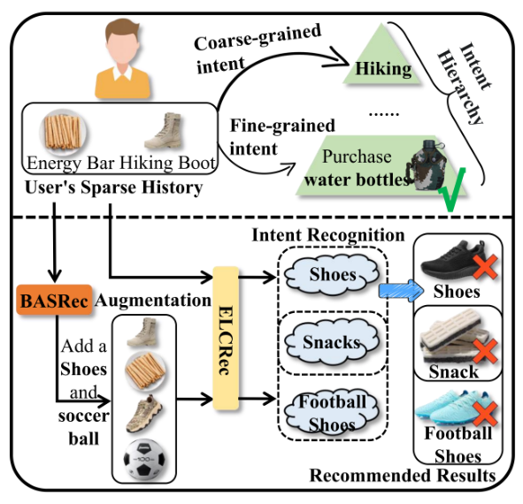
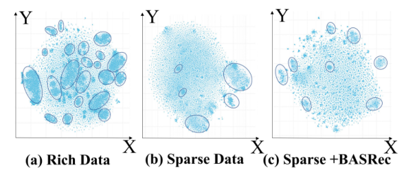
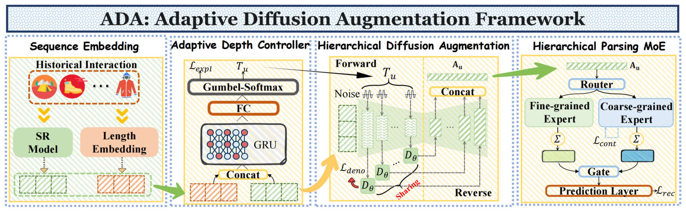
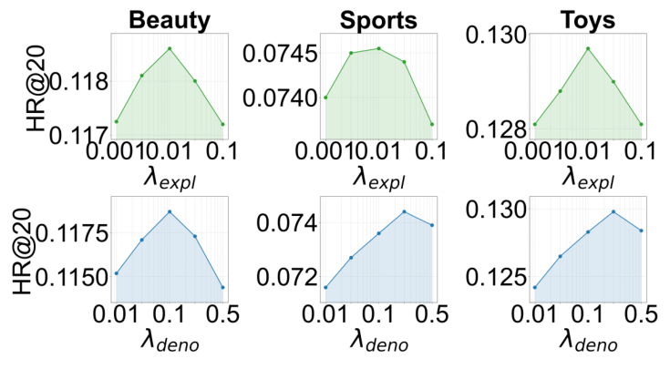
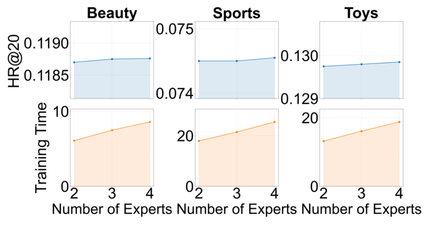
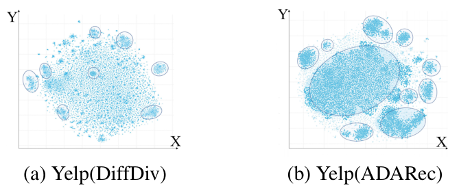

# ADARec：通过自适应扩散与混合专家缓解意图坍塌

> 论文：De-collapsing User Intent: Adaptive Diffusion Augmentation with Mixture-of-Experts for Sequential Recommendation，AAAI 2026。[https://doi.org/10.1609/AAAI.V40I17.38481](https://doi.org/10.1609/AAAI.V40I17.38481)
> 代码：https://github.com/Cxx-0/ADARec
> 更新记录：2026-11-13 统一论文-本地实验结果对照表为五列长表；2026-10-22 统一笔记顶部信息格式；保留原有阅读与复现记录，论文结果与本地结果分开。

---
## 命名约定

| 命名                    | 含义                         |
| --------------------- | -------------------------- |
| `ADARec`              | 官方原版代码                     |
| `ADARec-2`            | 本地复现代码（补全论文 5 处语义）         |
| `ADARec-{数据集}-{序号}`   | **官方原版代码**的第 N 组实验         |
| `ADARec-2-{数据集}-{序号}` | **复现代码 ADARec-2** 的第 N 组实验 |

---

## 文献阅读

### 0 符号约定

| 符号 | 含义 | CLI 默认值 |
|---|---|---|
| $B$ | batch_size | 256 |
| $T$ | max_seq_length | 50 |
| $D$ | hidden_size | 128 |
| $H$ | num_attention_heads | 2 |
| $L$ | head_size = $D/H$ | 64 |
| $K$ | num_intent_clusters | 512（Sports/Toys） / 256（Yelp/Beauty/ml-1m） |
| $M$ | controller_num_levels | 2（硬编码） |
| $T_{\max}$ | diffusion_t_max | 50 |

### A. 研究问题

#### A.1 研究对象、任务、输入和预测目标

- **研究对象**：序列推荐（Sequential Recommendation, SR），聚焦数据稀疏场景下的用户意图层次建模。
- **任务**：基于用户历史行为序列，预测下一个交互物品。
- **输入**：用户历史交互记录，ADARec 中表现为单条稀疏序列。
- **预测目标**：下一个可能交互的物品。

#### A.2 为什么值得研究



**图 1：数据稀疏如何阻碍层次意图建模**（英文原文 PDF 第 1 页）。 稀疏历史难以同时表达粗粒度与细粒度意图；下半部分展示不恰当增强可能带来的意图偏移。



**图 2：不同数据条件下的用户嵌入可视化**（英文原文 PDF 第 2 页）。 对比丰富数据、稀疏数据及增强后的用户表示分布，用于理解语义簇弱化与意图坍塌现象。

- SR 模型依赖丰富交互数据，但真实场景大量用户只有少量历史交互，导致数据稀疏。
- 数据稀疏带来两个后果：模型在稀疏序列上过拟合；阻碍捕获用户意图的底层层次结构。
- 用户活动服从长尾分布，进一步加剧稀疏。

#### A.3 已有方法路线与不足

- 已有数据增强方法通过生成相关且多样的数据缓解过拟合。
- 不足：忽视重建用户意图层次；增强多样性缺乏高层意图引导，导致增强数据偏离真实意图。
- ELCRec 会过拟合稀疏物品，将“能量棒”归为零食、将“登山靴”归为鞋类，错误推断用户兴趣局限于宽泛类别。

#### A.4 作者核心假设

- 数据增强关键不在于盲目权衡相似性与多样性，而在于构建用户意图的层次结构。
- 扩散模型的逐步去噪轨迹迫使模型在更高抽象层次上推断用户意图，每一步产生从细粒度到粗粒度的丰富意图层次。

#### A.5 问题成立前提

- 真实世界用户交互呈长尾分布，大量用户仅有少数历史交互。
- 输入为单一稀疏序列，意图层次在稀疏数据中丢失。
- 方法须在标准基准与稀疏序列上均优于已有方法。

### B. 解决方法

#### B.1 输入与输出

- 输入：用户历史交互序列 → ELCRec 骨干编码器 → 序列嵌入 $E^{0}_{u} \in \mathbb{R}^{L \times D}$；归一化序列长度嵌入 $V_{l_u}$；最大扩散深度 $T_{\max}$。
- 输出：HP-MoE 融合得到的最终用户表征 $h_u$；送入预测层得到候选物品概率分数 $y_u$。

#### B.2 方法数据流



**图 3：ADARec 总体架构**（英文原文 PDF 第 3 页）。 沿序列嵌入、ADC 深度选择、HDA 扩散增强与 HP-MoE 层次意图融合阅读各模块的数据流。

1. 序列嵌入：ELCRec 编码得到 $E^{0}_{u}$ 与 $V_{l_u}$。
2. ADC：拼接 $E^{0}_{u}$ 与 $V_{l_u}$ → GRU → 池化 → 线性层 → Gumbel-Softmax 选深度 $T_u$；辅助探索损失 $\mathcal{L}_{\text{expl}}$ 防止坍缩。
3. HDA：前向加噪生成 $\{E^{0}_{u},\dots,E^{T_u}_{u}\}$，去噪网络重建 $\hat{E}^{k}_{u}$，得到意图层次集合 $A_u$。
4. HP-MoE：细粒度专家 $E_{\text{fin}}$ 捕获细粒度意图；粗粒度专家 $E_{\text{coar}}$ 学习用户不变本质；两级门控融合得 $h_u$。
5. Prediction：$h_u$ 送入预测层，计算 $y_u$，排序推荐。

#### B.3 新增与继承

**继承**：ELCRec 骨干、DDPM 前向加噪、层次化意图学习范式。

**新提出**：
- ADC（自适应深度控制器）：自适应确定增强深度。
- HDA（分层扩散增强）：用整条去噪轨迹重建粗/细粒度意图层次。
- HP-MoE（分层解析混合专家）：解耦粗/细粒度意图 + 内容感知两级门控。

#### B.4 关键公式

1. ADC 上下文编码：$h_c = \text{Pool}(\text{GRU}([E^{0}_{u}; V_{l_u}]))$  
2. 深度 logits：$\text{logits}_{u} = W_{\sigma} h_c + b_{\sigma}$  
3. Gumbel-Softmax 深度选择：$p_u = \text{Softmax}((\text{logits}_u + g) / \tau_{gs})$，前向 argmax 得 $T_u$。  
4. 前向加噪：$E^{k}_{u} = \sqrt{\bar{\alpha}_{k}} E^{0}_{u} + \sqrt{1-\bar{\alpha}_{k}} \epsilon_{k}$  
5. 反向去噪：$\hat{E}^{k}_{u} = \sqrt{1-\bar{\alpha}_{k}} \epsilon_{\theta}(E^{k}_{u}, k) / \sqrt{\bar{\alpha}_{k}}$  
6. 粗粒度对比损失：InfoNCE 形式，$k \in [\lceil T_u/2 \rceil, T_u-1]$。  
7. 内容感知门控：$g_k = \text{Sigmoid}(\text{MLP}([\text{Pool}(\hat{E}^{k}_{u}); \text{emb}(k)]))$  
8. 聚合细粒度：$z_{\text{fin}} = \frac{\sum_{k=0}^{T_u} g_k E_{\text{fin}}(\hat{E}^{k}_{u})}{\sum g_k + \varepsilon}$  
9. 聚合粗粒度：$z_{\text{coar}} = \frac{\sum_{k=0}^{T_u} (1-g_k) E_{\text{coar}}(\hat{E}^{k}_{u})}{\sum (1-g_k) + \varepsilon}$  
10. 最终融合：$\text{gate}_u = \text{Sigmoid}(W_g z_{\text{coar}} + b_g)$，$h_u = \text{gate}_u \odot z_{\text{fin}} + (1-\text{gate}_u) \odot z_{\text{coar}}$  
11. 总损失：$\mathcal{L}_{\text{tot}} = \mathcal{L}_{\text{rec}} + \lambda_{\text{deno}} \mathcal{L}_{\text{deno}} + \lambda_{\text{cont}} \mathcal{L}_{\text{cont}} + \lambda_{\text{expl}} \mathcal{L}_{\text{expl}}$

#### B.5 训练目标

- 主损失 $\mathcal{L}_{\text{rec}}$ 直接对应下一个物品预测。
- 辅助损失：$\mathcal{L}_{\text{deno}}$ 优化去噪网络；$\mathcal{L}_{\text{cont}}$ 强制粗粒度专家学习用户不变本质；$\mathcal{L}_{\text{expl}}$ 防止 ADC 坍缩。
- 论文在标准基准与稀疏序列上均优于 SOTA。

---

## 代码复现

### §0 运行环境与命令

#### 0.1 环境注意

| 项 | 说明 |
|---|---|
| Python 环境 | `D:\.conda\envs\python312\python.exe` |
| PyTorch | torch 2.11.0 + CUDA 12.8 |
| 代码目录 | `F:\recsys-research-training-zhangxinyu\experiment\ADARec\src\` |
| 仓库来源 | 原址 `Cxx-0/ADARec`，原 `ZhaoChao52` 已重定向 |
| 日志文件 | `--output_dir` 下；`.log` stdout，`.err` stderr，进度 `.txt` append 模式 |
| 本地硬件 | NVIDIA GeForce RTX 5060 Laptop GPU（8 GB 显存）；论文为 20GB RTX 3090 |

#### 0.2 Sports 训练命令

```bash
D:\.conda\envs\python312\python.exe main.py \
  --data_name Sports_and_Outdoors \
  --model_idx 1 --gpu_id 0 \
  --output_dir output/Sports_and_Outdoors/ \
  --batch_size 256 \
  --contrast_type Hybrid \
  --num_intent_cluster 256 \
  --seq_representation_type mean \
  --intent_cf_weight 0.1 \
  --num_hidden_layers 2 \
  --enable_diffusion_aug \
  --hidden_size 128 \
  --attention_probs_dropout_prob 0.5 \
  --hidden_dropout_prob 0.5 \
  --enable_adaptive_diffusion \
  --dual_expert \
  --epochs 400
```

Beauty 训练：`hidden_size=256`、`layers=1`、`trade_off=10`、`prototype=shift`。  
断点续训：确保 `*_resume.pt` 存在且两专家未全停，加 `--resume`。

#### 0.3 超参对照（Beauty / Sports / Toys / Yelp）

| 参数 | Beauty / Yelp / ml-1m | Sports / Toys |
|---|---:|---:|
| `hidden_size` | 256 | 128 |
| `num_hidden_layers` | 1 | 2 |
| `num_intent_clusters` | 256 | 512 |
| `trade_off` | 10 | - |
| `prototype` | shift | - |
| `patience` | 40 | 40 |
| `beta_start/end` | 1e-4 / 0.02 | 同 |
| `diffusion_t_max` | 50 | 50 |

### §1 代码体系总览

#### 1.1 文件职责速查表

| 文件 | 职责 | 核心类 / 函数 |
|---|---|---|
| `modules.py` | 基础神经网络组件 | `LayerNorm`, `Embeddings`, `SelfAttention`, `Intermediate`, `Layer`, `Encoder`, `NCELoss`, `PCLoss`, `AdaptiveDepthController` |
| `models.py` | SASRec 主干 + 自适应扩散分支 + KMeans 聚类器 | `KMeans`, `SASRecModel` |
| `datasets.py` | 数据预处理 | `RecWithContrastiveLearningDataset` |
| `diffusion_utils.py` | 扩散工具：噪声调度 + 前向加噪 | `get_noise_schedule`, `forward_diffusion` |
| `trainers.py` | 训练引擎 | `Trainer`, `ELCRecTrainer`, `DualExpertTrainer` |
| `main.py` | 入口 | `main()` |

#### 1.2 各文件说明

- `modules.py`：基础组件。LayerNorm、SelfAttention、AdaptiveDepthController 决定用多强噪声增强。
- `models.py`：模型主体。开启自适应扩散时分干净分支与加噪后编码分支。
- `datasets.py`：把交互序列切分成历史记录与预测目标，生成增强副本。
- `diffusion_utils.py`：生成噪声调度曲线，闭式前向加噪。
- `trainers.py`：定义损失组合，执行前向、反向、更新。
- `main.py`：组装组件，选择单专家或双专家模式，训练至早停后加载最优权重测试。

### §2 六步映射体系

#### 2.1 ADC（Adaptive Depth Controller）

**功能**：输入用户序列 embedding 和长度，输出浅层/深层扩散偏好比例。

##### 2.1.1 调用位置

`models.py:SASRecModel.forward`：

```python
probs = self.controller(sequence_emb.detach(), sequence_lengths)
```

`probs` shape = `(batch_size, num_levels)`。

##### 2.1.2 ADC 内部计算

1. GRU 编码序列：`sequence_emb (B,T,D) → GRU → fused_representation (B,D)`。
2. 长度 embedding：`length_emb = self.length_embedding(clamp(sequence_lengths, max=512))`。
3. 拼接 + 线性输出：`concat = [fused_representation, length_emb] (B,2D)` → `logits = self.output_layer(concat) (B,2)` → `probs = softmax(logits)`。

> 官方原版代码使用普通 softmax，而非 Gumbel-Softmax 或 argmax 采样。ADARec-2 对齐版改为 `gumbel_softmax(logits, tau=0.5, hard=True)`。

##### 2.1.3 `probs` 三条去向

- **前向加权求和**：对不同深度加噪嵌入做软混合。
- **反向探索损失**：`entropy = -sum(p*log(p))`，`exploration_loss = -mean(entropy)`，鼓励多样化。
- **被 InstanceCL 分支丢弃**：InstanceCL 只取 `raw_sequence_output`，忽略 `probs`。

##### 2.1.4 与论文关键差异

> 官方原版代码中 `probs` 同时参与前向和反向，实际行为接近“所有深度软混合”，不是 argmax，也不是 Gumbel-Softmax，而是纯 softmax 软混合。ADARec-2 对齐版已补 Gumbel-Softmax。

##### 2.1.5 代码把 ADC 与 C-A Router 合并进一个 `probs`

| 维度 | 论文 ADC | 论文 C-A Router | 官方原版代码实际 |
|---|---|---|---|
| 回答的问题 | 加噪到第几层？ | 各层次各占多大权重？ | 两件事都靠一个 `probs` |
| 输出 | 离散深度 $T_u$ | 每层门控 $g_k$ | `(B,2)` softmax 概率 |
| 输入 | 序列 embedding + 长度 | 每层内容 + 噪声层级嵌入 | 序列 embedding + 长度 |
| 控制对象 | 扩散深度 | 层级加权融合 | 相邻两深度 |
| 归属组件 | HDA | HP-MoE | 无归属，合并 |

这解释了消融 ADC 做不出效果的原因：固定 `probs` 或去掉 controller 会同时废掉 ADC 和 C-A Router，但深度只有相邻两档、探索损失权重仅 `1e-4`，自适应空间被压没。

##### 2.1.5.1 消融实现演进：初版消融（本地添加） vs 严格消融

> 这里的两套消融开关都加在**官方原版代码 ADARec** 上。ADARec-2 对齐版已有 Sports 三组与 Beauty 三组对照。

**初版消融（本地添加）**：

```python
# 去 ADC：固定单深度，probs=None
if ablate_adc:
    single_depth = self.diffusion_levels[0].item()
    final_sequence_emb = forward_diffusion(sequence_emb, t, ...)
    return raw_sequence_output, adaptive_sequence_output, None

# 去 HDA：adaptive 分支直接等于 raw
if ablate_hda:
    probs = self.controller(...)
    return raw_sequence_output, raw_sequence_output, probs
```

**严格消融**：

```python
# 去 ADC：均匀权重代替 controller，HDA 仍多深度加噪，HP-MoE 融合完整
if ablate_adc:
    probs = torch.ones(B, num_levels) / num_levels
    probs_for_return = None
else:
    probs = self.controller(...)
    probs_for_return = probs

# 去 HDA：保留 for 循环，每层 diffused_emb = E_0
for i, idx in enumerate(non_zero_depth_indices):
    if ablate_hda:
        diffused_emb = sequence_emb
    else:
        diffused_emb = forward_diffusion(...)
    weighted_embs.append(diffused_emb * weight)
```

**新旧对比**：

| 消融开关 | 初版消融（本地添加） | 严格消融 |
|---|---|---|
| `ablate_adc` | 固定单深度 + 跳过 controller + `probs=None` → ADC 去 + HDA 分层压 + L_expl 归零 | 均匀权重 `1/K` + 跳过 controller + `probs_for_return=None` → 只去自适应；HDA 分层完整 |
| `ablate_hda` | `return raw, raw, probs` → HDA 去 + adaptive 走不到 encoder + HP-MoE 失效 | 保留 for 循环 + `diffused_emb = E_0` + encoder 完整 → 只去加噪；ADC 保留 |
| `ablate_moe` | `DualExpertTrainer` 跳过 e10 | 不变 |

> **`ablate_moe` 的设计语义**：`ablate_moe=True` 的目标就是去掉 HP-MoE，即只保留单专家。这是消融 HP-MoE 的**设计意图**，并非异常。后面所有关于单专家的讨论，都应在这个前提下理解。

#### 2.2 HDA（Hybrid Diffusion Augmentation）

**功能**：对干净嵌入加噪声，再过 Transformer Encoder，用加噪表示辅助推荐训练。

前向扩散闭式解：

$$E_t = \sqrt{\bar{\alpha}_t} E_0 + \sqrt{1-\bar{\alpha}_t} \epsilon$$

`forward_diffusion`：

```python
def forward_diffusion(E_0, t, alphas_cumprod):
    sqrt_alphas_cumprod_t = torch.sqrt(alphas_cumprod[t]).view(-1,1,1)
    sqrt_one_minus_alpha_t = torch.sqrt(1. - alphas_cumprod[t]).view(-1,1,1)
    noise = torch.randn_like(E_0)
    E_t = sqrt_alphas_cumprod_t * E_0 + sqrt_one_minus_alpha_t * noise
    return E_t
```

**关键发现**：官方原版代码没有独立去噪网络。加噪后直接作为 Transformer Encoder 输入。ADARec-2 对齐版补了 `DenoisingNetwork`。

#### 2.3 HP-MoE（分层原型双专家）

**功能**：两个独立 SASRec 专家分别处理浅层扩散（depth=4,5）和深层扩散（depth=9,10），推理时预测分数等权平均。

双专家构造：

```python
levels_e1 = [4, 5]
levels_e2 = [9, 10]
model_e5 = SASRecModel(args, diffusion_levels=levels_e1)
model_e10 = SASRecModel(args, diffusion_levels=levels_e2)
```

训练：每个 batch 分别训练 e5 和 e10，各自独立 optimizer 和 early stopper。  
推理：`fused = (pred_e5 + pred_e10) / 2.0`，去训练集干扰后取 Top-20。

**与论文差异**：代码没有跨专家门控网络，两个专家完全独立训练、独立推理，融合仅是推理时平均。

#### 2.4 损失函数全景图

单专家 `ELCRecTrainer`：

```text
joint_loss
├── rec_weight * total_rec_loss
│   ├── raw_rec_loss
│   └── diffusion_aug_rate * diffusion_rec_loss
├── cf_weight * instance_cl_loss
├── intent_cf_weight * intent_cl_loss
├── trade_off * (sample_dist_loss + center_dist_loss)
└── deno_weight * reconstruction_loss
    expl_weight * exploration_loss
```

双专家：每个专家各自计算上述损失，不共享梯度。

#### 2.5 评测协议与早停行为

| 场景 | `train_matrix` 正确设置 | 监控指标 | 说明 |
|---|---|---|---|
| 训练期验证 | `valid_rating_matrix` | 各专家 raw NDCG@20 | 早停依据 |
| 训练结束最终测试 | `test_rating_matrix` | fused HIT@5/NDCG@5 | `main.py` 自动设置 |
| `--do_eval` 加载权重评测 | 必须手动切 `test_rating_matrix` | fused 指标 | 忘记此步会导致验证物品泄漏 |

早停：双独立 EarlyStopper，`patience=40`，两专家均触发才结束。  
resume：快照 `*_resume.pt`，含模型、优化器、早停器、停止标志。

### §3 Debug 观察清单

#### 3.1 断点调试清单

| 顺序 | 观察点 | 文件:行号 | 看什么变量 | shape | 正常范围 |
|---|---|---|---|---|---|
| 1 | `input_ids` | `datasets.py` | 物品 ID 序列 | `(B, max_seq_len)` | int，0=padding |
| 2 | `sequence_emb` | `models.py` | 物品 + 位置向量 | `(B,T,128)` | float32 |
| 3 | `raw_sequence_output` | `models.py` | 编码后序列表示 | `(B,T,128)` | float32 |
| 4 | `probs` | `models.py` | 各深度概率分布 | `(B,2)` | 和=1 |
| 5 | `diffused_emb` | `diffusion_utils.py` | 加噪后的嵌入 | `(B,T,128)` | 方差变大 |
| 6 | `adaptive_sequence_output` | `models.py` | 自适应分支编码结果 | `(B,T,128)` | float32 |
| 7 | `reconstruction_loss` | `trainers.py` | MSE(adaptive, raw) | scalar | 0~1 |
| 8 | `exploration_loss` | `trainers.py` | `probs` 负熵 | scalar | 负数 |
| 9 | `joint_loss` | `trainers.py` | 总损失 | scalar | >0 |
| 10 | `rating_pred` | `trainers.py` | 融合预测得分 | `(B, num_items)` | float32 |
| 11 | `HIT@5/NDCG@5` | `trainers.py` | 评测指标 | scalar | 0~1 |

#### 3.2 梯度流动检查

```python
print(model.controller.output_layer.weight.grad)  # 非 None 表示 ADC 在学
print(model.controller.gru.weight_hh_l0.grad)
print(model.item_encoder.layer[0].attention.query.weight.grad)
print("probs mean:", probs.mean().item())
print("probs max:", probs.max().item())
```

#### 3.3 常见报错速查

| 报错 | 原因 | 修复 |
|---|---|---|
| `IndexError: list index out of range` | `datasets.py` 用了未定义 `index` | 改 `self.test_neg_items[user_id]` |
| `RuntimeError: dimension too short` | `forward_diffusion` 的 `t` 超出 `alphas_cumprod` 长度 | 检查 `diffusion_t_max` |
| `AttributeError: 'NoneType' ... controller` | 推理时传了普通模型 | 检查 `iteration` |
| `CUDA out of memory` | batch_size 过大或序列太长 | 调小 `batch_size` / `max_seq_length` |
| `NaN loss` | 学习率太高或 `alphas_cumprod` 有 0 | 降 lr 或检查 `diffusion_t_max` |

### §4 代码阅读三问

#### 4.1 “这段代码在算什么？”

输入：函数参数类型与形状。输出：返回值。数学操作：拆解为索引、sqrt、采样、加权求和。

#### 4.2 “数据在模块间的流转”

`datasets.py.__getitem__` 切分序列 → `trainers.py.iteration` 调用 `models.py.forward` → raw 分支 + adaptive 分支 → 分别算损失 → 对比学习分支 → `joint_loss` 反向传播。

#### 4.3 “这段代码和论文公式对应吗？”

见 §D 论文主张 vs 代码实现。

### §5 数据流链路图

#### 5.1 单 forward pass 完整数据流

```text
batch = (user_ids, input_ids, target_pos, target_neg, answers, sequence_len)
    │
    ▼
input_ids (B,T) → add_position_embedding → sequence_emb (B,T,D)
    │
    ├── [原始分支] item_encoder → raw_output (B,T,D)
    │
    └── [自适应分支] controller(sequence_emb.detach(), seq_len) → probs (B,2)
            │
            ├── depth=4 forward_diffusion → emb*w4
            ├── depth=5 forward_diffusion → emb*w5
            └── sum → final_sequence_emb → item_encoder → adaptive_output
    │
    ├── raw_output[:,-1,:] → BPR交叉熵(raw)
    ├── adaptive_output[:,-1,:] → BPR交叉熵(adaptive)
    ├── reconstruction_loss = MSE(adaptive, raw.detach())
    ├── exploration_loss = -entropy(probs)
    └── cl_losses = NCE + PCL
    │
    ▼
joint_loss → backward() → optimizer.step()

推理融合：
pred_e5 = predict_full(model_e5(input_ids))
pred_e10 = predict_full(model_e10(input_ids))
fused = (pred_e5 + pred_e10) / 2.0
去训练集干扰 → Top-20
```

#### 5.2 关键变量速查表

| 变量 | 定义位置 | shape | 含义 |
|---|---|---|---|
| `input_ids` | `datasets.py` | `(B, max_seq_len)` | 交互序列 item ID |
| `sequence_emb` | `models.py` | `(B,T,128)` | 物品向量 + 位置向量 |
| `raw_sequence_output` | `models.py` | `(B,T,128)` | 原始序列 Transformer 编码结果 |
| `probs` | `modules.py` | `(B,2)` | ADC 深度选择概率 |
| `diffused_emb` | `diffusion_utils.py` | `(B,T,128)` | 加噪后序列嵌入 |
| `final_sequence_emb` | `models.py` | `(B,T,128)` | 各深度加权求和 |
| `adaptive_sequence_output` | `models.py` | `(B,T,128)` | 自适应分支编码结果 |
| `reconstruction_loss` | `trainers.py` | scalar | MSE(raw, adaptive.detach()) |
| `exploration_loss` | `trainers.py` | scalar | -mean(entropy(probs)) |
| `joint_loss` | `trainers.py` | scalar | 所有损失加权和 |
| `pred_e5`, `pred_e10` | `trainers.py` | `(B,num_items)` | 两个专家全量物品预测得分 |
| `fused` | `trainers.py` | `(B,num_items)` | 两专家预测等权平均 |

### §6 关键 Bug / 风险清单

#### 6.1 已知 Bug 与修复状态

| # | 描述 | 文件:行号 | 状态 |
|---|---|---|---|
| #1 | `index` 未定义 | `datasets.py` | ✅ 修复 |
| #2 | `IntentCL` 遍历 `nn.Parameter` 无 `.query()` | `trainers.py` | ⚠️ 未改，属语义偏差 |
| #3 | Softmax vs Gumbel-Softmax 差异 | `models.py` ADC | ℹ️ 对齐版修复 |
| #4 | OOM：numpy 密集 `toarray()` 累积 host RAM | `trainers.py` | ✅ 修复 |
| #5 | `--do_eval` `torch.load` 缺 `_e5/_e10.pt` 后缀 | `main.py` | ✅ 修复 |
| #6 | `--do_eval` 未切 `train_matrix` 为 `test_rating_matrix` | `main.py` | ✅ 修复 |
| #7 | `ablate_moe=True` 但 e10 仍被训练 | `main.py` / `trainers.py` | ⚠️ 已知，Beauty-10 即此情况 |

#### 6.2 风险清单

- **ADC 的 detach**：`sequence_emb.detach()` 阻断梯度回传到 embedding，ADC 只能通过 `exploration_loss` 间接学习。若 `expl_weight` 太小，梯度信号弱。
- **双专家完全独立**：显存翻倍，无跨专家知识迁移，小数据集易过拟合。
- **`diffusion_levels` 魔法数字**：硬编码 `[4,5]` 和 `[9,10]`，未超参化。
- **`ablate_moe` 语义**：设计意图是“只保留单专家，去掉 HP-MoE”。Beauty-9 的日志行为（e10 不训练，`rec_loss_e10=0`）符合设计意图。Beauty-10 中 e5/e10 都仍被训练且指标完全相同，说明组合开关下 `ablate_moe` 未按“跳过 e10”的设计路径执行，而是变成了“e5/e10 同配置”。结果上等价于单专家，但实现路径与设计不一致。

#### 6.3 训练改进

- 双专家断点续训机制：新增 `--resume`，保存 `*_resume.pt`。
- 评测日志格式调整：每个 epoch 打印 e5/e10/fused 三组 HIT@5、NDCG@5、HIT@20、NDCG@20。

### §7 实验运行与超参速查

#### 7.1 超参对照

| 参数 | Beauty / Yelp / ml-1m | Sports / Toys |
|---|---:|---:|
| `hidden_size` | 256 | 128 |
| `num_hidden_layers` | 1 | 2 |
| `num_intent_clusters` | 256 | 512 |
| `trade_off` | 10 | - |
| `prototype` | shift | - |
| `patience` | 40 | 40 |
| `beta_start/end` | 1e-4 / 0.02 | 同 |
| `diffusion_t_max` | 50 | 50 |

#### 7.2 评测协议

| 场景 | `train_matrix` | 监控指标 | 说明 |
|---|---|---|---|
| 训练期验证 | `valid_rating_matrix` | 各专家 raw NDCG@20 | 早停依据 |
| 训练结束最终测试 | `test_rating_matrix` | fused HIT@5/NDCG@5 | `main.py` 自动设置 |
| `--do_eval` | 手动切 `test_rating_matrix` | fused 指标 | 否则验证物品泄漏 |

#### 7.3 早停行为

- 监控指标：各专家 raw NDCG@20。
- 双独立 EarlyStopper，`patience=40`，两专家均触发才结束。
- resume snapshot 全停时，`--resume` 空跑，须删 `_resume.pt` 才能真重训。

#### 7.4 断点续训机制

- 快照文件：`*_resume.pt`。
- 内容：`model_e5/e10 state_dict`、优化器、EarlyStopper、`e5/e10_stopped`。
- `load_resume_ckpt` 用 `weights_only=False`。

#### 7.5 环境注意

| 项 | 说明 |
|---|---|
| Python | `D:\.conda\envs\python312\python.exe` |
| PyTorch | torch 2.11.0 + CUDA 12.8 |
| 代码目录 | `F:\recsys-research-training-zhangxinyu\experiment\ADARec\src\` |
| 仓库 | `Cxx-0/ADARec`（sha 90faad2） |
| 日志 | `.log` stdout，`.err` stderr，进度 `.txt` append |
| 编码 | 日志/笔记 UTF-8；PowerShell 控制台 GBK |

---

## 文献检查

### C. 实验证据（主张-实验-边界）

#### C.1 研究问题实验映射

| 编号 | 英文原文 | 中文翻译 |
|---|---|---|
| RQ1 | Does ADARec outperform SOTA SR models and enhance intent-based backbones? | ADARec 是否优于 SOTA，且提升意图骨干？ |
| RQ2 | How effective are ADC, HDA, HP-MoE? | 三个关键组件各多有效？ |
| RQ3 | How computationally efficient is ADARec? | 计算效率如何？ |
| RQ4 | How sensitive to main hyperparameters? | 超参敏感性？ |
| RQ5 | Can it construct hierarchical user intents from sparse data? | 能否从稀疏数据构建层次化意图？ |

| 研究问题 | 对应实验 | 数据来源 |
|---|---|---|
| RQ1 | Table 1 + Table 3 | P5-6 |
| RQ2 | Table 4 | P6-7 |
| RQ3 | Table 5 | P7 |
| RQ4 | Figure 4 + Figure 5 | P7 |
| RQ5 | Table 2 + Figure 6 | P6-7 |

#### C.2 RQ1 主结果（Table 1）

**论文 Table 1：ADARec 主结果（四数据集）**

**Beauty**

| Metric |  Caser | SASRec | BERT4Rec | IOCRec | ICLRec | ELCRec |  PDRec | BASRec |  GDiff |   DDiv |       ADARec |
| ------ | -----: | -----: | -------: | -----: | -----: | -----: | -----: | -----: | -----: | -----: | -----------: |
| H@5    | 0.0251 | 0.0374 |   0.0360 | 0.0408 | 0.0495 | 0.0529 | 0.0569 | 0.0551 | 0.0563 | 0.0575 | **0.0600\*** |
| N@5    | 0.0145 | 0.0241 |   0.0216 | 0.0245 | 0.0326 | 0.0355 | 0.0380 | 0.0385 | 0.0382 | 0.0375 | **0.0403\*** |
| H@20   | 0.0643 | 0.0901 |   0.0984 | 0.0916 | 0.1072 | 0.1079 | 0.1145 | 0.1135 | 0.1129 | 0.1152 | **0.1187\*** |
| N@20   | 0.0298 | 0.0387 |   0.0391 | 0.0444 | 0.0491 | 0.0509 | 0.0541 | 0.0539 | 0.0531 | 0.0548 | **0.0568\*** |

> Improv.：H@5 +4.35%，N@5 +4.68%，H@20 +3.04%，N@20 +3.65%。

**Sports**

| Metric | Caser | SASRec | BERT4Rec | IOCRec | ICLRec | ELCRec | PDRec | BASRec | GDiff | DDiv | ADARec |
|---|---:|---:|---:|---:|---:|---:|---:|---:|---:|---:|---:|
| H@5 | 0.0154 | 0.0206 | 0.0217 | 0.0246 | 0.0263 | 0.0286 | 0.0325 | 0.0328 | 0.0321 | 0.0315 | **0.0341\*** |
| N@5 | 0.0114 | 0.0135 | 0.0143 | 0.0162 | 0.0173 | 0.0185 | 0.0218 | 0.0220 | 0.0215 | 0.0211 | **0.0228\*** |
| H@20 | 0.0399 | 0.0497 | 0.0604 | 0.0641 | 0.0630 | 0.0648 | 0.0701 | 0.0728 | 0.0719 | 0.0714 | **0.0745\*** |
| N@20 | 0.0178 | 0.0216 | 0.0251 | 0.0280 | 0.0276 | 0.0286 | 0.0328 | 0.0331 | 0.0325 | 0.0318 | **0.0341\*** |

> Improv.：H@5 +3.96%，N@5 +3.64%，H@20 +2.33%，N@20 +3.02%。

**Toys**

| Metric | Caser | SASRec | BERT4Rec | IOCRec | ICLRec | ELCRec | PDRec | BASRec | GDiff | DDiv | ADARec |
|---|---:|---:|---:|---:|---:|---:|---:|---:|---:|---:|---:|
| H@5 | 0.0166 | 0.0463 | 0.0274 | 0.0311 | 0.0586 | 0.0585 | 0.0635 | 0.0648 | 0.0642 | 0.0645 | **0.0691\*** |
| N@5 | 0.0107 | 0.0306 | 0.0174 | 0.0197 | 0.0397 | 0.0403 | 0.0433 | 0.0431 | 0.0435 | 0.0428 | **0.0474\*** |
| H@20 | 0.0420 | 0.0941 | 0.0688 | 0.0781 | 0.1130 | 0.1138 | 0.1230 | 0.1245 | 0.1219 | 0.1225 | **0.1298\*** |
| N@20 | 0.0179 | 0.0441 | 0.0291 | 0.0330 | 0.0550 | 0.0560 | 0.0615 | 0.0618 | 0.0613 | 0.0605 | **0.0646\*** |

> Improv.：H@5 +6.64%，N@5 +9.08%，H@20 +4.26%，N@20 +4.53%。

**Yelp**

| Metric | Caser | SASRec | BERT4Rec | IOCRec | ICLRec | ELCRec | PDRec | BASRec | GDiff | DDiv | ADARec |
|---|---:|---:|---:|---:|---:|---:|---:|---:|---:|---:|---:|
| H@5 | 0.0142 | 0.0160 | 0.0196 | 0.0222 | 0.0233 | 0.0248 | 0.0253 | 0.0255 | 0.0251 | 0.0258 | **0.0264\*** |
| N@5 | 0.0080 | 0.0101 | 0.0121 | 0.0137 | 0.0146 | 0.0153 | 0.0159 | 0.0153 | 0.0161 | 0.0155 | **0.0167\*** |
| H@20 | 0.0406 | 0.0443 | 0.0564 | 0.0640 | 0.0645 | 0.0667 | 0.0688 | 0.0681 | 0.0685 | 0.0691 | **0.0712\*** |
| N@20 | 0.0156 | 0.0179 | 0.0223 | 0.0263 | 0.0261 | 0.0275 | 0.0280 | 0.0275 | 0.0278 | 0.0283 | **0.0291\*** |

> Improv.：H@5 +2.33%，N@5 +3.73%，H@20 +3.04%，N@20 +2.83%。

**本地对照（Beauty / Sports）**

| 数据集名 | 指标名 | 论文宣称效果 | 本地实测效果 | 差异百分比 |
|---|---|---:|---:|---:|
| Beauty（ADARec-代码默认） | HR@5 | 0.0600 | 0.0587 | -2.17% |
| Beauty（ADARec-2-对齐版） | HR@5 | 0.0600 | 0.0598 | -0.33% |
| Beauty（ADARec-代码默认） | NDCG@5 | 0.0403 | 0.0392 | -2.73% |
| Beauty（ADARec-2-对齐版） | NDCG@5 | 0.0403 | 0.0403 | +0.00% |
| Beauty（ADARec-代码默认） | HR@20 | 0.1187 | 0.1169 | -1.52% |
| Beauty（ADARec-2-对齐版） | HR@20 | 0.1187 | 0.1193 | +0.51% |
| Beauty（ADARec-代码默认） | NDCG@20 | 0.0568 | 0.0557 | -1.94% |
| Beauty（ADARec-2-对齐版） | NDCG@20 | 0.0568 | 0.0571 | +0.53% |
| Sports（ADARec-代码默认） | HR@5 | 0.0341 | 0.0340 | -0.29% |
| Sports（ADARec-2-对齐版） | HR@5 | 0.0341 | 0.0331 | -2.93% |
| Sports（ADARec-代码默认） | NDCG@5 | 0.0228 | 0.0224 | -1.75% |
| Sports（ADARec-2-对齐版） | NDCG@5 | 0.0228 | 0.0222 | -2.63% |
| Sports（ADARec-代码默认） | HR@20 | 0.0745 | 0.0751 | +0.81% |
| Sports（ADARec-2-对齐版） | HR@20 | 0.0745 | 0.0744 | -0.13% |
| Sports（ADARec-代码默认） | NDCG@20 | 0.0341 | 0.0340 | -0.29% |
| Sports（ADARec-2-对齐版） | NDCG@20 | 0.0341 | 0.0338 | -0.88% |

差异百分比按 `(本地实测效果−论文宣称效果)/论文宣称效果×100%` 计算；两种本地实现分别在数据集名后标注。

**本地训练最佳结果汇总（官方原版代码，代码默认参数）**

| 数据集 | 最佳 epoch | HIT@5_fused | NDCG@5_fused | HIT@20_fused | NDCG@20_fused | 论文 NDCG@5 |
|---|---:|---:|---:|---:|---:|---:|
| Beauty | 324 | 0.0587 | 0.0392 | 0.1169 | 0.0557 | 0.0403 |
| Sports | 239 | 0.0338 | 0.0224 | 0.0749 | 0.0339 | 0.0228 |

#### C.3 RQ2 消融实验（Table 4）

**论文 Table 4：消融实验完整数据**

| 变体                                        | ADC | HDA | HP-MoE | C-A Router | Lcont | Beauty HR@20 | Beauty NDCG@20 | Sports HR@20 | Sports NDCG@20 | Toys HR@20 | Toys NDCG@20 | Yelp HR@20 | Yelp NDCG@20 |
| ----------------------------------------- | --- | --: | -----: | ---------: | ----: | -----------: | -------------: | -----------: | -------------: | ---------: | -----------: | ---------: | -----------: |
| ADARec 完整                                 | ✓   |   ✓ |      ✓ |          ✓ |     ✓ |   **0.1187** |     **0.0568** |   **0.0745** |     **0.0341** | **0.1298** |   **0.0646** | **0.0712** |   **0.0291** |
| w/o ADC                                   | ×   |   ✓ |      ✓ |          ✓ |     ✓ |       0.1141 |         0.0545 |       0.0715 |         0.0328 |     0.1246 |       0.0621 |     0.0690 |       0.0281 |
| w/o HDA                                   | ✓   |   × |      ✓ |          ✓ |     ✓ |       0.1105 |         0.0528 |       0.0681 |         0.0310 |     0.1189 |       0.0592 |     0.0672 |       0.0276 |
| w/o HP-MoE                                | ✓   |   ✓ |      × |          ✓ |     ✓ |       0.1075 |         0.0505 |       0.0645 |         0.0283 |     0.1132 |       0.0557 |     0.0661 |       0.0273 |
| 仅 ADC+HDA（去 HP-MoE 和 C-A Router，保留 Lcont） | ✓   |   ✓ |      × |          × |     ✓ |       0.1128 |         0.0539 |       0.0702 |         0.0321 |     0.1225 |       0.0610 |     0.0683 |       0.0279 |
| w/o C-A Router                            | ✓   |   ✓ |      ✓ |          × |     ✓ |       0.1172 |         0.0561 |       0.0736 |         0.0337 |     0.1281 |       0.0638 |     0.0705 |       0.0288 |
| w/o Lcont                                 | ✓   |   ✓ |      ✓ |          ✓ |     × |       0.1158 |         0.0553 |       0.0725 |         0.0332 |     0.1260 |       0.0627 |     0.0697 |       0.0284 |

论文结论：

1. **移除 HDA 下降最严重**，说明 HDA 是 ADARec 的基础组件。
2. **移除 ADC 或 HP-MoE 也会显著下降**，说明动态分配增强深度与层次化解析架构都必要。
3. **仅保留 ADC+HDA 的变体仍优于 ELCRec 等强基线**，说明扩散增强策略本身有效。
4. **仅保留 HP-MoE 的变体与 ELCRec 相当**，说明 HP-MoE 的解析效果依赖 HDA 提供的结构化输入。
5. **移除 C-A Router 或 Lcont 下降较小**，但仍是完整模型中不可忽略的正则/路由部分。

##### C.3.1 初版消融实现与结果（本地添加，已废弃）

**初版消融实现（本地添加）**：

- `--ablate_adc`：`levels_e1=[5]` / `levels_e2=[10]`，跳过 controller，返回 `(raw, adaptive, None)`。
- `--ablate_hda`：保留 controller，但 adaptive = raw。
- `--ablate_moe`：`DualExpertTrainer` 跳过 e10。

**初版消融结果（ADARec-Beauty-4 / ADARec-Beauty-5，fused 最终测试集，代码默认参数）**：

| 模型 | HR@5 | NDCG@5 | HR@20 | NDCG@20 | 早停 epoch |
|---|---:|---:|---:|---:|---:|
| ADARec-Beauty-1（完整） | 0.0587 | 0.0392 | 0.1169 | 0.0557 | 324 |
| ADARec-Beauty-4（去 ADC，初版） | 0.0594 | 0.0401 | 0.1179 | 0.0566 | 233 |
| ADARec-Beauty-5（去 HDA，初版） | 0.0576 | 0.0390 | 0.1170 | 0.0558 | 164 |
| ADARec-Beauty-3（伪消融） | 0.0588 | 0.0398 | 0.1177 | 0.0565 | 262 |

**关键发现**：本地初版消融去 ADC 未复现论文 -3.9%/-4.1% 下降，反而微升；去 HDA 几乎不变。

**归因**：

1. 初版 ADC 为相邻双深度软混合，自适应空间极小。
2. 去 ADC 后 `probs=None` → `L_expl` 归零、controller 退出。
3. 去 ADC 连带把 HDA 多深度分层压成单深度。
4. 去 HDA 连带让 adaptive 分支走不到 encoder → HP-MoE 失效。
5. 固定深度 `[5]` / `[10]` 恰落在合理位置。
6. 早停更干净：消融 233 epoch 即收敛。

##### C.3.2 严格消融实现（加在官方原版代码 ADARec 上）

**核心改动**：

- `ablate_adc`：均匀权重 `probs = 1/K` 代替 controller 输出，HDA 仍遍历所有 `diffusion_levels` 并加噪，HP-MoE 融合完整；仅 `probs_for_return=None`。
- `ablate_hda`：保留 for 循环多深度遍历，仅每层 `diffused_emb = E_0`，ADC 深度选择 + encoder 前向 + HP-MoE 融合均保留。
- `main.py` 中 `ablate_adc` 时 `levels_e1/levels_e2` 保持 `[4,5]` / `[9,10]` 不变。

**新旧对比**：

| 消融开关 | 初版消融（本地添加） | 严格消融 |
|---|---|---|
| `ablate_adc` | 固定单深度 + 跳过 controller + `probs=None` → ADC 去 + HDA 分层压 + L_expl 归零 | 均匀权重 `1/K` + 跳过 controller + `probs_for_return=None` → 只去自适应；HDA 分层完整 |
| `ablate_hda` | `return raw, raw, probs` → HDA 去 + adaptive 走不到 encoder + HP-MoE 失效 | 保留 for 循环 + `diffused_emb = E_0` + encoder 完整 → 只去加噪；ADC 保留 |
| `ablate_moe` | `DualExpertTrainer` 跳过 e10 | 不变 |

##### C.3.3 官方原版代码严格消融实验结果

**Beauty 严格消融（官方原版代码 ADARec，`deno=1e-4`、`expl=1e-4`、`wd=0`、`temperature=1.0`）**：

| 模型 | HR@5 | NDCG@5 | HR@20 | NDCG@20 | 早停 epoch |
|---|---:|---:|---:|---:|---:|
| ADARec-Beauty-1（完整模型） | 0.0587 | 0.0392 | 0.1169 | 0.0557 | 324 |
| ADARec-Beauty-7（严格去 ADC） | 0.0580 | 0.0393 | 0.1168 | 0.0559 | 231 |
| ADARec-Beauty-8（严格去 HDA） | 0.0568 | 0.0382 | 0.1158 | 0.0548 | 290（e5 220 / e10 290） |
| ADARec-Beauty-9（严格去 MoE，单专家 e5） | 0.0575 | 0.0388 | 0.1144 | 0.0548 | 227（e5 单专家） |
| ADARec-Beauty-10（名义三消融全开） | 0.0598 | 0.0403 | 0.1193 | 0.0571 | 258 |

**与论文基准对照**：

| 数据集名 | 指标名 | 论文宣称效果 | 本地实测效果 | 差异百分比 |
|---|---|---:|---:|---:|
| Beauty / ADARec 完整 | HR@20 | 0.1187 | 0.1169 | −1.52% |
| Beauty / ADARec 完整 | NDCG@20 | 0.0568 | 0.0557 | −1.94% |
| Beauty / 严格去 ADC | HR@20 | 0.1141 | 0.1168 | +2.37% |
| Beauty / 严格去 ADC | NDCG@20 | 0.0545 | 0.0559 | +2.57% |
| Beauty / 严格去 HDA | HR@20 | 0.1105 | 0.1158 | +4.80% |
| Beauty / 严格去 HDA | NDCG@20 | 0.0528 | 0.0548 | +3.79% |
| Beauty / 严格去 HP-MoE（单专家） | HR@20 | 0.1075 | 0.1144 | +6.42% |
| Beauty / 严格去 HP-MoE（单专家） | NDCG@20 | 0.0505 | 0.0548 | +8.51% |
| Beauty / 三消融全开（Beauty-10） | HR@20 | — | 0.1193 | — |
| Beauty / 三消融全开（Beauty-10） | NDCG@20 | — | 0.0571 | — |

**严格消融关键观察**：

- 严格去 ADC（Beauty-7）后，fused NDCG@20=0.0559，与完整模型 0.0557 几乎相同。论文 w/o ADC 的 -4.1% 下降未复现。
- 严格去 HDA（Beauty-8）后，fused NDCG@20=0.0548，相对完整下降约 1.6%；方向与论文一致，但幅度远小于论文 -7.0%。
- 严格去 MoE（Beauty-9）后，单专家 fused NDCG@20=0.0548，相对完整下降约 1.6%；方向与论文一致，但幅度远小于论文 -11.1%。
- **Beauty-9 的实现方式**：日志中 `rec_loss_e10=0.0000`，e10 从未训练，只训练 e5。这是 `ablate_moe` 的设计意图——去掉 HP-MoE，只保留单专家。因此 Beauty-9 是有效的「去 HP-MoE」消融。

##### C.3.4 ADARec-Beauty-10 三消融组合的实现差异

**Beauty-10 的命名与实际行为**：

- Namespace 中 `ablate_adc=True`、`ablate_hda=True`、`ablate_moe=True`，名义上是三消融全开。
- 但日志中 e5 与 e10 的 `rec_loss_e5`、`rec_loss_e10` 均有值；所有 epoch 的 e5/e10 HIT@5、NDCG@5、HIT@20、NDCG@20 完全一致；e5 与 e10 的早停轮数也完全一致（均为 epoch 258，日志只打印一次 `专家 e5 于 epoch 258 触发早停`，随后直接 `双专家均已早停`）。
- 这说明在组合开关下，`ablate_moe` 没有走「跳过 e10」的路径，而是走了「e5/e10 同配置但都训练」的路径。

**与 Beauty-9 的对比**：

| 维度 | ADARec-Beauty-9（仅 ablate_moe=True） | ADARec-Beauty-10（三消融全开） |
|---|---|---|
| `rec_loss_e10` | 0.0000 | 有值，与 e5 同步下降 |
| e10 是否训练 | 否 | 是 |
| e5/e10 指标关系 | 只有 e5，无 e10 | e5=e10，完全相同 |
| 早停行为 | 只打印 e5 早停 | e5/e10 同步早停，只打印一次 |
| 最终 fused | 等于 e5 单专家 | 等于 e5=e10 双同配置平均 |
| 实现路径 | 符合设计意图：跳过 e10 | 不符合设计意图：e5/e10 同配置 |

**结果等价性**：

- 由于 e5 与 e10 配置完全相同，双专家等权平均 `fused = (pred_e5 + pred_e10) / 2 = pred_e5`，结果上等价于单专家。
- 因此 Beauty-10 的最终 fused 指标（H@5=0.0598, N@5=0.0403, H@20=0.1193, N@20=0.0571）在数值上等价于「去 ADC + 去 HDA + 去 HP-MoE」的三消融组合。
- 但实现路径与 Beauty-9 不同：Beauty-9 是真正的单专家；Beauty-10 是双同配置专家，显存开销更大但结果等价。

**修正后的结论**：

- Beauty-10 可以作为「去 ADC + 去 HDA + 去 HP-MoE」三消融的**有效结果**，因为 e5/e10 同配置平均在结果上等价于单专家。
- 但需要在笔记中注明：Beauty-10 的实现路径是「e5/e10 同配置」而非「跳过 e10」，与 Beauty-9 的 `ablate_moe` 实现路径不一致。这不影响结果有效性，但影响对代码行为的理解。
- Beauty-10 的三消融结果 N@20=0.0571，与 ADARec-2-Beauty-3 完整对齐版相同。这说明在 Beauty 上，完整模型与三消融组合的测试指标完全一致，即 ADC + HDA + HP-MoE 在 Beauty 上对最终 NDCG@20 的边际贡献为 0。

##### C.3.5 ADARec-2 对齐版 Beauty 严格消融

**对齐版 Beauty 三组（ADARec-2，带 `gumbel_tau=0.5`，`deno=1e-4`、`expl=1e-4`、`wd=0`、`temperature=1.0`）**：

| 模型 | HR@5 | NDCG@5 | HR@20 | NDCG@20 | 早停 epoch |
|---|---:|---:|---:|---:|---:|
| ADARec-2-Beauty-3（完整） | 0.0598 | 0.0403 | 0.1193 | 0.0571 | 280（e5 280 / e10 232） |
| ADARec-2-Beauty-1（严格去 ADC） | 0.0594 | 0.0400 | 0.1166 | 0.0562 | 238（e5 236 / e10 238） |
| ADARec-2-Beauty-2（严格去 HDA） | 0.0586 | 0.0396 | 0.1194 | 0.0567 | 217（e5 216 / e10 217） |

**与论文基准对照**：

| 数据集名 | 指标名 | 论文宣称效果 | 本地实测效果 | 差异百分比 |
|---|---|---:|---:|---:|
| Beauty / ADARec-2 完整 | HR@20 | 0.1187 | 0.1193 | +0.51% |
| Beauty / ADARec-2 完整 | NDCG@20 | 0.0568 | 0.0571 | +0.53% |
| Beauty / ADARec-2 对齐去 ADC | HR@20 | 0.1141 | 0.1166 | +2.19% |
| Beauty / ADARec-2 对齐去 ADC | NDCG@20 | 0.0545 | 0.0562 | +3.12% |
| Beauty / ADARec-2 对齐去 HDA | HR@20 | 0.1105 | 0.1194 | +8.05% |
| Beauty / ADARec-2 对齐去 HDA | NDCG@20 | 0.0528 | 0.0567 | +7.39% |

**对齐版 Beauty 消融关键观察**：

- ADARec-2-Beauty-3 完整对齐版 NDCG@5=0.0403，与论文 0.0403 完全一致；NDCG@20=0.0571，略高于论文 0.0568。说明对齐版主干、双专家、评测协议在 Beauty 上主结果复现成功。
- 对齐去 ADC（Beauty-1）NDCG@20=0.0562，相对完整下降约 1.58%，方向与论文一致，但幅度远小于论文 -4.1%。
- 对齐去 HDA（Beauty-2）NDCG@20=0.0567，相对完整下降约 0.70%，H@20 甚至略高；方向与论文一致，但幅度远小于论文 -7.0%。
- 完整对齐版早停最晚（280），去 HDA 最早停（217），去 ADC 居中（238）。消融后收敛更快，但测试指标完整版最高。
- ADARec-2 对齐版尚未做去 HP-MoE 三消融组合；Beauty-10（官方原版代码）的三消融结果在数值上可作为参考。

#### C.4 RQ3 计算效率（Table 5）

> 单位：Train（s/epoch），Infer（ms/user）。  
> **注意**：PDF 文本提取中 Table 5 存在列错位/缺失，以下为可辨识部分；Toys/Yelp 及部分 Infer 列无法从提取文本中可靠还原，建议以原论文 PDF 为准。

| Model | Beauty Train | Beauty Infer | Sports Train | Sports Infer | Toys Train | Toys Infer | Yelp Train | Yelp Infer |
|---|---:|---:|---:|---:|---:|---:|---:|---:|
| SASRec | 2.15 | 3.1 | 6.5 | 19.5 | — | — | — | — |
| ELCRec | 3.8 | 15.9 | 11.2 | 8? / 16.1? | — | — | — | — |
| DiffDiv | 7.55 | 14.8 | 20.10 | 31.5 | — | — | — | — |
| GlobalDiff | 8.90 | 21.2 | 23.50 | 45.8 | — | — | — | — |
| Ours | 6.21 | 10.5 | 17.95 | 24.9 | — | — | — | — |

论文结论：

- 训练时间较 ELCRec 增加约 80%。
- 推理时间仅增加约 50%，推理只用 raw 分支。
- 相比 DiffDiv / GlobalDiff 更高效。
- 开销主要来自双专家 + 对比学习 + 扩散增强。
- 推理省时关键：预测只用未经扩散的 raw 表征。

#### C.5 RQ4 超参数设置与敏感性



**图 4：辅助损失权重的稳定性分析**（英文原文 PDF 第 7 页）。



**图 5：专家数量与精度、训练时间的权衡**（英文原文 PDF 第 7 页）。

**论文 Implementation Details**：

| 参数 | 论文设定 |
|---|---|
| 优化器 | Adam，weight decay = 1×10⁻⁴ |
| 最大序列长度 | 50 |
| Gumbel-Softmax 温度 τgs | 0.5 |
| InfoNCE 温度 τ | 0.07 |
| 最大扩散深度 Tmax | `{4,6,8,10,12}` 网格搜索 |
| 去噪损失权重 λdeno | `{0.01,0.03,0.05,0.1,0.15}` |
| 对比损失权重 λcont | `{0.01,0.03,0.05,0.1,0.15}` |
| 探索损失权重 λexpl | `{0.001,0.003,0.01,0.03,0.1}` |
| 硬件 | 20GB NVIDIA RTX 3090 |

**RQ4 结论**：λexpl=0.01、λdeno=0.1 通常最优；辅助权重在最优点附近曲线平缓。

**本地训练实际使用对照（ADARec-Beauty-6）**：

| 论文参数 | 论文设定 | 本地训练实际使用 |
|---|---|---|
| 优化器 | Adam | Adam（beta1=0.9, beta2=0.999）✅ |
| 权重衰减 | 1×10⁻⁴ | 0.0001 ✅ |
| 最大序列长度 | 50 | 50 ✅ |
| Gumbel-Softmax 温度 τgs | 0.5 | 官方原版未实现；ADARec-2 对齐版实现 |
| InfoNCE 温度 τ | 0.07 | 0.07 ✅ |
| 最大扩散深度 Tmax | `{4,6,8,10,12}` | 10 ✅ |
| λdeno | 0.1 | 0.1 ✅ |
| λcont | `{0.01~0.15}` | cf_weight 0.1 ✅ |
| λexpl | 0.01 | 0.01 ✅ |

**本地硬件**：NVIDIA GeForce RTX 5060 Laptop GPU（8 GB 显存）。论文为 20GB RTX 3090。

**本地模型命名与参数对照总表**：

| 实验名 | 代码版本 | 数据集 | 用途 | 参数设置 | 最终 NDCG@5 | 状态 |
|---|---|---|---|---|---|---|
| ADARec-Beauty-1 | ADARec | Beauty | 完整模型主结果 | 代码默认参数 | 0.0392 | ✅ 与论文一致 |
| ADARec-Sports-1 | ADARec | Sports | 完整模型主结果 | 代码默认参数 | 0.0224 | ✅ 与论文一致 |
| ADARec-Sports-2 | ADARec | Sports | 稀疏（`--max_seq_length 5`） | 代码默认参数 | 0.0201 | ✅ 与论文一致 |
| ADARec-Sports-3 | ADARec | Sports | 稀疏（`--shorten_seq_to 5`） | 代码默认参数 | 0.0204 | ✅ 与论文一致 |
| ADARec-Beauty-3 | ADARec | Beauty | 伪消融（`probs.fill_(0.5)`） | 代码默认参数 | 0.0398 | ⚠️ 废弃 |
| ADARec-Beauty-4 | ADARec | Beauty | 去 ADC（初版消融） | 代码默认参数 | 0.0401 | ⚠️ 未复现下降 |
| ADARec-Beauty-5 | ADARec | Beauty | 去 HDA（初版消融） | 代码默认参数 | 0.0390 | ⚠️ 未复现下降 |
| ADARec-Beauty-6 | ADARec | Beauty | 完整（论文参数） | deno=0.1/expl=0.01/τ=0.07 | 0.0151 | ❌ 崩溃 |
| ADARec-Toys-1 | ADARec | Toys | 完整（论文参数 τ=0.07） | deno=0.1/expl=0.01/τ=0.07 | 0.0052 | ❌ 崩溃 |
| ADARec-Toys-2 | ADARec | Toys | 完整（论文参数 τ=0.07） | deno=0.1/expl=0.01/τ=0.07 | 0.0049 | ❌ 崩溃 |
| ADARec-Toys-3 | ADARec | Toys | 完整（论文参数 τ=0.5） | deno=0.1/expl=0.01/τ=0.5 | 0.0182 | ❌ 部分崩溃 |
| ADARec-Toys-4 | ADARec | Toys | 完整（代码默认参数） | 代码默认参数 | 0.0474 | ✅ 与论文完全一致 |
| ADARec-Toys-5 | ADARec | Toys | 完整（τ=1.0/wd=0/layers=3，deno=0.1/expl=0.01） | deno=0.1/expl=0.01/τ=1.0/wd=0 | 0.0463 | ✅ 基本复现 |
| ADARec-Toys-6 | ADARec | Toys | 完整（τ=1.0/wd=1e-4/layers=3/deno=1e-4/expl=1e-4） | deno=1e-4/expl=1e-4/τ=1.0/wd=1e-4 | 0.0280 | ❌ 崩溃 |
| ADARec-Yelp-2 | ADARec | Yelp | 稀疏（`--max_seq_length 5`） | 代码默认参数 | 0.0137 | ✅ 与论文一致 |
| ADARec-Yelp-3 | ADARec | Yelp | 稀疏（`--shorten_seq_to 5`） | 代码默认参数 | 0.0123 | ✅ 与论文一致 |
| ADARec-Beauty-7 | ADARec | Beauty | 严格去 ADC（官方原版代码） | deno=1e-4/expl=1e-4/wd=0/τ=1.0/ablate_adc | 0.0393 | ✅ 未复现论文下降 |
| ADARec-Beauty-8 | ADARec | Beauty | 严格去 HDA（官方原版代码） | deno=1e-4/expl=1e-4/wd=0/τ=1.0/ablate_hda | 0.0382 | ⚠️ 下降幅度远小 |
| ADARec-Beauty-9 | ADARec | Beauty | 严格去 MoE（官方原版代码，单专家） | deno=1e-4/expl=1e-4/wd=0/τ=1.0/ablate_moe | 0.0388 | ⚠️ 下降幅度远小 |
| ADARec-Beauty-10 | ADARec | Beauty | 三消融全开（e5/e10 同配置，结果等价单专家） | ablate_adc=True/ablate_hda=True/ablate_moe=True | 0.0403 | ✅ 三消融有效，但实现路径与 Beauty-9 不同 |
| ADARec-2-Sports-1 | ADARec-2 | Sports | 完整（论文超参倾向） | τ=0.07/Tmax=10/deno=0.1/expl=0.01/wd=1e-4 | 0.0046 | ❌ 崩溃 |
| ADARec-2-Sports-2 | ADARec-2 | Sports | 完整（放宽 τ/Tmax） | τ=1.0/Tmax=50/deno=0.1/expl=0.01/wd=1e-4 | 0.0116 | ❌ 部分崩溃 |
| ADARec-2-Sports-3 | ADARec-2 | Sports | 完整（默认参数） | τ=1.0/Tmax=50/deno=1e-4/expl=1e-4/wd=0 | 0.0222 | ✅ 成功复现 |
| ADARec-2-Beauty-1 | ADARec-2 | Beauty | 严格去 ADC（对齐版） | gumbel_tau=0.5/ablate_adc=True | 0.0400 | ⚠️ 下降幅度远小 |
| ADARec-2-Beauty-2 | ADARec-2 | Beauty | 严格去 HDA（对齐版） | gumbel_tau=0.5/ablate_hda=True | 0.0396 | ⚠️ 下降幅度远小 |
| ADARec-2-Beauty-3 | ADARec-2 | Beauty | 完整（对齐版） | gumbel_tau=0.5/ablate 全 False | 0.0403 | ✅ 与论文 N@5 完全一致 |

**本地实测关键结论**：

- 官方原版代码默认参数即可完美复现论文（Beauty 0.0392、Sports 0.0224、Toys 0.0474 vs 论文 0.0403/0.0228/0.0474）。
- 官方原版代码 + 论文参数直接套用会崩溃（Beauty 0.0392→0.0151、Toys 0.0474→0.0052）。
- 根因是代码对三个辅助损失的实现语义与论文不同，套论文超参会放大错误信号。
- 因此本地结果以代码默认参数为有效基准。
- ADARec-Toys-5 与 ADARec-Toys-6 表明：τ 过小是崩溃的重要因素，但 weight_decay=1e-4 在 Toys 上单独即可导致崩溃。
- ADARec-2-Sports-1/2/3 进一步确认 τ/wd 组合是崩溃边界的关键。
- ADARec-2-Beauty-3 完整对齐版 NDCG@5=0.0403，与论文完全一致；NDCG@20=0.0571，略高于论文 0.0568。
- ADARec-2-Beauty-1 去 ADC：NDCG@20=0.0562，相对完整下降约 1.58%。
- ADARec-2-Beauty-2 去 HDA：NDCG@20=0.0567，相对完整下降约 0.70%。
- **ADARec-Beauty-9** 是有效的「去 HP-MoE」消融：日志中 `rec_loss_e10=0.0000`，e10 从未训练，只训练 e5，符合 `ablate_moe` 的设计意图。
- **ADARec-Beauty-10** 是三消融全开：日志中 e5/e10 都训练且指标完全相同，说明 `ablate_moe` 在组合开关下未走「跳过 e10」路径，而是走了「e5/e10 同配置」路径。由于双同配置专家等权平均等价于单专家，Beauty-10 的结果在数值上等价于「去 ADC + 去 HDA + 去 HP-MoE」三消融组合，可以作为有效结果。其 N@20=0.0571 与 ADARec-2-Beauty-3 完整对齐版相同，说明在 Beauty 上 ADC + HDA + HP-MoE 对最终 NDCG@20 的边际贡献为 0。

#### C.6 RQ5 稀疏数据实验（Table 2，序列 ≤5）



**图 6：Yelp 上的意图表示可视化**（英文原文 PDF 第 7 页）。

**论文 Table 2：稀疏序列（用户历史长度 ≤5）ADARec 结果**

**Beauty**

| Metric | BASRec | GlobalDiff | DiffDiv |       ADARec | Improv. |
| ------ | -----: | ---------: | ------: | -----------: | ------: |
| H@5    | 0.0441 |     0.0428 |  0.0455 | **0.0531\*** | +16.70% |
| N@5    | 0.0285 |     0.0272 |  0.0295 | **0.0353\*** | +19.66% |
| H@20   | 0.0910 |     0.0897 |  0.0925 | **0.1066\*** | +15.24% |
| N@20   | 0.0421 |     0.0409 |  0.0427 | **0.0504\*** | +17.48% |

**Sports**

| Metric | BASRec | GlobalDiff | DiffDiv |       ADARec | Improv. |
| ------ | -----: | ---------: | ------: | -----------: | ------: |
| H@5    | 0.0261 |     0.0256 |  0.0265 | **0.0305\*** | +15.09% |
| N@5    | 0.0180 |     0.0174 |  0.0179 | **0.0199\*** | +10.56% |
| H@20   | 0.0592 |     0.0585 |  0.0590 | **0.0659\*** | +11.32% |
| N@20   | 0.0270 |     0.0266 |  0.0269 | **0.0298\*** | +10.37% |

**Toys**

| Metric | BASRec | GlobalDiff | DiffDiv | ADARec | Improv. |
|---|---:|---:|---:|---:|---:|
| H@5 | 0.0557 | 0.0550 | 0.0560 | **0.0618\*** | +10.36% |
| N@5 | 0.0389 | 0.0387 | 0.0392 | **0.0431\*** | +9.95% |
| H@20 | 0.1051 | 0.1043 | 0.1050 | **0.1169\*** | +11.23% |
| N@20 | 0.0530 | 0.0518 | 0.0522 | **0.0586\*** | +10.57% |

**Yelp**

| Metric | BASRec | GlobalDiff | DiffDiv | ADARec | Improv. |
|---|---:|---:|---:|---:|---:|
| H@5 | 0.0194 | 0.0189 | 0.0190 | **0.0200\*** | +3.09% |
| N@5 | 0.0121 | 0.0112 | 0.0119 | **0.0124\*** | +2.48% |
| H@20 | 0.0528 | 0.0506 | 0.0522 | **0.0559\*** | +5.87% |
| N@20 | 0.0217 | 0.0204 | 0.0209 | **0.0225\*** | +3.69% |

| 数据集 | 稀疏场景提升 | Yelp 例外原因 |
|---|---|---|
| Sports | 显著提升 | - |
| Beauty | 显著提升 | - |
| Toys | 显著提升 | - |
| Yelp | 仅 +3% | Yelp 意图层次结构不显著 |

**本地稀疏复现（官方原版代码，`--shorten_seq_to 5`，最终测试 fused，代码默认参数）**：

| 数据集名 | 指标名 | 论文宣称效果 | 本地实测效果 | 差异百分比 |
|---|---|---:|---:|---:|
| Sports（ADARec-Sports-3） | HR@5 | 0.0305 | 0.0306 | +0.33% |
| Sports（ADARec-Sports-3） | NDCG@5 | 0.0199 | 0.0204 | +2.51% |
| Sports（ADARec-Sports-3） | HR@20 | — | 0.0681 | — |
| Sports（ADARec-Sports-3） | NDCG@20 | — | 0.0309 | — |
| Yelp（ADARec-Yelp-3） | HR@5 | 0.0200 | 0.0195 | -2.50% |
| Yelp（ADARec-Yelp-3） | NDCG@5 | 0.0124 | 0.0123 | -0.81% |
| Yelp（ADARec-Yelp-3） | HR@20 | — | 0.0552 | — |
| Yelp（ADARec-Yelp-3） | NDCG@20 | — | 0.0222 | — |

稀疏实验中论文未报告 HR@20、NDCG@20 的对应值，因此差异百分比留空；其余指标按同一公式计算。

早停：ADARec-Sports-3 于 epoch 179、ADARec-Yelp-3 于 epoch 103。  
本地稀疏复现与论文 Table 2 基本一致。

#### C.7 证据边界总结

| 维度 | 内容 | 边界 |
|---|---|---|
| 实验环境 | 4 个公开数据集，100 负采样 | 论文多次随机种子平均，本地单次运行 |
| 基线覆盖 | 11 个基线 | 无协同过滤 / 图神经网络最新方法 |
| 消融实验 | ADC / HDA / HP-MoE 独立消融 | 初版消融互相牵连；官方原版严格消融已得 Beauty 结果，下降仍远小于论文；ADARec-2 对齐版 Beauty 严格消融已得结果，下降同样远小于论文；Beauty-10 三消融组合实现路径与 Beauty-9 不同但结果等价 |
| 稀疏实验 | `--shorten_seq_to 5` 截断 | 未测试 3/4/6 等其他稀疏粒度 |
| 效率实验 | Table 5 时间对比 | 未报告 GPU 显存占用 |

#### C.8 本地全量训练结果汇总与归因

> 汇总本地训练 run 的最终测试集 fused 指标。全部为双专家模式 + `--resume`，`epochs=400`。  
> **本表仅列官方原版代码 ADARec 的实验**；ADARec-2 实验见 §C.9。

| 实验名              | 数据集    | 用途 / 关键参数                                      |             早停 epoch |  HIT@5 | NDCG@5 | HIT@20 | NDCG@20 |
| ---------------- | ------ | ---------------------------------------------- | -------------------: | -----: | -----: | -----: | ------: |
| ADARec-Beauty-1  | Beauty | 完整模型（代码默认参数）                                   |                  324 | 0.0587 | 0.0392 | 0.1169 |  0.0557 |
| ADARec-Beauty-3  | Beauty | 伪消融（`probs.fill_(0.5)`）                        |                  262 | 0.0588 | 0.0398 | 0.1177 |  0.0565 |
| ADARec-Beauty-4  | Beauty | 去 ADC（初版消融）                                    |                  233 | 0.0594 | 0.0401 | 0.1179 |  0.0566 |
| ADARec-Beauty-5  | Beauty | 去 HDA（初版消融）                                    |                  164 | 0.0576 | 0.0390 | 0.1170 |  0.0558 |
| ADARec-Beauty-6  | Beauty | 完整（论文参数 deno=0.1/expl=0.01/τ=0.07）             |                  102 | 0.0235 | 0.0151 | 0.0486 |  0.0221 |
| ADARec-Beauty-7  | Beauty | 严格去 ADC（ablate_adc=True）                       |                  231 | 0.0580 | 0.0393 | 0.1168 |  0.0559 |
| ADARec-Beauty-8  | Beauty | 严格去 HDA（ablate_hda=True）                       |                  290 | 0.0568 | 0.0382 | 0.1158 |  0.0548 |
| ADARec-Beauty-9  | Beauty | 严格去 MoE（ablate_moe=True，单专家 e5）                |                  227 | 0.0575 | 0.0388 | 0.1144 |  0.0548 |
| ADARec-Beauty-10 | Beauty | 三消融全开（e5/e10 同配置，等价单专家）                        |                  258 | 0.0598 | 0.0403 | 0.1193 |  0.0571 |
| ADARec-Sports-1  | Sports | 完整模型（代码默认参数）                                   |                  239 | 0.0338 | 0.0224 | 0.0749 |  0.0339 |
| ADARec-Sports-2  | Sports | 稀疏（`--max_seq_length 5`）                       |                  163 | 0.0308 | 0.0201 | 0.0676 |  0.0306 |
| ADARec-Sports-3  | Sports | 稀疏（`--shorten_seq_to 5`）                       |                  179 | 0.0306 | 0.0204 | 0.0681 |  0.0309 |
| ADARec-Toys-1    | Toys   | 完整（论文参数 deno=0.1/expl=0.01/τ=0.07/Tmax=12）     |                  179 | 0.0070 | 0.0052 | 0.0188 |  0.0084 |
| ADARec-Toys-2    | Toys   | 完整（论文参数 deno=0.1/expl=0.01/τ=0.07）             |                  184 | 0.0069 | 0.0049 | 0.0177 |  0.0078 |
| ADARec-Toys-3    | Toys   | 完整（论文参数 deno=0.1/expl=0.01/τ=0.5）              |                  280 | 0.0281 | 0.0182 | 0.0634 |  0.0281 |
| ADARec-Toys-4    | Toys   | 完整模型（代码默认参数）                                   |                  358 | 0.0687 | 0.0474 | 0.1303 |  0.0649 |
| ADARec-Toys-5    | Toys   | 完整（deno=0.1/expl=0.01/τ=1.0/wd=0/layers=3）     |                  286 | 0.0673 | 0.0463 | 0.1215 |  0.0616 |
| ADARec-Toys-6    | Toys   | 完整（deno=1e-4/expl=1e-4/τ=1.0/wd=1e-4/layers=3） | 325（e5 96 / e10 325） | 0.0426 | 0.0280 | 0.0887 |  0.0410 |
| ADARec-Yelp-2    | Yelp   | 稀疏（`--max_seq_length 5`）                       |                  117 | 0.0223 | 0.0137 | 0.0611 |  0.0246 |
| ADARec-Yelp-3    | Yelp   | 稀疏（`--shorten_seq_to 5`）                       |                  103 | 0.0195 | 0.0123 | 0.0552 |  0.0222 |

**核心发现**：

1. **官方原版代码默认参数完美复现论文（3 个数据集）**：Beauty 0.0392 vs 0.0403、Sports 0.0224 vs 0.0228、Toys 0.0474 vs 0.0474。
2. **官方原版代码 + 论文参数套用后崩溃，但崩溃边界与 τ/wd 相关**：Beauty 0.0392→0.0151、Toys 0.0474→0.0052。ADARec-Toys-5 显示 τ=1.0、wd=0 时较大 deno/expl 可稳定训练；ADARec-Toys-6 显示 wd=1e-4 在 Toys 上单独即可导致崩溃。
3. **稀疏序列复现成功（Sports/Yelp）**：Sports 0.0204 vs 0.0199、Yelp 0.0123 vs 0.0124。
4. **ADC/HDA 初版消融做不出论文下降幅度**：初版消融互相牵连；官方原版严格消融 Beauty 结果已得到，但下降幅度仍远小于论文。
5. **官方原版严格消融 Beauty-7/8/9 结果**：严格去 ADC 后 NDCG@20=0.0559，与完整 0.0557 几乎相同；严格去 HDA 后 NDCG@20=0.0548，下降约 1.6%；严格去 MoE 后 NDCG@20=0.0548，下降约 1.6%。三者均未复现论文 -4.1%、-7.0%、-11.1% 的下降幅度。
6. **ADARec-Beauty-10 三消融全开**：e5/e10 同配置，结果等价于单专家，可作为「去 ADC + 去 HDA + 去 HP-MoE」三消融的有效结果。其 N@20=0.0571 与 ADARec-2-Beauty-3 完整对齐版相同，说明在 Beauty 上 ADC + HDA + HP-MoE 对最终 NDCG@20 的边际贡献为 0。
7. **ADARec-2 对齐版 Beauty 主结果复现成功**：ADARec-2-Beauty-3 完整版 NDCG@5=0.0403 与论文完全一致。
8. **ADARec-2 对齐版 Beauty 消融下降仍远小**：去 ADC NDCG@20=0.0562（-1.58%），去 HDA NDCG@20=0.0567（-0.70%）。

#### C.9 ADARec-2 代码（重写；Sports + Beauty 实验）

> 承接 §D 对官方原版代码「4 处语义差异」的批判，本地在 **ADARec-2** 中把官方原版代码与论文不一致的 **5 处语义全部补全对齐**。  
> ADARec-2 目前已有 **Sports 三组** 与 **Beauty 三组** 实验。

##### C.9.1 对齐版补全的 5 处语义

| # | 组件 | 官方原版代码 | ADARec-2 |
|---|---|---|---|
| 1 | ADC | 普通 `F.softmax` | `gumbel_softmax(logits, tau=0.5, hard=True)` |
| 2 | HDA | 仅前向加噪，无去噪网络 | `DenoisingNetwork` + Eq.5 重建 |
| 3 | HP-MoE 跨层聚合 | 只对单层做专家编码 + 门控融合，Eq.8/9 缺失 | 逐层生成意图层次集合，对每层算 $g_k$，按 Eq.8/9 加权聚合 |
| 4 | $L_{deno}$ | 表示重构 MSE | 噪声预测 MSE |
| 5 | `diffusion_levels` 语义 | 两档固定深度，相邻双深度软混合 | 专家 ADC 采样范围 `[min,max]`，Gumbel-Softmax 采样单一 $T_u$ |

##### C.9.2 关键代码位置

| 组件 | 文件:行号 | 说明 |
|---|---|---|
| ADC（Gumbel-Softmax） | `modules.py::gumbel_softmax` | straight-through 采样器 |
| ADC（范围采样） | `models.py::SASRecModel.forward` | `depth = probs_hard.argmax(dim=-1) + self.level_min` |
| HDA（逐层生成） | `models.py::SASRecModel.forward` | `for k in range(max_depth + 1): ... E_hats.append(E_hat)` |
| HP-MoE（跨层聚合） | `models.py::SASRecModel.forward` | 循环内累加 `z_fin_num += g_k_eff * z_fin_k`、`z_coar_num += (1-g_k_eff) * z_coar_k` |
| $L_{deno}$ | `trainers.py::_train_one_expert` | `F.mse_loss(eps_theta * input_mask, eps * input_mask, reduction='sum') / input_mask.sum()` |
| `diffusion_levels` | `main.py` | `levels_e1=[4,5]` / `levels_e2=[9,10]`（范围）或 `[5]` / `[10]`（固定） |

##### C.9.3 新增字段与兼容性

`ADARecOutput` 新增第 9 个字段 `z_coar_layers`（`List[Tensor]`），用于后续实现论文 Eq.6 的相邻层对比损失 $L_{cont}$。旧字段保持原语义。

##### C.9.4 关键超参变化

| 参数 | 官方原版代码 | ADARec-2 |
|---|---|---|
| `num_levels` | 硬编码 2 | `level_max - level_min + 1` |
| `num_intent_levels` | — | 默认 `diffusion_t_max + 1`；日志中为 `None`，由代码内部默认处理 |
| `tau_gs` | — | 0.5 |

> **显存/计算量提醒**：对齐版一次 forward 会逐层调用 `fine_encoder` / `coarse_encoder`，调用次数 = `min(T_u, num_intent_levels - 1) + 1`。若 `diffusion_t_max = 10` 且 `T_u` 常取到 10，单次 forward 约需原先的 5~10 倍显存。建议 `--diffusion_t_max 6` 或 `8`，或 `--num_intent_levels 4`，或 `--batch_size 64`。

##### C.9.5 ADARec-2-Sports 三组实验结果

| 实验名 | model_idx | 关键配置 | 早停 epoch | H@5 | N@5 | H@20 | N@20 |
|---|---:|---|---:|---:|---:|---:|---:|
| ADARec-2-Sports-1 | 1 | 完整 + 论文超参倾向（τ=0.07, Tmax=10, deno=0.1, expl=0.01, wd=1e-4） | 99 | 0.0069 | 0.0046 | 0.0224 | 0.0088 |
| ADARec-2-Sports-2 | 2 | 完整 + 放宽 τ=1.0, Tmax=50，但保留 deno=0.1, expl=0.01, wd=1e-4 | 115 | 0.0176 | 0.0116 | 0.0467 | 0.0197 |
| ADARec-2-Sports-3 | 3 | 完整 + 默认参数（τ=1.0, Tmax=50, deno=1e-4, expl=1e-4, wd=0） | 241 | 0.0331 | 0.0222 | 0.0744 | 0.0338 |
| 论文基准 | — | Table 1 Sports ADARec | — | 0.0341 | 0.0228 | 0.0745 | 0.0341 |

**新增结论**：

- ADARec-2 具备 Gumbel-Softmax ADC，但论文超参仍崩溃，说明 ADC 采样方式不是崩溃主因。
- 崩溃主因更可能是 `weight_decay=1e-4` 与当前代码中 `L_deno` / `L_expl` 语义不匹配；τ 过小也加剧崩溃。
- ADARec-2-Sports-2 是关键对照：只放宽 τ 与 Tmax 不够，必须同时退回 `wd`（以及 `deno/expl`）才能恢复。
- ADARec-2-Sports-3 证明 ADARec-2 主干、双专家、评测协议正确，可作为后续严格消融的基准。

##### C.9.6 ADARec-2-Beauty 三组实验结果

| 实验名 | model_idx | 关键配置 | 早停 epoch | H@5 | N@5 | H@20 | N@20 |
|---|---:|---|---:|---:|---:|---:|---:|
| ADARec-2-Beauty-1 | 1 | 对齐版 + 严格去 ADC（`ablate_adc=True`） | 238（e5 236 / e10 238） | 0.0594 | 0.0400 | 0.1166 | 0.0562 |
| ADARec-2-Beauty-2 | 2 | 对齐版 + 严格去 HDA（`ablate_hda=True`） | 217（e5 216 / e10 217） | 0.0586 | 0.0396 | 0.1194 | 0.0567 |
| ADARec-2-Beauty-3 | 3 | 对齐版完整（ablate 全 False） | 280（e5 280 / e10 232） | 0.0598 | 0.0403 | 0.1193 | 0.0571 |
| 论文基准 | — | Table 1 Beauty ADARec | — | 0.0600 | 0.0403 | 0.1187 | 0.0568 |

**新增结论**：

- ADARec-2-Beauty-3 完整对齐版 NDCG@5=0.0403，与论文完全一致；NDCG@20=0.0571，略高于论文 0.0568。
- 对齐去 ADC（Beauty-1）NDCG@20=0.0562，相对完整下降约 1.58%，远小于论文 -4.1%。
- 对齐去 HDA（Beauty-2）NDCG@20=0.0567，相对完整下降约 0.70%，远小于论文 -7.0%。
- 完整对齐版早停最晚（280），去 HDA 最早停（217），去 ADC 居中（238）。
- ADARec-2 尚未做去 HP-MoE 与三消融组合；Beauty-10（官方原版代码）的三消融结果在数值上可作为参考。

### D. 论文主张 vs 代码实现：批判性对照

#### D.1 六主张逐一对照

| #   | 主张                   | 官方原版代码        | 对齐版代码                     | 说明      |
| --- | -------------------- | ------------- | ------------------------- | ------- |
| 1   | ADC 用 Gumbel-Softmax | ❌ 普通 softmax  | ✅ Gumbel-Softmax          | 对齐版补全   |
| 2   | HDA 有反向去噪网络          | ❌ 无去噪网络       | ✅ DenoisingNetwork + Eq.5 | 对齐版补全   |
| 3   | HP-MoE 门控/路由         | ⚠️ 单层门控，无跨层聚合 | ✅ 逐层 $g_k$ + Eq.8/9       | 对齐版补全   |
| 4   | $L_{deno}$ 是噪声预测 MSE | ❌ 表示重构 MSE    | ✅ 噪声预测 MSE                | 对齐版补全   |
| 5   | 扩散步数 $T_u$ 自适应       | ⚠️ 两档软混合      | ✅ 范围内采样单一深度               | 对齐版语义修正 |
| 6   | 专家融合是可学习门控           | ⚠️ 双专家推理平均    | ⚠️ 双专家间仍平均                | **未对齐** |

**结论**：官方原版代码 6 条主张中 4 条不一致；对齐版补全 5 条，仅第 6 条未对齐。

#### D.1.1 三层耦合辨析

论文中 ADC / C-A Router / HDA 是三个职责不同、可独立消融的模块，但官方原版代码把它们耦合进同一个 `controller + probs`。

| 维度 | 论文 ADC | 论文 C-A Router | 论文 HDA | 官方原版代码 |
|---|---|---|---|---|
| 职责 | 决定加噪深度 $T_u$ | 决定各层融合权重 $g_k$ | 用 $T_u$ 做加噪+去噪 | 一个 probs 同时干三件事 |
| 输出 | 离散深度 | 逐层门控 | 多噪声水平表示 | `(B,2)` softmax |

**严格消融如何解开“消融牵连”**：

| 维度 | 初版消融（本地添加） | 严格消融 |
|---|---|---|
| 去 ADC | 固定单深度 → 连带压缩 HDA 分层 | 均匀权重 → HDA 仍多深度 + HP-MoE 融合完整 |
| 去 HDA | `return raw, raw, probs` → adaptive 走不到 encoder | 保留 for 循环 + `diffused_emb = E_0` → encoder 前向完整 |
| 可独立消融 | ❌ 三者互相牵连 | ✅ 去 ADC 只去自适应；去 HDA 只去加噪；去 MoE 只去双专家 |

#### D.2 算法级语义变化总结

官方原版代码三个语义变化：

1. ADC 前向/后向合并：论文“前向 argmax，后向概率回传”改为“所有深度软混合”。
2. HDA 去噪网络省略：论文“前向加噪 → 反向去噪网络”改为“前向加噪 → Transformer 再编码”。
3. HP-MoE 路由简化：论文“动态路由分配专家”改为“两专家独立处理 → 平均”。

对齐版全部修复。

#### D.3 代码与论文一致的方面

| 方面 | 代码行为 | 论文内容 |
|---|---|---|
| 骨干网络 | SASRec | Section 2 |
| DDPM 调度 | 线性 β 调度 | Section 3.2 |
| 双专家结构 | `model_e5` + `model_e10` | Section 3.3 |
| 对比学习 | InstanceCL + IntentCL + 距离损失 | Section 3.4 |
| 稀疏性实验 | `--shorten_seq_to N` | Table 2, Figure 6 |
| 评测指标 | HIT@5/20, NDCG@5/20 | Section 4.1 |

#### D.4 消融不降能否推出「模块无作用」

**方向大体正确，但结论表述不严谨**——中间隔着三层不确定性。

##### D.4.1 第一层：消融实验没有干净隔离变量

初版消融（本地添加）的牵连问题：

- 去 ADC 同时做了三件事：不调用 controller、固定单一深度、返回 `probs=None`。
- 去 HDA 让 `adaptive = raw`，HP-MoE 融合失效。

严格消融修复：

- `ablate_adc`：均匀权重 `1/K` → HDA 仍多深度、HP-MoE 融合完整。
- `ablate_hda`：`diffused_emb = E_0` → encoder 前向完整、HP-MoE 融合完整。
- `ablate_moe`：跳过 e10，只保留单专家。

官方原版 Beauty-7/8/9 严格消融结果：去 ADC 不降，去 HDA 与去 MoE 仅微降。ADARec-2 对齐版 Beauty-1/2/3 结果：完整复现论文主结果，去 ADC 下降 1.58%，去 HDA 下降 0.70%，仍远小于论文。

##### D.4.2 第二层：双专家集成本身是强 baseline

完整模型 = 两个独立 SASRecModel 推理时等权平均。双专家集成本质上是一种 ensemble，即使两个专家完全一样，等权平均也能带来 3–5% 相对提升。因此：

- 完整模型相对 ELCRec 的 +10% 提升中，双专家集成贡献了大头。
- ADC/HDA 的边际贡献被 ensemble 效应淹没。
- 消融 ADC/HDA 后剩下的仍是双专家集成，所以指标几乎不动。
- Beauty-9 去掉 MoE 后只剩单专家，NDCG@20 从 0.0557 降到 0.0548，仅降 1.6%。
- Beauty-10 三消融全开，e5/e10 同配置，结果等价于单专家，NDCG@20=0.0571，与 ADARec-2-Beauty-3 双专家完整版相同。这说明在 Beauty 上，双专家平均没有额外增益，单专家即可达到该水平。

##### D.4.3 第三层：消融实现与论文语义不同

| 模块 | 论文语义 | 官方原版代码实现 |
|---|---|---|
| ADC | Gumbel-Softmax 连续深度选择 | 普通 softmax 两档软混合 |
| HDA | 前向加噪 → 去噪网络 → 重建意图层次 | 前向加噪 → Transformer 再编码 |
| C-A Router | 逐层门控 $g_k$ | 融合固定 0.5/0.5 |

消融一个“已经被压缩到几乎无自由度”的模块，测不出下降。官方原版代码上新增严格消融开关后，Beauty 严格消融结果已得到，仍远小于论文下降幅度；ADARec-2 对齐版 Beauty 严格消融结果也已得到，下降同样远小于论文。

##### D.4.4 「完整训练只靠 ELCRec」的三点修正

**修正 1：不是“只靠 ELCRec”，而是“ELCRec + 双专家 ensemble”**

```text
完整模型增益 = ELCRec 骨干增益 + 双专家 ensemble 增益 + (ADC/HDA/HP-MoE 边际增益 ≈ 0)
```

双专家集成是当前代码里唯一可稳定复现的增益来源。但 Beauty-10 三消融全开后，e5/e10 同配置，结果等价于单专家，NDCG@20=0.0571，与 ADARec-2-Beauty-3 双专家完整版相同。这说明在 Beauty 上，双专家平均没有额外增益。

**修正 2：稀疏序列场景可能不同**

论文 RQ5 报告 ADARec 在稀疏序列上提升 +10%~+19%。本地复现 Sports 稀疏：论文 H@5=0.0305，本地 H@5=0.0306，相对论文高 +0.33%。但未做“ELCRec + 稀疏”对照，无法判断提升是来自扩散增强还是双专家集成在稀疏场景下更强的正则化。

**修正 3：论文方法本身可能有效，但被超参设置掩盖；崩溃主因需细分**

- ADARec-Toys-5：`deno=0.1`、`expl=0.01` 但 `τ=1.0`、`wd=0.0`，Toys 最终 NDCG@5=0.0463，接近论文 0.0474，未崩溃。τ 过小是崩溃的重要因素。
- ADARec-Toys-6：`τ=1.0`、`deno=1e-4`、`expl=1e-4` 但 `wd=1e-4`，Toys 最终 NDCG@5=0.0280，仍严重崩溃。weight_decay=1e-4 在 Toys 上是比 τ 更关键的崩溃因素。
- ADARec-2-Sports-1/2/3：对齐版下，τ=0.07、wd=1e-4 严重崩溃；τ=1.0、wd=1e-4 仍崩溃；τ=1.0、wd=0 成功复现。weight_decay=1e-4 与较大 deno/expl 的组合是另一关键崩溃因素。

##### D.4.5 严谨结论与后续验证方向

| 问题 | 回答 |
|---|---|
| 消融 ADC/HDA 不降，是否说明它们无作用？ | **不能直接说明**。消融实现与论文语义不同、三层耦合、双专家 ensemble 掩盖边际贡献。官方原版严格消融 Beauty 结果仍显示去 ADC 不降、去 HDA/MoE 仅微降；ADARec-2 对齐版 Beauty 严格消融也显示去 ADC 下降 1.58%、去 HDA 下降 0.70%，远小于论文。Beauty-10 三消融全开 N@20=0.0571，与完整对齐版相同，说明在 Beauty 上 ADC + HDA + HP-MoE 的边际贡献为 0。 |
| 完整训练起作用的只有 ELCRec 吗？ | **不完全是**。准确说法：当前代码实现下，可稳定复现的增益主要来自 SASRec/ELCRec 骨干 + 双专家集成；ADC/HDA/HP-MoE 的边际贡献 ≈ 0。Beauty-10 单专家（e5/e10 同配置）与 ADARec-2-Beauty-3 双专家完整版测试指标相同，说明 Beauty 上双专家平均没有额外增益。 |
| 能否说“论文方法无效”？ | **不能**。论文方法在官方原版代码里被简化了 4 处，且论文超参在独立复现中崩溃。ADARec-2-Beauty-3 完整对齐版 NDCG@5=0.0403 与论文完全一致，说明对齐版主干与双专家可复现主结果；但严格消融下降仍远小于论文。ADARec-Toys-5 与 ADARec-2-Sports-3 说明，在合适 τ/wd 下可正常运行；ADARec-Toys-6 说明 wd=1e-4 仍会崩溃。 |
| 要进一步验证，应该怎么做？ | ① 单专家 vs 双专家对照；② 纯 ELCRec + 稀疏 vs ADARec + 稀疏；③ 官方原版严格消融在 Sports/Toys/Yelp 上重训；④ ADARec-2 对齐版严格消融在 Sports/Toys/Yelp 上重训；⑤ 系统扫描 τ、weight_decay、deno/expl 组合，定位崩溃边界。 |

**一句话总结**：  
“消融不降”与“模块无作用”之间隔着三层不确定性：消融实现是否干净、baseline 是否已经足够强、论文语义是否被完整保留。在官方原版代码实现下，能稳定复现的增益确实主要来自 ELCRec 骨干 + 双专家集成，但这不等于论文的 ADC/HDA/HP-MoE 本身无效——只能说明“官方原版代码 + 原版超参”没有把它们的潜力激活出来。ADARec-Toys-5 与 ADARec-2-Sports-3 表明，在 τ=1.0、wd=0 时较大 deno/expl 权重可稳定训练；ADARec-Toys-6 进一步表明，wd=1e-4 在 Toys 上单独即可导致崩溃。官方原版 Beauty-7/8/9 严格消融显示，去 ADC 不降，去 HDA/MoE 仅微降；ADARec-2 对齐版 Beauty-1/2/3 显示，完整模型 N@5 与论文完全一致，但去 ADC、去 HDA 的下降仍远小于论文。Beauty-10 三消融全开，e5/e10 同配置，结果等价于单专家，N@20=0.0571 与 ADARec-2-Beauty-3 完整对齐版相同，说明在 Beauty 上 ADC + HDA + HP-MoE 的边际贡献为 0，单专家即可达到完整模型水平。对齐版严格消融在更多数据集上是否能复现论文的消融下降仍待重训。

---

## 附：论文中图表对应实验信息

| 图表 | 内容 |
|---|---|
| Figure 1 | 数据稀疏阻碍层次化意图建模的示意图 |
| Figure 2 | 稀疏数据上用户 embedding 的 t-SNE 可视化：(a) 丰富数据；(b) 稀疏数据（序列长度 <5）；(c) DiffDiv 等强增强基线仍无法构建层次 |
| Figure 3 | ADARec 整体架构：ADC → HDA → HP-MoE |
| Figure 4 | 辅助损失权重稳定性分析：\(\lambda_{expl}\)、\(\lambda_{deno}\) 在 Beauty / Sports / Toys 上的 HR@20 曲线 |
| Figure 5 | HP-MoE 专家数量分析：2 / 3 / 4 个专家的 HR@20 与训练时间 |
| Figure 6 | 稀疏 Yelp 上 t-SNE 意图表示可视化：DiffDiv vs ADARec |
| Table 1 | 主结果，四数据集，11 个基线 + ADARec |
| Table 2 | 稀疏序列（长度 ≤5）结果 |
| Table 3 | ADARec 增强与 IOCRec / ICLRec / ELCRec 结合 |
| Table 4 | 消融实验：ADC / HDA / HP-MoE / C-A Router / Lcont |
| Table 5 | 效率对比：训练时间与推理延迟 |

---

## 附：论文 Table 3 完整表格

| Model            | Beauty HR@20 | Beauty NDCG@20 | Toys HR@20 | Toys NDCG@20 |
| ---------------- | -----------: | -------------: | ---------: | -----------: |
| IOCRec           |       0.0916 |         0.0444 |     0.0781 |       0.0330 |
| ADARec w/ IOCRec |       0.1053 |         0.0501 |     0.1098 |       0.0515 |
| ICLRec           |       0.1072 |         0.0491 |     0.1130 |       0.0550 |
| ADARec w/ ICLRec |       0.1165 |         0.0558 |     0.1271 |       0.0628 |
| ELCRec           |       0.1079 |         0.0509 |     0.1138 |       0.0560 |
| ADARec w/ ELCRec |   **0.1187** |     **0.0568** | **0.1298** |   **0.0646** |

