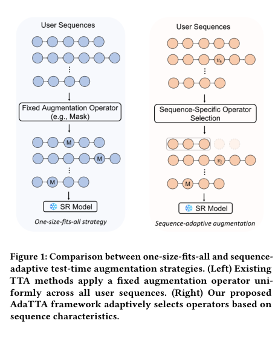

# AdaTTA：通过强化学习自适应选择测试时增强

> 论文：Beyond One-Size-Fits-All: Adaptive Test-Time Augmentation for Sequential Recommendation，arXiv 2026。[https://doi.org/10.48550/arXiv.2604.16121](https://doi.org/10.48550/arXiv.2604.16121)
> 代码：无
> 更新记录：2026-10-22 补充 MDP 状态、动作、奖励、PPO 训练与测试时数据流；论文结果与本地复现分开记录，未进行的实验留空。

---

# 一、文献阅读

## 1. 为什么固定测试时增强不够

测试时增强（TTA）先用若干操作改写当前序列，再把多个视图送入已经训练好的推荐模型，最后聚合预测。它不需要重新训练推荐主干，但“所有用户都用同一种操作”的假设很强：短序列可能适合 Crop，重复率高的序列可能适合 Reorder，包含噪声的序列又可能更适合 Mask 或 Substitute。AdaTTA 的出发点不是再设计一种增强，而是学习“当前序列应选哪一种增强”。

论文先做固定操作实验，观察不同序列的最佳操作并不一致；随后把操作选择写成一个小型决策问题，用策略网络在每条测试序列上选择动作。

## 2. 方法总览与测试时数据流

| 步骤 | 输入/模块 | 输出 | 是否更新推荐主干 |
|---|---|---|---|
| 1 | 已训练好的 SASRec/GRU4Rec 与测试序列 $S$ | 原始表示 $h(S)$ | 否 |
| 2 | 状态编码器 | 序列 embedding + 统计特征 $s$ | 否 |
| 3 | PPO Actor | Crop/Mask/Substitute/Reorder/Insert/TNoise/TMask 等动作 | 否；只训练策略 |
| 4 | 动作执行器 | 一个或多个增强视图 $S^{(1)},\ldots,S^{(m)}$ | 否 |
| 5 | 冻结主干推理 | 各视图的 item score | 否 |
| 6 | 聚合器 | 平均/加权后的最终排序 | 否 |

因此 AdaTTA 的部署边界很清楚：推荐模型训练结束后，策略网络可以离线训练；线上每个请求多运行若干次冻结主干，换取准确率提升。

## 3. 状态为什么需要两类信息

状态由两部分组成：

1. **序列 embedding**：编码物品语义、顺序和用户近期偏好，能区分“买了什么”。
2. **统计特征**：序列长度、重复率、唯一物品比例、相邻转移的重复程度等，能区分“序列长什么样”。

只用 embedding 时，策略容易把结构相似但噪声程度不同的序列混在一起；只用统计量时，又无法知道物品语义。论文的消融结果表明两者结合更稳，这也是状态设计的核心，而不是简单增加 state 维度。

## 4. MDP、动作和奖励

### 4.1 MDP 定义

对每个测试序列，状态 $s_t$ 包含当前序列表示和统计信息，动作 $a_t$ 是一次增强操作，策略输出：

$$a_t\sim\pi_\theta(a_t\mid s_t).$$

执行动作后得到增强视图并计算推荐结果。由于一个请求可以生成多次视图，后续状态还可以记录已经选择的操作，避免策略连续采样完全相同的动作。论文将整个选择过程按有限步 MDP 处理，而不是更新推荐模型参数。

动作集合包括 Crop、Mask、Substitute、Reorder、Insert、TNoise、TMask 等。动作的具体概率、替换词表和噪声强度由增强器实现；不能把动作名称直接理解为固定比例。

### 4.2 为什么奖励要拆成两部分

$$r=\alpha r_{macro}+\beta r_{rank}.$$

- $r_{macro}$ 反映整体推荐指标的变化，防止策略只对少数样本过拟合。
- $r_{rank}$ 关注当前目标物品的排名或分数变化，告诉策略“这条序列的正确答案有没有被推得更前”。

只有 macro reward 时，策略可能学到对整体平均有利但伤害当前样本的动作；只有 rank reward 时，训练方差较大，容易围绕单个目标产生投机策略。两者联合才同时顾及全局和个体。

## 5. PPO 训练和推理的区别

| 阶段 | 做什么 | 主干是否训练 | 结果是否用于线上 |
|---|---|---|---|
| 推荐预训练 | 正常训练 SASRec/GRU4Rec | 是 | 得到冻结 checkpoint |
| 策略训练 | 采样动作、评估 reward、用 PPO 更新 Actor/Critic | 否 | 得到策略参数 |
| 测试推理 | 策略按序列选动作，主干对多个视图预测并聚合 | 否 | 输出最终推荐 |

PPO 使用 clipped surrogate objective 限制单次策略更新幅度：

$$L^{clip}=\mathbb E\left[\min\left(r_t(\theta)\hat A_t,\operatorname{clip}(r_t(\theta),1-\epsilon,1+\epsilon)\hat A_t\right)\right],$$

其中 $r_t(\theta)=\pi_\theta(a_t|s_t)/\pi_{old}(a_t|s_t)$，$\hat A_t$ 是优势估计。$\gamma=0.96$、clip 0.2、policy batch 512、value loss 权重 0.25 是论文报告的关键设置。PPO 的更新发生在策略网络上，不应误写成重新训练 SASRec。

## 6. 论文实验设置

| 项目 | 论文设置 |
|---|---|
| 数据集 | Beauty、Sports、Home、Yelp |
| 骨干 | 预训练 SASRec、GRU4Rec |
| 指标 | HR/NDCG@5、10、20 |
| 增强视图 | 每条序列约 10 次，聚合预测 |
| PPO | policy batch 512；$\gamma=0.96$；clip 0.2；value loss 0.25 |
| 统计 | 5 次运行平均 |

## 7. 论文结果（代表性表格）

| 数据集 | 方法 | H@5 | N@5 | H@10 | N@10 | H@20 | N@20 |
|---|---|---:|---:|---:|---:|---:|---:|
| Beauty | Base | .0204 | .0125 | .0376 | .0180 | .0652 | .0249 |
| Beauty | 最佳固定 TMask-R | .0287 | .0178 | .0474 | .0238 | .0744 | .0306 |
| Beauty | AdaTTA | .0295 | .0182 | .0492 | .0245 | .0797 | .0322 |
| Sports | Base | .0083 | .0051 | .0157 | .0075 | .0291 | .0108 |
| Sports | AdaTTA | .0186 | .0118 | .0311 | .0158 | .0511 | .0208 |

相对 Base，Sports 的 H@5 提升 124.09%；相对最佳固定策略再提升 19.23%。Home 的最高相对提升为 26.31%。这些百分比的分母不同，不能直接互相比较。

### 状态与奖励消融（SASRec）

| 配置 | Beauty H@5/H@10 | Home H@5/H@10 |
|---|---|---|
| Metric only | .0414/.0647 | .0109/.0187 |
| Rank only | .0436/.0664 | .0117/.0197 |
| AdaTTA | .0438/.0692 | .0124/.0205 |
| Embedding only | .0427/.0674 | .0122/.0200 |
| Stats only | .0423/.0661 | .0120/.0195 |

## 8. 结果解读、成本与限制

- **收益来自选择，而不只是视图数量。** AdaTTA 超过最佳固定操作，说明同一动作不能覆盖所有序列。
- **状态互补。** embedding 负责语义，统计特征负责结构；两者同时使用的增益高于单独使用。
- **奖励互补。** macro 与 rank 同时保留时结果最好，说明个体排名和总体指标之间存在取舍。
- **推理代价。** 论文报告推理开销约为基础模型的 1.48 倍。生成 10 个视图时，延迟近似随视图数线性增长，适合对准确率敏感且可接受额外计算的场景。
- **风险。** 策略训练依赖目标数据集和主干 checkpoint；换数据分布后，动作策略可能失效。论文没有公开代码，本项目无法核对动作实现、reward 归一化和视图聚合细节。

# 二、代码复现

## 1. 当前状态

项目中没有 AdaTTA 代码，未进行本地实验。

| 实验 | 数据集 | 骨干 | H@10 | N@10 | 状态 |
|---|---|---|---:|---:|---|
| 固定 TTA 对比 |  |  |  |  |  |
| AdaTTA 主实验 |  |  |  |  |  |
| 动作空间/奖励/状态消融 |  |  |  |  |  |

## 2. 公式到实现的核查重点

- 推荐主干先冻结，再训练 PPO；策略训练不能反向更新主干。
- 核对动作、视图生成、主干预测和 reward 计算的先后顺序。
- 分开记录策略训练耗时、单请求视图数和最终推理延迟。
- 论文结果与本地结果分开，未公开代码导致的缺口留空。

## 3. 本地实验记录

（留空，待代码公开后再填写。）
