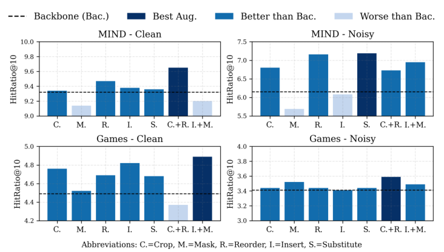
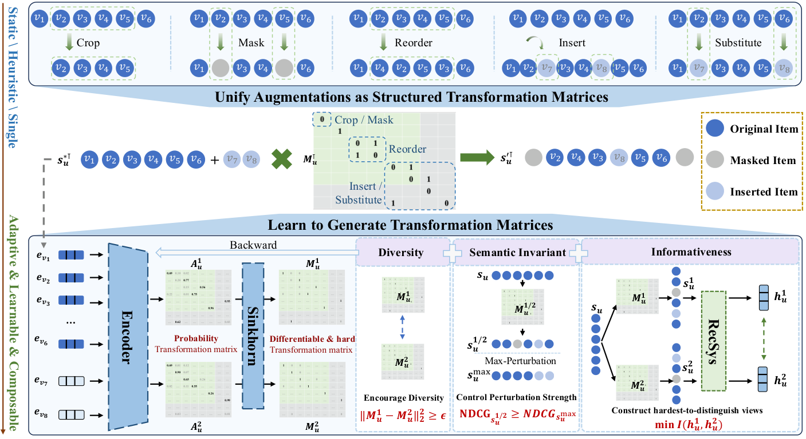
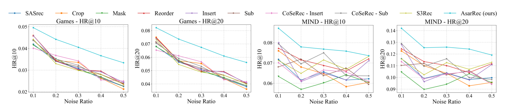
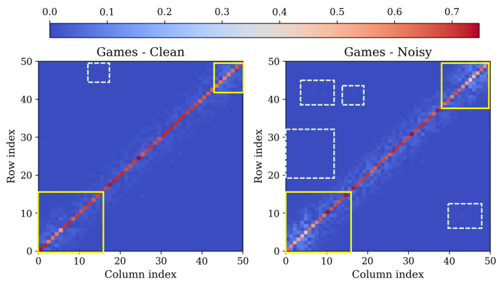
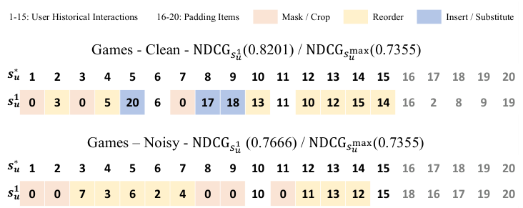
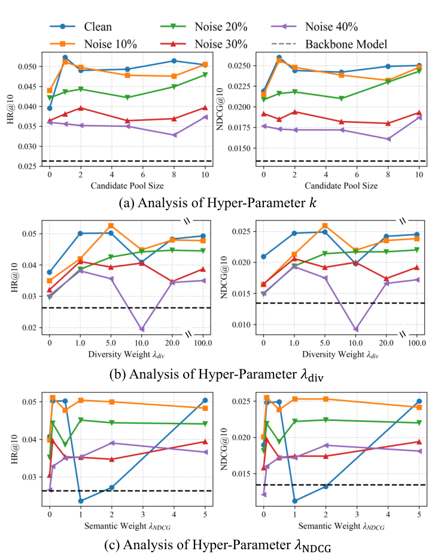
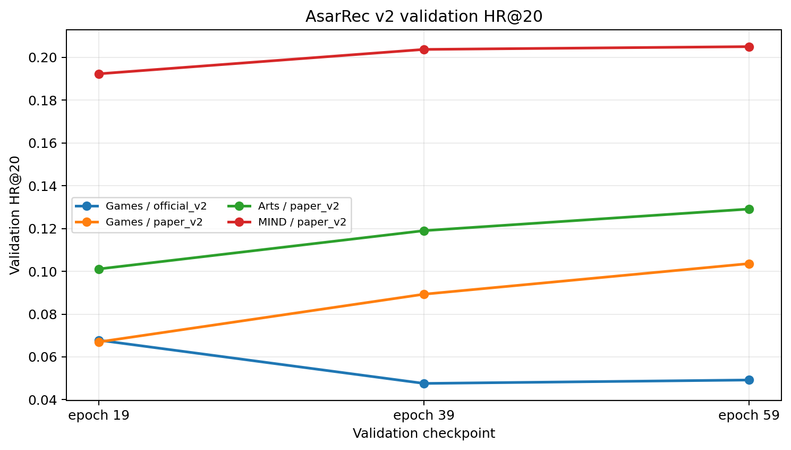
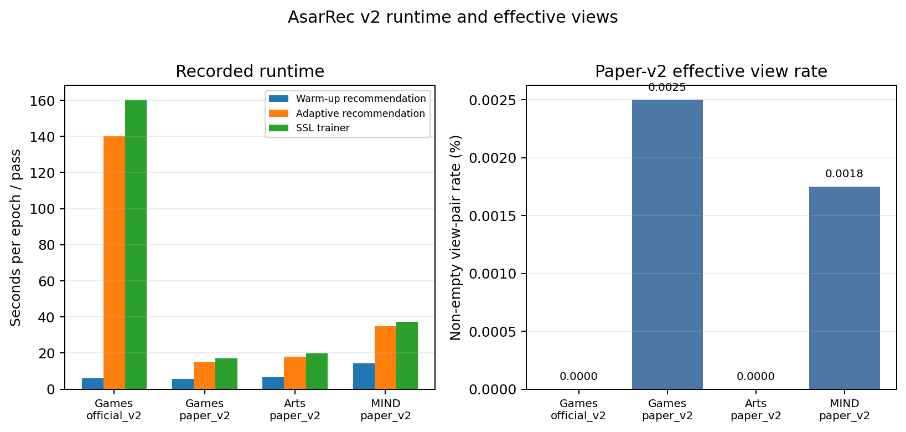

# AsarRec：通过自适应序列增强提升自监督推荐鲁棒性

> 论文：AsarRec: Adaptive Sequential Augmentation for Robust Self-supervised Sequential Recommendation，SIGIR 2026。[https://doi.org/10.1145/3805712.3809629](https://doi.org/10.1145/3805712.3809629)
> 代码：https://github.com/Kaike-Zhang/AsarRec
> 更新记录：2026-11-13 统一论文-本地实验结果对照表为五列长表；2026-10-22 统一笔记顶部信息格式；按 AsarRec-3 当前入口修正训练命令和路径，清理失效链接；将实验结果并入代码复现，改为运行总表、对比表和问题表；论文结果与本地结果分开。2026-10-25 标注复现失败并放弃，判定依据写在第二节开头的状态标记里。

---
# 一、文献阅读

## 1. 研究背景



**图 1：固定增强在干净与噪声场景下的表现**（英文原文 PDF 第 2 页）。

序列推荐系统通过用户历史交互序列预测下一物品，已广泛用于新闻、电商、视频等场景。但真实用户行为常含噪声，例如误点击、行为歧义、不确定性等。噪声会偏置学习到的行为模式，降低推荐模型鲁棒性。

自监督学习（SSL），尤其是对比学习，被广泛用于提升鲁棒性：对用户交互序列施加数据增强，生成两个扰动视图，再最大化视图间互信息，使模型学习噪声不变表示。典型增强包括 Mask、Crop、Reorder、Insert、Substitute 等。

然而，现有 SSL 方法大多采用**预定义静态增强策略**：一旦选定增强类型，就对所有用户、所有数据场景统一应用。论文指出两个关键问题：

1. 最优增强类型随场景、数据集、噪声水平、用户行为而变化；
2. 不合适的增强可能反而降低推荐性能，限制 SSL 效果。

原文图 1 展示了这种不稳定性：

- Games 中 Mask 可过滤低信息交互，带来正收益；MIND 中 Mask 反而移除语义重要物品，损害长程依赖。
- Games 干净场景中 Insert 可增加上下文多样性；噪声场景中继续 Insert 会进一步引入无关物品，训练不稳定。
- 某些组合优于单操作，例如 MIND 20% 噪声下 “Insert + Mask”；某些组合却低于单操作，例如干净 Games 中 “Crop + Reorder”。

因此，固定增强策略高度依赖上下文，盲目套用会损害性能。

## 2. 研究目的

提出一种**自适应序列增强框架**，为每个用户序列和具体上下文动态选择增强类型及其组合，从而：

- 提升自监督序列推荐的鲁棒性；
- 在干净与噪声场景下均稳定优于静态增强；
- 不修改 backbone 架构和推理流程；
- 只影响训练阶段，引入零推理开销和少量训练开销。

## 3. 研究问题

论文实验围绕三个 RQ：

1. **RQ1**：在干净和噪声条件下，AsarRec 相比 SOTA 增强方法表现如何？
2. **RQ2**：AsarRec 能否泛化到不同 backbone？它倾向学习哪些增强类型或组合？计算复杂度如何？
3. **RQ3**：关键超参数敏感性如何？各组件贡献如何（消融）？

## 4. 研究方法



**图 2：统一变换矩阵与自适应增强框架**（英文原文 PDF 第 4 页）。

AsarRec 的核心思想可以概括为：

1. **统一增强操作**：把 Crop、Mask、Reorder、Insert、Substitute 统一为约束矩阵变换

   $$
   s' = M \cdot s
   $$

   其中 $M$ 为硬半双随机矩阵。

2. **自适应生成变换矩阵**：对每个用户序列，编码为连续概率转移矩阵，再用可微 Semi-Sinkhorn 投影为硬半双随机矩阵。

3. **三目标联合优化**：
   - 多样性：两个增强视图不同，避免模式崩溃；
   - 语义不变性：保留重要物品相对排序，避免破坏语义；
   - 信息性：构造对下游推荐有挑战、有信息量的增强视图。

4. **训练期增强**：AsarRec 只用于训练阶段，不改变推理 pipeline。

原文图 2 给出总体框架：顶部为五种启发式增强；中部统一为结构化变换矩阵；底部通过可微 Sinkhorn 过程学习变换矩阵，并由 diversity、semantic invariance、informativeness 三个目标指导。

## 5. 研究内容（公式分析）

### 5.1 统一增强操作

给定用户交互序列 $s$，增强视图 $s'$ 表示为：

$$
s' = M_o \cdot s,\qquad M_o\in\{0,1\}^{|s|\times|s|}
$$

其中 $M_o$ 是硬半双随机矩阵，满足行、列和约束：

$$
\sum_j M_{o,i,j}\in\{0,1\},\qquad \sum_i M_{o,i,j}\in\{0,1\}
$$

论文式(4)的排版写作：

$$
\sum M_{o,i,s}\in\{0,1\},\qquad \sum M_{o,s,j}\in\{0,1\}
$$

这里按语义理解为行、列归一化约束。

- 若某行和为 0，表示对应物品被移除，对应 Mask 或 Crop；
- 若 $M_{o,i,j}=1$，表示原序列物品 $v_i$ 被放到位置 $j$，对应 Reorder。

对于 Insert 和 Substitute，由于会引入新物品，先随机 padding $k$ 个不在原序列中的新物品：

$$
s^*=[v_1,v_2,\ldots,v_{|s|},v_{|s|+1},\ldots,v_{|s|+k}]
$$

然后将变换矩阵扩展为：

$$
M\in\{0,1\}^{(|s|+k)\times(|s|+k)}
$$

并保持同样的硬半双随机约束。若满足：

$$
\sum_{i\ge |s|,\ j<|s|}M_{i,j}\ge 1
$$

则说明新引入物品被插入或替换到用户历史交互序列中。

通过该统一形式，Reorder、Mask、Crop、Insert、Substitute 都被表示为结构化硬半双随机矩阵变换。

### 5.2 变换矩阵生成

给定用户序列 $s_u^*$（含 padding），目标是为两个视图生成两个变换矩阵：

$$
M_u^1,\quad M_u^2
$$

直接学习离散且强约束的矩阵很困难，存在梯度消失或不稳定。AsarRec 先编码为连续概率转移矩阵。

将 padded 序列表示为嵌入序列：

$$
s_u^*\in\mathbb{R}^{|s_u^*|\times d}
$$

通过共享线性变换 $W\in\mathbb{R}^{d\times d'}$，再输入两个独立 self-attention 模块，得到概率投影矩阵：

$$
A_u^{(z)}
=
\operatorname{softmax}\left(
\frac{
\left((s_u^*W^\top)W_Q^{(z)}\right)
\left((s_u^*W^\top)W_K^{(z)}\right)^\top
}{\sqrt{d'}}
\right),
\quad z\in\{1,2\}
$$

其中 $W_Q^{(z)},W_K^{(z)}\in\mathbb{R}^{d'\times d'}$ 为可学习参数。  
$A_{u,i,j}$ 表示物品 $v_i$ 映射到位置 $j$ 的概率。

然后使用 Semi-Sinkhorn 算法投影为硬半双随机矩阵：

$$
M_u^{(z)}=\operatorname{Semi\text{-}Sinkhorn}(A_u^{(z)}),\quad z\in\{1,2\}
$$

Semi-Sinkhorn 迭代归一化行和列，使矩阵逼近半双随机约束。相比 softmax 投影，该过程缓解梯度缩放不平衡或扭曲，并逐步逼近硬二值结构。

论文算法 1 可概括为：

```text
输入：概率矩阵 A，阈值 δ，迭代次数 T
1: S ← A
2: for t = 1 to T do
3:     行归一化：S ← S / row_sum(S)
4:     列归一化：S ← S / col_sum(S)
5:     for 每一行或列 do
6:         if max 与 min 差值 < δ then
7:             将该行或列置零
8:         end if
9:     end for
10: end for
11: M_hard ← argmax_per_row_col(S)
12: M ← (M_hard - S).detach() + S
13: return M
```

第 12 行使用 straight-through 风格：前向为硬矩阵，反向通过 $S$ 传梯度。

### 5.3 学习目标

#### 5.3.1 多样性约束

希望同一用户序列的两个变换矩阵 $M_u^1$ 和 $M_u^2$ 不同，避免冗余增强模式。定义：

$$
\mathcal{L}_{\mathrm{div}}
=
\mathbb{E}_{u\in\mathcal{U}}
\left[
\max\left(0,\epsilon-\|M_u^1-M_u^2\|_2^2\right)
\right]
$$

其中 $\epsilon$ 为预设阈值。若两矩阵差异过小，则施加惩罚。

#### 5.3.2 语义不变性约束

为防止过度扰动破坏原序列语义，引入基于 Sequence-aware NDCG2 的约束，衡量原始序列与变换序列的排序一致性。

给定用户序列：

$$
s_u=[v_1,v_2,\ldots,v_{|s_u|}]
$$

为每个物品分配 relevance：

$$
r_i=\operatorname{position}(v_i)
$$

越靠近序列末尾的物品 relevance 越高。  
构造最坏语义退化参考：将最近、高 relevance 的物品替换为无关物品，relevance 设为 0，得到 $s_u^{\max}$，其 NDCG 为：

$$
\operatorname{NDCG}_{s_u^{\max}}
$$

对两个增强序列 $s_u^1,s_u^2$，计算其 Sequence-aware NDCG。语义不变性损失为：

$$
\mathcal{L}_{\mathrm{NDCG}}
=
\mathbb{E}_{u\in\mathcal{U}}
\left[
\sum_{z=1}^2
\max\left(
0,
\operatorname{NDCG}_{s_u^{\max}}
-
\operatorname{NDCG}_{s_u^z}
\right)
\right]
$$

该约束鼓励变换矩阵保留重要物品的相对排序，使扰动视图仍忠实于原始用户意图。

#### 5.3.3 信息性约束

为使增强视图对下游推荐有信息量，论文采用 InfoNCE 约束两个增强序列经推荐模型编码后的互信息：

$$
\mathcal{L}_{\mathrm{info}}
=
\mathbb{E}_{u\in\mathcal{U}}
\left[
\log
\frac{
\exp\left(\operatorname{sim}(f(s_u^1),f(s_u^2))/\tau\right)
}{
\sum
\exp\left(\operatorname{sim}(f(s_u^1),f(s_u^2))/\tau\right)
}
\right]
$$

其中 $f(\cdot)$ 为推荐模型，$\operatorname{sim}(\cdot)$ 为余弦相似度，$\tau$ 为温度系数，分母对 batch 内 $N$ 个负样本求和。  
注意：论文文字称“最小化互信息”，但常见 InfoNCE 对比损失通常最大化正样本相似度。复现时应以官方代码和损失符号为准，检查式(11)是否省略负号或负样本索引。

#### 5.3.4 联合损失

最终联合损失：

$$
\mathcal{L}
=
\mathcal{L}_{\mathrm{info}}
+
\lambda_{\mathrm{div}}\mathcal{L}_{\mathrm{div}}
+
\lambda_{\mathrm{NDCG}}\mathcal{L}_{\mathrm{NDCG}}
$$

其中 $\lambda_{\mathrm{div}},\lambda_{\mathrm{NDCG}}$ 为超参数。

论文讨论指出：

- 多样性和信息性有部分重叠，但多样性作用于变换矩阵 $M_u^1,M_u^2$，信息性作用于推荐模型表示；
- 只优化多样性可能导致矩阵差异大但表示仍相似；
- 没有多样性约束时，两个增强视图可能退化为相同序列，InfoNCE 可能梯度爆炸或训练不稳定。

### 5.4 方法讨论

1. **零推理开销**：AsarRec 只影响训练阶段，不改变 backbone 和推理流程。
2. **可接不同 backbone**：论文在 GRU4Rec、SASRec、FMLPRec 上验证。
3. **额外训练开销有限**：主要来自概率矩阵生成和 Semi-Sinkhorn，复杂度与序列长度平方相关。
4. **自适应增强**：模型可根据数据场景和用户序列，学习增强类型及组合，而非固定选择。

---

## 6. 实验环境、数据集、参数配置

### 6.1 数据集

论文使用四个数据集：

| 数据集    |  #Users | #Items | #Interactions | Avg. length | Sparsity |
| ------ | ------: | -----: | ------------: | ----------: | -------: |
| Games  |  61,521 | 33,243 |       541,789 |        8.89 |   99.97% |
| Arts   |  71,364 | 61,505 |       600,989 |        8.49 |   99.99% |
| MIND   | 152,909 | 63,608 |     4,186,679 |       27.49 |   99.96% |
| ML-20M | 138,493 | 27,278 |    20,000,263 |      144.49 |   99.47% |

数据处理：

- 排除交互少于 5 的用户；
- 最近一次交互用于测试；
- 第二次最近交互用于验证；
- 之前交互最多 50 个用于训练。

### 6.2 Backbone 与 Baseline

Backbone：

- GRU4Rec：RNN 序列推荐；
- SASRec：Transformer 自注意力序列推荐；
- FMLPRec：全 MLP + 可学习滤波增强块，用于噪声抑制。

Baseline：

- 五种基本增强：Crop、Mask、Reorder、Insert、Substitute；
- CoSeRec：利用外部知识插入或替换相似物品；
- CL4Rec：Mask + Reorder 两个互补视图；
- S3Rec：预测式自监督增强，重构 masked 片段。

### 6.3 评估指标

- HR@K；
- NDCG@K；
- $K\in\{10,20\}$。

### 6.4 实现细节

- 学习率：$\{0.1,0.01,\ldots,1\times10^{-5}\}$；
- weight decay：$\{0,0.1,\ldots,1\times10^{-5}\}$；
- 扰动预算：$\gamma=10\%$；
- AsarRec 阈值：$\epsilon=20.0$；
- $\lambda_{\mathrm{div}}\in\{1.0,2.0,5.0,50.0,100.0\}$；
- $\lambda_{\mathrm{NDCG}}\in\{0.1,0.5,1.0,2.0,5.0\}$；
- 候选数 $k\in\{2,3,5,10,20\}$；
- 主要实验 backbone 为 SASRec，泛化实验使用 GRU4Rec 和 FMLPRec。

---

## 7. 完整实验结果表格

### 表 2：主实验，SASRec 在 Games、Arts、MIND 上

| Model          | Games HR@10 | Games HR@20 | Games NDCG@10 | Games NDCG@20 | Arts HR@10 | Arts HR@20 | Arts NDCG@10 | Arts NDCG@20 | MIND HR@10 | MIND HR@20 | MIND NDCG@10 | MIND NDCG@20 |
| -------------- | ----------: | ----------: | ------------: | ------------: | ---------: | ---------: | -----------: | -----------: | ---------: | ---------: | -----------: | -----------: |
| SASRec         |      0.0449 |      0.0745 |        0.0231 |        0.0311 |     0.0367 |     0.0528 |       0.0214 |       0.0252 |     0.0932 |     0.1500 |       0.0471 |       0.0613 |
| +Crop          |      0.0476 |      0.0777 |        0.0244 |        0.0319 |     0.0394 |     0.0547 |       0.0225 |       0.0264 |     0.0934 |     0.1500 |       0.0469 |       0.0611 |
| +Mask          |      0.0452 |      0.0738 |        0.0228 |        0.0300 |     0.0375 |     0.0525 |       0.0230 |       0.0268 |     0.0914 |     0.1467 |       0.0459 |       0.0597 |
| +Reorder       |      0.0469 |      0.0766 |        0.0238 |        0.0313 |     0.0383 |     0.0540 |       0.0217 |       0.0256 |     0.0947 |     0.1515 |       0.0475 |       0.0618 |
| +Insert        |      0.0482 |      0.0780 |        0.0243 |        0.0318 |     0.0394 |     0.0550 |       0.0230 |       0.0269 |     0.0938 |     0.1491 |       0.0475 |       0.0614 |
| +Sub           |      0.0468 |      0.0765 |        0.0239 |        0.0313 |     0.0362 |     0.0527 |       0.0234 |       0.0275 |     0.0936 |     0.1501 |       0.0467 |       0.0609 |
| +CoSeRecInsert |      0.0480 |      0.0780 |        0.0246 |        0.0321 |     0.0384 |     0.0539 |       0.0223 |       0.0262 |     0.0945 |     0.1507 |       0.0476 |       0.0617 |
| +CoSeRecSub    |      0.0477 |      0.0782 |        0.0246 |        0.0322 |     0.0383 |     0.0538 |       0.0222 |       0.0260 |     0.0938 |     0.1503 |       0.0471 |       0.0613 |
| +CL4Rec        |      0.0479 |      0.0776 |        0.0244 |       /0.0318 |     0.0394 |     0.0544 |       0.0231 |       0.0269 |     0.0939 |     0.1507 |       0.0472 |       0.0616 |
| +S3Rec         |      0.0475 |      0.0770 |        0.0244 |        0.0318 |     0.0386 |     0.0536 |       0.0232 |       0.0269 |     0.0928 |     0.1506 |       0.0465 |       0.0610 |
| **+AsarRec**   |  **0.0512** |  **0.0837** |    **0.0256** |    **0.0337** | **0.0429** | **0.0616** |   **0.0265** |   **0.0312** | **0.1030** | **0.1658** |   **0.0511** |   **0.0669** |
| Gain           |      +6.40% |      +7.08% |        +4.07% |        +4.71% |     +8.95% |    +12.10% |      +13.39% |      +13.49% |     +8.83% |     +9.47% |       +7.39% |       +8.32% |

AsarRec 平均相对增益：

- HR@10：+8.06%
- HR@20：+9.55%
- NDCG@10：+8.28%
- NDCG@20：+8.84%

### 表 3：ML-20M 大规模验证

| Metric | Base | SOTA | AsarRec | Gain |
|---|---:|---:|---:|---:|
| HR@10 | 0.2175 | 0.2231 | 0.2317 | +3.86% |
| NDCG@10 | 0.1203 | 0.1228 | 0.1261 | +2.69% |

### 表 4：GRU4Rec 与 FMLPRec 泛化实验

#### Clean 设置

| Model | HR@10 | HR@20 | NDCG@10 | NDCG@20 |
|---|---:|---:|---:|---:|
| GRU4Rec | 0.0345 | 0.0591 | 0.0169 | 0.0231 |
| +Crop | 0.0349 | 0.0604 | 0.0172 | 0.0238 |
| +Mask | 0.0353 | 0.0613 | 0.0178 | 0.0244 |
| +CoSeRec | 0.0350 | 0.0600 | 0.0177 | 0.0243 |
| +S3Rec | 0.0339 | 0.0595 | 0.0170 | 0.0232 |
| **+AsarRec** | **0.0375** | **0.0650** | **0.0187** | **0.0255** |
| Gain | +6.21% | +6.07% | +4.77% | +4.67% |
| FMLPRec | 0.0464 | 0.0725 | 0.0243 | 0.0313 |
| +Crop | 0.0483 | 0.0803 | 0.0248 | 0.0328 |
| +Mask | 0.0438 | 0.0770 | 0.0213 | 0.0294 |
| +CoSeRec | 0.0389 | 0.0668 | 0.0194 | 0.0264 |
| +S3Rec | 0.0241 | 0.0423 | 0.0115 | 0.0161 |
| **+AsarRec** | **0.0534** | **0.0858** | **0.0284** | **0.0364** |
| Gain | +10.56% | +6.79% | +14.25% | +11.15% |

#### Noisy 设置（20% 噪声）

| Model | HR@10 | HR@20 | NDCG@10 | NDCG@20 |
|---|---:|---:|---:|---:|
| GRU4Rec | 0.0230 | 0.0401 | 0.0115 | 0.0159 |
| +Crop | 0.0228 | 0.0400 | 0.0113 | 0.0156 |
| +Mask | 0.0235 | 0.0411 | 0.0121 | 0.0162 |
| +CoSeRec | 0.0236 | 0.0409 | 0.0120 | 0.0164 |
| +S3Rec | 0.0229 | 0.0390 | 0.0113 | 0.0155 |
| **+AsarRec** | **0.0259** | **0.0446** | **0.0132** | **0.0179** |
| Gain | +9.82% | +8.63% | +8.75% | +8.63% |
| FMLPRec | 0.0293 | 0.0489 | 0.0149 | 0.0196 |
| +Crop | 0.0277 | 0.0472 | 0.0132 | 0.0181 |
| +Mask | 0.0263 | 0.0510 | 0.0115 | 0.0176 |
| +Sub | 0.0200 | 0.0377 | 0.0101 | 0.0144 |
| +S3Rec | 0.0178 | 0.0354 | 0.0079 | 0.0123 |
| **+AsarRec** | **0.0314** | **0.0544** | **0.0158** | **0.0215** |
| Gain | +7.15% | +6.64% | +6.22% | +9.53% |

### 表 5：训练时间

| Method     | Time (s/epoch) | Remarks       |
| ---------- | -------------: | ------------- |
| Backbone   |   23.25 ± 0.67 | —             |
| Mask       |   32.59 ± 0.96 | Basic aug.    |
| Crop       |   33.63 ± 0.83 | Basic aug.    |
| Reorder    |   39.35 ± 1.37 | Basic aug.    |
| Insert     |   34.34 ± 0.62 | Basic aug.    |
| Substitute |   32.10 ± 0.37 | Basic aug.    |
| AsarRec    |   33.65 ± 0.69 | Adaptive aug. |

论文据此认为 AsarRec 没有显著增加计算开销，主要成本仍在自监督损失和反向传播。这是作者在其计时条件下的结论，不代表当前公开代码的端到端训练耗时；本地分阶段计时及口径差异见代码复现第 6 节。

---

## 8. 结果分析

### 8.1 推荐性能

- AsarRec 在 SASRec 上于 Games、Arts、MIND 均取得最优结果；
- 平均相对增益：HR@10 +8.06%，HR@20 +9.55%，NDCG@10 +8.28%，NDCG@20 +8.84%；
- 最强 baseline 随数据集和指标变化，说明固定增强策略对数据特征高度敏感；
- 基本增强中 Insert、Reorder 偶尔有竞争力，但波动大；Substitute 等常导致性能下降。

### 8.2 噪声鲁棒性



**图 3：不同噪声比例下的推荐表现**（英文原文 PDF 第 7 页）。

论文图 3 在噪声比例 0.1–0.5 下比较方法。结论：

- AsarRec 在所有噪声水平下持续优于 baseline；
- 随噪声增加，性能下降更慢；
- 静态增强对噪声高度敏感，无法区分信息交互和噪声交互。

### 8.3 泛化能力

在 GRU4Rec、FMLPRec 上：

- AsarRec 在 clean 和 noisy 设置下均取得一致提升；
- 强 backbone FMLPRec 本身已有去噪机制，多数 baseline 增强甚至低于原 backbone；
- AsarRec 仍能稳定提升，说明其不依赖特定 backbone。

### 8.4 变换矩阵可视化



**图 4：干净与噪声场景下的平均变换矩阵**（英文原文 PDF 第 8 页）。

论文图 4 展示平均变换矩阵：

- 序列头尾，尤其头部，扰动更强；
- 这与语义不变性约束一致：序列开头扰动通常对推荐语义影响较小；
- 噪声环境下，变换更集中、更强烈，模型将增强预算分配给可能积累噪声的片段；
- 避免长程 Reorder，因为远距离交换难以保持语义一致，且信息性约束偏好局部但具挑战性的扰动。

### 8.5 案例研究



**图 5：Games 数据集的序列增强案例**（英文原文 PDF 第 8 页）。

Games 数据集某用户，扰动预算 10%，最坏语义退化阈值 $\mathrm{NDCG}^*=0.7355$。

- Clean 设置：扰动较小，NDCG=0.8201，AsarRec 倾向 Insert/Substitute，丰富序列；
- Noisy 设置（20% 噪声）：NDCG=0.7666，AsarRec 更保守，倾向 Mask/Reorder，移除或重排可疑物品。

说明 AsarRec 能根据输入动态调整增强策略：干净时丰富序列，噪声时去噪。

### 8.6 时间复杂度

设 batch size 为 $B$，序列长度 $L$，隐藏维 $d$。

- Transformer backbone：$O(BL^2d)$；
- RNN backbone：论文写为 $O(BL^2d)$；
- 基本增强：$O(BL)$，相对可忽略；
- AsarRec 生成概率矩阵和 Semi-Sinkhorn：$O(BL^2)$，常数较小；
- 总体复杂度仍为 $O(BL^2d)$，与 backbone 同阶。

### 8.7 超参数与消融



**图 6：候选池大小与损失权重的参数分析及消融**（英文原文 PDF 第 9 页）。

论文图 6：

- 候选池大小 $k$：性能对 $k$ 不敏感，小候选集也稳定；
- 多样性权重 $\lambda_{\mathrm{div}}$：小于 20 时约束弱，视图接近，性能不稳定；大于 20 后稳定；
- 语义不变性权重 $\lambda_{\mathrm{NDCG}}$：较小时语义失真严重，性能下降；大于 5 后稳定；
- 消融：去掉 $k$、$\lambda_{\mathrm{div}}$ 或 $\lambda_{\mathrm{NDCG}}$ 均导致性能下降，说明三者互补且关键。

---

## 9. 结论

AsarRec 针对静态增强策略无法跨数据集、噪声水平泛化的问题，提出：

1. 将序列增强统一为硬半双随机矩阵变换；
2. 用编码模块生成概率转移矩阵，并通过可微 Semi-Sinkhorn 投影为硬矩阵；
3. 用多样性、语义不变性、信息性三约束联合优化；
4. 仅训练阶段生效，零推理开销。

实验表明，AsarRec 在多个真实数据集、不同噪声水平、不同 backbone 上均优于现有方法，具有较强鲁棒性、适应性和泛化能力。

---

# 二、代码复现

> **状态标记（2026-10-25）：复现失败，已放弃。** 判定依据：19 次完整运行的最佳轮次全部停在预热阶段或训练上限（第 6 节），增强阶段没有一次超过预热权重；`paper_v2` 出现增强器 NaN 与空增强视图（第 8 节）；本地 Games 为 61,708 / 33,388 / 543,667，论文表 1 为 61,521 / 33,243 / 541,789，指标不能直接对照。代码目录已改名为「AsarRec（复现失败）」，不再改代码、不再补实验，仅作为已知失败保留。
>
> 代码与数据准备记录始于 2026-10-17。当前入口为 [AsarRec-3](../../experiment/ELSE/AsarRec（复现失败）/AsarRec-3/)，对应作者提交 `9cd0e07`。当前目录可直接运行 Games + SASRec；Arts、MIND 和其他骨干的旧结果仅作历史记录。

## 1. 实验设置

| 项目       | 当前设置                                                                               |
| -------- | ---------------------------------------------------------------------------------- |
| 数据集 / 骨干 | Games / SASRec；当前目录仅提供这一组合                                                         |
| 训练       | 最多 200 轮；每轮验证；连续 `patience` 轮无提升早停                                                 |
| 评估       | HR@10、HR@20、NDCG@10、NDCG@20；按验证 HR@20 选检查点                                         |
| 默认参数     | `out_dim=64`、`max_interaction=50`、`candidate_num=5`、`batch_size=256`、`patience=10` |
| 学习率      | Games 由代码固定为 `lr=0.001`、`weight_decay=0.0001`                                      |
| 随机种子     | `main.py` 固定依次训练 2024–2028；`--seed` 不能单独控制一次运行                                     |

## 2. 训练命令

命令在仓库根目录执行。当前入口不支持 `--augmentation_mode`、`--repeats`、`--ssl_begin`、`--ssl_interval`、`--ssl_epochs` 和 `--ssl_weight`。

```powershell
# 论文公式实现（paper）
& 'D:\.conda\envs\python312\python.exe' -X utf8 'experiment/ELSE/AsarRec（复现失败）/AsarRec-3/main.py' --model SASrec --method AdaptiveSSL --implementation paper --dataset Games --device_id 0 --noise 0 --n_epochs 60 --min_epochs 20 --patience 10

# 官方流程对照（official）
& 'D:\.conda\envs\python312\python.exe' -X utf8 'experiment/ELSE/AsarRec（复现失败）/AsarRec-3/main.py' --model SASrec --method AdaptiveSSL --implementation official --dataset Games --device_id 0 --noise 0 --n_epochs 60 --min_epochs 20 --patience 10

# 纯 SASRec 基线
& 'D:\.conda\envs\python312\python.exe' -X utf8 'experiment/ELSE/AsarRec（复现失败）/AsarRec-3/main.py' --model SASrec --method None --implementation paper --dataset Games --device_id 0 --noise 0 --n_epochs 60 --min_epochs 20 --patience 10

# 短流程检查
& 'D:\.conda\envs\python312\python.exe' -X utf8 'experiment/ELSE/AsarRec（复现失败）/AsarRec-3/main.py' --model SASrec --method AdaptiveSSL --implementation paper --dataset Games --device_id 0 --noise 0 --n_epochs 2 --min_epochs 0 --patience 3
```

## 3. 主实验对比（论文表 2）

主实验只保留与论文最接近的 Games / SASRec 作为后续消融和参数实验对象；Arts、MIND 的结果为旧 AsarRec-1 归档。

| 数据集名 | 指标名 | 论文宣称效果 | 本地实测效果 | 差异百分比 |
|---|---|---:|---:|---:|
| Games / SASRec | HR@10 | 0.0512 | 0.0578 | +12.89% |
| Games / SASRec | HR@20 | 0.0837 | 0.0803 | -4.06% |
| Games / SASRec | NDCG@10 | 0.0256 | 0.0385 | +50.39% |
| Games / SASRec | NDCG@20 | 0.0337 | 0.0442 | +31.16% |
| Arts / SASRec | HR@10 | 0.0429 | 0.0755 | +75.99% |
| Arts / SASRec | HR@20 | 0.0616 | 0.0900 | +46.10% |
| Arts / SASRec | NDCG@10 | 0.0265 | 0.0568 | +114.34% |
| Arts / SASRec | NDCG@20 | 0.0312 | 0.0604 | +93.59% |
| MIND / SASRec | HR@10 | 0.1030 | 0.1206 | +17.09% |
| MIND / SASRec | HR@20 | 0.1658 | 0.1914 | +15.44% |
| MIND / SASRec | NDCG@10 | 0.0511 | 0.0609 | +19.18% |
| MIND / SASRec | NDCG@20 | 0.0669 | 0.0787 | +17.64% |

差异百分比按 `(本地实测效果−论文宣称效果)/论文宣称效果×100%` 计算；正值表示本地结果更高，负值表示更低。Games、Arts、MIND 的本地结果分别为旧 AsarRec-1 的单 seed / 历史记录，不能视为多 seed 平均。



## 4. 消融实验

只在 Games / SASRec 上进行；尚未完成的实验留空。

| 变体         | HR@20 | NDCG@20 | 状态      |
| ---------- | ----: | ------: | ------- |
| 完整 AsarRec |       |         | 使用主实验结果 |
| 去掉多样性约束    |       |         | 未完成     |
| 去掉语义约束     |       |         | 未完成     |
| 去掉信息性/对比损失 |       |         | 未完成     |

## 5. 参数实验

固定 Games / SASRec、同一评估规则和随机种子，每次只改变一个参数；未完成结果留空。

| 参数               | 取值                       | HR@20 | NDCG@20 | 状态  |
| ---------------- | ------------------------ | ----: | ------: | --- |
| `candidate_num`  | 2、5、10                   |       |         | 未完成 |
| `lambda_reg`     | 1、10、100                 |       |         | 未完成 |
| `lambda_rank`    | 0.1、0.5、1                |       |         | 未完成 |
| `sinkhorn_delta` | 0、0.001、0.01             |       |         | 未完成 |
| `noise`          | 0、0.1、0.2、0.3            |       |         | 未完成 |
| `seed`           | 2024、2025、2026、2027、2028 |       |         | 未完成 |

## 6. 全部运行结果

以下列出日志和结果文件中已有的 19 份完整运行；缺失指标记为 `—`，不补估计值。

| 工程 / 运行 ID | 版本 / 数据集 | seed | 最佳 epoch / 阶段 | HR@10 | HR@20 | NDCG@10 | NDCG@20 |
|---|---|---:|---|---:|---:|---:|---:|
| AsarRec-1 / 20261017_105622 | legacy / Games | 2024 | 19 / warmup | 0.0501 | 0.0738 | 0.0286 | 0.0346 |
| AsarRec-1 / 20261017_105622 | legacy / Games | 2025 | 19 / warmup | 0.0429 | 0.0654 | 0.0245 | 0.0301 |
| AsarRec-1 / 20261017_191545 | official_v2 / Games | 2024 | 19 / warmup | 0.0304 | 0.0492 | 0.0170 | 0.0217 |
| AsarRec-1 / 20261017_231254 | paper_v2 / Games | 2024 | 59 / adaptive | 0.0578 | 0.0803 | 0.0385 | 0.0442 |
| AsarRec-1 / 20261017_233907 | paper_v2 / Arts | 2024 | 59 / adaptive | 0.0755 | 0.0900 | 0.0568 | 0.0604 |
| AsarRec-1 / 20261018_120837 | paper_v2 / MIND | 2024 | 59 / adaptive | 0.1206 | 0.1914 | 0.0609 | 0.0787 |
| AsarRec-1 / 20261018_144212 | paper_v3 / Games | 2024 | 59 / adaptive | 0.0287 | 0.0500 | 0.0138 | 0.0191 |
| AsarRec-1 / 20261018_155424 | paper_v4 / Games | 2024 | 19 / warmup | 0.0256 | 0.0437 | 0.0120 | 0.0165 |
| AsarRec-1 / 20261018_165352 | paper_v4 (1/5/2) / Games | 2024 | 19 / warmup | 0.0206 | 0.0367 | 0.0097 | 0.0138 |
| AsarRec-1 / 20261018_210820 | paper_v5 / Games | 2024 | 19 / warmup | 0.0229 | 0.0399 | 0.0105 | 0.0147 |
| AsarRec-1 / 20261018_220132 | official_v4 / Games | 2024 | 19 / warmup | 0.0306 | 0.0509 | 0.0148 | 0.0199 |
| AsarRec-1 / 20261019_100957 | official_v4 / Games | 2024 | 19 / warmup | 0.0271 | 0.0476 | 0.0133 | 0.0185 |
| AsarRec-2 / 2026102117 | official AdaptiveSSL / Games | 2024 | 60 / adaptive | 0.0457 | 0.0762 | 0.0221 | 0.0297 |
| AsarRec-3 / 2026102118 | paper（重构前） / Games | 2024 | 19 / warmup | 0.0266 | 0.0480 | 0.0126 | 0.0180 |
| AsarRec-3 / 2026102118 | paper（重构前） / Games | 2025 | 19 / warmup | 0.0260 | 0.0458 | 0.0127 | 0.0177 |
| AsarRec-3 / 2026102118 | paper（重构前） / Games | 2026 | 19 / warmup | 0.0304 | 0.0504 | 0.0148 | 0.0198 |
| AsarRec-3 / 2026102118 | paper（重构前） / Games | 2027 | 19 / warmup | 0.0230 | 0.0421 | 0.0110 | 0.0158 |
| AsarRec-3 / 2026102118 | paper（重构前） / Games | 2028 | 19 / warmup | 0.0312 | 0.0544 | 0.0148 | 0.0206 |
| AsarRec-3 / 2026102121 | paper（当前最小差异） / Games | 2024 | 19 / warmup | 0.0242 | 0.0428 | 0.0116 | 0.0162 |

未完成记录：AsarRec-1 `20261018_154115` 在 epoch 24 的 batch 200/241 中断，无最终测试结果。



## 7. 论文描述、官方原版与论文对齐版

| 项目          | 论文描述                       | 官方原版                          | 论文对齐版（当前 paper）                         |
| ----------- | -------------------------- | ----------------------------- | --------------------------------------- |
| 增强器         | 共享线性 W、两套 Q/K、缩放 softmax   | 位置编码 + Transformer + ReLU Q/K | 共享无 bias 线性 W、两套 Q/K、缩放 softmax         |
| 矩阵投影        | Algorithm 1，归一化、平坦行列删除、硬匹配 | log-Sinkhorn + 匈牙利完整匹配        | log-Sinkhorn + `delta=1e-8` 删除 + 贪心部分匹配 |
| 多样性损失       | `max(0, ε−‖M1−M2‖²)`       | 负 L1 均值                       | 论文 hinge                                |
| 语义损失        | 两路低于参考分数的 hinge            | 平均 NDCG 损失，带下限 0.05           | 两路 hinge，NDCG 细节含本地选择                   |
| 额外迹项        | 无                          | 有                             | 无                                       |
| 视图处理        | 论文未给出筛选/回退细节               | 语义筛选 + 随机连续裁剪回退               | 直接使用生成视图                                |
| 候选抽样        | 补充原序列之外物品                  | 批内共享、可重复、可含已见物品               | 每用户独立、排已交互、无放回                          |
| 噪声          | 随机替换                       | 插入 / 删除                       | 随机替换                                    |
| 数据规模（Games） | 61,521 / 33,243 / 541,789  | 61,708 / 33,388 / 543,667     | 61,708 / 33,388 / 543,667               |
| 训练选择        | 论文未完整公布                    | 按验证 HR@20 选模型                 | 沿用当前训练器按验证 HR@20 选模型                    |

## 8. 已知问题

| 问题            | 现象 / 证据                                   | 影响                            |
| ------------- | ----------------------------------------- | ----------------------------- |
| 数据口径不同        | Games 数据规模与论文表 1 不同                       | 指标不能直接视为同数据复现                 |
| 官方代码不完整       | 缺失部分工具源码，InfoNCE 等函数需本地补全                 | 无法证明官方流程逐位等价                  |
| 论文与官方实现有算法差异  | 增强器、匹配、候选、损失、噪声流程均不同                      | `official` 和 `paper` 不能只按名称比较 |
| paper_v2 数值崩溃 | 增强器出现 NaN，后续双视图几乎为空                       | 早期分数不能归因于有效增强                 |
| 增强质量不均衡       | 一路接近原序列，另一路对短序列扰动过强                       | 验证 HR@20 在启用增强后下降             |
| 预热权重被选中       | 多次运行最佳 epoch 为 19 / warmup                | 尚未证明增强阶段带来收益                  |
| 评估口径存在敏感项     | 重复目标屏蔽规则会明显改变指标                           | 需固定评估协议后再比较                   |
| 多种子不足         | AsarRec-2 只有 1 次，当前 AsarRec-3 最小差异版只有 1 次 | 不能报告稳定性或显著性                   |
| 运行中断          | 20261018_154115 无最终测试结果                   | 不纳入均值                         |

## 9. 当前结论

- Games / SASRec 是当前与论文主实验最接近的可运行组合；后续消融和参数实验只围绕该组合展开。
- 已有完整运行的结果见第 6 节；论文对齐版、官方原版和论文描述的差异见第 7 节。
- 多次运行在增强阶段没有超过预热权重，且部分版本出现空视图或 NaN，当前不能把分数差异解释为 AsarRec 增益。
- 消融、参数扫描和补充多 seed 结果不再补做：按上面三条证据判定复现失败并放弃（2026-10-25），表 4、表 5 保持留空。


