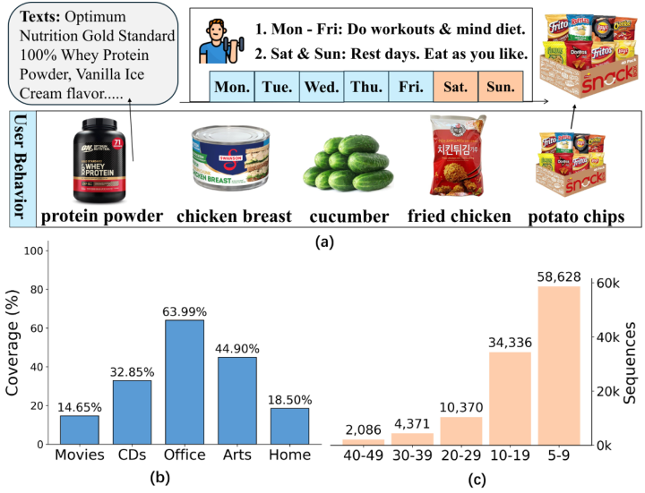
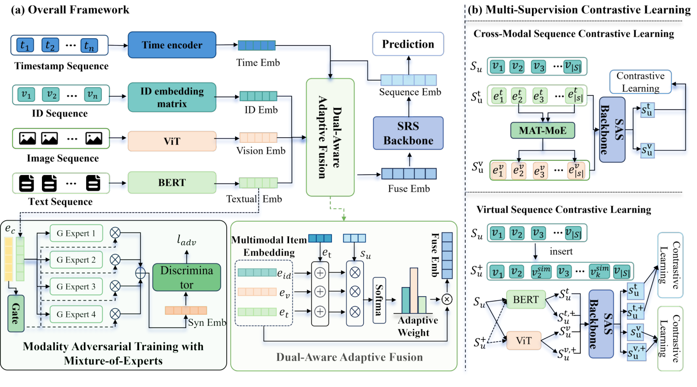
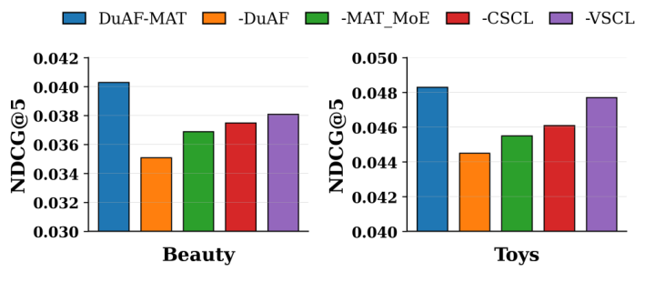
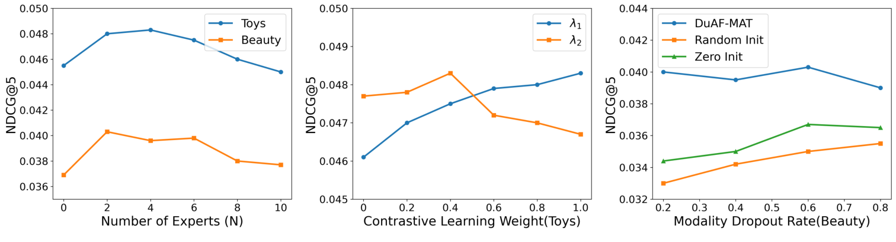

# DuAF-MAT：通过时间感知融合与缺失补全建模多模态兴趣

> 论文：Capturing Dynamic User Interests Under Modality Imbalance for Multimodal Sequential Recommendation，AAAI 2026。[https://doi.org/10.1609/aaai.v40i18.38544](https://doi.org/10.1609/aaai.v40i18.38544)
> 代码：无
> 更新记录：2026-10-22 统一笔记顶部信息格式；保留原有阅读与复现记录，论文结果与本地结果分开。

---
# 一、文献阅读

## 1. 研究背景

多模态序列推荐利用物品 ID、文本与图像建模用户兴趣。实际困难不仅是“如何拼接特征”：同一用户在不同时间关注的模态会变；部分物品缺少图像或描述；短历史难以提供足够监督。图 1 以食品选择说明，在控制饮食时用户关注营养文本，在放松饮食时可能更关注外观。

## 2. 研究目的

根据用户偏好与时间动态分配模态权重，用类别条件专家生成缺失视觉表示，再通过跨模态和虚拟序列对比缓解稀疏监督，提升下一物品预测效果。

## 3. 研究问题

1. 模态融合如何同时感知用户兴趣与交互时间？
2. 缺失图像时，如何从文本和类别产生更合理的视觉特征？
3. 如何从模态一致性与相似物品插入获得额外监督？
4. 主实验收益、组件贡献和不同模态缺失率下的效果如何？

以上按研究动机归纳；原文实验没有逐项编号 RQ。

## 4. 研究方法

DuAF-MAT 包含 DuAF（Dual-Aware Adaptive Fusion）、MAT-MoE（Modality Adversarial Training with Mixture-of-Experts）和 MSCL（Multi-Supervised Contrastive Learning）。DuAF 决定每次交互更应依赖哪种模态；MAT-MoE 恢复缺失表示；MSCL 的 CSCL 对齐同用户文本/视觉序列，VSCL 对齐原始/虚拟序列。序列编码器采用 SASRec。

论文的 MoE 用类别路由对多个专家加权，式(12)包含全部专家求和，没有给出 Top-k 稀疏路由。具体生成器从文本条件生成视觉嵌入，也不能据此推断已完整实现任意模态双向补全。

## 5. 研究内容（公式分析）

### 5.1 任务与多模态表征：第 3 节、第 4.1 节，式(1)(2)

给定按时间排列的用户历史 $S_u$，预测：

$$v_{n+1}=\arg\max_{v\in\mathcal V}P(v\mid S_u).\tag{1}$$

ID 嵌入可训练；BERT 的 [CLS] 文本特征与 ViT 图像特征先提取并冻结，再投影至共同维度 $d$。加入位置表示：

$$e_i^m=x_i^m+p_i,\qquad m\in\{id,textual,visual\}.\tag{2}$$

固定的是原始模态特征，投影参数仍可学习。原文还提到 structural features，但式(2)明确列出的模态只有 ID、文本与视觉；式(8)的额外 $S$ 记号需要进一步确认，不能自行解释成已实现的第四种输入。

### 5.2 双重感知融合 DuAF：式(3)–(8)

相邻交互时间差为：

$$\Delta t_1=0,\qquad\Delta t_i=t_i-t_{i-1}\ (i\ge2).\tag{3}$$

$$e_i^{inter}=W_1\log(\Delta t_i+1)+b_1.\tag{4}$$

绝对时间使用可学习频率和相位的正余弦编码：

$$e^{ts}[2k]=\sin(\alpha_kt+\beta_k),\quad e^{ts}[2k+1]=\cos(\alpha_kt+\beta_k).\tag{5}$$

$$e_i^{time}=W_2[e_i^{inter};e_i^{ts}]+b_2.\tag{6}$$

因此相对时间差与绝对时间都进入融合，而非只加入序列位置。时间单位、归一化及截断范围会影响表示，但原文未详细规定。

$$\omega_i^m(u,t_i)=\frac{\exp\langle s_u,\tanh(e_i^m+e_i^{time})\rangle}{\sum_{n\in M}\exp\langle s_u,\tanh(e_i^n+e_i^{time})\rangle}.\tag{7}$$

$$h_i=\sum_{m\in M\cup\{S\}}\omega_i^m(u,t)e_i^m.\tag{8}
$$

原式(8)的求和范围保留为 $M\cup\{S\}$，它与式(7)的 $M$ 范围不完全一致。融合权重为用户、位置、模态相关的标量，并非 FAERec 那样的逐维向量门控。另一个待明确处是：式(7)使用 $s_u$，正文把它指向式(17)，而式(17)又对融合后的 $h_i$ 编码。原文未说明如何初始化或解除这个依赖环，需要查看源码或询问作者，不能直接假定迭代更新。

### 5.3 类别条件专家生成：式(9)–(12)

原文先以 WGAN 形式表达分布匹配：

$$\max_D\min_G\ \mathbb E_{x\sim p_{real}}D(x)-\mathbb E_{x'\sim G}D(x').\tag{9}$$

每个生成专家接收文本表示与高斯噪声：

$$G_i(e_t,z)=W_{2,i}\delta(W_{1,i}[e_t;z]+b_{1,i})+b_{2,i},\quad z\sim\mathcal N(0,I).\tag{10}$$

类别嵌入 $e_c$ 决定专家权重：

$$g=\operatorname{softmax}(W_ge_c+b_g),\tag{11}$$

$$e_{syn}=G(e_t,z)=\sum_{i=1}^{N}g_iG_i(e_t,z).\tag{12}$$

生成的是推荐空间中的视觉嵌入，不是像素图像。噪声使同一物品可以生成多个候选，类别门控让专家适应不同类别的语义和外观关系。

### 5.4 判别、梯度惩罚与候选筛选：式(13)–(16)

原文判别器为：

$$D(e_t,e_v)=W_4[\delta(W_3e_t+b_3);e_v]+b_4.\tag{13}$$

真实文本–视觉对作正例，文本–合成视觉对作负例。原文式(14)写为：

$$\mathcal L_{adv}=-\frac1{|E|}\sum_{e_i\in E}\log(1-D(e_t^i,e_{syn}^i))+\frac1{|E_c|}\sum_{e_i\in E_c}\log D(e_t^i,e_v^i).\tag{14}$$

$$\min_G\max_D\ \mathcal L_{adv}-\lambda_{gp}\mathcal L_{gp},\tag{15}$$

$$\mathcal L_{gp}=\lambda_{gp}\mathbb E_{\hat e_v}\big(\|\nabla_{\hat e_v}D(e_t,\hat e_v)\|_2-1\big)^2,\quad\hat e_v=a e_v+(1-a)e_{syn},\ a\sim U(0,1).\tag{16}$$

**原文公式疑点：** 式(9)是 Wasserstein 分数目标，式(14)却使用对数分类形式；式(13)没有写 sigmoid；式(14)两个项的符号与通常 BCE 不一致；$\lambda_{gp}$ 在式(15)(16)出现两次。笔记如实保留这些差异，不能把它们当作已核实可直接运行的统一损失。$E_c$ 在上下文中还和类别嵌入矩阵记号接近，需要区分完整模态样本集合与类别参数表。

生成多个视觉候选后，用判别器的二值结果 $y_{i,j}$ 筛选并池化：

$$e'_v=\frac{\sum_{j=1}^{K}y_{i,j}e_{syn}^{(j)}}{\sum_{j=1}^{K}y_{i,j}}.$$

此式为正文未编号表达。若全部候选被拒绝，分母为零；原文没有给出回退规则。实现时需要明确阈值、候选数和兜底策略，并标明这些选择是否来自作者代码。

### 5.5 序列预测：式(17)(18)

$$s_u=\operatorname{SeqEncoder}([h_1,\ldots,h_{|S_u|}]),\tag{17}$$

$$\mathcal L_{main}=-\sum_{u\in\mathcal U}\sum_{i\in\mathcal I}\left[y_{ui}\log\hat y_{ui}+(1-y_{ui})\log(1-\hat y_{ui})\right].\tag{18}$$

编码器采用 SASRec。式(18)按常见 BCE 的整体括号整理；点积是打分，若使用 BCE 需明确 sigmoid 或相应 logits 损失。正文把 $\hat y$ 写为二值集合元素，但训练概率与最终二值决策应在实现中分清。

### 5.6 多重监督对比 MSCL：式(19)–(23)

同用户文本与视觉序列表示组成 CSCL 正对，批内其他用户为负对：

$$\mathcal L_{CSCL}=-\log\frac{\exp(s_u^t\cdot s_u^v)}{\exp(s_u^t\cdot s_u^v)+\sum_{u^-\in N_u}\exp(s_u^t\cdot s_{u^-}^v)}.\tag{19}$$

VSCL 在相邻物品之间采样相似但未交互的物品：

$$P(i_k^{sim}=j\mid i_k,i_{k+1})\propto\exp\left(\frac{\gamma\operatorname{sim}(e_k^m,e_j^m)+(1-\gamma)\operatorname{sim}(e_{k+1}^m,e_j^m)}{\lambda}\right).\tag{20}$$

$\gamma$ 平衡前后两个物品，$\lambda$ 控制采样分布平滑度；插入次数服从均值与序列长度成比例的泊松分布。它根据邻接语义构造虚拟交互，区别于任意随机插入。

$$\mathcal L_{VSCL}^{m}=-\log\frac{\exp(s(s_u^m,s_u^{m,+})/\tau)}{\sum_{j=1}^{|B|}\exp(s(s_u^m,s_j^m)/\tau)},\tag{21}$$

$$\mathcal L_{VSCL}=(\mathcal L_{VSCL}^{v}+\mathcal L_{VSCL}^{t})/2,\tag{22}$$

$$\mathcal L=\mathcal L_{main}+\lambda_1\mathcal L_{CSCL}+\lambda_2\mathcal L_{VSCL}.\tag{23}$$

式(21)分母照原文使用 $s_j^m$，增强视图候选如何放入分母未进一步展开。式(23)只列推荐与对比目标，不含显式对抗项；GAN 与推荐模型的训练时序、参数共享及冻结边界不能仅凭该式确定。

## 6. 所作实验与环境、数据集、参数配置

| 项目 | 原文第 6 页设置 |
| --- | --- |
| 数据 | Amazon Toys and Games、Video Games、Beauty、Home and Kitchen |
| 预处理 | 去重，按时间排序；数据集规模称见补充材料，本地所附 PDF 未附统计表 |
| 基线 | ID：GRU4Rec、SASRec、LRURec；文本：FDSA、UniSRec、TedRec；多模态：NOVA、DIF-SR、MISSRec、M3SRec、IISAN |
| 评价 | 留一法、全物品排名，不采样候选；NDCG/MRR@5/10 |
| 框架与硬件 | RecBole；Ubuntu 20.04.5；NVIDIA GeForce RTX 3090 |
| 训练 | Adam，batch 2048，NDCG@10 连续 10 轮未改善早停 |
| 学习率 | $\{0.0003,0.001,0.003,0.01\}$ |
| 维度 | $\{64,128,300\}$ |
| 专家数 | $\{2,4,6,8,10\}$ |
| 温度 | $\{0.1,0.2,0.3,0.5,0.7,1.0\}$ |
| 梯度惩罚系数 | $\{10^{-2},10^{-3},10^{-4},10^{-5}\}$ |
| 对比权重 | $\lambda_1,\lambda_2\in\{0.2,0.4,0.6,0.8,1.0\}$ |

未给出每个数据集的最终参数、随机种子数、标准差、完整缺失机制与序列长度设置，不应直接套用其他 Amazon 实验的统计量。MRR@K 对单个真实下一物品衡量命中排名的倒数，不能写成 HR@K。

## 7. 完整实验结果表格

### 表 1：四数据集主实验（原文第 6 页）

按数据集拆分，保留原表所有方法和 16 项结果。Improv. 照录原文，按各列最佳基线比较。

#### Toys

| 方法 | NDCG@5 | NDCG@10 | MRR@5 | MRR@10 |
| --- | ---: | ---: | ---: | ---: |
| GRU4Rec | 0.0236 | 0.0289 | 0.0201 | 0.0222 |
| SASRec | 0.0348 | 0.0411 | 0.0257 | 0.0295 |
| LRURec | 0.0362 | 0.0446 | 0.0278 | 0.0312 |
| FDSA | 0.0255 | 0.0307 | 0.0214 | 0.0235 |
| UniSRec | 0.0276 | 0.0384 | 0.0194 | 0.0239 |
| TedRec | 0.0318 | 0.0397 | 0.0265 | 0.0297 |
| NOVA | 0.0381 | 0.0478 | 0.0288 | 0.0328 |
| DIF-SR | 0.0359 | 0.0444 | 0.0284 | 0.0318 |
| MISSRec | 0.0323 | 0.0414 | 0.0235 | 0.0270 |
| M3SRec | 0.0416 | 0.0486 | 0.0363 | 0.0391 |
| IISAN | 0.0395 | 0.0489 | 0.0354 | 0.0393 |
| DuAF-MAT | 0.0483 | 0.0553 | 0.0405 | 0.0437 |
| Improv. | +16.11% | +13.09% | +11.57% | +11.20% |

#### Games

| 方法 | NDCG@5 | NDCG@10 | MRR@5 | MRR@10 |
| --- | ---: | ---: | ---: | ---: |
| GRU4Rec | 0.0385 | 0.0514 | 0.0311 | 0.0365 |
| SASRec | 0.0391 | 0.0546 | 0.0286 | 0.0349 |
| LRURec | 0.0410 | 0.0557 | 0.0315 | 0.0376 |
| FDSA | 0.044 | 0.0576 | 0.0372 | 0.0423 |
| UniSRec | 0.0386 | 0.0535 | 0.0291 | 0.0353 |
| TedRec | 0.0468 | 0.0604 | 0.0384 | 0.0439 |
| NOVA | 0.0417 | 0.0576 | 0.0303 | 0.0368 |
| DIF-SR | 0.0416 | 0.0575 | 0.0311 | 0.0375 |
| MISSRec | 0.0398 | 0.0506 | 0.0312 | 0.0353 |
| M3SRec | 0.0493 | 0.0643 | 0.0404 | 0.0464 |
| IISAN | 0.0525 | 0.0671 | 0.0432 | 0.0491 |
| DuAF-MAT | 0.0534 | 0.0682 | 0.0457 | 0.0511 |
| Improv. | +1.71% | +1.64% | +5.79% | +4.07% |

#### Beauty

| 方法 | NDCG@5 | NDCG@10 | MRR@5 | MRR@10 |
| --- | ---: | ---: | ---: | ---: |
| GRU4Rec | 0.0271 | 0.0337 | 0.0223 | 0.0260 |
| SASRec | 0.0325 | 0.0415 | 0.0246 | 0.0283 |
| LRURec | 0.0323 | 0.0412 | 0.0250 | 0.0286 |
| FDSA | 0.0298 | 0.0365 | 0.0254 | 0.0282 |
| UniSRec | 0.0287 | 0.0398 | 0.0212 | 0.0288 |
| TedRec | 0.0330 | 0.0419 | 0.0275 | 0.0311 |
| NOVA | 0.0347 | 0.0442 | 0.0273 | 0.0312 |
| DIF-SR | 0.0340 | 0.0436 | 0.0262 | 0.0302 |
| MISSRec | 0.0315 | 0.0397 | 0.0240 | 0.0271 |
| M3SRec | 0.0345 | 0.0428 | 0.0294 | 0.0328 |
| IISAN | 0.0372 | 0.0464 | 0.0309 | 0.0347 |
| DuAF-MAT | 0.0403 | 0.0475 | 0.0338 | 0.0374 |
| Improv. | +8.33% | +2.37% | +9.39% | +7.78% |

#### Home

| 方法 | NDCG@5 | NDCG@10 | MRR@5 | MRR@10 |
| --- | ---: | ---: | ---: | ---: |
| GRU4Rec | 0.0067 | 0.0087 | 0.0056 | 0.0064 |
| SASRec | 0.0118 | 0.0148 | 0.0089 | 0.0100 |
| LRURec | 0.0112 | 0.0141 | 0.0084 | 0.0096 |
| FDSA | 0.0115 | 0.0138 | 0.0098 | 0.0108 |
| UniSRec | 0.0121 | 0.0160 | 0.0092 | 0.0108 |
| TedRec | 0.0113 | 0.0140 | 0.0094 | 0.0105 |
| NOVA | 0.0120 | 0.0147 | 0.0092 | 0.0102 |
| DIF-SR | 0.0092 | 0.0112 | 0.0078 | 0.0086 |
| MISSRec | 0.0140 | 0.0174 | 0.0107 | 0.0119 |
| M3SRec | 0.0122 | 0.0144 | 0.0105 | 0.0115 |
| IISAN | 0.0152 | 0.0187 | 0.0129 | 0.0142 |
| DuAF-MAT | 0.0162 | 0.0189 | 0.0139 | 0.0156 |
| Improv. | +6.58% | +1.07% | +7.75% | +9.86% |

### 图 4：消融实验（原文第 7 页）

| 变体 | 改动 | 用来检验的假设 |
| --- | --- | --- |
| −DuAF | 改用平均融合 | 用户与时间相关的模态权重有作用 |
| −MAT-MoE | 移除对抗专家模块 | 补全缺失视觉特征改善推荐 |
| −CSCL | 去掉跨模态序列对比 | 模态间共享偏好需显式对齐 |
| −VSCL | 去掉虚拟序列对比 | 语义一致的插入提供额外监督 |

原文展示 Beauty/Toys 的图形结果，称各组件均有贡献，两种对比中 CSCL 影响更大。图未附逐点精确数值表，因此保留原图及趋势，不估算小数填表。

### 图 3：超参数与模态缺失（原文第 7 页）

专家数在 2 或 4 附近较优，过多专家可能影响对抗稳定性。不同模态丢弃率下均优于随机与零初始化，原文报告 0.6 附近最好。这是指定丢弃实验中的观察，不能推广为任何生产数据都应主动丢弃 60% 模态。

## 8. 结果分析

表 1 的 16 个指标均由 DuAF-MAT 取得最好值，提升范围 1.07%–16.11%。例如 Toys NDCG@5 从 M3SRec 的 0.0416 到 0.0483；Games NDCG@10 从 IISAN 的 0.0671 到 0.0682，增益较小。文本和视觉信息总体提供互补，但不同领域受益幅度明显不同。

消融支持动态融合、缺失补全及两类对比的组合有效；它没有单独证明所有收益来自更准确的像素或语义重建。生成器输出的是嵌入，若要判断补全质量，还需独立考察重建/兼容指标与缺失机制。现有 PDF 未给完整运行时间、参数量和随机波动表，不能宣称已验证“几乎无额外训练成本”。

与 M³BSR 相比，DuAF-MAT 主要处理动态模态权重与缺失视觉，采用对抗专家；M³BSR 还区分多种用户行为并使用条件扩散去噪。二者都利用文本和视觉，但任务输入及噪声处理机制不同。

# 二、代码复现

## 1. 环境配置与运行

当前工作区无 DuAF-MAT 源码目录，所附原文未列出明确官方仓库地址；未联网确认最新公开状态。RecBole 是论文实现基础，不等于本地已经存在 DuAF-MAT 模型。本次没有安装环境或启动训练。

复现前需准备时间戳、物品类别、文本/图像特征、真实缺失掩码及训练/验证/测试划分，并确认是否存在配套补充材料。

## 2. 源代码分析：公式或模块对应的代码

以下为等待源码后的核查映射，不是对不存在文件的定位。

| 公式/模块 | 需要确认的实现 |
| --- | --- |
| 式(2) | 特征缓存与 ID 映射，冻结特征/可训练投影的边界 |
| 式(3)–(8) | 时间单位，模态 softmax 掩码，用户表示来源及结构模态记号 |
| 式(10)–(12) | 类别 ID、噪声维度、全部专家路由，是否还有未写出的激活 |
| 式(13)–(16) | 判别输出、GAN 损失符号、梯度惩罚计入次数及 G/D 更新顺序 |
| 候选筛选 | 判别阈值、采样次数、全部拒绝时的兜底 |
| 式(17)(18) | SASRec 因果掩码、训练打分与 BCE、历史物品屏蔽 |
| 式(19)–(23) | 模态正对、虚拟序列插入、正样本在分母中的索引 |

数据流：原始交互与多模态缓存 → 缺失视觉补全 → 时间/用户感知融合 → SASRec → 推荐打分；并行构造文本/视觉与原始/虚拟序列对比。

## 3. bug 检查及修复

没有源码级修复记录。原文的损失记号、融合依赖环和筛选分母问题已列在文献分析中，它们是复现前的澄清点，不能直接等同于官方代码 bug。还需检查缺失掩码是否在训练与推断一致、padding 是否参与模态对比及真实测试目标是否被用于生成虚拟历史。

## 4. 代码修改及优化

尚无代码修改。后续可以缓存固定模态特征、批量处理专家候选和采样分布，并分别记录推荐、对比、G/D 损失；同时保存缺失掩码、完整模型、优化器状态和种子，便于复查对抗训练稳定性。

## 5. 实验结果复现

| 实验 | 当前状态 |
| --- | --- |
| 四数据集主表 | 未开展 |
| DuAF/MAT-MoE/CSCL/VSCL 消融 | 未开展 |
| 专家数及权重扫描 | 未开展 |
| 模态缺失率对比 | 未开展 |

## 6. 结果对比及分析

先对齐数据过滤、候选集和 NDCG/MRR 口径，再比较表 1。缺失率实验必须对各方法使用相同掩码，区分数据原生缺失与人工丢弃；报告多种子统计及补全开销。若根据合理工程选择修正了原文损失，需要明确记录为实现选择，并与作者代码版本分开描述。
