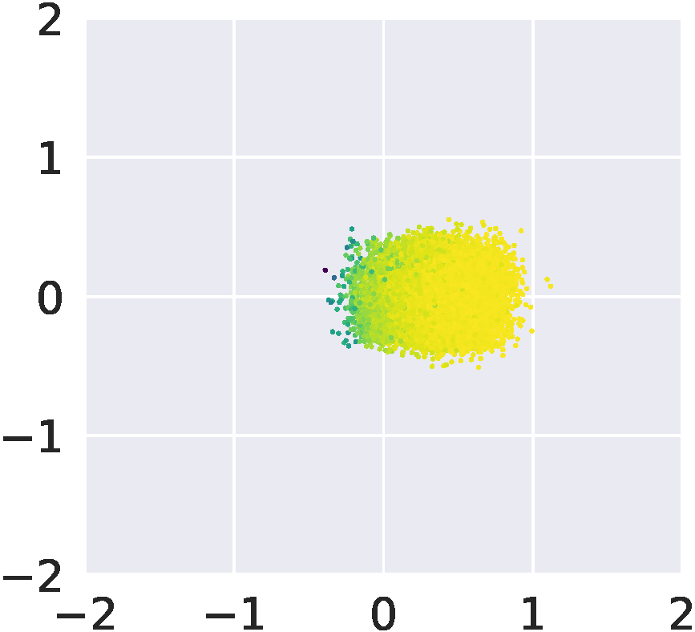

# DuoRec：通过模型级对比学习缓解表示退化

> 论文：Contrastive Learning for Representation Degeneration Problem in Sequential Recommendation，WSDM 2022。[https://doi.org/10.1145/3488560.3498433](https://doi.org/10.1145/3488560.3498433)
> 代码：[https://github.com/RuihongQiu/DuoRec](https://github.com/RuihongQiu/DuoRec)
> 更新记录：2026-11-13 统一论文-本地实验结果对照表为五列长表；2026-11-01 新增笔记；汇总论文主表、消融思路和本地 DuoRec 日志。Beauty 首次运行出现异常高分，单独保留并标记，未混入稳定对比。2026-11-08 §7 补充本地相对论文的提升/下降百分比。

---

# 一、文献阅读

## 1. 问题与核心观察

SASRec 一类序列模型在交叉熵训练下容易把物品嵌入压到狭窄的各向异性区域，物品之间的余弦相似度变高，序列表示与候选物品的区分度下降。DuoRec 将这个问题看成表示空间的均匀性不足，而不是单纯增加模型深度。

## 2. 方法流程

| 环节 | 做法 | 作用 |
|---|---|---|
| 序列编码 | 用 SASRec 编码历史序列，得到序列表示 $z$ | 保留原有下一物品预测能力 |
| 无监督视图 | 对同一序列使用两组独立 Dropout mask，得到 $z_i,z_j$ | 在不改动离散物品顺序的情况下构造语义相近正样本 |
| 有监督视图 | 在 batch 中检索目标物品相同的其他序列，作为 hard positive | 利用“同一目标”提供更强的语义监督 |
| 对比正则 | 分别计算无监督和有监督对比损失，并与推荐损失联合 | 同时改善 alignment 与 uniformity |

无监督视图的 InfoNCE 形式为
$$
\mathcal{L}_{u}=-\log\frac{\exp(\operatorname{sim}(z_i,z_j)/\tau)}{\sum_{k\neq i}\exp(\operatorname{sim}(z_i,z_k)/\tau)}.
$$
有监督视图把目标物品相同的序列放入正样本集合，记为 $P(i)$：
$$
\mathcal{L}_{s}=-\sum_{p\in P(i)}\frac{1}{|P(i)|}\log\frac{\exp(\operatorname{sim}(z_i,z_p)/\tau)}{\sum_{k\neq i}\exp(\operatorname{sim}(z_i,z_k)/\tau)}.
$$
最终目标可写成 $\mathcal{L}=\mathcal{L}_{rec}+\lambda(\mathcal{L}_{u}+\mathcal{L}_{s})$。代码中两类 Dropout 和 $\lambda$ 通过配置文件控制，不能把 UCL、SCL 直接相加的对照误当成完整 DuoRec。

## 3. 论文实验协议

- 数据：Amazon Beauty、Clothing、Sports、ML-1M、Yelp；用户或物品交互少于 5 的记录删除，最大序列长度 50。
- 评测：全物品排序，报告 HR/NDCG@5、@10；论文表中给出 5 次运行的均值和标准差。
- 模型：隐藏维度 64、2 层/2 头 Transformer、batch 256、Adam，学习率 $10^{-3}$；Dropout 和对比权重在论文给定网格中选择。

## 4. 论文主实验结果

| 数据集 | DuoRec HR@10 | DuoRec NDCG@10 | 相对最佳旧基线 HR | 相对最佳旧基线 NDCG |
|---|---:|---:|---:|---:|
| Beauty | 0.0845 | 0.0443 | +19.17% | +39.75% |
| Clothing | 0.0302 | 0.0148 | +11.03% | +12.12% |
| Sports | 0.0498 | 0.0262 | +33.16% | +42.39% |
| ML-1M | 0.2946 | 0.1680 | +49.16% | +81.03% |
| Yelp | 0.0631 | 0.0386 | +79.26% | +108.65% |

论文主表还报告了 HR/NDCG@5；这里先保留最常用于本地复现对齐的 @10。论文的结论是：SCL 提供的同目标 hard positive 比随机裁剪、掩码或重排更稳定，UCL 与 SCL 需要在完整目标下联合使用。

## 5. 论文消融与参数实验

| 实验 | 论文结论 | 本地状态 |
|---|---|---|
| CL4SRec / UCL / SCL / UCL+SCL / DuoRec | UCL 优于传统数据增强；SCL 通常更强；直接相加 UCL+SCL 可能冲突；完整 DuoRec 最好 |  |
| Dropout 比例 | 影响表示均匀性和推荐效果 |  |
| 对比权重 $\lambda$ | 过小约束不足，过大可能损害推荐目标 |  |
| 表示空间可视化 | DuoRec 的奇异值下降更慢，嵌入分布更均匀 |  |

## 6. 本地复现结果

本地入口为 `experiment/DuoRec/run_seq.py`，统一使用 seed=2020、`TO_LS,full`、8:1:1 时间切分、全物品排序，训练 batch=256、Adam、lr=0.001。下表逐次保留日志结果；`DPh/DPa` 是隐藏层/注意力 Dropout。

| 数据集 | 配置（日志日期） | 最佳轮 | valid MRR@10 | test HR@10 | test NDCG@10 | test MRR@10 |
|---|---|---:|---:|---:|---:|---:|
| Beauty | DPh=0.4, DPa=0.4（10-31 13:46） | 26 | 0.8675 | 0.8512 | 0.6231 | 0.5473 |
| Beauty | DPh=0.4, DPa=0.4（10-31 14:32） | 36 | 0.0411 | 0.0870 | 0.0450 | 0.0322 |
| Clothing | DPh=0.5, DPa=0.5（10-31 15:06） | 26 | 0.0110 | 0.0288 | 0.0138 | 0.0092 |
| Sports | DPh=0.5, DPa=0.5（10-31 15:32） | 24 | 0.0231 | 0.0487 | 0.0251 | 0.0178 |
| ML-100K | DPh=0.5, DPa=0.5（10-28 12:22） | 30 | 0.0570 | 0.1400 | 0.0667 | 0.0448 |
| ML-1M | DPh=0.5, DPa=0.5（10-30 13:19） | 33 | 0.0997 | 0.2543 | 0.1362 | 0.1004 |
| ML-1M | DPh=0.1, DPa=0.1（10-30 21:47） | 32 | 0.1429 | 0.3000 | 0.1733 | 0.1346 |
| Yelp | DPh=0.5, DPa=0.5（10-31 15:59） | 72 | 0.0306 | 0.0622 | 0.0384 | 0.0312 |

第一条 Beauty 日志的 test NDCG@10=0.6231，远高于论文值 0.0443，也与同配置的第二次运行相差一个数量级；目前将其视为异常运行，保留日志但不作为主结果。其余 Beauty、Clothing、Sports、ML-1M 和 Yelp 的量级与论文相近。

## 7. 本地与论文差值

以下选用每个数据集量级正常且配置明确的一次运行；ML-1M 选用 Dropout=0.1 的较新结果。差值 = 本地 test NDCG@10 − 论文均值；相对变化 = (本地 − 论文) / 论文 × 100%，正值为提升、负值为下降，均由表中四位小数计算。

| 数据集名 | 指标名 | 论文宣称效果 | 本地实测效果 | 差异百分比 |
|---|---|---:|---:|---:|
| Beauty | NDCG@10 | 0.0443 | 0.0450 | +1.58% |
| Clothing | NDCG@10 | 0.0148 | 0.0138 | −6.76% |
| Sports | NDCG@10 | 0.0262 | 0.0251 | −4.20% |
| ML-1M | NDCG@10 | 0.1680 | 0.1733 | +3.15% |
| Yelp | NDCG@10 | 0.0386 | 0.0384 | −0.52% |

五个数据集中 Beauty、ML-1M 高于论文 +1.58%、+3.15%，Clothing、Sports、Yelp 低于论文 −6.76%、−4.20%、−0.52%，相对偏差都在 7% 以内。这些差值只能用于当前协议下的初步对齐。论文是 5 次均值，本地目前是单 seed 单次运行，尚未进行多 seed、UCL/SCL 消融和参数扫描。

## 8. 后续实验

| 项目 | 结果 |
|---|---|
| 复核 Beauty 异常高分 |  |
| 多随机种子（至少 3 次） |  |
| UCL、SCL、UCL+SCL、完整 DuoRec 消融 |  |
| Dropout 和 $\lambda$ 参数实验 |  |
| 与同一骨干 SASRec 的严格配对对比 |  |
