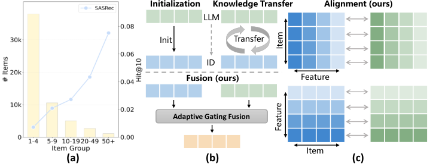
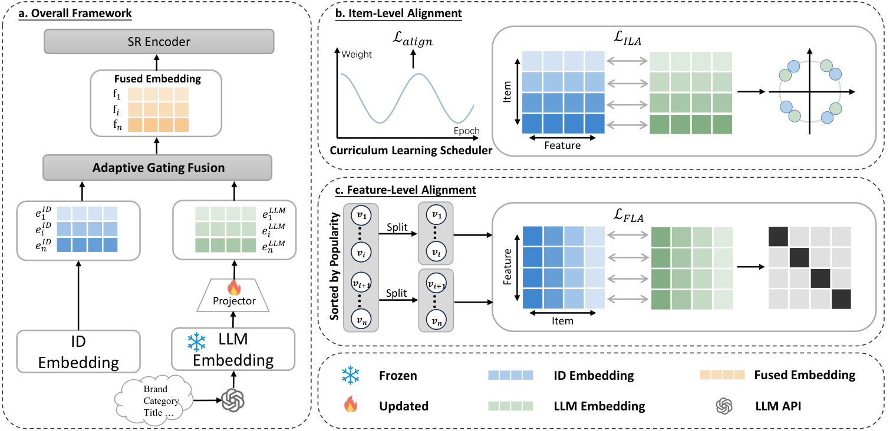
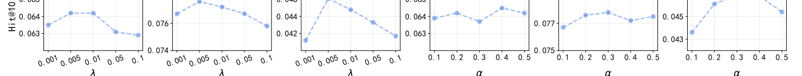
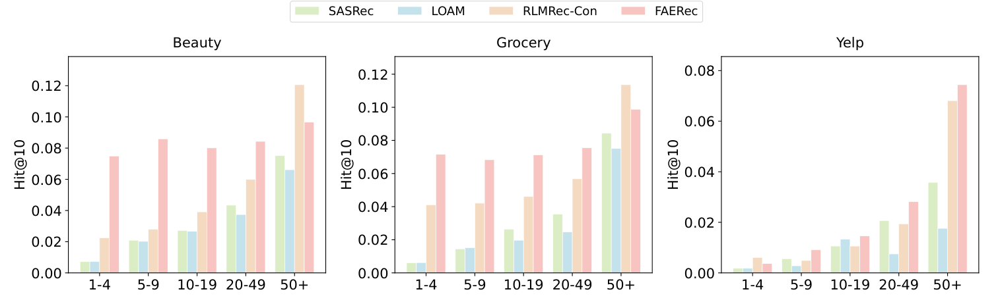
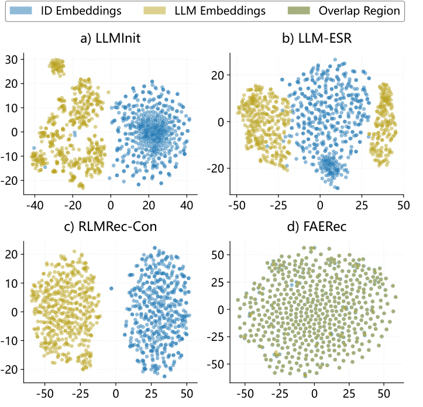

# FAERec：通过语义融合与双层对齐改善尾部物品推荐

> 论文：Fusion and Alignment Enhancement with Large Language Models for Tail-item Sequential Recommendation，SIGIR 2026。[https://doi.org/10.1145/3805712.3809741](https://doi.org/10.1145/3805712.3809741)
> 代码：https://github.com/ZhifuWei/FAERec
> 更新记录：2026-10-22 统一笔记顶部信息格式；保留原有阅读与复现记录，论文结果与本地结果分开。

---
# 一、文献阅读

## 1. 研究背景

序列推荐通过交互学习 ID 嵌入，但长尾物品交互少，难以获得可靠的协同表示。LLM 可以从标题、品牌、类别和描述中提供语义知识。仅用语义初始化 ID，训练后可能丢失语义；仅做跨视图迁移，又未必解决协同与语义空间的结构不一致。对应物品相似并不意味着两套嵌入的特征维度组织也一致，直接融合可能引入冲突。

## 2. 研究目的

同时保留协同与语义信息，并从物品对应关系和特征相关结构两层对齐嵌入，使长尾物品受益，同时兼顾整体准确性与推荐覆盖率。

## 3. 研究问题

1. 如何按物品、按维度融合 ID 与 LLM 嵌入？
2. 物品级对比之外，是否还需对齐特征维度结构？
3. 如何避免热门物品主导特征统计，以及过早的结构约束干扰学习？
4. 长尾收益是否牺牲整体或头部性能，能否推广到多种序列骨干？

以上按原文动机归纳，对应第 5.2–5.8 节实验。

## 4. 研究方法

FAERec 在训练前离线生成并缓存 LLM 物品向量，PCA 降维后初始化 ID。训练时用逐维自适应门控融合 ID 与投影后的语义向量；物品级对比建立同物品跨视图对应；按批内流行度分组后，用 Barlow Twins 风格交叉相关损失建立特征结构一致。余弦课程调度平衡两种对齐，推断改用等权融合。

它增强现有序列模型的物品表征，不要求把推荐输出改成 LLM 文本生成。与 TADA 的交互增强不同，核心改动是嵌入融合和对齐。

## 5. 研究内容（公式分析）

### 5.1 问题定义与头尾划分：第 3 节，式(1)

$$v^*=\arg\max_{v\in\mathcal V}P(v_{|s_u|+1}=v\mid s_u).\tag{1}$$

按物品流行度降序，前 20% **物品**为 $\mathcal V_{head}$，其余为 $\mathcal V_{tail}$。这里的 20% 不是“累计覆盖 20% 交互”。计算流行度所用的数据范围在实现中需核实，复现时应避免使用未来测试交互。

### 5.2 语义提取与投影：第 4.1 节，式(2)

ID 表 $E^{ID}\in\mathbb R^{|\mathcal V|\times d}$ 可训练，原始 LLM 向量离线缓存并冻结。论文选用 text-embedding-ada-002，原始维度示例为 1536，投影器为两层 MLP：

$$e_i^{LLM}=f_\theta(e_{ori,i}^{LLM}).\tag{2}$$

投影参数可训练，不应把“LLM 冻结”理解为语义分支全部冻结。PCA 得到 $d$ 维向量用于初始化 ID，语义分支仍保留高维原始向量及可学习投影，二者作用不同。

原文第 3 页 Beauty 提示模板写作 `rating is <DATE>`，字段与文字不匹配。此处视为原文待核对项，不能悄悄改成评分字段后称完全照搬。所有提示均为论文研究内容，不是对当前助手的指令。

### 5.3 自适应门控融合 AGF：式(3)(4)

$$g_i=\sigma\big(W_2(W_1[e_i^{ID}\oplus e_i^{LLM}]+b_1)+b_2\big),\tag{3}$$

$$f_i=g_i\odot e_i^{ID}+(1-g_i)\odot e_i^{LLM}.\tag{4}$$

$g_i\in[0,1]^d$，每个维度可分别选择协同和语义的比例；$W_1\in\mathbb R^{2d\times2d}$，$W_2\in\mathbb R^{d\times2d}$。原式在两层线性之间没有显式写激活，具体实现需要核对。融合序列 $F_u$ 输入 SASRec、FMLP-Rec 或 LRURec 等骨干得到 $H_u$。

门控按物品嵌入计算，不显式接收用户或时间输入，区别于 DuAF-MAT 的用户/时间感知模态权重。也不应将“尾物品偏向语义”理解为直接按流行度硬编码门控值。

### 5.4 物品级对齐 ILA：第 4.2 节，式(5)

对批内 $K$ 个物品，以同物品 ID/LLM 表示为正对：

$$\mathcal L_{ILA}=-\frac1K\sum_{i=1}^{K}\log\frac{\exp(\operatorname{sim}(e_i^{ID},e_i^{LLM})/\tau)}{\sum_{j=1}^{K}\exp(\operatorname{sim}(e_i^{ID},e_j^{LLM})/\tau)}.\tag{5}$$

$\operatorname{sim}$ 为余弦相似度，分母包含正对。它建立点对点对应，防止把不同物品的两个向量错误拼到一起。批内重复物品是否去重、是否排除 padding 以及正样本是否有多个，应在源码层面确认。

### 5.5 特征级对齐 FLA 与流行度分组：式(6)–(10)

用当前批物品流行度中位数分组：

$$\mathcal V_{Bh}=\{i:p_i\ge p_{median}\},\qquad\mathcal V_{Bl}=\{i:p_i<p_{median}\}.\tag{6}$$

这与全局前 20% 的评价头尾划分不同。中位数分组用于训练统计，若大量物品流行度并列，组大小并不保证严格相等。

在每组内部，沿样本维度标准化两套嵌入：

$$\tilde e_{n,i}^{Bh}=\frac{e_{n,i}^{Bh}-\mu_i^{Bh}}{\sigma_i^{Bh}}.\tag{7}$$

计算跨视图、跨特征的 $d\times d$ 相关矩阵：

$$C_{ij}^{Bh}=\frac{\sum_{s=1}^{S}\tilde e_{s,i}^{ID}\tilde e_{s,j}^{LLM}}{\sqrt{\sum_s(\tilde e_{s,i}^{ID})^2}\sqrt{\sum_s(\tilde e_{s,j}^{LLM})^2}}.\tag{8}$$

$$\mathcal L_{FLA}^{Bh}=\sum_{i=1}^{d}(1-C_{ii}^{Bh})^2+\lambda\sum_{i=1}^{d}\sum_{j\ne i}(C_{ij}^{Bh})^2,\tag{9}$$

$$\mathcal L_{FLA}=\mathcal L_{FLA}^{Bh}+\mathcal L_{FLA}^{Bl}.\tag{10}$$

对角项使同维特征一致，非对角项降低不同维度的冗余。ILA 比较物品之间的对应，FLA 比较特征之间的相关，二者矩阵的维度与含义不同。若某组只有一个样本、为空或某维方差为零，标准化可能失效；原文未明确数值兜底，后续需核对 epsilon、分组回退和样本去重。

### 5.6 课程调度 CLS：式(11)(12)

$$w_i(t)=(w_{max}-w_{min})\frac{1+\cos(2\pi t/T)}2+w_{min},\tag{11}$$

$$\mathcal L_{align}=w_i(t)\mathcal L_{ILA}+(1-w_i(t))\mathcal L_{FLA}.\tag{12}$$

原文从“先建立物品对应，再学习复杂结构”解释课程思想，但式(11)是**周期余弦振荡**，不是整个训练期间单调下降：$t=0,T$ 都回到高值，$t=T/2$ 到低值。是否只用半周期、完整周期或多次振荡必须按源码核实。$w_{min},w_{max},T$ 没有在所附 PDF 中完整指定，也不应默认任意范围都能构成非负损失权重。

### 5.7 推荐训练、联合优化与推断：第 4.3 节，式(13)(14)

原文称使用 BCE，但式(13)的展开式为：

$$\mathcal L_{rec}=\log\sigma(H_u\cdot E_u^+)+\log(1-\sigma(H_u\cdot E_u^-)).\tag{13}
$$

该展开式缺少通常负对数 BCE 的整体负号。若以最小化目标直接实现，会与常规 BCE 方向不符；笔记保留原式并指出差异，实际复现应核对作者损失函数。

$$\mathcal L=\mathcal L_{rec}+\alpha\mathcal L_{align}.\tag{14}$$

推断时原文明示采用 ID 与 LLM 嵌入等权融合，以简化计算。按该描述可写为 $f_i^{infer}=(e_i^{ID}+e_i^{LLM})/2$（笔记整理的未编号表达）。因此训练使用自适应门控，预测时不应默认仍沿用同一门控。缓存的是原始语义向量，投影后的最终向量需随训练权重生成。

### 5.8 覆盖率：第 5.8 节，式(15)

$$\operatorname{Coverage}@K=\frac{|\bigcup_{u\in\mathcal U}L_K(u)|}{|\mathcal V|},\qquad
\operatorname{Tail\_Coverage}@K=\frac{|\bigcup_uL_K^{tail}(u)|}{|\mathcal V_{tail}|}.\tag{15}$$

这是全体用户推荐列表的物品并集覆盖率，重复曝光只计一次。它不等于单个用户列表内相似度多样性，也不同于“推荐中尾物品所占比例”。

## 6. 所作实验与环境、数据集、参数配置

| 项目 | 原文第 5.1 节设置 |
| --- | --- |
| 数据 | Amazon Beauty、Grocery and Gourmet Food；Yelp |
| 预处理 | 评分/评论作为隐式交互，删除少于 3 次交互的账号；最大序列长度 50 |
| 主干 | SASRec、FMLP-Rec、LRURec |
| 对比方法 | CITIES、MELT、LOAM、RLMRec-Con/Gen、LLMInit、LLM-ESR |
| 划分与评价 | 留一法训练/验证/测试，全物品排名，不采样候选 |
| 指标 | H/N@5/10/20；主要数值表列 H/N@10 |
| 优化 | Adam，学习率 0.001，$\beta_1=0.9,\beta_2=0.999$，batch 256 |
| 嵌入维度 | 128；原始 LLM 为 text-embedding-ada-002 |
| 搜索 | $\lambda\in\{0.001,0.005,0.01,0.05,0.1\}$；$\alpha\in\{0.1,0.2,0.3,0.4,0.5\}$ |
| 扩展骨干 | NARM、LightSANs、gMLP |
| 未充分披露 | GPU/软件版本、重复运行与种子、标准差、早停设置及课程周期 |

原文说明排除少交互用户，是因为用户冷启动不属于本研究范围；它针对长尾物品，不能写成验证了所有用户冷启动情形。各论文 Beauty 的用户/物品过滤不同，因此不能直接横向比较本表与 FLAME、TADA 的绝对指标。

### 表 1：数据集统计（原文第 5 页）

| 数据集 | 用户数 | 物品数 | 稀疏度 | 平均长度 |
| --- | ---: | ---: | ---: | ---: |
| Beauty | 52,204 | 57,289 | 99.99% | 7.56 |
| Grocery | 32,126 | 39,264 | 99.98% | 8.57 |
| Yelp | 15,720 | 11,383 | 99.89% | 12.23 |

## 7. 完整实验结果表格

### 表 2：主实验（原文第 6 页）

按主干及数据集拆分，保留全部原始数值与 Impr. 行。Overall/Tail 为整体/尾物品测试子集；指标均为 @10。Impr. 相对各列最佳基线，允许为负，不删去不利结果。

#### SASRec / Beauty

| 方法 | 整体 H@10 | 整体 N@10 | 尾部 H@10 | 尾部 N@10 |
| --- | ---: | ---: | ---: | ---: |
| Base | 0.0331 | 0.0180 | 0.0113 | 0.0072 |
| CITIES | 0.0305 | 0.0159 | 0.0106 | 0.0064 |
| LOAM | 0.0300 | 0.0158 | 0.0115 | 0.0076 |
| MELT | 0.0178 | 0.0088 | 0.0001 | 0.0000 |
| RLMRec-Con | 0.0521 | 0.0287 | 0.0239 | 0.0132 |
| RLMRec-Gen | 0.0439 | 0.0242 | 0.0122 | 0.0066 |
| LLMInit | 0.0377 | 0.0200 | 0.0103 | 0.0064 |
| LLM-ESR | 0.0269 | 0.0140 | 0.0049 | 0.0028 |
| FAERec | 0.0642 | 0.0372 | 0.0633 | 0.0368 |
| Impr. | 23.22% | 29.62% | 164.85% | 178.79% |

#### SASRec / Grocery

| 方法 | 整体 H@10 | 整体 N@10 | 尾部 H@10 | 尾部 N@10 |
| --- | ---: | ---: | ---: | ---: |
| Base | 0.0332 | 0.0168 | 0.0086 | 0.0055 |
| CITIES | 0.0286 | 0.0144 | 0.0074 | 0.0045 |
| LOAM | 0.0285 | 0.0148 | 0.0089 | 0.0059 |
| MELT | 0.0208 | 0.0101 | 0.0004 | 0.0003 |
| RLMRec-Con | 0.0607 | 0.0344 | 0.0418 | 0.0248 |
| RLMRec-Gen | 0.0471 | 0.0252 | 0.0119 | 0.0062 |
| LLMInit | 0.0434 | 0.0225 | 0.0087 | 0.0049 |
| LLM-ESR | 0.0298 | 0.0157 | 0.0051 | 0.0027 |
| FAERec | 0.0776 | 0.0446 | 0.0718 | 0.0421 |
| Impr. | 27.84% | 29.65% | 71.77% | 69.76% |

#### SASRec / Yelp

| 方法 | 整体 H@10 | 整体 N@10 | 尾部 H@10 | 尾部 N@10 |
| --- | ---: | ---: | ---: | ---: |
| Base | 0.0240 | 0.0113 | 0.0060 | 0.0036 |
| CITIES | 0.0240 | 0.0111 | 0.0049 | 0.0024 |
| LOAM | 0.0122 | 0.0055 | 0.0060 | 0.0031 |
| MELT | 0.0382 | 0.0188 | 0.0004 | 0.0002 |
| RLMRec-Con | 0.0406 | 0.0212 | 0.0073 | 0.0041 |
| RLMRec-Gen | 0.0391 | 0.0198 | 0.0051 | 0.0021 |
| LLMInit | 0.0374 | 0.0198 | 0.0044 | 0.0018 |
| LLM-ESR | 0.0412 | 0.0209 | 0.0040 | 0.0019 |
| FAERec | 0.0461 | 0.0225 | 0.0090 | 0.0047 |
| Impr. | 11.89% | 6.13% | 23.29% | 14.63% |

#### FMLP-Rec / Beauty

| 方法 | 整体 H@10 | 整体 N@10 | 尾部 H@10 | 尾部 N@10 |
| --- | ---: | ---: | ---: | ---: |
| Base | 0.0277 | 0.0153 | 0.0066 | 0.0047 |
| CITIES | 0.0238 | 0.0134 | 0.0062 | 0.0044 |
| LOAM | 0.0225 | 0.0119 | 0.0057 | 0.0044 |
| MELT | 0.0268 | 0.0143 | 0.0053 | 0.0030 |
| RLMRec-Con | 0.0458 | 0.0262 | 0.0360 | 0.0217 |
| RLMRec-Gen | 0.0533 | 0.0305 | 0.0269 | 0.0151 |
| LLMInit | 0.0383 | 0.0205 | 0.0096 | 0.0061 |
| LLM-ESR | 0.0224 | 0.0118 | 0.0051 | 0.0031 |
| FAERec | 0.0622 | 0.0361 | 0.0645 | 0.0379 |
| Impr. | 16.70% | 18.36% | 79.17% | 74.65% |

#### FMLP-Rec / Grocery

| 方法 | 整体 H@10 | 整体 N@10 | 尾部 H@10 | 尾部 N@10 |
| --- | ---: | ---: | ---: | ---: |
| Base | 0.0285 | 0.0146 | 0.0053 | 0.0037 |
| CITIES | 0.0252 | 0.0136 | 0.0048 | 0.0032 |
| LOAM | 0.0221 | 0.0111 | 0.0048 | 0.0036 |
| MELT | 0.0242 | 0.0122 | 0.0026 | 0.0014 |
| RLMRec-Con | 0.0585 | 0.0322 | 0.0403 | 0.0229 |
| RLMRec-Gen | 0.0550 | 0.0304 | 0.0285 | 0.0166 |
| LLMInit | 0.0406 | 0.0208 | 0.0091 | 0.0053 |
| LLM-ESR | 0.0274 | 0.0144 | 0.0081 | 0.0046 |
| FAERec | 0.0749 | 0.0425 | 0.0737 | 0.0426 |
| Impr. | 28.03% | 31.99% | 82.88% | 86.03% |

#### FMLP-Rec / Yelp

| 方法 | 整体 H@10 | 整体 N@10 | 尾部 H@10 | 尾部 N@10 |
| --- | ---: | ---: | ---: | ---: |
| Base | 0.0153 | 0.0072 | 0.0029 | 0.0014 |
| CITIES | 0.0153 | 0.0077 | 0.0015 | 0.0007 |
| LOAM | 0.0115 | 0.0055 | 0.0022 | 0.0011 |
| MELT | 0.0242 | 0.0119 | 0.0033 | 0.0013 |
| RLMRec-Con | 0.0232 | 0.0114 | 0.0090 | 0.0048 |
| RLMRec-Gen | 0.0178 | 0.0087 | 0.0026 | 0.0014 |
| LLMInit | 0.0265 | 0.0130 | 0.0038 | 0.0019 |
| LLM-ESR | 0.0308 | 0.0159 | 0.0040 | 0.0017 |
| FAERec | 0.0292 | 0.0149 | 0.0097 | 0.0051 |
| Impr. | -5.19% | -6.29% | 7.78% | 6.25% |

#### LRURec / Beauty

| 方法 | 整体 H@10 | 整体 N@10 | 尾部 H@10 | 尾部 N@10 |
| --- | ---: | ---: | ---: | ---: |
| Base | 0.0349 | 0.0192 | 0.0108 | 0.0069 |
| CITIES | 0.0330 | 0.0175 | 0.0101 | 0.0062 |
| LOAM | 0.0302 | 0.0160 | 0.0110 | 0.0073 |
| MELT | 0.0242 | 0.0120 | 0.0018 | 0.0008 |
| RLMRec-Con | 0.0372 | 0.0205 | 0.0117 | 0.0073 |
| RLMRec-Gen | 0.0418 | 0.0229 | 0.0098 | 0.0058 |
| LLMInit | 0.0383 | 0.0205 | 0.0096 | 0.0061 |
| LLM-ESR | 0.0277 | 0.0144 | 0.0045 | 0.0024 |
| FAERec | 0.0644 | 0.0374 | 0.0617 | 0.0357 |
| Impr. | 54.07% | 63.32% | 427.35% | 389.04% |

#### LRURec / Grocery

| 方法 | 整体 H@10 | 整体 N@10 | 尾部 H@10 | 尾部 N@10 |
| --- | ---: | ---: | ---: | ---: |
| Base | 0.0351 | 0.0184 | 0.0080 | 0.0046 |
| CITIES | 0.0335 | 0.0175 | 0.0077 | 0.0047 |
| LOAM | 0.0296 | 0.0150 | 0.0081 | 0.0050 |
| MELT | 0.0251 | 0.0125 | 0.0008 | 0.0004 |
| RLMRec-Con | 0.0602 | 0.0335 | 0.0239 | 0.0135 |
| RLMRec-Gen | 0.0458 | 0.0249 | 0.0070 | 0.0041 |
| LLMInit | 0.0451 | 0.0234 | 0.0089 | 0.0051 |
| LLM-ESR | 0.0333 | 0.0173 | 0.0054 | 0.0030 |
| FAERec | 0.0759 | 0.0434 | 0.0675 | 0.0382 |
| Impr. | 26.08% | 29.55% | 182.43% | 182.96% |

#### LRURec / Yelp

| 方法 | 整体 H@10 | 整体 N@10 | 尾部 H@10 | 尾部 N@10 |
| --- | ---: | ---: | ---: | ---: |
| Base | 0.0288 | 0.0144 | 0.0033 | 0.0015 |
| CITIES | 0.0247 | 0.0115 | 0.0031 | 0.0013 |
| LOAM | 0.0248 | 0.0119 | 0.0030 | 0.0015 |
| MELT | 0.0387 | 0.0187 | 0.0004 | 0.0002 |
| RLMRec-Con | 0.0344 | 0.0172 | 0.0035 | 0.0020 |
| RLMRec-Gen | 0.0394 | 0.0202 | 0.0031 | 0.0013 |
| LLMInit | 0.0415 | 0.0211 | 0.0057 | 0.0026 |
| LLM-ESR | 0.0384 | 0.0194 | 0.0029 | 0.0013 |
| FAERec | 0.0433 | 0.0219 | 0.0086 | 0.0045 |
| Impr. | 4.34% | 3.79% | 50.88% | 73.08% |

原文脚注称严格使用 MELT 作者实现并调参后仍观察到异常低值，其他论文也有类似现象。这是作者的实验说明，不能据此把表中 MELT 极低指标推广为该方法在所有设置下的固有表现。

### 表 3：Beauty 消融（原文第 7 页）

AGF 为自适应门控融合；ILA/FLA 为物品级/特征级对齐；CLS 为课程调度；PG 为特征对齐时的流行度分组。

#### SASRec

| 变体 | 整体 H@10 | 整体 N@10 | 尾部 H@10 | 尾部 N@10 |
| --- | ---: | ---: | ---: | ---: |
| FAERec | 0.0642 | 0.0372 | 0.0633 | 0.0368 |
| w/o AGF | 0.0534 | 0.0267 | 0.0359 | 0.0182 |
| w/o ILA | 0.0568 | 0.0318 | 0.0473 | 0.0260 |
| w/o FLA | 0.0626 | 0.0365 | 0.0603 | 0.0355 |
| w/o CLS | 0.0554 | 0.0309 | 0.0436 | 0.0239 |
| w/o PG | 0.0636 | 0.0367 | 0.0601 | 0.0350 |
| Base | 0.0331 | 0.0180 | 0.0113 | 0.0072 |

#### FMLP-Rec

| 变体 | 整体 H@10 | 整体 N@10 | 尾部 H@10 | 尾部 N@10 |
| --- | ---: | ---: | ---: | ---: |
| FAERec | 0.0622 | 0.0361 | 0.0645 | 0.0379 |
| w/o AGF | 0.0624 | 0.0355 | 0.0516 | 0.0291 |
| w/o ILA | 0.0585 | 0.0343 | 0.0567 | 0.0331 |
| w/o FLA | 0.0597 | 0.0353 | 0.0630 | 0.0376 |
| w/o CLS | 0.0576 | 0.0330 | 0.0538 | 0.0305 |
| w/o PG | 0.0618 | 0.0357 | 0.0642 | 0.0373 |
| Base | 0.0277 | 0.0153 | 0.0066 | 0.0047 |

#### LRURec

| 变体 | 整体 H@10 | 整体 N@10 | 尾部 H@10 | 尾部 N@10 |
| --- | ---: | ---: | ---: | ---: |
| FAERec | 0.0644 | 0.0374 | 0.0617 | 0.0357 |
| w/o AGF | 0.0561 | 0.0289 | 0.0369 | 0.0185 |
| w/o ILA | 0.0519 | 0.0289 | 0.0353 | 0.0192 |
| w/o FLA | 0.0632 | 0.0369 | 0.0595 | 0.0346 |
| w/o CLS | 0.0529 | 0.0292 | 0.0401 | 0.0218 |
| w/o PG | 0.0636 | 0.0369 | 0.0583 | 0.0339 |
| Base | 0.0349 | 0.0192 | 0.0108 | 0.0069 |

### 表 4：更多骨干（原文第 8 页）

#### Beauty

| 骨干 | 整体 H@10 | 整体 N@10 | 尾部 H@10 | 尾部 N@10 |
| --- | ---: | ---: | ---: | ---: |
| NARM | 0.0197 | 0.0097 | 0.0017 | 0.0010 |
| NARM + FAERec | 0.0429 | 0.0226 | 0.0331 | 0.0176 |
| LightSANs | 0.0252 | 0.0143 | 0.0059 | 0.0046 |
| LightSANs + FAERec | 0.0597 | 0.0353 | 0.0614 | 0.0364 |
| gMLP | 0.0271 | 0.0163 | 0.0076 | 0.0058 |
| gMLP + FAERec | 0.0571 | 0.0325 | 0.0547 | 0.0311 |

#### Grocery

| 骨干 | 整体 H@10 | 整体 N@10 | 尾部 H@10 | 尾部 N@10 |
| --- | ---: | ---: | ---: | ---: |
| NARM | 0.0219 | 0.0114 | 0.0016 | 0.0008 |
| NARM + FAERec | 0.0540 | 0.0286 | 0.0400 | 0.0213 |
| LightSANs | 0.0291 | 0.0150 | 0.0052 | 0.0038 |
| LightSANs + FAERec | 0.0714 | 0.0406 | 0.0727 | 0.0425 |
| gMLP | 0.0299 | 0.0157 | 0.0058 | 0.0040 |
| gMLP + FAERec | 0.0694 | 0.0383 | 0.0622 | 0.0340 |

#### Yelp

| 骨干 | 整体 H@10 | 整体 N@10 | 尾部 H@10 | 尾部 N@10 |
| --- | ---: | ---: | ---: | ---: |
| NARM | 0.0387 | 0.0195 | 0.0015 | 0.0009 |
| NARM + FAERec | 0.0456 | 0.0223 | 0.0051 | 0.0021 |
| LightSANs | 0.0167 | 0.0080 | 0.0024 | 0.0016 |
| LightSANs + FAERec | 0.0254 | 0.0125 | 0.0115 | 0.0057 |
| gMLP | 0.0203 | 0.0093 | 0.0013 | 0.0007 |
| gMLP + FAERec | 0.0337 | 0.0169 | 0.0099 | 0.0048 |

### 表 5：Beauty 覆盖率（原文第 9 页）

| 方法 | SASRec Cov@10 | SASRec TCov@10 | FMLP-Rec Cov@10 | FMLP-Rec TCov@10 | LRURec Cov@10 | LRURec TCov@10 |
| --- | ---: | ---: | ---: | ---: | ---: | ---: |
| Base | 0.6972 | 0.6266 | 0.5273 | 0.4267 | 0.6679 | 0.5920 |
| LOAM | 0.6419 | 0.5634 | 0.5092 | 0.4057 | 0.6768 | 0.6036 |
| RLMRec-Con | 0.5019 | 0.4141 | 0.7010 | 0.6442 | 0.5477 | 0.4554 |
| LLM-ESR | 0.3513 | 0.2251 | 0.5176 | 0.4215 | 0.4075 | 0.2831 |
| FAERec | 0.8538 | 0.8249 | 0.8571 | 0.8298 | 0.8612 | 0.8315 |

Cov/TCov 的数值为 0–1 比例。SASRec 上 FAERec 的尾物品覆盖率为 0.8249，表示尾物品集合中 82.49% 至少出现在一个用户的前 10 推荐列表，并不是 82.49% 的单次推荐一定是尾物品。

### 图 3：对齐权重敏感性（原文第 7 页）

采用 SASRec，原文报告适中的 $\lambda\in\{0.005,0.01\}$ 与 $\alpha\in\{0.3,0.4\}$ 较好；过强对齐可能损害推荐目标。没有逐点表格，不估算每个曲线坐标的小数值。

### 图 4：物品流行度分组（原文第 8 页）

分组为 1–4、5–9、10–19、20–49、50+ 次交互。本方法在极稀疏组受益较多；原文明示在 50+ 热门组略逊于 RLMRec-Con。该划分又不同于全局前 20% 与训练中位数组，三种分组不能混写。

### 图 5：两种嵌入的可视化（原文第 9 页）

相同采样物品的两空间在 FAERec 下显示更接近的分布模式。它是定性支持，不能把二维重叠直接理解成高维空间完全等同，也不能用 t-SNE 单独证明推荐提升的原因。

## 8. 结果分析

主表的 18 个尾部 H/N@10 结果均最优，优势尤其集中在 Beauty/Grocery。SASRec/Beauty 的尾部 H@10 从最佳基线 0.0239 到 0.0633，相对提升 164.85%；LRURec/Beauty 从 0.0117 到 0.0617，提升 427.35%。高相对增幅需结合较低的基线绝对值一起理解。

**整体结果并非全部最优。** FMLP-Rec/Yelp 的整体 H@10 为 0.0292，低于 LLM-ESR 的 0.0308；N@10 为 0.0149，低于 0.0159，原表分别记 −5.19%、−6.29%。主表共 36 项准确性指标，34 项最好，2 项整体指标落后。这与头尾兼顾存在取舍的讨论一致。

移除物品级对齐和课程调度会明显损害尾部。例如 SASRec/Beauty 尾 H@10 从 0.0633 分别降至 0.0473、0.0436。特征级对齐收益较小但多数指标为正；不能写成每个组件在每项指标上都不可替代：FMLP-Rec 的 w/o AGF 整体 H@10 为 0.0624，略高于完整模型的 0.0622。原文未给随机方差，不宜把这一微小差别解释为稳定规律。

表 4 支持跨骨干泛化，表 5 支持推荐目录覆盖增加。与 HERec 的双曲几何及探索控制不同，FAERec 从协同/语义表征一致性改善尾部与覆盖率；Coverage 与 HERec 的列表多样性、Shannon 熵等指标不属于同一评价口径。

# 二、代码复现

## 1. 环境配置与运行

原文给出 [官方仓库地址](https://github.com/ZhifuWei/FAERec)。当前工作区无对应源码目录；本次未联网核实仓库现状，未调用嵌入 API、安装环境或启动训练。原文未完整披露软件/GPU 配置，不能照抄其他论文的环境作为已验证设置。

后续应固定代码版本，先读取 README 与依赖清单，确认原始文本特征、缓存及物品 ID 映射，再决定是否需要重新生成嵌入；具体运行命令须以真实入口为依据。

## 2. 源代码分析：公式或模块对应的代码

| 论文内容 | 等待源码后的核查点 |
| --- | --- |
| 语义缓存、PCA 初始化 | item ID 对齐，padding 排除，降维拟合数据范围 |
| 式(2)–(4) | 原始 LLM 冻结、投影与 ID 可训练，逐维门控形状 |
| 式(5) | 批内物品去重、正负掩码、余弦温度 |
| 式(6)–(10) | 批内中位数分组、并列/空组、标准差及相关归一化 epsilon |
| 式(11)(12) | 周期/半周期、上下限、权重与 epoch 对应 |
| 式(13)(14) | 实际 BCE 符号、负采样及对齐损失的量级 |
| 推断 | 训练门控切换为等权融合，候选物品表示与历史输入一致 |
| 式(15) | 全用户列表求并集、尾物品分母、跨 batch 累计 |

此表未提供虚构文件或函数定位。数据流应为：物品属性 → 冻结语义缓存＋PCA 初始化 ID → 可训练投影/ID/门控 → 序列编码 → 推荐损失，同时执行物品与特征对齐 → 训练后等权融合 → 全排序与覆盖率评价。

## 3. bug 检查及修复

尚无源码级检查及修复。优先核对原文 BCE 符号、课程调度、空组及零方差、重复物品假负样本、全局流行度是否泄漏未来，以及训练/推断融合方式。原文公式疑点不是已确认的代码 bug。

## 4. 代码修改及优化

当前没有代码修改。后续可缓存固定特征与训练结束后的等权融合表，避免重复投影；分别记录 ILA/FLA 及课程权重、头尾结果和覆盖率，保存 PCA、ID 映射、完整检查点和配置。跨模型比较应把 API 准备成本与训练/推断成本分别列出。

## 5. 实验结果复现

| 实验 | 当前状态 |
| --- | --- |
| 三主干、三数据集主表 | 未开展 |
| Beauty 五类消融 | 未开展 |
| λ/α 扫描及流行度分组 | 未开展 |
| 扩展 NARM/LightSANs/gMLP | 未开展 |
| 目录/尾物品覆盖率 | 未开展 |

## 6. 结果对比及分析

复现时先对齐数据规模、全局头尾定义与全物品排名，整体和尾部结果分别报告，并保留 Yelp 整体落后的情况。需用多种子评估消融中的微小差异，补记标准差及模型选择依据；覆盖率应使用同一用户集合和候选库，避免由于推荐目录或用户规模改变而产生不可比增幅。
