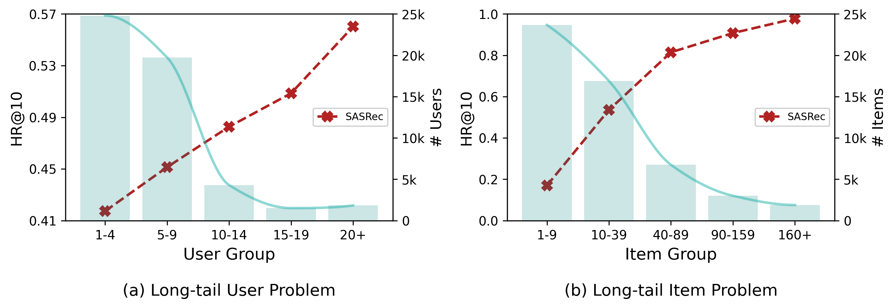

# FCRLLM：通过翻转课堂式对齐改善长尾序列推荐

> 论文：FCRLLM: Aligning LLM with Collaborative Filtering for Long-tailed Sequential Recommendation，WWW 2026。[https://doi.org/10.1145/3774904.3792565](https://doi.org/10.1145/3774904.3792565)
> 代码：无
> 更新记录：2026-11-01 新增笔记；整理双流表示、FlipClass 能量对齐和头尾用户/物品结果。

---

# 一、文献阅读

## 1. 问题

协同过滤对头部物品有足够更新，但尾部物品交互稀疏；LLM 文本嵌入能补充语义，却和协同空间的尺度、方向及训练动态不同。FCRLLM 将两类表示放进学生/教师双流，并让教师随学生注意力动态更新。

## 2. 方法

| 模块 | 输入 | 作用 |
|---|---|---|
| 协同流 | ID 与交互序列 | 学习用户-物品协同信号 |
| 语义流 | LLM item embedding | 为尾部物品提供文本先验 |
| ST alignment | 协同 query、语义 key/value | 用语义教师指导协同学生 |
| CT alignment | 语义 query、协同 key/value | 反向把协同信号传回语义流 |
| FlipClass | 能量函数 + teacher update | 根据 student attention 翻转教师关注位置 |

能量项使用 Hopfield 风格的 query-key 相互作用，教师更新由注意力权重和更新率控制；最终将推荐损失与 ST/CT 对齐损失联合训练。该机制不是静态 cosine 蒸馏，而是随查询序列变化的双向对齐。

## 3. 论文协议与结果

论文在 Yelp、Fashion、Beauty 上使用 GRU4Rec/SASRec，最大序列长 200、维度 64、batch 128、Adam 学习率 0.001；每个用户从未交互物品中随机采样 100 个负例，报告 H@10/N@10，并拆分头/尾物品和用户。

| 数据集/骨干 | 模型 | Overall H/N@10 | Tail item H/N@10 | Tail user H/N@10 |
|---|---|---|---|---|
| Beauty/GRU4Rec | FCRLLM | 0.5253 / 0.3509 | 0.1623 / 0.0940 | 0.5169 / 0.3418 |
| Beauty/SASRec | FCRLLM | 0.5997 / 0.4098 | 0.2467 / 0.1350 | 0.5885 / 0.4023 |
| Yelp/SASRec | FCRLLM | 0.6748 / 0.4262 | 0.2136 / 0.0977 | 0.6736 / 0.4268 |
| Fashion/SASRec | FCRLLM | 0.5814 / 0.4881 | 0.1312 / 0.0649 | 0.5044 / 0.3920 |

Beauty 的消融表明，移除 FlipClass 或任一 ST/CT 方向都会下降；FlipClass 也优于 cosine 和 KL 对齐。论文没有提供本地可复现结果，本笔记不填本地数值。

## 4. 待补实验

| 项目 | 结果 |
|---|---|
| 本地复现 |  |
| ST/CT/FlipClass 消融 |  |
| 语义嵌入模型和对齐权重扫描 |  |
