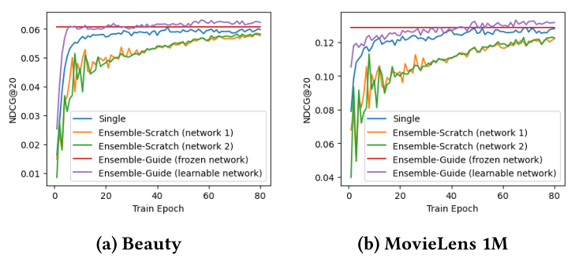
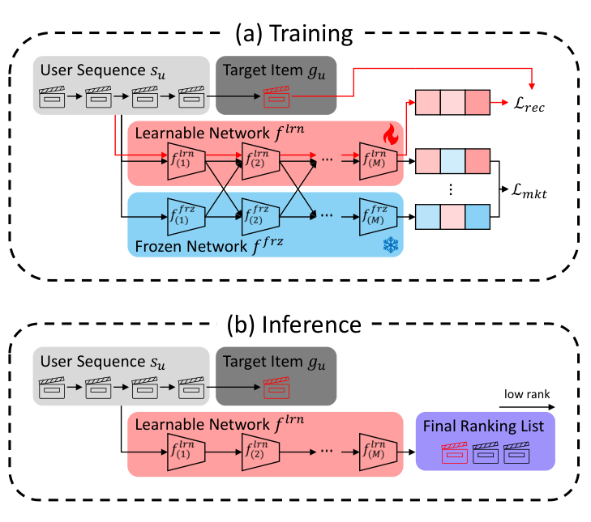
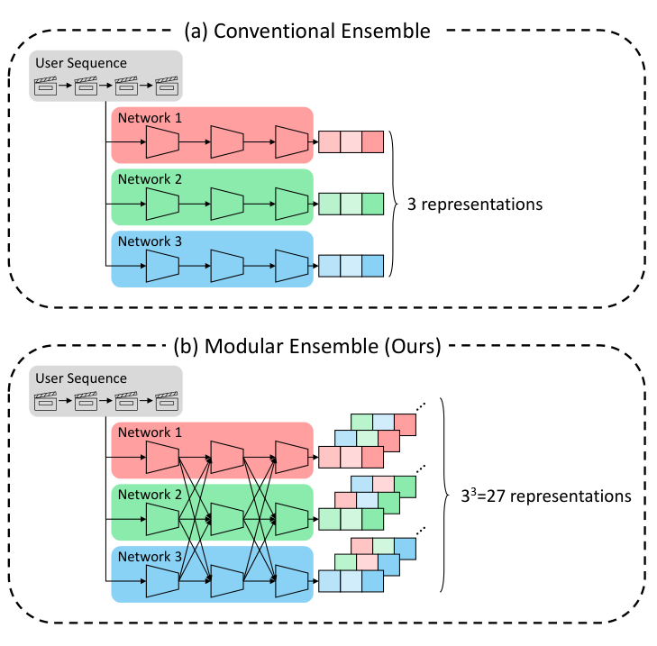
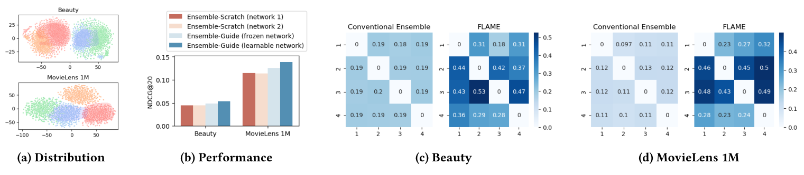
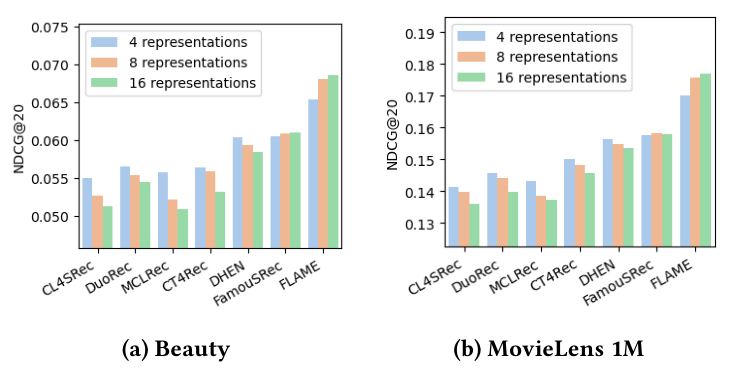
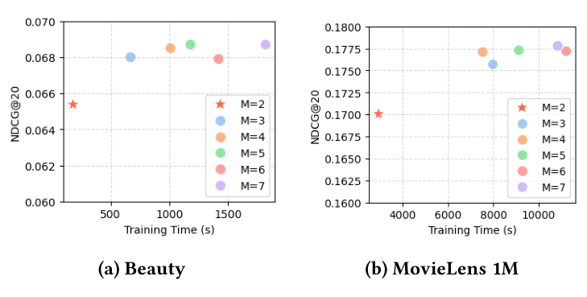
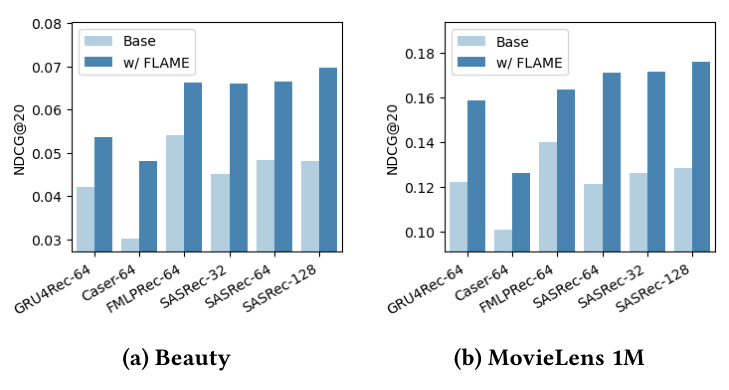
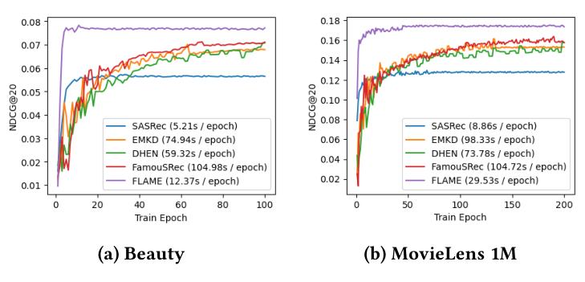
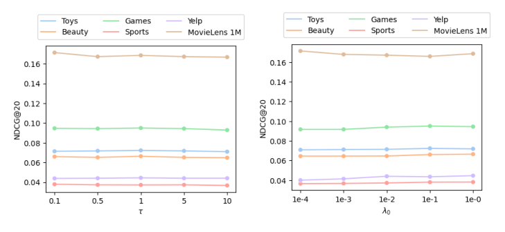

# FLAME：将集成多样性压缩到单网络实现高效序列推荐

> 论文：FLAME: Condensing Ensemble Diversity into a Single Network for Efficient Sequential Recommendation，SIGIR 2026。[https://doi.org/10.1145/3805712.3809560](https://doi.org/10.1145/3805712.3809560)
> 代码：https://github.com/woo-joo/FLAME_SIGIR26
> 更新记录：2026-11-13 统一论文-本地实验结果对照表为五列长表；2026-10-22 统一笔记顶部信息格式；保留原有阅读与复现记录，论文结果与本地结果分开。

---
# 一、文献阅读

## 1. 研究背景



**图 1：单网络与两种集成策略的训练曲线**（英文原文 PDF 第 2 页）。 同时观察收敛速度、训练稳定性及冻结网络对可学习网络的引导效果。

序列推荐根据用户按时间排列的历史物品预测下一次交互。单一模型可能难以覆盖不同用户行为模式；多模型集成能提高表征多样性，却需要多个模型参与训练和推理，部署成本较高。如果多个随机初始化模型从训练初期便互相传递知识，还会将不可靠表示作为监督，造成波动和慢收敛。论文图 1 对比单 SASRec、两个模型从头互学、冻结预训练模型引导另一个模型，展示了这个问题。

## 2. 研究目的

用两个模型在训练期间产生多样且可靠的序列表征，并把这种集成收益凝聚到其中一个可学习模型，使推理只运行单个模型。目标同时覆盖推荐精度、训练稳定性与推理效率。

## 3. 研究问题

1. 能否从同一网络内部的不同模块组合产生比传统网络级集成更丰富的表征？
2. 预训练后冻结的网络能否稳定引导另一个网络，避免从头互学的噪声监督？
3. 如何在多条模块路径之间做有效知识迁移，同时防止高度相似的路径主导损失？
4. 能否仅保留可学习网络推理，并在多个数据集上超过通用、对比学习和集成基线？

## 4. 研究方法



**图 4：FLAME 的训练和单网络推理流程**（英文原文 PDF 第 5 页）。 训练时组合冻结网络与可学习网络的子模块，并进行推荐学习和表示对齐；推理时只保留可学习网络。

FLAME 的全称为 **Frozen and Learnable networks with Aligned Modular Ensemble**。训练时使用一个预训练且冻结的网络和一个从头训练的网络，把每个网络拆为多个可替换子模块。每一层选择冻结或可学习子模块，得到指数数量的计算路径；同一用户的不同路径表征作为正对、批内其他用户作为负对，进行带相似度权重的对比对齐。可学习网络还独立承担下一物品预测，且对比损失权重随训练退火。推理只使用完整的可学习网络。

## 5. 研究内容（公式分析）

### 5.1 问题定义与研究动机（论文第 2–3 节）

给定用户序列 $s_u=[i_{u,1},\ldots,i_{u,|s_u|}]$，下一物品任务为 $\arg\max_{i\in\mathcal I}p(i_{u,|s_u|+1}=i\mid s_u)$（式 1）。常规集成令 $N$ 个完整网络分别生成 $\tilde h_u^n$，各自执行推荐任务并通过成对损失互相传递知识：

$$\mathcal L_{ens}=\sum_{u\in\mathcal U}\left[\sum_{n=1}^{N}\mathcal L_{rec}(u;\tilde h_u^n)+\mathcal L_{mkt}(u;\tilde h_u^1,\ldots,\tilde h_u^N)\right],\tag{2}$$

$$\mathcal L_{mkt}=\sum_{n_1\ne n_2}\mathcal L_{pair}(\tilde h_u^{n_1},\tilde h_u^{n_2}).\tag{3}$$

其训练与推理成本通常随完整网络数上升。论文的两个观察是：同一网络内部模块也会捕获不同模式；冻结已训练网络能给新网络提供更可靠的训练信号。论文图 3 用成对独占命中率 PER 衡量两种表征命中用户集合的互补性，形式为 $\mathrm{PER}(h_i,h_j)=|H_i\setminus H_j|/|H_i|$，数值越高代表两者命中用户越不重叠。

默认骨干 SASRec 将长度 $T$ 的输入序列左填充或截断后，叠加物品嵌入 $I$ 与位置嵌入 $P$：$e_u=[I_{i_{u,1}}+P_1,\ldots,I_{i_{u,T}}+P_T]\in\mathbb R^{T\times d}$（式 4），再用 $L$ 层 Transformer 逐层编码 $H_u^l=\mathrm{Trm}_l(H_u^{l-1})$（式 5）。

### 5.2 模块化集成（论文 4.1，式 6–7）



**图 2：传统集成与模块化集成的表示组合**（英文原文 PDF 第 3 页）。 传统集成由 N 个网络产生 N 个表示；将每个网络拆为 M 个子模块后，跨网络组合可产生 N^M 个表示。

设冻结网络为 $f_{frz}$、可学习网络为 $f_{lrn}$。两者各拆为 $M$ 个子模块，原始路径是同一网络各模块顺序复合：

$$f_{frz}(s_u)=f_{frz}^{(M)}\circ\cdots\circ f_{frz}^{(1)}(s_u)=h_u^{frz},\quad f_{lrn}(s_u)=f_{lrn}^{(M)}\circ\cdots\circ f_{lrn}^{(1)}(s_u)=h_u^{lrn}.\tag{6}$$

在每个子模块位置，从冻结或可学习网络中选一个，路径 $p=(p_1,\ldots,p_M)\in\{frz,lrn\}^M$ 产生

$$\tilde h_u^p=f_{p_M}^{(M)}\circ\cdots\circ f_{p_1}^{(1)}(s_u),\qquad |\mathcal P|=2^M.\tag{7}$$

默认 $M=2$，分别是**物品及位置嵌入模块**、**序列编码模块**。两个完整网络便得到 FF、FL、LF、LL 四条路径（字母分别指该阶段选 Frozen 或 Learnable）。其中 FF 完全冻结；其余三条含可学习模块并接受对齐信号。论文图 2 表明，相比相同网络数的传统集成，交换模块能扩大表征覆盖范围。$2^M$ 是**计算路径/表征数**，不是需要额外部署的完整网络数；训练计算量仍会随路径数增加。

### 5.3 引导式互学习（论文 4.2，式 8–11）



**图 3：表示多样性、单网络可靠性与 PER 互补性**（英文原文 PDF 第 4 页）。 四组子图分别比较表示分布、各单网络性能，以及 Beauty 和 MovieLens 1M 上的 PER 图。

同一用户的不同模块路径为正对，批内其他用户路径为负对。若无权重，所有路径对的 InfoNCE 之和为

$$\mathcal L_{cl}(u)=\sum_{\{p,q\}\subset\mathcal P}\mathcal L_{nce}(\tilde h_u^p,\tilde h_u^q),\tag{8}$$

$$\mathcal L_{nce}(\tilde h_u^p,\tilde h_u^q)=-\log\frac{\exp(\tilde h_u^p\cdot\tilde h_u^q/\tau)}{\sum_{u'\in\mathcal B}\exp(\tilde h_u^p\cdot\tilde h_{u'}^q/\tau)},\tag{9}$$

其中 $\tau$ 是温度，$\mathcal B$ 是小批量。不同路径可能共享子模块，因此相似路径对若等权处理，容易主导优化。论文根据**批内平均点积**给路径对分配权重，越相似，权重越小：

$$\mathcal L_{mkt}(u)=\sum_{\{p,q\}\subset\mathcal P}w_{p,q}\mathcal L_{nce}(\tilde h_u^p,\tilde h_u^q),\tag{10}$$

$$\mathrm{sim}_{p,q}=\frac1{|\mathcal B|}\sum_{u\in\mathcal B}\tilde h_u^p\cdot\tilde h_u^q,\qquad w_{p,q}=\frac{e^{-\mathrm{sim}_{p,q}}}{\sum_{\{p',q'\}\subset\mathcal P}e^{-\mathrm{sim}_{p',q'}}}.\tag{11}$$

冻结路径提供稳定的语义锚点；对齐使可学习模块从多条路径吸收信息，同时降低高度重复路径的影响。

### 5.4 联合优化与退火（论文 4.3，式 12–14）

完整可学习路径 $h_u^{lrn}$ 负责下一物品预测。令 $g_u$ 为真实物品，$I_{lrn}$ 为可学习物品嵌入表：

$$\hat y_u=\operatorname{Softmax}(h_u^{lrn}I_{lrn}^{\top}),\qquad \mathcal L_{rec}(u)=-\log\hat y_u[g_u].\tag{12}$$

总体损失是 $\mathcal L=\sum_u[\mathcal L_{rec}(u)+\lambda(r)\mathcal L_{mkt}(u)]$（式 13）。为避免模型后期过度贴近冻结网络的表征空间，权重从初值 $\lambda_0$ 指数退火到终值 $\lambda_R$：

$$\lambda(r)=\lambda_0\left(\frac{\lambda_R}{\lambda_0}\right)^{r/R},\tag{14}$$

其中 $r$ 是当前 epoch、$R$ 是总 epoch 数。冻结网络预训练时只使用 $\mathcal L_{rec}$；FLAME 联合训练时只更新可学习网络的参数。

### 5.5 单网络推理（论文 4.4，式 15）

推理阶段丢弃冻结网络及混合路径，只计算 $h_u^{lrn}$ 与可学习物品嵌入的分数：$p(i_{u,n+1}\mid s_u)=\operatorname{Softmax}(h_u^{lrn}I^{\top})$（式 15）。因此在线前向计算与单个 SASRec 骨干相同；这不等于训练阶段也只有单网络开销。

## 6. 所作实验与环境、数据集、参数配置

论文提出六个研究问题：RQ1 主结果；RQ2 模块消融；RQ3 子模块数扩展；RQ4 冻结网络的架构与容量；RQ5 计算效率及训练稳定性；RQ6 温度和初始对齐系数敏感性。数据包含 Amazon Toys、Beauty、Games、Sports，以及 Yelp、MovieLens 1M。数据按隐式反馈处理，过滤交互少于 5 次的用户和物品；Yelp 使用 2020-01-01 后的交互。留一法取每条序列末项测试、倒数第二项验证；全物品排序，HR/NDCG@5/10/20。论文使用单张 RTX 3090。

### 表 1：数据集统计（论文第 6 页）

| 数据集 | 交互数 | 用户数 | 物品数 | 平均序列长度 | 稀疏度 |
|---|---:|---:|---:|---:|---:|
| Toys | 167,597 | 19,412 | 11,924 | 8.6 | 99.93% |
| Beauty | 198,502 | 22,363 | 12,101 | 8.9 | 99.93% |
| Games | 231,780 | 24,303 | 10,672 | 9.5 | 99.91% |
| Sports | 296,337 | 35,598 | 18,357 | 8.3 | 99.96% |
| Yelp | 345,186 | 29,915 | 21,572 | 11.5 | 99.95% |
| MovieLens 1M | 999,611 | 6,040 | 3,416 | 165.5 | 95.16% |

基线分为通用推荐（GRU4Rec、Caser、SASRec、BERT4Rec、FMLPRec）、对比学习推荐（CL4SRec、DuoRec、MCLRec、CT4Rec）和集成模型（EMKD、DHEN、FamouSRec）。论文默认 $d=64,L=2$、2 个注意力头、dropout 0.5、$T=50,M=2$；Adam 学习率 0.001、batch 256、最多 200 epoch，以验证 NDCG@20 早停（patience 30）。搜索 $\tau\in\{0.1,0.5,1,5,10\}$、$\lambda_0\in\{10^{-4},10^{-3},10^{-2},10^{-1},1\}$，固定 $\lambda_R=10^{-5}$。预训练 Frozen 网络权重随仓库提供。

## 7. 完整实验结果表格

### 表 2：六个数据集的主实验（论文第 7 页）

表中最后一列是 FLAME 相对每行最优基线的提升；以下照录论文数值。

| 数据集          | 指标      | GRU4Rec |  Caser | SASRec | BERT4Rec | FMLPRec | CL4SRec | DuoRec | MCLRec | CT4Rec |   EMKD |   DHEN | FamouSRec |  FLAME | 提升     |
| ------------ | ------- | ------: | -----: | -----: | -------: | ------: | ------: | -----: | -----: | -----: | -----: | -----: | --------: | -----: | ------ |
| Toys         | HR@5    |  0.0316 | 0.0146 | 0.0554 |   0.0362 |  0.0620 |  0.0707 | 0.0694 | 0.0692 | 0.0683 | 0.0598 | 0.0668 |    0.0682 | 0.0744 | 5.21%  |
| Toys         | HR@10   |  0.0496 | 0.0273 | 0.0737 |   0.0533 |  0.0855 |  0.0952 | 0.0917 | 0.0946 | 0.0922 | 0.0925 | 0.0932 |    0.0912 | 0.1026 | 7.82%  |
| Toys         | HR@20   |  0.0746 | 0.0443 | 0.0989 |   0.0654 |  0.1140 |  0.1268 | 0.1211 | 0.1257 | 0.1221 | 0.1256 | 0.1268 |    0.1226 | 0.1382 | 9.01%  |
| Toys         | NDCG@5  |  0.0213 | 0.0102 | 0.0404 |   0.0246 |  0.0444 |  0.0501 | 0.0502 | 0.0501 | 0.0497 | 0.0405 | 0.0487 |    0.0493 | 0.0543 | 8.07%  |
| Toys         | NDCG@10 |  0.0271 | 0.0142 | 0.0463 |   0.0300 |  0.0520 |  0.0580 | 0.0574 | 0.0583 | 0.0573 | 0.0510 | 0.0552 |    0.0567 | 0.0634 | 8.75%  |
| Toys         | NDCG@20 |  0.0334 | 0.0185 | 0.0527 |   0.0364 |  0.0592 |  0.0660 | 0.0648 | 0.0662 | 0.0648 | 0.0611 | 0.0643 |    0.0647 | 0.0723 | 9.29%  |
| Beauty       | HR@5    |  0.0413 | 0.0278 | 0.0500 |   0.0425 |  0.0560 |  0.0626 | 0.0608 | 0.0620 | 0.0601 | 0.0627 | 0.0619 |    0.0623 | 0.0684 | 9.16%  |
| Beauty       | HR@10   |  0.0646 | 0.0456 | 0.0709 |   0.0636 |  0.0788 |  0.0872 | 0.0857 | 0.0880 | 0.0849 | 0.0878 | 0.0882 |    0.0879 | 0.0948 | 7.48%  |
| Beauty       | HR@20   |  0.0959 | 0.0706 | 0.0966 |   0.0929 |  0.1090 |  0.1196 | 0.1180 | 0.1206 | 0.1167 | 0.1193 | 0.1207 |    0.1204 | 0.1311 | 8.62%  |
| Beauty       | NDCG@5  |  0.0267 | 0.0181 | 0.0350 |   0.0287 |  0.0392 |  0.0437 | 0.0435 | 0.0438 | 0.0426 | 0.0422 | 0.0438 |    0.0441 | 0.0488 | 10.57% |
| Beauty       | NDCG@10 |  0.0342 | 0.0238 | 0.0418 |   0.0355 |  0.0465 |  0.0516 | 0.0514 | 0.0523 | 0.0504 | 0.0499 | 0.0519 |    0.0524 | 0.0573 | 9.39%  |
| Beauty       | NDCG@20 |  0.0421 | 0.0301 | 0.0483 |   0.0428 |  0.0541 |  0.0598 | 0.0595 | 0.0605 | 0.0584 | 0.0600 | 0.0604 |    0.0605 | 0.0664 | 9.70%  |
| Games        | HR@5    |  0.0541 | 0.0397 | 0.0659 |   0.0671 |  0.0796 |  0.0845 | 0.0846 | 0.0839 | 0.0857 | 0.0811 | 0.0863 |    0.0870 | 0.0934 | 7.35%  |
| Games        | HR@10   |  0.0853 | 0.0673 | 0.1019 |   0.1074 |  0.1218 |  0.1286 | 0.1263 | 0.1289 | 0.1277 | 0.1260 | 0.1310 |    0.1323 | 0.1423 | 7.55%  |
| Games        | HR@20   |  0.1291 | 0.1095 | 0.1485 |   0.1637 |  0.1753 |  0.1886 | 0.1827 | 0.1887 | 0.1848 | 0.1833 | 0.1879 |    0.1894 | 0.2073 | 9.43%  |
| Games        | NDCG@5  |  0.0345 | 0.0259 | 0.0437 |   0.0437 |  0.0527 |  0.0567 | 0.0569 | 0.0568 | 0.0575 | 0.0524 | 0.0575 |    0.0579 | 0.0629 | 8.62%  |
| Games        | NDCG@10 |  0.0445 | 0.0347 | 0.0553 |   0.0568 |  0.0662 |  0.0709 | 0.0703 | 0.0713 | 0.0710 | 0.0668 | 0.0718 |    0.0725 | 0.0786 | 8.48%  |
| Games        | NDCG@20 |  0.0555 | 0.0453 | 0.0671 |   0.0708 |  0.0798 |  0.0859 | 0.0845 | 0.0863 | 0.0854 | 0.0829 | 0.0861 |    0.0868 | 0.0950 | 9.43%  |
| Sports       | HR@5    |  0.0224 | 0.0137 | 0.0278 |   0.0211 |  0.0317 |  0.0347 | 0.0332 | 0.0335 | 0.0348 | 0.0310 | 0.0349 |    0.0360 | 0.0379 | 5.32%  |
| Sports       | HR@10   |  0.0352 | 0.0222 | 0.0395 |   0.0336 |  0.0462 |  0.0510 | 0.0470 | 0.0498 | 0.0511 | 0.0495 | 0.0516 |    0.0527 | 0.0550 | 4.42%  |
| Sports       | HR@20   |  0.0551 | 0.0366 | 0.0560 |   0.0521 |  0.0666 |  0.0721 | 0.0665 | 0.0713 | 0.0723 | 0.0703 | 0.0727 |    0.0736 | 0.0796 | 8.12%  |
| Sports       | NDCG@5  |  0.0144 | 0.0086 | 0.0197 |   0.0134 |  0.0217 |  0.0242 | 0.0239 | 0.0234 | 0.0245 | 0.0208 | 0.0247 |    0.0252 | 0.0263 | 4.28%  |
| Sports       | NDCG@10 |  0.0185 | 0.0114 | 0.0236 |   0.0175 |  0.0263 |  0.0294 | 0.0283 | 0.0286 | 0.0298 | 0.0266 | 0.0298 |    0.0306 | 0.0318 | 4.07%  |
| Sports       | NDCG@20 |  0.0235 | 0.0150 | 0.0277 |   0.0221 |  0.0315 |  0.0347 | 0.0333 | 0.0340 | 0.0351 | 0.0341 | 0.0352 |    0.0359 | 0.0380 | 5.88%  |
| Yelp         | HR@5    |  0.0234 | 0.0243 | 0.0268 |   0.0319 |  0.0341 |  0.0374 | 0.0358 | 0.0377 | 0.0371 | 0.0367 | 0.0364 |    0.0362 | 0.0402 | 6.54%  |
| Yelp         | HR@10   |  0.0407 | 0.0385 | 0.0426 |   0.0527 |  0.0543 |  0.0602 | 0.0582 | 0.0593 | 0.0596 | 0.0592 | 0.0587 |    0.0576 | 0.0657 | 9.07%  |
| Yelp         | HR@20   |  0.0677 | 0.0598 | 0.0688 |   0.0865 |  0.0873 |  0.0975 | 0.0924 | 0.0949 | 0.0984 | 0.0942 | 0.0938 |    0.0925 | 0.1036 | 5.33%  |
| Yelp         | NDCG@5  |  0.0146 | 0.0152 | 0.0176 |   0.0208 |  0.0229 |  0.0245 | 0.0235 | 0.0245 | 0.0243 | 0.0240 | 0.0242 |    0.0243 | 0.0268 | 9.21%  |
| Yelp         | NDCG@10 |  0.0202 | 0.0198 | 0.0227 |   0.0274 |  0.0293 |  0.0318 | 0.0307 | 0.0314 | 0.0315 | 0.0311 | 0.0309 |    0.0312 | 0.0350 | 10.01% |
| Yelp         | NDCG@20 |  0.0269 | 0.0251 | 0.0293 |   0.0359 |  0.0375 |  0.0412 | 0.0392 | 0.0404 | 0.0413 | 0.0400 | 0.0409 |    0.0400 | 0.0445 | 7.69%  |
| MovieLens 1M | HR@5    |  0.1228 | 0.1061 | 0.1280 |   0.1416 |  0.1421 |  0.1581 | 0.1573 | 0.1599 | 0.1591 | 0.1465 | 0.1597 |    0.1610 | 0.1755 | 8.99%  |
| MovieLens 1M | HR@10   |  0.1875 | 0.1539 | 0.1955 |   0.2197 |  0.2151 |  0.2346 | 0.2386 | 0.2346 | 0.2344 | 0.2314 | 0.2389 |    0.2408 | 0.2626 | 8.99%  |
| MovieLens 1M | HR@20   |  0.2663 | 0.2142 | 0.2773 |   0.3171 |  0.3075 |  0.3307 | 0.3314 | 0.3291 | 0.3325 | 0.3261 | 0.3392 |    0.3410 | 0.3705 | 8.67%  |
| MovieLens 1M | NDCG@5  |  0.0813 | 0.0704 | 0.0836 |   0.0914 |  0.0932 |  0.1031 | 0.1036 | 0.1053 | 0.1053 | 0.0947 | 0.1057 |    0.1068 | 0.1163 | 8.90%  |
| MovieLens 1M | NDCG@10 |  0.0982 | 0.0857 | 0.1055 |   0.1164 |  0.1165 |  0.1277 | 0.1299 | 0.1295 | 0.1296 | 0.1220 | 0.1313 |    0.1325 | 0.1443 | 8.90%  |
| MovieLens 1M | NDCG@20 |  0.1220 | 0.1009 | 0.1260 |   0.1409 |  0.1398 |  0.1521 | 0.1534 | 0.1533 | 0.1543 | 0.1497 | 0.1564 |    0.1577 | 0.1714 | 8.67%  |

### 表 3：关键模块消融（论文第 7 页）

| 模型                         | Beauty HR@20 | Beauty NDCG@20 | MovieLens 1M HR@20 | MovieLens 1M NDCG@20 |
| -------------------------- | -----------: | -------------: | -----------------: | -------------------: |
| FLAME                      |       0.1311 |         0.0664 |             0.3705 |               0.1714 |
| 去模块化组合，改用传统集成              |       0.1265 |         0.0618 |             0.3549 |               0.1603 |
| 去冻结引导，双网络从头训练              |       0.1254 |         0.0618 |             0.3446 |               0.1576 |
| 去相似度加权                     |       0.1275 |         0.0645 |             0.3586 |               0.1650 |
| 去退火，固定 $\lambda=\lambda_0$ |       0.1294 |         0.0639 |             0.3575 |               0.1653 |

### 表 4：效率、参数量与精度（论文第 9 页）

| 模型              | Beauty 参数量 | Beauty 推理时间 | Beauty NDCG@20 | MovieLens 1M 参数量 | MovieLens 1M 推理时间 | MovieLens 1M NDCG@20 |
| --------------- | ---------: | ----------: | -------------: | ---------------: | ----------------: | -------------------: |
| SASRec          |     0.84 M |      1.30 s |         0.0483 |           0.31 M |            0.16 s |               0.1260 |
| SASRec-Large    |     1.86 M |      1.35 s |         0.0485 |           0.80 M |            0.18 s |               0.1227 |
| SASRec-Ensemble |     1.67 M |      2.58 s |         0.0513 |           0.61 M |            0.29 s |               0.1352 |
| EMKD            |     4.76 M |      5.52 s |         0.0600 |           1.56 M |            1.08 s |               0.1497 |
| DHEN            |     3.12 M |      2.97 s |         0.0604 |           1.49 M |            0.44 s |               0.1564 |
| FamouSRec       |     2.30 M |      3.29 s |         0.0605 |           1.77 M |            0.49 s |               0.1577 |
| FLAME           |     1.67 M |      1.30 s |         0.0660 |           0.61 M |            0.16 s |               0.1714 |

## 8. 结果分析

- **RQ1：** 表 2 中 36 个数据集–指标组合均由 FLAME 取得最高值，相对各行最优基线提升 4.07%–10.57%。例如 Beauty NDCG@20 从最优基线 0.0605 提高到 0.0664，MovieLens 1M 从 0.1577 提高到 0.1714。
- **RQ2：** 表 3 中移除模块化组合或冻结引导，Beauty 和 MovieLens 1M 的 HR/NDCG@20 均下降；相似度加权与退火也有正贡献。


**图 5：不同表示数量下的模型表现**（英文原文 PDF 第 8 页）。



**图 6：模块数量、训练耗时与推荐性能**（英文原文 PDF 第 8 页）。

- **RQ3：** 图 5–6 比较 4、8、16 等不同表征数以及 $M=2$ 到 7 的效率权衡。更细拆分可继续提升精度，但训练时间上升，$M>4$ 后增益较小；论文以 $M=2$ 为默认实用选择。图中未提供可逐点精确抄录的数值表。


**图 7：不同冻结网络架构及容量的效果**（英文原文 PDF 第 8 页）。

- **RQ4：** 图 7 报告 Frozen 网络为 GRU4Rec、Caser、FMLPRec、SASRec 及不同嵌入维度时的效果，显示方法跨架构适用，且更高容量可继续受益。图中没有逐点数值表。


**图 8：训练收敛曲线与每轮耗时**（英文原文 PDF 第 9 页）。

- **RQ5：** 表 4 中 FLAME 的 Beauty 推理时间 1.30 s，等于 SASRec，优于需要并行或串行执行多模型的集成基线；训练曲线图 8 表明收敛更平稳，论文报告比其他集成方法快 4.55–7.69 倍。表中 FLAME 参数量按**训练时双网络**计，推理只用 Learnable 网络，不能误读为在线部署同时运行 1.67 M 参数。


**图 9：温度与初始对齐权重的敏感性**（英文原文 PDF 第 9 页）。

- **RQ6：** 图 9 显示温度 $\tau$ 与初始对比损失系数 $\lambda_0$ 变化时性能总体稳定；原文未列出每个坐标点的精确数字。

# 二、代码复现

## 1. 环境配置与运行

官方仓库 `experiment/FLAME_SIGIR26` 提供 `env.yml`：其锁定环境为 Linux/Conda、Python 3.12.2、PyTorch 2.2.1、CUDA 11.8，另含 NumPy 1.26.4、SciPy 1.11.4 等。仓库 `README.md` 给出的运行方法是：

```bash
cd experiment/FLAME_SIGIR26
conda env create --file env.yml
conda activate flame
python3 train.py --dataset amazon-beauty
```

本地环境为 **Python 3.12、PyTorch 2.11.0+cu128**。其他可选数据集为 `amazon-toys`、`amazon-games`、`amazon-sports`、`yelp`、`ml-1m`。`train.py` 默认使用 CPU（`--gpu=-1`）；GPU 运行需显式指定 `--gpu=0`。`datasets/`、`frozen_weights/` 和输出路径均相对于 `experiment/FLAME_SIGIR26`。

### 1.1 训练与加载测试

```bash
python train.py --dataset amazon-beauty --gpu 0 --seed 42 --run_name beauty-42
python train.py --dataset amazon-beauty --gpu 0 --eval_only --checkpoint output/beauty-42/best.pt
```

| 新增参数 | 默认值 | 用途 |
| --- | --- | --- |
| `--output_dir` | `output` | 日志和模型的输出根目录 |
| `--run_name` | 自动生成 | 实验目录名；不覆盖同名目录 |
| `--checkpoint` | 无 | 加载完整 FLAME 权重 |
| `--eval_only` | 关闭 | 只测试，不训练；需要指定 checkpoint |

加载测试时，模型结构参数需与保存时一致。仅传入 `--checkpoint` 时作为训练初始权重，不恢复优化器和原训练轮次。

### 1.2 日志与模型文件

默认输出目录为 `output/<数据集>-seed<种子>-<时间>/`；上例为 `output/beauty-42/`。

| 文件 | 内容 |
| --- | --- |
| `train.log` | 参数、数据规模、逐轮损失与退火权重、验证/测试指标、模型保存记录和异常 |
| `config.json` | 本次命令行参数 |
| `best.pt` | 验证 NDCG@20 最优的完整权重，包含 Frozen 与 Learnable 网络 |
| `results.json` | 最佳轮次、验证/测试结果和总耗时；直接测试时记录测试结果和加载路径 |

训练结束后从 `best.pt` 恢复最佳模型再测试。日志和 JSON 的 HR、NDCG 为**百分比**，与论文的 0–1 比例比较时需除以 100。

## 2. 源代码分析：公式或模块对应的代码

| 论文内容              | 源码位置                                                                              | 实现要点                                          |
| ----------------- | --------------------------------------------------------------------------------- | --------------------------------------------- |
| 数据划分与评估           | `utils.py:read_data/make_rating_matrix/get_dataloader`、`samplers.py`、`metrics.py` | 读取序列，留一构建训练/验证/测试样本，屏蔽历史物品，计算全排序 HR/NDCG。     |
| SASRec 式(4)(5)    | `models/sasrec.py:get_seq_emb/get_attn_mask/forward`、`models/modules.py`          | 物品加位置嵌入，经带因果掩码的 Transformer 编码。               |
| 式(6)(7) 冻结与模块组合   | `models/flame.py:load_frozen/get_seq_emb/forward`                                 | 载入预训练 Frozen 权重、关闭其梯度；拼接两套嵌入并分别过两套编码器，得到四条路径。 |
| 式(8)(9) InfoNCE   | `models/flame.py:compute_info_nce_loss`                                           | 批内正对和负对构成 2B×2B 对比 logits，温度由 `tau` 控制。       |
| 式(10)(11) 相似度权重   | `models/flame.py:compute_loss`                                                    | 对六个无序路径对求批内平均点积，取负值后 softmax，作为对比损失权重。        |
| 式(12)(13) 推荐与联合损失 | `models/flame.py:compute_loss`                                                    | 完整 Learnable 路径与其物品嵌入表相乘，交叉熵加权 InfoNCE。       |
| 式(14) 退火          | `models/flame.py:anneal`、`train.py:train`                                         | 每 epoch 更新 `lambda_r`。                        |
| 式(15) 单网络推理       | `models/flame.py:predict`、`train.py:eval`                                         | 只调用 `self.learnable`，与其物品嵌入计算全排序分数。           |
| 实验日志与参数记录 | `train.py:setup_logging/main`、`utils.py:get_dataloader` | 同时输出控制台与文件日志，记录配置和数据规模。 |
| 最佳模型保存与加载 | `train.py:main` | `torch.save` 保存完整 state_dict；按设备加载，支持独立测试。 |

默认 CLI：`num_epoch=200`、`patience=30`、`batch_size=256`、`learning_rate=0.001`、`seed=42`、`num_latent=64`、`num_head=2`、`num_layer=2`、`dropout=0.5`、`max_len=50`、`tau=1`、`lambda_0=1`、`lambda_R=1e-5`。`eval` 返回全部指标的字典，`main` 取验证 NDCG@20 选模。源码固定为默认 $M=2$ 的 SASRec 版本；更多模块数和其他骨干需额外实现。

## 3. bug 检查及修复

- 原最佳指标初始化为 0，验证指标全为 0 时没有最佳权重。改为负无穷，首轮也能保存。
- `patience=0` 时原流程可能在首轮前停止。增加已完成选模的判断，保证至少训练一轮。
- 最佳轮次输出改为兼容的格式化日志；冻结权重按 CPU 加载，再随模型移动到目标设备。

## 4. 代码修改及优化

- 增加独立实验目录、文件日志、参数与结果 JSON，保留控制台输出。
- 最佳权重从内存保存改为 `best.pt`，训练结束后重新加载；增加独立测试入口。
- 损失累计使用 `loss.item()`，避免保存各批次的计算图。

## 5. 实验结果复现

### 5.1 本地环境与实际参数

已完成 Toys、Beauty、Games、Sports、Yelp、MovieLens 1M 六组主实验，结果保存在 `experiment/FLAME_SIGIR26/output/`。每个数据集运行一次，seed 均为 42，没有多种子平均。统计依据为各实验目录的 `config.json`、`results.json` 和 `train.log`；六组均有完整结果和 `best.pt`，最终测试前已恢复验证 NDCG@20 最优的权重。

本地环境为 Python 3.12、PyTorch 2.11.0+cu128、CUDA 12.8，使用 `cuda:0`。六组除数据集和实验名外参数完全相同：

| 配置 | 实际设置 |
|---|---|
| 骨干 | Frozen、Learnable 均为 SASRec；Frozen 加载仓库提供的同数据集预训练权重 |
| 结构 | num_latent=64，num_layer=2，num_head=2，dropout=0.5，max_len=50，std=0.02 |
| 优化 | Adam，learning_rate=0.001，batch_size=256 |
| 对齐与退火 | tau=1，lambda_0=1，lambda_R=1e-5，退火总轮数 num_epoch=200 |
| 训练与选模 | 最多 200 轮，每轮验证，验证 NDCG@20 连续 30 轮未提高则早停 |
| 初始化 | seed=42，checkpoint 为空；Learnable 从头训练 |

数据采用留一法。实际代码先保留每位用户最近 `max_len+3=53` 条交互，再生成训练窗口、验证和测试样本；评估时也只屏蔽这段保留历史。下表的训练样本数是生成的窗口数量，不是原始交互总数。六组均直接使用默认 tau 和 lambda_0，没有分别搜索各数据集的最优组合。

### 5.2 主实验结果

以下数据取论文表 2 的 FLAME 列和各本地 `results.json` 的 `test` 字段。相对差异按 `(本地实测效果−论文宣称效果)/论文宣称效果×100%` 计算；论文未报告 HR@1，因此该指标的差异留空。

| 数据集名 | 指标名 | 论文宣称效果 | 本地实测效果 | 差异百分比 |
|---|---|---:|---:|---:|
| Toys | HR@1 | — | 0.0325 | — |
| Toys | HR@5 | 0.0744 | 0.0748 | +0.54% |
| Toys | HR@10 | 0.1026 | 0.1006 | -1.95% |
| Toys | HR@20 | 0.1382 | 0.1363 | -1.37% |
| Toys | NDCG@5 | 0.0543 | 0.0542 | -0.18% |
| Toys | NDCG@10 | 0.0634 | 0.0625 | -1.42% |
| Toys | NDCG@20 | 0.0723 | 0.0715 | -1.11% |
| Beauty | HR@1 | — | 0.0263 | — |
| Beauty | HR@5 | 0.0684 | 0.0677 | -1.02% |
| Beauty | HR@10 | 0.0948 | 0.0938 | -1.05% |
| Beauty | HR@20 | 0.1311 | 0.1312 | +0.08% |
| Beauty | NDCG@5 | 0.0488 | 0.0475 | -2.66% |
| Beauty | NDCG@10 | 0.0573 | 0.0559 | -2.44% |
| Beauty | NDCG@20 | 0.0664 | 0.0653 | -1.66% |
| Games | HR@1 | — | 0.0308 | — |
| Games | HR@5 | 0.0934 | 0.0920 | -1.50% |
| Games | HR@10 | 0.1423 | 0.1411 | -0.84% |
| Games | HR@20 | 0.2073 | 0.2057 | -0.77% |
| Games | NDCG@5 | 0.0629 | 0.0616 | -2.07% |
| Games | NDCG@10 | 0.0786 | 0.0773 | -1.65% |
| Games | NDCG@20 | 0.0950 | 0.0936 | -1.47% |
| Sports | HR@1 | — | 0.0139 | — |
| Sports | HR@5 | 0.0379 | 0.0381 | +0.53% |
| Sports | HR@10 | 0.0550 | 0.0542 | -1.45% |
| Sports | HR@20 | 0.0796 | 0.0780 | -2.01% |
| Sports | NDCG@5 | 0.0263 | 0.0263 | +0.00% |
| Sports | NDCG@10 | 0.0318 | 0.0315 | -0.94% |
| Sports | NDCG@20 | 0.0380 | 0.0375 | -1.32% |
| Yelp | HR@1 | — | 0.0130 | — |
| Yelp | HR@5 | 0.0402 | 0.0393 | -2.24% |
| Yelp | HR@10 | 0.0657 | 0.0647 | -1.52% |
| Yelp | HR@20 | 0.1036 | 0.1041 | +0.48% |
| Yelp | NDCG@5 | 0.0268 | 0.0261 | -2.61% |
| Yelp | NDCG@10 | 0.0350 | 0.0343 | -2.00% |
| Yelp | NDCG@20 | 0.0445 | 0.0442 | -0.67% |
| MovieLens 1M | HR@1 | — | 0.0536 | — |
| MovieLens 1M | HR@5 | 0.1755 | 0.1732 | -1.31% |
| MovieLens 1M | HR@10 | 0.2626 | 0.2570 | -2.13% |
| MovieLens 1M | HR@20 | 0.3705 | 0.3651 | -1.46% |
| MovieLens 1M | NDCG@5 | 0.1163 | 0.1141 | -1.89% |
| MovieLens 1M | NDCG@10 | 0.1443 | 0.1411 | -2.22% |
| MovieLens 1M | NDCG@20 | 0.1714 | 0.1685 | -1.69% |

表中 36 个可比指标的平均绝对相对偏差约为 1.40%；HR@1 是代码额外输出的指标，不能与论文直接比较。

### 5.3 训练轮次与耗时

| 实验 | 训练样本数 | 最佳轮次 | 实际结束轮次 | 最佳验证 NDCG@20 | 总耗时 / min |
|---|---:|---:|---:|---:|---:|
| toys-1 | 106,592 | 29 | 59 | 0.0863 | 18.55 |
| beauty-1 | 128,031 | 21 | 51 | 0.0788 | 18.11 |
| games-1 | 149,717 | 19 | 49 | 0.1079 | 19.93 |
| sports-1 | 187,944 | 29 | 59 | 0.0468 | 32.79 |
| yelp-1 | 240,483 | 15 | 45 | 0.0478 | 34.99 |
| movie-1 | 266,007 | 160 | 190 | 0.1747 | 159.95 |

六组都因连续 30 轮没有改善而早停，日志中的最大验证 NDCG@20 与保存记录一致。总耗时合计约 284.31 分钟，包含数据准备、验证、模型保存和最终测试，不包含仓库 Frozen 权重的预训练成本。

## 6. 结果对比及分析

### 6.1 与论文的差距

逐指标的论文值、本地值和差异百分比已在第 5.2 节统一列出。六个数据集的可比指标偏差为 −2.66%～+0.54%，Beauty 的 NDCG@5 差距最大（−2.66%），Sports 的平均差距最小，MovieLens 1M 最大。整体结果接近论文，主实验数值基本复现成功。

### 6.2 训练过程与学习收获

- 四个 Amazon 数据集和 Yelp 在第 15～29 轮取得最佳结果，MovieLens 1M 到第 160 轮才达到最佳，说明不同数据集需要的训练轮数差别较大。MovieLens 1M 的训练窗口更多，本次总耗时也最长，不能直接按其他数据集的轮数提前结束。
- Yelp 第 15 轮之后，验证 NDCG@20 从最佳的约 0.04785 降到结束时的 0.04437，相对下降约 7.26%。最终采用最佳权重，测试 NDCG@20 与论文只差 −0.76%，说明选模和恢复最佳模型很重要，最后一轮结果不一定最好。
- 本次六组使用相同默认参数，没有逐数据集调参，仍能接近论文结果，说明这组默认配置在这些数据集上适用。但目前每组只有一个随机种子，也没有本地消融或基线对照，因此不能据此判断多次运行的稳定性，或单独验证各模块的提升。当前可以总结为六组主实验基本复现，尚未复现模块消融与效率对比。
