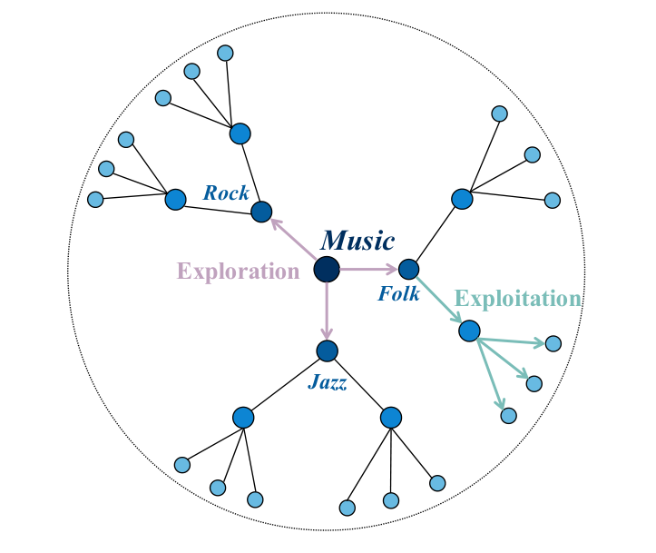
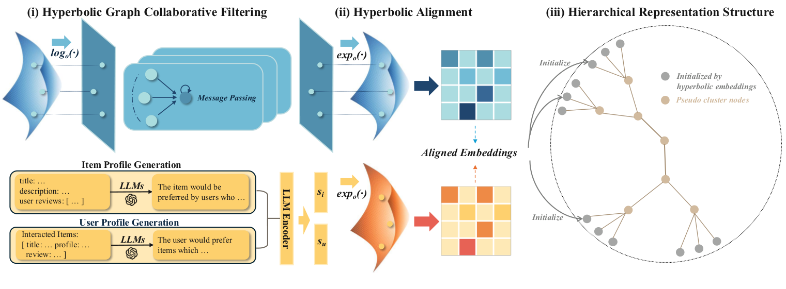
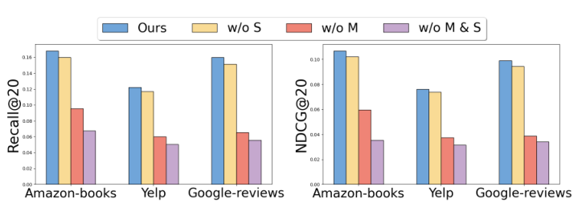
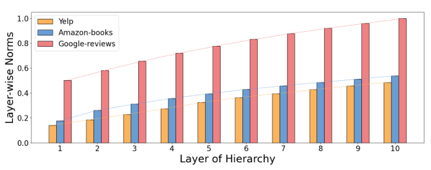
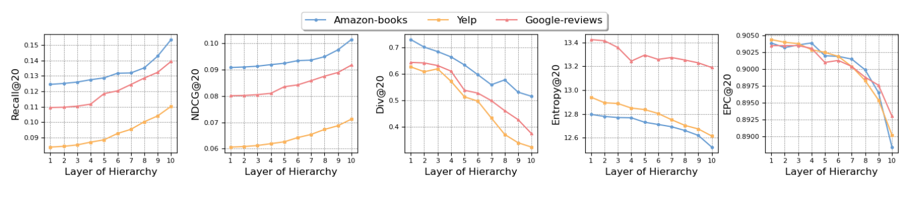

# HERec：利用双曲表征平衡推荐的探索与利用

> 论文：Breaking Information Cocoons: A Hyperbolic Framework for Balancing Exploration and Exploitation in Recommender Systems，KDD 2026。[https://doi.org/10.1145/3770855.3817909](https://doi.org/10.1145/3770855.3817909)
> 代码：无
> 更新记录：2026-11-13 统一论文-本地实验结果对照表为五列长表；2026-11-12 补充三组主实验全部 10 项指标的本地-论文百分比差异；2026-10-22 统一笔记顶部信息格式，保留论文结果与本地结果分开。

---
# 一、文献阅读

## 1. 研究背景



**图 1：双曲空间中的探索与利用**（英文原文 PDF 第 2 页）。 层级较高的兴趣节点支持较宽泛的探索，较低层节点对应更具体的兴趣利用。

传统协同过滤根据已有交互不断推荐相似内容，容易形成信息茧房。用户既希望获得符合当前兴趣的内容（利用，exploitation），也希望接触新类别（探索，exploration）。这两种需求有层级关系，例如“音乐→民谣→某年龄群体偏好的民谣”，仅按平面相似度排序难以呈现不同粒度的兴趣。

用户–物品网络具有稀疏、长尾和潜在层级结构。欧氏空间的容量随半径呈多项式增长，较难低失真地表示分支不断扩张的树；双曲空间容量随半径呈指数增长，更适合层级和幂律网络。已有双曲推荐方法主要依赖交互，缺乏用户与物品文本语义；LLM 和文本编码器通常输出欧氏向量，直接与双曲表示结合会遇到空间不一致问题。

## 2. 研究目的

构建同时整合协同信号与文本语义的双曲推荐框架，提高推荐效用及多样性，并利用学得的兴趣层级让用户主动调节探索范围与推荐替换比例，从而缓解信息茧房。

## 3. 研究问题

1. 如何在双曲空间中表示用户–物品的高阶协同关系？
2. 如何把 LLM 提炼的文本语义与双曲协同表示对齐，改善稀疏尾物品的推荐？
3. 双曲对齐的梯度行为如何与层级位置相关，和欧氏对齐有何区别？
4. 如何从表示自动构造兴趣层级，并让用户控制探索与利用？
5. 方法在总体、头尾物品、大规模数据与不同语义编码器上是否有效？

## 4. 研究方法



**图 2：HERec 总体架构**（英文原文 PDF 第 4 页）。 依次展示双曲图协同过滤、语义与协同表示的双曲对齐，以及由双曲嵌入构造层级结构。

HERec 包括三个连续环节：在 Lorentz 双曲模型的原点切空间进行图消息传递，再映回双曲空间；由 LLM 生成用户/物品 profile，经文本编码器和 MLP 转换后，在同一双曲空间与协同表示对齐；在联合表示上构造层级树，通过温度与层数替换部分原推荐。LLM 主要参与离线语义准备，常规推荐阶段使用学得的嵌入。训练同时包含双曲间隔排序损失和语义对齐损失。

## 5. 研究内容（公式分析）

本节覆盖论文第 4 章 **4.1–4.6 的全部工作**，并先说明第 3 章的几何基础。设用户集合为 $U$，物品集合为 $I$，交互图为 $G$；$h$ 表示双曲协同向量，$z$ 表示切空间向量，$s$ 表示映射到双曲空间的语义向量。论文用 $\kappa$ 表示半径平方，曲率为 $-1/\kappa$；源码用 `c` 表示正曲率幅度，`K=1/c` 对应论文 $\kappa$。

### 5.1 Lorentz 模型与切空间：式(1)–(5)

$$\langle x,y\rangle_L=-x_0y_0+\sum_{j=1}^n x_jy_j.\tag{1}$$

第 0 维是时间坐标，其余是空间坐标。双曲面满足 $\langle x,x\rangle_L=-\kappa$、$x_0>0$，因此 $x_0=\sqrt{\kappa+\|x_{1:n}\|_2^2}$。切向量必须与基点在 Lorentz 度量下正交：

$$T_x\mathbb H_\kappa^n=\{v\in\mathbb R^{n+1}:\langle v,x\rangle_L=0\}.\tag{2}$$

在切空间执行常规线性计算，再通过指数映射回到流形：

$$\exp_x^\kappa(v)=\cosh\!\left(\frac{\|v\|_L}{\sqrt\kappa}\right)x+\sqrt\kappa\sinh\!\left(\frac{\|v\|_L}{\sqrt\kappa}\right)\frac{v}{\|v\|_L}.\tag{3}$$

对数映射反向恢复从 $x$ 指向 $y$ 的切向量：

$$\log_x^\kappa(y)=d_H^\kappa(x,y)\frac{y+\kappa^{-1}\langle x,y\rangle_Lx}{\|y+\kappa^{-1}\langle x,y\rangle_Lx\|_L}.\tag{4}$$

$$d_H^\kappa(x,y)=\sqrt\kappa\operatorname{arcosh}\!\left(-\frac{\langle x,y\rangle_L}{\kappa}\right).\tag{5}$$

论文默认 $\kappa=1$，原点 $o=(\sqrt\kappa,0,\ldots,0)$。式(4) PDF 分母未明确标出下标，按 Lorentz 切向量范数理解；源码 `logmap` 使用 `minkowski_norm`。`proj` 重算时间坐标，`clamp` 则防止反双曲函数越界和数值爆炸。

### 5.2 双曲图协同过滤：第 4.1 节，式(6)–(12)

**初始化。** 论文先高斯采样欧氏向量，把它扩展为时间坐标为 0 的原点切向量，再映到流形：

$$z_u^0=(0,e_u),\quad z_i^0=(0,e_i),\quad h_u^0=\exp_o(z_u^0),\quad h_i^0=\exp_o(z_i^0).\tag{6}$$

源码用均匀分布 `uniform_(-scale, scale)` 初始化 `nn.Embedding`，`expmap0` 将第 0 维当作时间坐标，只使用其余维度进行空间映射；因此代码 `dim=50` 对应 50 个总坐标，而非额外补一维后的 51 个坐标。

**消息传递与跨层融合。** 论文在切空间聚合邻居并保留上一层自身信息：

$$z_u^l=z_u^{l-1}+\sum_{i\in\mathcal N_u}\frac{z_i^{l-1}}{|\mathcal N_u|},\qquad z_i^l=z_i^{l-1}+\sum_{u\in\mathcal N_i}\frac{z_u^{l-1}}{|\mathcal N_i|}.\tag{7}$$

$$z_u=\sum_lz_u^l,\quad z_i=\sum_lz_i^l;\qquad h_u=\exp_o(z_u),\quad h_i=\exp_o(z_i).\tag{8–9}$$

高阶传播表达相似用户与相关物品之间的协同联系。代码实际使用 $\widetilde A=D^{-1}(A+I)$，调用 `resSumGCN_encode`：先 `logmap0`，执行 `num_layers-1` 次 `torch.spmm`，累加 `output[1:]`，最后 `expmap0` 和 `proj`。它与式(7)的“自身项加邻居平均”并不逐项相同；自环、归一化以及排除初始层的求和范围均须在复现时确认。另有 `resAddGCN_encode` 残差变体，但默认训练没有调用它。

**预测。** 论文以距离倒数表示偏好强度：

$$p(u,i)=\frac1{d_H(h_u,h_i)}.\tag{10}$$

代码用 $-d_H^2$ 排序；在距离不受截断影响时，二者均按距离升序推荐。该分数是排序分数，并非经过归一化的概率。代码 `sqdist` 将距离平方上限截为 50，大距离项可能因此并列。

**间隔排序。** 对已交互物品 $i$ 和负物品 $j$：

$$\ell_m(u,i,j)=\max\{d_H^2(h_u,h_i)-d_H^2(h_u,h_j)+m,0\}.\tag{11}$$

正物品应比负物品更靠近用户，且差距满足间隔。只有违反约束的三元组贡献损失。

**HAML 与 HINS。** 自适应间隔根据几何位置变化：

$$m_{ui}^{H}=\operatorname{sigmoid}(\delta),\quad \delta=\frac{d_H^2(e_u,o)+d_H^2(e_i,o)-d_H^2(e_u,e_i)}{e_{u,0}e_{i,0}}.\tag{12}$$

论文认为原点附近的用户–物品对需要更大的间隔，HINS 则优先选靠近正物品的负样本。代码 `hratio` 计算 $-\{1-\langle h_u,h_i\rangle_L-h_{u,0}-h_{i,0}\}/(h_{u,0}h_{i,0})$，`decode_pos` 取 sigmoid，实际损失的间隔为 `args.margin * w`。这一实现与式(12)的双曲距离平方表达存在差异。`decode_neg` 以负物品和正物品的**环境空间欧氏距离平方**挑困难负例，然后用双曲距离计算用户–困难负物品的损失；不能将其描述成直接用双曲距离挑负例。

### 5.3 语义表示生成：第 4.2 节

LLM 从物品标题、描述、评论，以及用户已交互物品及其评论中提炼 profile：

$$\mathcal P_i=\operatorname{LLM}(\mathcal S_i,\mathcal T_i),\qquad e_i=\operatorname{Encoder}(\mathcal P_i).$$

$\mathcal S_i$ 是系统提示，$\mathcal T_i$ 是原始文本；用户采用相应流程。profile 把零散或有噪声的文本汇总成句子级偏好描述。预训练文本编码器把描述压缩为稠密语义向量，减少每次推荐调用 LLM 的开销。源码读取预生成的 `user_semantic_embed.pkl`、`item_semantic_embed.pkl`，未提供这一整套原始文本到 GPT profile 的生成入口。`decoder` 是从嵌入重建 profile 的辅助模块，不等同于此处的离线 profile 生成。

### 5.4 双曲语义对齐：第 4.3 节，式(13)

先通过 MLP 适配维度，再映到双曲空间：$s_i=\operatorname{proj}(\exp_o(\operatorname{MLP}(e_i)))$。对应的对齐损失为：

$$\ell_{align}(i)=d_H^2(h_i,s_i).\tag{13}$$

它要求协同表示与同一实体的语义表示靠近，并非使用所有其他实体作为负例的 InfoNCE。仓库注释虽称“contrastive alignment”，实际是成对距离对齐。用户也执行同样的对齐。两层 MLP 使用 LeakyReLU，中间宽度为输入维度与目标维度的整数平均；线性层采用 Xavier 权重初始化。

代码的联合训练目标可写为（该表达是对源码的整理，不是论文额外编号公式）：

$$\mathcal L=\sum_{(u,i,j)\in B}\max\{d_H^2(h_u,h_i)-d_H^2(h_u,h_j)+m\,w_{ui},0\}+\lambda_a\sum_{(u,i)\in B}[d_H^2(h_u,s_u)+d_H^2(h_i,s_i)].$$

各项为求和而非批次平均，因此改变 batch size 会改变梯度规模。双曲嵌入由 RSGD 更新，欧氏 MLP 参数由 Adam 更新。

### 5.5 梯度分析：第 4.4 节，式(14)及附录 A

$$\|\nabla_xd_H(x,y)\|\approx\frac{\|\hat x-\hat y\|}{\|x\|(1-\cos\theta)}.\tag{14}$$

这里范数和单位方向使用空间坐标，$\theta$ 是两个空间向量夹角。设 $q=-\langle x,y\rangle_L$，则 $d_H=\operatorname{arcosh}(q)$。在 $\|x\|,\|y\|$ 足够大、$q$ 足够大时，附录采用 $x_0\approx\|x\|$、$y_0\approx\|y\|$、$\sqrt{q^2-1}\approx q$，得到 $q\approx\|x\|\|y\|(1-\cos\theta)$ 及 $\partial q/\partial x_j\approx\|y\|(\hat x_j-\hat y_j)$，从而得到式(14)。

在方向关系固定时，大范数、细粒度节点的坐标梯度更小，小范数、抽象节点的梯度更大。欧氏距离 $\|x-y\|$ 的梯度范数恒为 1（$x\ne y$），没有上述位置依赖。

理解时需保留三个限定：这是近似式，近原点或方向几乎相同时不能无条件套用；论证对象为**距离**，训练式(13)使用**距离平方**，其导数还要乘 $2d_H$；这里的坐标梯度分析也不等同于 RSGD 转换后的黎曼梯度范数。附录给出近似总误差界 $1/[2\|x\|^2(1-\cos\theta)]+1/(2q^2)$，并以 $\|x\|=\|y\|=5,\theta=\pi/2$ 举例，约 2.1%。这说明适用条件，不能仅凭维度为 50 就认定所有点满足近似条件。

### 5.6 层级表示结构：第 4.5.1 节，算法 1

层级树要从交互与语义中发现数据标签没有直接描述的兴趣群体，例如“民谣→青少年偏好的民谣”。论文算法从底层真实用户/物品表示开始：设 $D_L=X$、$L=\log_k|X|$；每层初始化 $|D_l|/k$ 个质心，按双曲距离分配节点，以簇内双曲均值更新质心，迭代到收敛；再令 $D_{l-1}=M_l$，把这一层质心当作上层的伪簇节点，逐层向根合并。

作者借鉴 Dasgupta 层级聚类代价，鼓励把强相似节点的切割推到树的较低位置，并固定层间比例 $k=2$ 来得到二叉层级。可用标准代价 $C(T)=\sum_{(a,b)}w_{ab}|\mathrm{leaves}(\mathrm{LCA}_T(a,b))|$ 理解动机（此式是解释性补充，非论文编号公式）。论文称无需预定义层级超参数，是指簇数随样本数及固定比例推导；并不意味着用户无需选择推荐温度和探索层数，也不能据此认定任意二叉树达到代价的全局最优。

**仓库实现。** `HierarchicalClustering.hierarchical_clustering` 从根向下，对当前真实嵌入递归执行平衡二分；`assign_labels` 限制每簇容量，容量满时随机改派；`compute_centroids` 通过 `logmap0→切空间均值→expmap0` 更新质心。它是原点切空间均值近似，未显式优化 Dasgupta 代价，也不是算法 1 的逐层聚类质心流程。`ClusterNode` 保存该簇数据、子节点、质心、层号与父指针，为祖先访问和 LCA 查询提供基础。

### 5.7 探索与利用平衡：第 4.5.2 节

两个可调参数为温度 $\tau\in[0,1]$ 和探索层 $l$。先产生符合当前兴趣的原推荐，再从指定祖先簇中采样物品替换一部分推荐。$\tau$ 控制替换比例；根附近的小层号表示宽兴趣范围，靠叶端的大层号表示细粒度范围。示例 $\tau=0.5,l=5$：保留一半推荐，用第 5 层祖先簇中的候选替换另一半。

代码 `Balance.predict` 对前 20 项计算 `int(temperature*20)` 个候选，经随机采样后去掉原推荐中已有的物品，替换尾部对应位置，因此实际替换比例可能小于 $\tau$。该温度是替换比例，不是 softmax 温度。索引使用 `(嵌入坐标元组, 层号)`，祖先列表顺序为叶到根；用户与物品均参与建树，候选则通过与物品嵌入匹配获得。层级案例：偏好超自然/恐怖题材的用户与 *Spirit Fighter* 的 LCA=10，比与 *Barefoot Summer* 的 LCA=5 更接近，展示细粒度与宽范围兴趣的差别。

### 5.8 复杂度分析：第 4.6 节

**4.6.1 构树。** 论文设真实节点总数为 $N$、聚类迭代次数为 $t$，先计算缓存成对距离，代价 $O(N^2/2)$；层数为 $O(\log N)$，并将后续迭代部分写为 $O(t\log N)$，总计 $O(N^2/2+t\log N)$。该表达依赖距离预计算和复用的假设，不能据此忽略实际节点分配与质心更新成本；成对距离的空间成本也为二次规模。

**4.6.2 检索与替换。** 论文在双曲最近邻检索假设下给出 top-$K$ 查询 $O(K\log N)$、祖先检索与替换 $O(K)$。这里 $K$ 是推荐长度，区别于聚类比例 $k=2$。仓库 `HERec.predict` 逐用户遍历全部物品，生成完整 $|U|\times|I|$ 分数矩阵；`Balance.predict` 还广播比较祖先簇与全部物品坐标。因此该实现没有直接实现论文的最近邻索引及复杂度保证，实际运行须考虑全量矩阵和广播张量的内存。

## 6. 所作实验与完整结果

### 6.1 实验任务、基线与评估指标

这是基于用户–物品交互图的 top-K 推荐，源码不按行为顺序预测下一物品。主实验比较 LightGCN、TAG-CF、LightGCL、SimGCL、HCCF、HGCF、HICF 与 HERec；前五个为欧氏方法，后两个为双曲方法。效用指标为 Recall、NDCG，多样性指标为 Div、Shannon entropy、EPC，报告 K=10、20。

Recall 衡量测试相关物品被召回的比例；NDCG 用位置折扣衡量相关物品排序。论文的多样性定义为：

$$\mathrm{Div}(u)=\frac{\sum_{i\in R_u}\sum_{j\in R_u,j\ne i}d(i,j)}{\#\text{物品对}}.\tag{15}$$

论文列出物品对数为 $\binom{|R_u|}{2}$；其分子按排版写成双重求和时会计入两个方向，阅读时须留意有序对与无序对的口径。作者强调模型应在同一表示空间计算距离，以公平比较。

$$H=-\sum_{i\in\mathrm{set}(\biguplus_uR_u)}p(i)\log p(i),\quad p(i)=\frac{\mathrm{count}(i)}{\sum_j\mathrm{count}(j)}.\tag{16}$$

这里统计跨用户推荐曝光分布；高熵表示曝光较分散。代码使用以 2 为底的对数。

$$\mathrm{EPC}=1-\frac1{|\mathrm{set}(\biguplus_uR_u)|}\sum_{i\in\mathrm{set}(\biguplus_uR_u)}\frac{\mathrm{pop}(i)}{\max_j\mathrm{pop}(j)}.\tag{17}$$

高 EPC 表示偏向低流行度物品。源码按**含重复曝光**的推荐列表平均 `1-pop/max_pop`，并非式(17)对唯一物品平均；Div 源码计算双曲平方距离、包含自配对，再对用户分数做 min–max 归一化。这些口径差异会影响复现对比。

### 6.2 表 1：总体结果

以下 R=Recall、N=NDCG、D=Div；保留原表数值精度，HERec 对应原表 Ours。所有指标越高越好，但不同指标不可直接相加。

| 数据集            | 模型       | R@10   | N@10   | R@20   | N@20   | D@10   | H@10   | EPC@10 | D@20   | H@20   | EPC@20 |
| -------------- | -------- | ------ | ------ | ------ | ------ | ------ | ------ | ------ | ------ | ------ | ------ |
| Amazon-books   | LightGCN | 0.0950 | 0.0726 | 0.1428 | 0.0884 | 0.4469 | 9.8554 | 0.7429 | 0.4504 | 10.485 | 0.7798 |
| Amazon-books   | TAG-CF   | 0.0986 | 0.0755 | 0.1468 | 0.0912 | 0.4090 | 10.915 | 0.7899 | 0.4517 | 11.465 | 0.8227 |
| Amazon-books   | LightGCL | 0.1075 | 0.0846 | 0.1515 | 0.0991 | 0.4651 | 11.511 | 0.8523 | 0.4974 | 11.941 | 0.8728 |
| Amazon-books   | SimGCL   | 0.0997 | 0.0762 | 0.1478 | 0.0918 | 0.4286 | 10.341 | 0.7757 | 0.4802 | 10.915 | 0.8076 |
| Amazon-books   | HCCF     | 0.1045 | 0.0813 | 0.1488 | 0.0962 | 0.5008 | 11.814 | 0.8579 | 0.5433 | 12.137 | 0.8746 |
| Amazon-books   | HGCF     | 0.1013 | 0.0759 | 0.1511 | 0.0921 | 0.4742 | 11.577 | 0.8623 | 0.5041 | 11.732 | 0.8585 |
| Amazon-books   | HICF     | 0.1113 | 0.0862 | 0.1599 | 0.1022 | 0.4702 | 11.922 | 0.8561 | 0.5261 | 12.129 | 0.8660 |
| Amazon-books   | HERec    | 0.1167 | 0.0902 | 0.1682 | 0.1069 | 0.5255 | 12.096 | 0.8700 | 0.5754 | 12.254 | 0.8758 |
| Yelp           | LightGCN | 0.0678 | 0.0565 | 0.1135 | 0.0717 | 0.2603 | 8.3263 | 0.6842 | 0.2277 | 9.1811 | 0.7343 |
| Yelp           | TAG-CF   | 0.0692 | 0.0571 | 0.1142 | 0.0722 | 0.2353 | 8.4516 | 0.6939 | 0.2276 | 9.3108 | 0.7428 |
| Yelp           | LightGCL | 0.0709 | 0.0594 | 0.1141 | 0.0739 | 0.2856 | 11.243 | 0.8281 | 0.3064 | 11.823 | 0.8550 |
| Yelp           | SimGCL   | 0.0707 | 0.0586 | 0.1184 | 0.0748 | 0.3397 | 9.8191 | 0.7642 | 0.3460 | 10.508 | 0.7973 |
| Yelp           | HCCF     | 0.0680 | 0.0562 | 0.1097 | 0.0701 | 0.3168 | 11.942 | 0.8572 | 0.3535 | 12.311 | 0.8752 |
| Yelp           | HGCF     | 0.0654 | 0.0510 | 0.1099 | 0.0665 | 0.3133 | 11.977 | 0.8718 | 0.3289 | 12.103 | 0.8747 |
| Yelp           | HICF     | 0.0709 | 0.0579 | 0.1169 | 0.0737 | 0.3478 | 11.877 | 0.8557 | 0.3721 | 12.147 | 0.8666 |
| Yelp           | HERec    | 0.0739 | 0.0597 | 0.1224 | 0.0762 | 0.3874 | 12.155 | 0.8716 | 0.3961 | 12.329 | 0.8773 |
| Google-reviews | LightGCN | 0.0932 | 0.0745 | 0.1430 | 0.0929 | 0.2422 | 9.9149 | 0.7241 | 0.2725 | 10.761 | 0.7749 |
| Google-reviews | TAG-CF   | 0.0942 | 0.0754 | 0.1447 | 0.0940 | 0.2376 | 10.184 | 0.7485 | 0.2497 | 11.031 | 0.7961 |
| Google-reviews | LightGCL | 0.0945 | 0.0768 | 0.1461 | 0.0959 | 0.2639 | 11.643 | 0.8333 | 0.2705 | 12.317 | 0.8655 |
| Google-reviews | SimGCL   | 0.0979 | 0.0784 | 0.1482 | 0.0971 | 0.2966 | 10.361 | 0.7486 | 0.2950 | 11.119 | 0.7923 |
| Google-reviews | HCCF     | 0.0923 | 0.0744 | 0.1446 | 0.0937 | 0.2195 | 10.741 | 0.8056 | 0.2402 | 11.561 | 0.8433 |
| Google-reviews | HGCF     | 0.0910 | 0.0697 | 0.1485 | 0.0909 | 0.2859 | 12.248 | 0.8538 | 0.3321 | 12.474 | 0.8619 |
| Google-reviews | HICF     | 0.0951 | 0.0736 | 0.1515 | 0.0944 | 0.3262 | 12.376 | 0.8523 | 0.3510 | 12.660 | 0.8640 |
| Google-reviews | HERec    | 0.1002 | 0.0772 | 0.1598 | 0.0992 | 0.3185 | 12.466 | 0.8598 | 0.3543 | 12.769 | 0.8728 |

### 6.3 表 2：主数据集统计

| 数据集 | 用户数 | 物品数 | H20(%) | T80(%) | 交互数 | 密度 |
| --- | --- | --- | --- | --- | --- | --- |
| Amazon-books | 11,000 | 9,332 | 45.2 | 54.8 | 120,464 | 1.17e-3 |
| Yelp | 11,091 | 11,010 | 47.0 | 53.0 | 166,620 | 1.36e-3 |
| Google-reviews | 22,582 | 16,557 | 46.8 | 53.2 | 411,840 | 1.10e-3 |

### 6.4 表 3：与语义特征增强的欧氏基线比较

“+”表示在欧氏空间加入语义对齐。原表按三个数据集横向排版，此处按数据集分行，保留全部结果。

| 数据集 | 模型 | R@20 | N@20 | D@20 | H@20 | EPC@20 |
| --- | --- | --- | --- | --- | --- | --- |
| Amazon-books | LightGCN+ | 0.1466 | 0.0901 | 0.4349 | 10.3915 | 0.7802 |
| Amazon-books | LightGCL+ | 0.1545 | 0.0992 | 0.5064 | 11.9761 | 0.8728 |
| Amazon-books | SimGCL+ | 0.1494 | 0.0926 | 0.5163 | 11.4751 | 0.8342 |
| Amazon-books | HCCF+ | 0.1525 | 0.0940 | 0.4316 | 11.7984 | 0.8616 |
| Amazon-books | HERec | 0.1682 | 0.1069 | 0.5754 | 12.2543 | 0.8758 |
| Yelp | LightGCN+ | 0.1156 | 0.0733 | 0.2697 | 9.6903 | 0.7526 |
| Yelp | LightGCL+ | 0.1131 | 0.0739 | 0.2759 | 11.8617 | 0.8581 |
| Yelp | SimGCL+ | 0.1195 | 0.0752 | 0.3152 | 9.9952 | 0.7811 |
| Yelp | HCCF+ | 0.1170 | 0.0729 | 0.2884 | 11.6906 | 0.8577 |
| Yelp | HERec | 0.1224 | 0.0762 | 0.3961 | 12.3290 | 0.8773 |
| Google-reviews | LightGCN+ | 0.1438 | 0.0940 | 0.2707 | 10.8664 | 0.7801 |
| Google-reviews | LightGCL+ | 0.1443 | 0.0946 | 0.2744 | 12.4700 | 0.8776 |
| Google-reviews | SimGCL+ | 0.1504 | 0.0982 | 0.3030 | 11.2111 | 0.7953 |
| Google-reviews | HCCF+ | 0.1438 | 0.0941 | 0.2524 | 11.5433 | 0.8406 |
| Google-reviews | HERec | 0.1598 | 0.0992 | 0.3543 | 12.7690 | 0.8728 |

### 6.5 表 4：头部与尾部物品结果

H20 为训练交互最多的前 20% 物品，T80 为其余物品。ΔH(%) 是相对第二好的双曲基线的提升，不能将它当作相对所有模型的提升。

| 数据集            | 模型/提升    | R@20 H20 | R@20 T80 | N@20 H20 | N@20 T80 |
| -------------- | -------- | -------- | -------- | -------- | -------- |
| Amazon-books   | LightGCN | 0.1162   | 0.0266   | 0.0744   | 0.0140   |
| Amazon-books   | HGCF     | 0.1083   | 0.0428   | 0.0673   | 0.0248   |
| Amazon-books   | HICF     | 0.1086   | 0.0513   | 0.0713   | 0.0309   |
| Amazon-books   | HERec    | 0.1125   | 0.0557   | 0.0730   | 0.0339   |
| Amazon-books   | ΔH(%)    | +3.59%   | +8.58%   | +2.38%   | +9.71%   |
| Yelp           | LightGCN | 0.1076   | 0.0059   | 0.0693   | 0.0024   |
| Yelp           | HGCF     | 0.0789   | 0.0310   | 0.0489   | 0.0176   |
| Yelp           | HICF     | 0.0847   | 0.0322   | 0.0556   | 0.0180   |
| Yelp           | HERec    | 0.0863   | 0.0361   | 0.0558   | 0.0204   |
| Yelp           | ΔH(%)    | +1.89%   | +12.11%  | +0.36%   | +13.33%  |
| Google-reviews | LightGCN | 0.1311   | 0.0119   | 0.0878   | 0.0051   |
| Google-reviews | HGCF     | 0.1123   | 0.0362   | 0.0714   | 0.0195   |
| Google-reviews | HICF     | 0.1147   | 0.0388   | 0.0746   | 0.0208   |
| Google-reviews | HERec    | 0.1155   | 0.0443   | 0.0755   | 0.0238   |
| Google-reviews | ΔH(%)    | +0.70%   | +14.18%  | +1.21%   | +14.42%  |

### 6.6 表 5：大规模数据结果（附录 B.1）

| 数据集 | 模型 | R@20 | N@20 | D@20 | H@20 | EPC@20 |
| --- | --- | --- | --- | --- | --- | --- |
| Amazon-Books (Large) | LightGCN | 0.0242 | 0.0107 | 0.6142 | 11.0605 | 0.8943 |
| Amazon-Books (Large) | LightGCL | 0.0329 | 0.0154 | 0.6547 | 13.4200 | 0.9216 |
| Amazon-Books (Large) | SimGCL | 0.0318 | 0.0142 | 0.5977 | 9.9114 | 0.8683 |
| Amazon-Books (Large) | HGCF | 0.0545 | 0.0307 | 0.6419 | 13.2311 | 0.9132 |
| Amazon-Books (Large) | HICF | 0.0565 | 0.0319 | 0.6777 | 14.0322 | 0.9347 |
| Amazon-Books (Large) | HERec | 0.0598 | 0.0335 | 0.6832 | 15.3017 | 0.9388 |
| Amazon-CDs (Large) | LightGCN | 0.0538 | 0.0248 | 0.0572 | 11.6691 | 0.7869 |
| Amazon-CDs (Large) | LightGCL | 0.0677 | 0.0323 | 0.0641 | 12.9922 | 0.8273 |
| Amazon-CDs (Large) | SimGCL | 0.0566 | 0.0262 | 0.0588 | 11.0439 | 0.7649 |
| Amazon-CDs (Large) | HGCF | 0.0642 | 0.0364 | 0.0612 | 13.7102 | 0.8072 |
| Amazon-CDs (Large) | HICF | 0.0683 | 0.0388 | 0.0629 | 13.7451 | 0.8423 |
| Amazon-CDs (Large) | HERec | 0.0712 | 0.0391 | 0.0632 | 13.7762 | 0.8330 |

### 6.7 表 6：10 次独立运行的标准差（附录 B.2）

以下是标准差，不是均值或置信区间。

| 数据集    | R@20   | N@20   | D@20   | H@20   | EPC@20 |
| ------ | ------ | ------ | ------ | ------ | ------ |
| Amazon | 0.0010 | 0.0004 | 0.0067 | 0.0035 | 0.0002 |
| Yelp   | 0.0009 | 0.0004 | 0.0091 | 0.0017 | 0.0014 |
| Google | 0.0010 | 0.0003 | 0.0077 | 0.0008 | 0.0009 |

### 6.8 表 7：大规模数据统计（附录 B.1）

| 数据集 | 用户数 | 物品数 | 交互数 | 密度 |
| --- | --- | --- | --- | --- |
| Amazon-Books (Large) | 116,455 | 387,492 | 1,442,011 | 3.20e-5 |
| Amazon-CDs (Large) | 61,938 | 88,590 | 779,575 | 1.42e-4 |

### 6.9 表 8：直接在双曲空间进行消息传递（附录 B.3）

用直接双曲传播替代原点切空间传播的变体结果：

| 数据集 | R@20 | N@20 | D@20 | H@20 | EPC@20 |
| --- | --- | --- | --- | --- | --- |
| Amazon | 0.1721 | 0.1082 | 0.5760 | 12.211 | 0.8773 |
| Yelp | 0.1205 | 0.0793 | 0.4005 | 12.321 | 0.8755 |
| Google | 0.1611 | 0.0988 | 0.3532 | 12.766 | 0.8731 |

### 6.10 图形实验与案例



**图 3：排序与语义对齐模块消融**（英文原文 PDF 第 8 页）。

- 图 3：消融 `w/o M`（去除双曲间隔排序）、`w/o S`（去除语义对齐）、`w/o M & S`（仅保留 BPR）。完整模型最好，两者均去除时最差；去掉任一模块都会降低效用。


**图 4：层级结构中各层的范数**（英文原文 PDF 第 8 页）。

- 图 4：逐层质心范数随层号增大而增大，说明从抽象兴趣向细粒度兴趣逐步远离双曲原点。


**图 5：层级选择对推荐效用与多样性的影响**（英文原文 PDF 第 9 页）。

- 图 5：固定温度 τ=0.5，在不同层号调节推荐；层号增大时效用上升、多样性下降。
- 第 5.5 节：通过超自然题材用户与 LCA=10/5 两个图书案例解释层级语义。

论文没有给出图 3–5 的逐点数值表，本笔记保留实验内容与趋势，不把图形估读值写成精确实验结果。

## 7. 结果分析

Amazon-books 的 HERec 在表 1 的全部指标上领先。Yelp 的大部分指标也领先，但 EPC@10=0.8716 略低于 HGCF 的 0.8718；Google-reviews 的 NDCG@10=0.0772 低于 SimGCL 的 0.0784，Div@10=0.3185 低于 HICF 的 0.3262。论文的“总体效用与多样性均有优势”应理解为整体表现，不能写成每个单独指标都是最优。

摘要报告效用最多提升 5.49%、多样性最多提升 11.39%。表 1 可直接核算：Google R@20 相对 HICF 为 $(0.1598/0.1515-1)\times100\%=5.48\%$，Yelp Div@10 相对 HICF 为 $(0.3874/0.3478-1)\times100\%=11.39\%$。舍入与基线口径会影响“最多”的数字，比较时应明确指标和参照。

特征增强能够改善部分欧氏模型的效用，但多样性变化不稳定。表 3 中 Google 的 LightGCL+ EPC@20=0.8776 高于 HERec 的 0.8728，因此“优于所有特征增强基线”同样不能逐指标绝对化。头尾实验中，HERec 相对 HICF 的尾部 NDCG@20 提升分别为 9.71%、13.33%、14.42%，明显大于头部提升，支持语义信息帮助稀疏物品的结论；该实验并不等价于对完全无交互物品的独立零样本评估。

消融与层级实验说明排序约束、语义对齐和探索层级各自发挥作用，但论文没有给出图 3–5 的逐点数值表，不能编造精确数值。大规模实验总体保持效用优势，不过 Amazon-CDs (Large) 的 EPC@20 低于 HICF，Div@20 也低于 LightGCL。表 6 展示 10 次运行的标准差；正文称结果具统计显著性，但表中未列检验方法、p 值或置信区间，标准差本身不能替代显著性检验。

## 8. 环境、数据集与参数配置

### 8.1 论文设置

| 配置项 | 论文描述 |
|---|---|
| 表示维度 | 50 |
| 训练 batch size | 1024 |
| 优化器 | 双曲嵌入 RSGD；MLP Adam |
| 早停 | 基于 Recall@10，连续 10 个 epoch 未改善 |
| profile 生成 | GPT-3.5-turbo |
| 文本编码 | Amazon/Yelp 及两个大规模集用 text-embedding-ada-002；Google 用 BERT 检查编码器适用性 |
| 硬件 | NVIDIA A40/A100，论文写 40GB VRAM；A40 与 A100 的具体显存规格应以实际设备为准 |
| 标准集训练耗时 | 每 epoch 少于 5 秒（论文报告） |
| 大规模集训练耗时 | Amazon-Books 约 45 秒/epoch；Amazon-CDs 约 20 秒/epoch |
| 学习率搜索 | {1e-3, 5e-3, 1e-2, 5e-2, 1e-1} |
| weight decay 搜索 | {1e-3, 1e-2, 1e-1} |
| 负样本数搜索 | {10, 20, 50} |
| 对齐权重搜索 | {1e-3, 1e-2, 1e-1} |
| 固定聚类比例 | k=2 |

主数据集为图协同过滤数据，H20/T80 按训练交互频度划分。表 2 中头尾占比需按原表记录，不能直接解释为“物品个数恰为 20%/80%”；该表与正文头部前 20% 物品的定义存在口径需进一步核查。论文没有明确给出本仓库全部预处理/切分的可重复生成流程，代码直接加载 pickle，不能自行补写 leave-one-out、随机种子或切分比例。

### 8.2 仓库实际默认配置

| 数据集参数 | amazon | yelp | google |
|---|---:|---:|---:|
| align_weight | 0.1 | 0.1 | 0.01 |
| lr（RSGD） | 0.0005 | 0.0005 | 0.001 |
| weight_decay | 0.25 | 0.2 | 0.05 |
| num_neg | 50 | 50 | 40 |
| margin | 1.0 | 1.0 | 2.0 |

共有默认项：`euc_lr=1e-5`、`dim=50`、`scale=0.1`、`eval_freq=1`、`momentum=0.95`、`c=1.0`、`k=2`、`num_layers=4`、`batch_size=10000`、`epochs=300`、`layer=8`、`temperature=0.5`。评价间隔已从 10 改为 1，早停按训练轮数计算。原代码的数据集默认值会覆盖命令行设置，并使用测试集选模。修改后显式参数优先，默认在 `valid.pkl` 存在时使用验证集，缺少时保留原测试集选模协议；实际协议写入日志。

# 二、代码复现

## 1. 环境配置

### 1.1 本地运行环境与依赖

本地环境为 **Python 3.12、PyTorch 2.11.0+cu128**，已完成真实 HERec 模型的合成图训练与加载检查。仓库原始 `requirements.txt` 固定 `torch==2.3.1`、`transformers==4.44.2`、`numpy==2.0.0`、`scipy==1.13.1`、`scikit-learn==1.5.1`、`geoopt==0.5.1`、`pandas==2.2.2` 等。安装依赖时保留本地 PyTorch 版本。解码器另使用量化、文本生成和评价依赖，未纳入本次功能检查。

若使用指定的 PyTorch，不能直接用原始完整 requirements 覆盖已安装版本。先在目标 conda 环境确认 `python --version` 与 `python -c "import torch; print(torch.__version__, torch.version.cuda)"`；再安装目标 PyTorch，并将其余依赖放到临时安装清单中安装。PyTorch 安装命令以对应发行版本在 cu128 索引上的可用包为准，版本字符串不能视为已成功安装的证据。解码器所固定的老版本 bitsandbytes 与 Windows/PyTorch 新版本兼容性需实际运行检查。

### 1.2 数据与运行顺序

已从 [官方 Google Drive](https://drive.google.com/drive/folders/18RmXeLmc3mJVkgMn8v9sOcxmffXWOU5C) 下载数据至 `experiment/HERec/data/{amazon,google,yelp}/`。共 47 个文件，约 1.18 GB，文件大小、SHA-256 和向量尺寸记录在 `data/download_manifest.json`。

| 数据集 | 文件数 | 交互主体数 | 物品数 | 训练交互数 | 测试交互数 | 语义维度 | 验证集 |
| --- | --- | --- | --- | --- | --- | --- | --- |
| Amazon | 16 | 11,000 | 9,332 | 120,464 | 40,106 | 1536 | 有 |
| Google | 16 | 22,582 | 16,557 | 320,594 | 91,246 | 768 | 未提供 |
| Yelp | 15 | 11,091 | 11,010 | 166,620 | 55,436 | 1536 | 未提供 |

三个数据集的预训练双曲嵌入均为 50 维，输入编号与向量行数已核对。上述为下载文件的实际统计。

| 文件 | 用途 |
|---|---|
| user_item_list.pkl | 完整交互列表，用于推导用户/物品数量 |
| train.pkl、test.pkl | 训练交互与测试答案 |
| valid.pkl | Amazon 提供；用于验证选模，最终测试时屏蔽验证交互 |
| user_semantic_embed.pkl、item_semantic_embed.pkl | 预生成欧氏语义向量 |
| user_embed.pkl、item_embed.pkl | 学得的双曲表示 |
| prediction.pkl | 按用户保存 top-50 物品 ID |
| hierarchy_tree.pkl | 层级树 |
| usr_prf.pkl、itm_prf.pkl | 辅助解码器使用的 profile |
| user_converter.pkl、item_converter.pkl | 解码器适配器权重 |
| profile_pred.pkl、profile_ref.pkl | 生成文本与参考文本 |

在 HERec 根目录下执行主流程：

```powershell
cd F:\recsys-research-training-zhangxinyu\experiment\HERec
python recommend.py --mode train --dataset amazon --gpu 0 --seed 42 --run-name amazon-42
python recommend.py --mode test --dataset amazon --gpu 0 --checkpoint output/amazon-42/best.pt
python hierarchy.py --mode build --dataset amazon --gpu 0 --embedding-dir output/amazon-42
python hierarchy.py --mode evaluate --dataset amazon --gpu 0 --embedding-dir output/amazon-42
python hierarchy.py --mode balance --dataset amazon --gpu 0 --embedding-dir output/amazon-42 --temperature 0.5 --layer 8
```

以上命令在 HERec 根目录运行。训练、测试产物保存到独立实验目录，层级入口通过 `--embedding-dir` 读取。推荐主流程支持 `--gpu -1`，已用合成图验证 CPU 训练与模型加载；旧版嵌入也可用 `--mode test --embedding-dir data/amazon` 测试。

### 1.3 参数设置与评估协议

`lr`、`weight_decay`、`align_weight`、`num_neg`、`margin` 显式传入时优先，否则使用数据集默认值。

| 新增参数 | 默认值 | 用途 |
| --- | --- | --- |
| `--seed` | 42 | 固定初始化及采样随机种子 |
| `--gpu` | 0 | GPU 编号；−1 为 CPU |
| `--eval-freq` | 1 | 每隔多少轮评价；复刻论文保持为 1 |
| `--patience` | 10 | Recall@10 连续未改善的训练轮数 |
| `--num-workers` | 5 | 后台采样进程数 |
| `--output-dir` | output | 输出根目录 |
| `--run-name` | 自动生成 | 实验目录名；同名目录不覆盖 |
| `--checkpoint` | 无 | 完整模型权重路径 |
| `--embedding-dir` | data/数据集 | 指定测试或层级分析的嵌入目录 |
| `--selection-split` | auto | valid/test/auto 选模协议 |
| `--export-to-data` | 关闭 | 将新嵌入和推荐结果同步覆盖到 data/数据集 |

默认 Amazon 按验证集 Recall@10 选模，最终测试屏蔽训练和验证交互；Google、Yelp 缺少验证文件，按原测试集协议选模并记录。比较实验时保持同一协议。最后一轮始终评价，避免短训练没有模型文件。多进程采样各有固定 seed，但队列顺序仍可能波动，严格复现可使用 `--num-workers 1`。

加载权重时检查数据集、维度、层数、曲率等设置与数据规模。训练时指定 checkpoint 仅加载初始权重，不恢复优化器或轮次。

早停默认每轮检查 Recall@10，连续 10 轮没有严格提高则停止，相同分数也计入等待轮数。若最佳结果出现在第 30 轮，后续没有改善，第 40 轮停止并恢复第 30 轮权重。增大评价间隔时，首轮、早停期限和最后一轮仍会评价，但中间的改善可能被漏掉，因此论文复现使用 `--eval-freq 1`。

yelp-4 按论文 batch=1024、dim=50，使用搜索范围内的一组参数，实际训练命令为：

```powershell
python recommend.py --mode train --dataset yelp --gpu 0 --seed 42 --batch-size 1024 --dim 50 --lr 0.001 --weight_decay 0.01 --align_weight 0.1 --num_neg 50 --margin 1.0 --euc_lr 0.00001 --eval-freq 1 --patience 10 --epochs 300 --run-name yelp-4
```

论文未列出 Yelp 的最优参数组合；上述学习率、正则、负样本数和对齐权重在论文搜索范围内，MLP 学习率、margin 等沿用代码值。该配置已完成训练，结果记录在第 5 节。

### 1.4 日志与模型保存

默认目录为 `output/<数据集>-<模式>-seed<种子>-<时间>/`。

| 文件 | 内容 |
| --- | --- |
| run.log | 环境、实际参数、数据规模、损失、评价指标、保存/加载记录和异常 |
| config.json | 当前运行参数 |
| best.pt | 完整 HERec 权重，含嵌入与 MLP；同时保存配置、最佳轮次和选模指标 |
| results.json | 最佳轮次、选模协议、测试指标和总耗时 |
| user_embed.pkl、item_embed.pkl | 最佳模型导出的 CPU 双曲嵌入 |
| prediction.pkl | 测试 top-50 推荐列表 |

训练期间每次评估、训练结束后的测试及 `--mode test` 均计算以下 Top-10/20 指标，日志、最佳模型记录和结果 JSON 同步保存：

| 指标     | 含义              | 单位与口径                           |
| ------ | --------------- | ------------------------------- |
| Recall | 推荐命中比例          | 0–1                             |
| NDCG   | 推荐排序质量          | 0–1                             |
| Div    | 列表内双曲距离多样性      | 平方距离含自配对，跨列表 min–max 归一化；等值时为 0 |
| H      | 推荐曝光的 Shannon 熵 | bit，越高表示曝光更分散                   |
| EPC    | 流行度补数           | 按训练频次归一化，对含重复曝光的推荐物品平均          |

精度与多样性共用同一份已屏蔽历史交互的推荐列表；不足 K 时统计实际候选。Div、EPC 沿用源码口径，与论文公式的差异见第一模块。最佳模型仍按 Recall@10 选择，训练完成后恢复最佳权重再测试。层级入口也记录参数与运行日志，层级树写入指定的嵌入目录。

### 1.5 辅助解码器

辅助解码器内部使用 `../data/`，其相对路径适合从 `decoder` 目录启动：

```powershell
cd F:\recsys-research-training-zhangxinyu\experiment\HERec\decoder
python main.py --mode finetune --dataset amazon
python main.py --mode generate --dataset amazon
python main.py --mode evaluate --dataset amazon
```

解码器加载 `meta-llama/Meta-Llama-3-8B-Instruct`，采用 8-bit 量化，需 Hugging Face 模型访问资格及本地资源。当前 `evaluater.py` 的 `from parse import args` 与实际 `config.py` 命名不一致，评估入口可用性需核查；这里只记录代码依赖关系，未改动该行为。

## 2. 源代码分析（公式与模块对应）

### 2.1 文件与职责

| 文件/目录                                         | 主要职责                                                     |
| --------------------------------------------- | -------------------------------------------------------- |
| recommend.py                                  | 推荐训练/测试入口，调用共享运行流程                                       |
| utils/runner.py                               | 参数检查、训练、最佳模型保存/加载、测试和嵌入导出                                |
| utils/experiment.py                           | 实验目录、日志、JSON 和指标格式化                                      |
| hierarchy.py                                  | 构树、计算效用/多样性、按温度与层号调节推荐                                   |
| models/align.py                               | HGCN、双曲嵌入、语义适配、排序和对齐损失                                   |
| models/clustering.py                          | ClusterNode、平衡双曲 k-means、递归层级树                           |
| models/balance.py                             | 节点索引、祖先访问、推荐替换、LCA 查询                                    |
| manifolds/base.py                             | 流形接口与携带流形元信息的参数                                          |
| manifolds/hyperboloid.py                      | Lorentz 内积、距离、映射、投影、平行移动                                 |
| rgd/rsgd.py                                   | 梯度转换、指数映射更新、动量平行移动                                       |
| utils/data_generator.py                       | 加载数据、构造二部图与训练屏蔽矩阵                                        |
| utils/sampler.py                              | 多进程采样用户–正物品–负物品批次                                        |
| utils/metrics.py                              | `eval_all` 统一计算 Recall、NDCG、Div、Shannon 熵和 EPC；训练与独立测试共用 |
| utils/config.py                               | 参数解析，显式设置优先于数据集默认值                                       |
| utils/helper.py、utils/math_utils.py           | 稀疏转换、归一化、格式化和数值稳定运算                                      |
| decoder/decoder.py                            | MoE 适配嵌入并注入冻结 Llama 的特殊 token                            |
| decoder/main.py                               | 训练适配器、生成描述、调用文本评价                                        |
| decoder/utils/data_handler.py                 | 组装 profile 提示、按 ID 划分文本数据                                |
| decoder/evaluater.py                          | BLEU、ROUGE、BERTScore 与独特句子比例                             |
| decoder/manifolds、decoder/utils/math_utils.py | 解码器本地使用的几何与数学副本                                          |

### 2.2 逐公式定位

| 论文工作 | 代码位置 | 分析要点 |
|---|---|---|
| 式(1) Lorentz 内积 | Hyperboloid.minkowski_dot / l_inner / inner | 时间坐标取负号，空间坐标取正号 |
| 式(2) 切空间 | Hyperboloid.proj_tan | 调整切向量时间分量以满足正交约束 |
| 式(3)(4) 指数/对数映射 | expmap / logmap；expmap0 / logmap0 | 任意基点与原点的两个版本 |
| 式(5) 双曲距离 | Hyperboloid.sqdist | 返回距离平方并截断至 50 |
| 式(6) 初始化 | HERec.__init__ | uniform_、expmap0、ManifoldParameter |
| 式(7)–(9) 传播/融合 | HGCN.resSumGCN_encode、Data.__init__ | 带自环行归一化与论文公式有实现差异 |
| 式(10) 排序 | HERec.predict、utils.metrics.eval_rec | 负距离平方排序，屏蔽训练交互，取 top-50 |
| 式(11) 间隔损失 | HERec.compute_loss | 正负距离差加 margin*w，截负值为 0 |
| 式(12) HAML | HERec.hratio / decode_pos | 基于 Lorentz 内积和时间坐标的代码表达 |
| HINS | HERec.negative_sampling / decode_neg | 批内交互排除、正物品邻近的困难负例 |
| 第 4.2 节语义编码 | HERec.__init__ | 从 pickle 加载离线向量，拼接用户与物品 |
| 式(13) 对齐 | HERec.compute_loss、self.mlp | MLP→expmap0→proj，用户与正物品成对对齐 |
| 式(14) 梯度分析 | torch 自动求导及 RiemannianSGD.step | 理论性质，没有专门计算式(14)的训练模块 |
| 算法 1 层级结构 | HierarchicalClustering | 仓库使用自顶向下递归平衡二分 |
| 第 4.5.2 节推荐控制 | Balance.predict | 查祖先→提取物品→随机探索→替换前 20 项尾部 |
| 第 4.6 节复杂度 | HERec.predict、Balance.predict | 当前全量评分/广播匹配未实现论文最近邻索引假设 |
| 式(15)–(17) 指标 | Diversity / Shannon_entropy / EPC | 距离、曝光重复计数与归一化的实现口径需区分 |

### 2.3 张量与训练数据流

`Data` 用用户 ID $[0,|U|)$ 与偏移后的物品 ID $[|U|,|U|+|I|)$ 构造联合图，评分矩阵和最终推荐仍使用原物品 ID。`embedding.weight` 和 `encode` 输出为 $(|U|+|I|,\mathrm{dim})$；语义向量同样按“用户在前、物品在后”拼接，顺序必须与图节点对应。

`WarpSampler` 产出 $(B,2+N_{neg})$ 的数组。`compute_loss` 取前两列后重新调用 `negative_sampling`，采样器先生成的负样本列没有直接进入模型损失。模型的 `np.isin` 排除当前传入边集合中的正交互，未显式按用户完整训练交互排除。因此两级负采样并非同一个步骤。

`decode_pos` 与 `decode_neg` 返回 $(B,1)$ 距离平方。MLP 将全体实体的语义向量映射后，按批次 anchor/pos 索引选取对齐项；负物品未在该批对齐项中显式出现。每批仍对完整图编码和完整语义矩阵运行 MLP。`utils/runner.py` 保存完整 HERec state_dict 与最佳嵌入；加载 checkpoint 测试时重新编码图，也保留已有嵌入文件的测试入口。

### 2.4 层级结构与探索路径

`ClusterNode` 保存 `data/children/centroid/layer/parent`。构树初始化时先依据总样本数和 k 推导最大深度，然后递归二分。`Balance.build_index` 用每簇首个嵌入坐标与层号建索引；`get_ancestors` 从节点沿父指针返回 `[当前节点,…,根]`。层号 0 为根，大层号越靠近具体用户/物品。

`Balance.predict` 从用户叶节点查指定祖先，在该簇数据中匹配物品表示，抽取探索候选，剔除原推荐后替换前 20 项的末尾。当前代码没有根据显式品类字段跨类别采样；“探索分支”是模型学得的嵌入簇。

### 2.5 辅助 profile 解码器

`PWLayer` 用可学习 bias、dropout 和线性层转换表示；`MoEAdaptorLayer` 用 8 个专家和带噪声 softmax 门控加权输出。虽然门控函数名包含 `top_k`，源码实际对全部专家加权，没有选择部分专家。

`Decoder` 冻结 Llama 参数，仅训练用户/物品 converter；将转换后的表示替换 `<USER_EMBED>` 或 `<ITEM_EMBED>` 位置的 token embedding。训练损失为移位后的 next-token 交叉熵；生成使用 `max_new_tokens=128`。`DataHandler` 按 ID 对 10 取模划分：余数 0 验证、1 测试、其余训练。原始仓库中的“映回欧氏空间”说明与实际 `expmap0` 调用不符，本次中文注释及源码分析均按实际执行操作记录。该辅助模块不对应论文第 4 章的独立编号目标。

## 3. bug 检查及修复

- 数据集默认值原本覆盖显式参数；改为仅补全未指定值。
- 原训练指标全为 0 或未到评价周期时可能没有最佳记录；改为首个评价结果可保存，最后一轮始终评价。
- 早停原来按评价次数递减，间隔 10 轮时 patience=10 实际等待约 100 轮。改为计算当前轮次与最佳轮次的差，默认每轮评价，连续 10 轮未改善则停止；到早停期限时补充评价，避免大间隔推迟停止。
- 训练图显式指定完整节点数，修复孤立物品造成图尺寸与嵌入表不一致的问题。
- 设备改为按参数和张量选择，困难负例使用 `squeeze(1)`，避免单样本批次丢失维度。
- 推荐文件统一保存到实验目录，修正旧版 `../data` 与层级入口路径不一致的问题。
- NDCG 按真实交互主体 ID 读取推荐，修复评估字典顺序或 ID 不连续时的对应错误；空列表与等值多样性避免除零。

- PyTorch 2.11 稀疏检查警告：`utils/helper.py` 在构造 COO 图前显式调用 `torch.sparse.check_sparse_tensor_invariants.enable()`，并设置 `check_invariants=True`。本地版本只传构造关键字仍会触发进程级开关警告，因此两处都显式设置；非法索引直接报错，未屏蔽警告。检查开关对本进程后续稀疏构造同样生效。
- RSGD 旧接口警告：`grad.add_(weight_decay, point)` 改为 `grad.add_(point, alpha=weight_decay)`，动量和 Nesterov 分支也改用关键字 `alpha`。CPU、CUDA 各验证三条更新路径，修复前后连续三步参数完全一致。这是接口兼容修复，不改变损失、学习率或正则强度。

解码器的依赖和入口问题未纳入本次修复。

## 4. 代码修改及优化

- 增加 seed、GPU、早停、采样进程数和选模协议设置。
- 增加独立日志、配置与结果 JSON，完整最佳模型保存和加载检查。
- 固定各采样进程的 NumPy seed，训练结束或异常时回收采样进程。
- 导出 CPU 嵌入与推荐列表，层级分析可读取实验目录；需要旧版下游时显式同步到 data 目录。
- 在训练评估与独立测试中统一输出 10 项精度/多样性指标；Div 按批计算列表内点对距离，使用配置的曲率。

## 5. 实验结果复现

### 5.1 本地环境与实际参数

本次统计 amazon-1、google-1 和 yelp-4，Yelp 仅采用 yelp-4。数据来自各实验目录的 `config.json`、`results.json` 和 `run.log`，三组均有完整结果和 `best.pt`，最终测试前已恢复最佳模型。每个数据集采用一次 seed=42 的运行结果，没有多种子平均。

日志记录的环境为 Python 3.12.12、PyTorch 2.11.0+cu128、CUDA 12.8，设备为 `cuda:0`。共同参数为 dim=50、num_layers=4、scale=0.1、momentum=0.95、c=1、euc_lr=1e-5、epochs=300、num_workers=5。双曲嵌入使用 RSGD，MLP 使用 Adam，均从头训练，未加载 checkpoint。

| 实验 | lr | weight_decay | align_weight | num_neg | margin | batch | 评价间隔 / 轮 | patience=10 的含义 |
|---|---:|---:|---:|---:|---:|---:|---:|---:|
| amazon-1 | 0.0005 | 0.25 | 0.1 | 50 | 1 | 10000 | 10 | 10 次评价 |
| yelp-4 | 0.001 | 0.01 | 0.1 | 50 | 1 | 1024 | 1 | 10 轮 |
| google-1 | 0.001 | 0.05 | 0.01 | 40 | 2 | 10000 | 10 | 10 次评价 |

Amazon、Google 使用修改前的早停，每 10 轮评价一次，patience=10 表示连续 10 次评价未改善，约等待 100 轮。yelp-4 使用修改后的早停，每轮评价，连续 10 个训练轮次没有改善则停止。三组以 Recall@10 选模，不能将旧实验写成已使用新的早停规则。

yelp-4 的 batch=1024、dim=50 符合论文描述，学习率、正则、负样本数和对齐权重位于论文搜索范围内；论文未列出 Yelp 的最优组合。Amazon、Google 沿用代码配置，batch=10000，部分参数也不在论文给出的搜索集合中，因此三组不是完全统一的论文训练设置。

Amazon 使用验证集选模，最终测试屏蔽训练与验证交互；Google、Yelp 缺少 valid.pkl，沿用原代码的测试集选模方式。后两组的选模结果与最终测试来自同一数据划分，不属于独立的测试集评估。

### 5.2 主实验结果

论文数值取表 1 的 HERec（Ours）行，本地数值取三组 `results.json` 的 `test` 字段。全部主实验指标及其差异统一列在下表；相对差异按 `(本地实测效果−论文宣称效果)/论文宣称效果×100%` 计算，正值表示本地结果高于论文，负值表示低于论文。

| 数据集名 | 指标名 | 论文宣称效果 | 本地实测效果 | 差异百分比 |
|---|---|---:|---:|---:|
| Amazon-books | Recall@10 | 0.1167 | 0.1209 | +3.64% |
| Amazon-books | NDCG@10 | 0.0902 | 0.0968 | +7.36% |
| Amazon-books | Recall@20 | 0.1682 | 0.1744 | +3.69% |
| Amazon-books | NDCG@20 | 0.1069 | 0.1139 | +6.53% |
| Amazon-books | Div@10 | 0.5255 | 0.5666 | +7.82% |
| Amazon-books | H@10 | 12.0960 | 12.0556 | -0.33% |
| Amazon-books | EPC@10 | 0.8700 | 0.8663 | -0.42% |
| Amazon-books | Div@20 | 0.5754 | 0.5861 | +1.86% |
| Amazon-books | H@20 | 12.2540 | 12.2240 | -0.24% |
| Amazon-books | EPC@20 | 0.8758 | 0.8729 | -0.33% |
| Yelp | Recall@10 | 0.0739 | 0.0721 | -2.43% |
| Yelp | NDCG@10 | 0.0597 | 0.0590 | -1.17% |
| Yelp | Recall@20 | 0.1224 | 0.1186 | -3.12% |
| Yelp | NDCG@20 | 0.0762 | 0.0747 | -2.03% |
| Yelp | Div@10 | 0.3874 | 0.4119 | +6.33% |
| Yelp | H@10 | 12.1550 | 11.9452 | -1.73% |
| Yelp | EPC@10 | 0.8716 | 0.8629 | -0.99% |
| Yelp | Div@20 | 0.3961 | 0.4184 | +5.64% |
| Yelp | H@20 | 12.3290 | 12.1870 | -1.15% |
| Yelp | EPC@20 | 0.8773 | 0.8727 | -0.52% |
| Google-reviews | Recall@10 | 0.1002 | 0.0997 | -0.52% |
| Google-reviews | NDCG@10 | 0.0772 | 0.0767 | -0.70% |
| Google-reviews | Recall@20 | 0.1598 | 0.1594 | -0.23% |
| Google-reviews | NDCG@20 | 0.0992 | 0.0987 | -0.46% |
| Google-reviews | Div@10 | 0.3185 | 0.3321 | +4.26% |
| Google-reviews | H@10 | 12.4660 | 12.4722 | +0.05% |
| Google-reviews | EPC@10 | 0.8598 | 0.8589 | -0.10% |
| Google-reviews | Div@20 | 0.3543 | 0.3732 | +5.34% |
| Google-reviews | H@20 | 12.7690 | 12.7749 | +0.05% |
| Google-reviews | EPC@20 | 0.8728 | 0.8721 | -0.08% |

Div、H、EPC 的实现口径与论文存在差异，表中百分比只表示数值偏差，不直接等同于严格同口径的多样性提升。论文没有提供训练损失、最佳轮次、耗时等对应值，当前本地实验也没有复现头尾分组、消融、层级控制和大规模数据表，因此这些项目没有可比的百分比差异。

### 5.3 训练轮次与耗时

| 实验 | 选模数据 | 最佳轮次 | 实际结束轮次 | 最佳选模 R@10 | 总耗时 / min | 结束原因 |
|---|---:|---:|---:|---:|---:|---:|
| amazon-1 | valid | 280 | 300 | 0.1203 | 13.30 | 达到轮数上限 |
| yelp-4 | test | 76 | 86 | 0.0721 | 59.07 | 早停 |
| google-1 | test | 120 | 220 | 0.0997 | 25.31 | 早停 |

三组总耗时合计约 97.69 分钟，包含数据准备、训练、评价、模型保存和最终测试。yelp-4 的最佳结果在第 76 轮，第 86 轮早停，符合连续 10 轮未改善的设置。不同实验的 batch 和评价频率不同，总耗时不能直接用于比较模型训练效率。

## 6. 结果对比及分析

### 6.1 结果对比及分析

Amazon 的四项精度指标均高于论文，差异为 +3.64%～+7.36%；Yelp 的四项精度指标低于论文 −1.17%～−3.12%；Google 的四项精度指标低于论文 −0.23%～−0.70%。三组 Div 均高于论文，但 H 与 EPC 大多接近论文。

### 6.2 训练过程与学习收获

- yelp-4 的 R@10 从第 1 轮约 0.0271 提高到第 76 轮约 0.0721；排序损失从约 512.36 降到 239.97，H@10 从约 11.568 提高到 11.945。这次运行中精度和曝光分散程度都有改善。论文描述、仓库默认值与实际运行参数需要分别核对，不能把代码默认值直接当成论文最优设置。
- Google 第 120 轮 R@10 约为 0.09968，第 220 轮降至约 0.08394，而总损失仍从约 3090.79 降到 1781.08。损失继续下降不代表推荐质量继续提高，最终应恢复按选模指标保存的最佳模型。
- yelp-4 第 86 轮的 N@10、R@20、N@20 均略高于第 76 轮，但 R@10 没有超过最佳值，所以仍恢复第 76 轮。一个检查点不一定同时取得所有指标的最大值，比较时应使用同一选模规则，不能把不同轮次的最优值拼成一行。
- 本次完成的是推荐对齐模型的三组主实验，没有加入层级探索后的推荐替换，也未统计本地头尾分组、消融或 profile 解码结果；这些论文结论不能由当前主实验直接验证。
