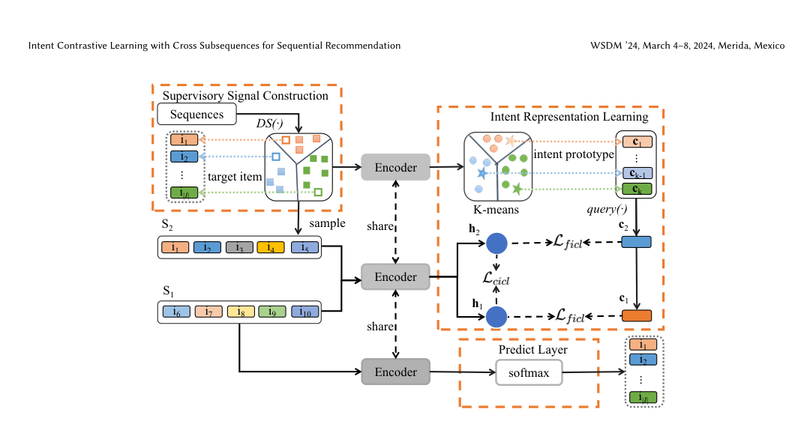

# ICSRec：通过跨子序列意图对比学习建模用户意图

> 论文：Intent Contrastive Learning with Cross Subsequences for Sequential Recommendation，WSDM 2024。[https://doi.org/10.1145/3616855.3635773](https://doi.org/10.1145/3616855.3635773)
> 代码：[https://github.com/QinHsiu/ICSRec](https://github.com/QinHsiu/ICSRec)
> 更新记录：2026-11-01 新增笔记；整理动态滑窗、粗粒度/细粒度意图对比和论文主结果。

---

# 一、文献阅读

## 1. 动机

用户一条长序列可能包含多个购买意图。随机裁剪、掩码等增强容易把不同意图混在一起；辅助标签又通常不可得。ICSRec 从不同用户的跨子序列中挖掘隐式意图监督。

## 2. 方法

1. **动态滑窗**：把序列切成多个不同长度的子序列，并用每个子序列的 target 作为弱监督。
2. **粗粒度 CICL**：假设 target 相同的两个子序列可能表达相同意图，将其表示拉近；target 不同的样本参与对比负例。
3. **细粒度 FICL**：对粗粒度表示聚类得到意图 prototype，再把子序列表示拉向最近 prototype。
4. **推荐任务**：意图表示仍通过下一物品交叉熵训练，最终损失为推荐、CICL 和 FICL 的加权和。

## 3. 论文结果

论文在 Sports、Beauty、Toys、ML-1M 上采用全物品排序。完整 ICSRec 的 HR/NDCG@20 为：Sports `0.0794/0.0393`、Beauty `0.1298/0.0663`、Toys `0.1368/0.0736`、ML-1M `0.4518/0.2297`；对应 SASRec 为 `0.0500/0.0218`、`0.0894/0.0386`、`0.0957/0.0397`、`0.2745/0.1156`。

| 消融 | 作用观察 |
|---|---|
| 去 CICL | 四个数据集均下降，粗粒度同 target 监督有效 |
| 去 FICL | prototype 约束缺失，下降幅度因数据集不同 |
| 去 FNM | 去掉细粒度意图建模后意图区分变弱 |
| 改用 GRU4Rec | 仍优于对应 GRU4Rec，说明收益不只来自 SASRec |

## 4. 本地实验

| 项目 | 结果 |
|---|---|
| 统一 seed 和全物品排序复现 |  |
| CICL/FICL/FNM 消融 |  |
