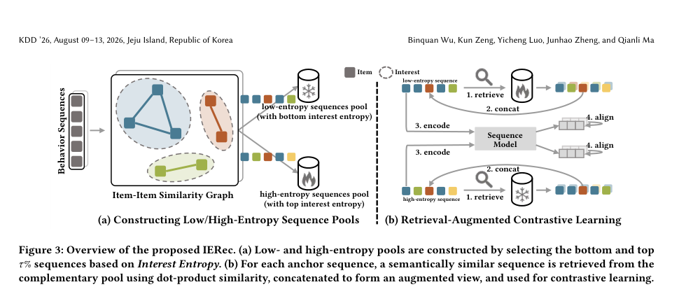

# IERec：通过兴趣熵与互检索缓解对比语义偏差

> 论文：Interest Entropy: Rethinking Contrastive Learning for Sequential Recommendation with Interest Uncertainty，KDD 2026。[https://doi.org/10.1145/3770854.3780333](https://doi.org/10.1145/3770854.3780333)
> 代码：[https://github.com/qianlima-lab/IERec](https://github.com/qianlima-lab/IERec)
> 更新记录：2026-11-13 统一论文-本地实验结果对照表为五列长表；2026-10-22 补充兴趣组构造、熵的语义、SLA/SA-CL 数据流和消融解读；2026-11-08 汇总 ML-100K、Beauty、Sports、Retailrocket-view 的 IERec 本地结果，补充 Sports 的 SASRec 对照；未完成实验继续留空。

---

# 一、文献阅读

## 1. 研究问题：增强风险不是对所有序列都一样

很多序列对比学习默认每个用户都适合 Mask、Crop 或 Reorder。IERec 认为，关键变量不是“用了多少次增强”，而是序列中的兴趣分布：

- **低熵序列**：少数兴趣组占主导，用户偏好集中；随机删掉或替换主兴趣后，正视图容易失去核心语义。
- **高熵序列**：兴趣分散，包含多个主题；随机操作可能把本来就弱的兴趣进一步放大成噪声。
- **中熵序列**：既不集中也不分散，兴趣权重相近。它们对局部改动最敏感，难以判断被改变的是噪声还是有效兴趣，因此论文默认不把这部分样本送入选择性增强。

这解释了为什么全量随机增强会产生语义偏差：同一个操作在不同熵区间对应不同的风险。

## 2. 兴趣组与兴趣熵怎么计算

### 2.1 兴趣组构造

论文先利用 item similarity graph 连接语义相近物品，再把一条用户序列中的物品按图关系划分为若干兴趣组 $G_t^i$。这里的“组”不是用户标签，而是由序列内物品的相似关系得到的局部主题。组大小反映该兴趣在序列中出现的频率。

### 2.2 熵定义与直观含义

对序列 $s_i$，令：

$$p_t^i=\frac{|G_t^i|}{\sum_j|G_j^i|},\qquad IE(s_i)=-\sum_t p_t^i\log p_t^i.$$

当某个兴趣组占据大多数位置时，$p_t$ 分布尖锐，$IE$ 较低；各组大小接近时，$IE$ 较高。熵只描述兴趣分布是否集中，不直接代表推荐准确率，因此需要和相似度图、序列长度一起解释。

论文按分位数建立两个增强池：

$$S_{low}=\{s_i:IE(s_i)<q_\tau\},\qquad S_{high}=\{s_i:IE(s_i)>q_{1-\tau}\}.$$

中间区间保留推荐监督，但不激活选择性对比损失。$τ$ 越大，进入增强池的样本越多，增强覆盖和语义误伤风险会同时增加。

## 3. IERec 的数据流

| 步骤 | 操作 | 结果 | 解决的问题 |
|---|---|---|---|
| 1 | 用物品相似图对序列分组 | $G_t^i$、$IE(s_i)$ | 估计兴趣集中/分散程度 |
| 2 | 按熵分位数分成 $S_{low}$、$S_{high}$、中间池 | 样本路由标签 | 不对所有用户一刀切增强 |
| 3 | 从互补熵池检索 top-$k$ 相似序列 | 候选序列 $s_j$ | 给低熵/高熵样本提供互补兴趣 |
| 4 | 将 anchor 与检索序列拼接并重新编码 | SLA 正视图 $\tilde s_i$ | 保留主题同时补足缺失兴趣 |
| 5 | 原序列与 SLA 计算 SA-CL | 选择性对比损失 | 只约束需要增强的样本 |
| 6 | 与下一物品预测联合训练 | 推荐模型 | 让表示改进服务于推荐目标 |

## 4. SLA：为什么要从互补池检索

SLA（Similarity-based and Low/High-entropy Aware augmentation）的核心不是把任意两条序列拼接，而是“先按熵分池，再从互补池检索”。低熵 anchor 从高熵池找相似序列，可以补充被主兴趣压制的次要兴趣；高熵 anchor 从低熵池找相似序列，可以用更集中的偏好帮助模型判断主线。

检索通常以序列表示或兴趣组相似度排序，取 top-$k$ 后与原序列拼接，再交给同一个序列编码器。拼接不是新的真实交互标签，下一物品仍由原始训练目标提供。需要在代码中明确：检索池是否跨 batch、相似度是否缓存、拼接长度超过最大长度时保留哪一端。

## 5. SA-CL 与普通 InfoNCE 的差异

普通 InfoNCE 会把每条样本都强制拉近原视图和增强视图；IERec 的 SA-CL 使用熵路由指示函数：

$$\mathcal L=\mathcal L_{rec}+\lambda\,\mathbb I[s_i\in S_{low}\cup S_{high}]\mathcal L_{SA-CL}(s_i,\tilde s_i).$$

因此中熵样本仍参与推荐损失，但不因不可靠的随机视图被强行对齐。这个设计把“增强对象选择”和“增强数量”分开：即使总增强数量增加，只要对象仍集中在低/高熵池，风险也可能可控；反过来，给中熵样本大量增强并不一定有益。

## 6. 论文实验设置

| 项目 | 论文设置 |
|---|---|
| 数据集 | ML-100K、Beauty、Sports、Retailrocket、KuaiRec |
| 预处理 | 5-core；按时间 80%/10%/10% 切分 |
| 主干/基线 | SASRec；FPMC、NARM、GRU4Rec、BERT4Rec、CL4SRec、DuoRec、CadiRec 等 |
| 指标 | Recall/NDCG@10、@20；5 次运行平均 |
| 选择性增强 | 默认按 $\tau$ 分位数划分；$k$ 和损失权重在敏感性实验中改变 |

## 7. 论文结果

### ML-100K 主表代表值

| 数据集 | 指标 | IERec | DuoRec | p-value |
|---|---|---:|---:|---:|
| ML-100K | R@10 | 0.1172 | 0.1110 | $1.9\times10^{-7}$ |
| ML-100K | N@10 | 0.0558 | 0.0525 | $9.8\times10^{-9}$ |
| ML-100K | R@20 | 0.1997 | 0.1929 | $7.1\times10^{-5}$ |

论文报告 IERec 在五个数据集的大多数指标上超过传统序列推荐和对比学习基线。以 CadiRec 为骨干时，加入 SA-CL 后平均 NDCG@10 提升 13.71%，Recall@10 提升 9.06%。这里的“平均提升”是多个数据集的汇总，不能代替各数据集的绝对值。

### 模块消融

| 去掉模块 | 论文报告的变化 | 解释 |
|---|---:|---|
| SA-CL | N@10 −11.37%，R@10 −8.77% | 选择性正视图和熵路由共同贡献 |
| SLA | N@10 −1.54%，R@10 −3.10% | 互检索是补充，主收益仍来自兴趣感知对比 |
| 中熵也做普通增强 | 下降（论文趋势） | 说明中熵样本不宜直接套用固定增强 |

## 8. 结果解读与限制

1. **核心贡献是路由。** IERec 不是简单把增强池扩大，而是先判断序列是否容易被增强破坏。
2. **低熵和高熵的修复方向不同。** 低熵需要补充被主兴趣遮蔽的变化，高熵需要抑制无关变化；互补池检索提供了对照。
3. **SLA 有额外成本。** 需要构建相似图、维护熵分池并检索 top-$k$ 序列，训练速度和显存占用会高于普通 CL。
4. **熵阈值依赖数据。** 不同领域的兴趣组数和序列长度不同，固定 $\tau$ 不一定能迁移；复现应同时记录熵分布和实际入池比例。
5. **方法假设。** item similarity graph 的质量直接影响兴趣组和正视图；相似度图若包含未来交互或未冻结的表示，可能引入数据泄漏。

# 二、代码复现

## 1. 实验配置

本地入口为 `experiment/IERec/run_recbole.py`，实际运行仓库中的 `NEW` 模型；Sports 另外运行了 `NEWV2`。两者都使用 seed=2025、全物品排序、RS 0.8/0.1/0.1 切分、`valid_metric=NDCG@10`、无训练负采样。主要参数为 `hidden_size=64`、`train_batch_size=512`、`lmd=0.01`、`tau=1.0`、`sim=dot`、`disturb=0.1`、`stopk=8`。

## 2. IERec 本地主实验结果

下表只保留有完整 `best valid` 和 `test result` 的日志；指标均为全物品排序结果。

| 实现          | 数据集               | Best valid N@10 | Test N@10 | Test N@20 | Test H@10 | Test H@20 |
| ----------- | ----------------- | --------------: | --------: | --------: | --------: | --------: |
| IERec-NEW   | ML-100K           |          0.0536 |    0.0531 |    0.0741 |    0.1093 |    0.1929 |
| IERec-NEW   | Beauty            |          0.0650 |    0.0513 |    0.0614 |    0.0990 |    0.1390 |
| IERec-NEW   | Sports            |          0.0305 |    0.0236 |    0.0290 |    0.0490 |    0.0705 |
| IERec-NEWV2 | Sports            |          0.0306 |    0.0230 |    0.0284 |    0.0471 |    0.0688 |
| IERec-NEW   | Retailrocket-view |          0.0936 |    0.0887 |    0.1131 |    0.2007 |    0.2973 |

日志：`log/NEW/ml-100k-Nov-02-2026_15-16-05.log`、`log/NEW/beauty-Nov-03-2026_18-08-37.log`、`log/NEW/sports-Nov-02-2026_17-55-54.log`、`log/NEWV2/sports-Nov-03-2026_12-22-28.log`、`log/NEW/retailrocket-view-Nov-04-2026_23-13-24.log`。

## 3. SASRec 对照

| 数据集               | SASRec Best valid N@10 | SASRec Test N@10 | IERec Test N@10 |      差值 |     相对变化 |
| ----------------- | ---------------------: | ---------------: | --------------: | ------: | -------: |
| Sports            |                 0.0295 |           0.0227 |     0.0236（NEW） | +0.0009 |   +3.96% |
| Sports            |                 0.0295 |           0.0227 |   0.0230（NEWV2） | +0.0003 |   +1.32% |
| Retailrocket-view |                 0.0062 |           0.0066 |     0.0887（NEW） |       — |        — |

Sports 的 IERec 与 SASRec 使用相同数据集、seed 和 300 轮训练，NDCG@10 分别提高 0.0009 和 0.0003，相对 SASRec 提升 +3.96%（NEW）和 +1.32%（NEWV2）。Retailrocket-view 的 SASRec 日志只训练 1 轮，不能与完整 IERec 结果计算差值。KuaiRec 目前只有 SASRec：Best valid/Test N@10=0.0605/0.0337，IERec 尚未完成。

## 4. 与论文结果的可比项

| 数据集名 | 指标名 | 论文宣称效果 | 本地实测效果 | 差异百分比 |
|---|---|---:|---:|---:|
| ML-100K | NDCG@10 | 0.0558 | 0.0531 | −4.84% |

论文其余数据集的完整主表数值尚未在当前记录中核对，因此不补填差值。ML-100K 本地结果相对论文低 4.84%（0.0531 vs 0.0558），只能作为当前单 seed 运行的偏差，不能作为稳定结论。

## 5. 当前结论

1. ML-100K、Beauty、Sports、Retailrocket-view 的 IERec-NEW 已有完整本地测试结果；Sports 的 NEWV2 也已完成。
2. 在同协议 Sports 对照中，IERec 的 NDCG@10 比 SASRec 高 0.0003–0.0009，但提升幅度较小，仍需多 seed 复核。
3. Retailrocket-view 的 SASRec 只训练 1 轮，不能据此宣称 IERec 有大幅提升。
4. 当前结果均为单 seed；尚未完成 IERec 的正式消融、参数敏感性、多 seed，以及 KuaiRec 的 IERec 主实验。

## 6. 尚未完成的实验

| 实验 | 数据集 | 结果 |
|---|---|---|
| IERec 主实验 | KuaiRec |  |
| IERec 多随机种子 | ML-100K、Beauty、Sports、Retailrocket-view |  |
| SLA / SA-CL 消融 | 全部 |  |
| $τ$、$k$、$λ$ 敏感性 | 全部 |  |
| 头尾用户/物品分组 | 全部 |  |

## 7. 复现核查重点

- `NEW` 按兴趣熵排序后从低熵和高熵两端抽取序列，再从相反池检索相似序列；需要继续核对这一路由是否与论文 SLA 的分位数定义完全一致。
- `NEWV2` 在中间样本上加入扰动并使用选择性 InfoNCE，和 `NEW` 的实现路径不同，不能把两者结果直接平均。
- 复现结果必须继续区分论文表、本地单 seed 结果和未完成实验；未取得的论文数字留空。
