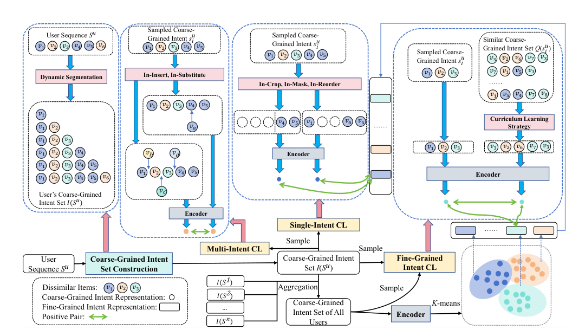

# IOCLRec：面向多意图的对比学习序列推荐

> 论文：Intent Oriented Contrastive Learning for Sequential Recommendation，AAAI 2025。[https://doi.org/10.1609/aaai.v39i12.33390](https://doi.org/10.1609/aaai.v39i12.33390)
> 代码：无
> 更新记录：2026-11-01 新增笔记；整理粗粒度子序列、三类意图对比任务和论文消融结果。

---

# 一、文献阅读

## 1. 方法概览

IOCLRec 认为用户意图会随时间变化，整条历史直接编码会把多个意图平均化。模型先将行为序列切成子序列，得到粗粒度意图单元，再用三类对比任务学习不同层次的意图表示。

| 模块 | 目标 | 视图构造 |
|---|---|---|
| Fine-grained ICL | 学习子序列与意图 prototype 的对应关系 | 聚类后的细粒度意图 |
| Single-intent ICL | 放大当前主导意图 | 同一意图内的裁剪、掩码、替换 |
| Multi-intent ICL | 保留多个并存意图 | 跨子序列组合和多意图增强 |

三种损失与下一物品交叉熵联合优化。与 ICSRec 只依赖同 target 正样本不同，IOCLRec 显式区分 single-intent 与 multi-intent 视图，减少单一意图假设带来的误约束。

## 2. 论文结果

论文在 Sports、Beauty、Toys、ML-1M 上进行全物品排序，完整 IOCLRec 的 NDCG@10 分别为 `0.0363、0.0657、0.0747、0.2048`。去掉 coarse、fine、single 或 multi 任一对比分支都会下降；Beauty 的对应值分别为 `0.0591、0.0629、0.0642、0.0635`（完整值 `0.0657`）。

## 3. 个人理解

IOCLRec 的重点是把“意图不确定性”拆成两个方向：一个序列内部可能有多个意图，不同用户也可能共享同一意图。前者需要 multi-intent 增强，后者需要 prototype/跨序列对齐。切分策略会直接影响这两个监督信号的数量，因此与 SSS 笔记中的评测问题相关。

## 4. 本地实验

| 项目 | 结果 |
|---|---|
| 主实验 |  |
| 三类 ICL 消融 |  |
| 子序列长度和聚类数 $K$ |  |
