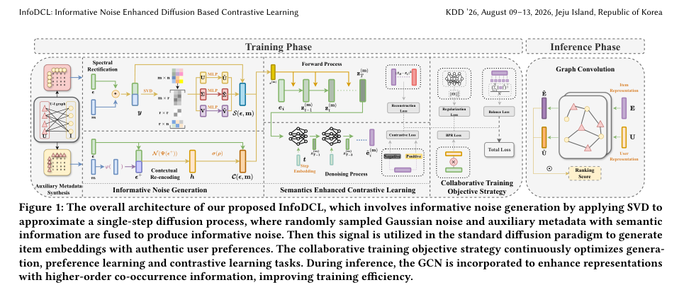

# InfoDCL：将辅助语义融入扩散噪声构造对比视图

> 论文：InfoDCL: Informative Noise Enhanced Diffusion Based Contrastive Learning，KDD 2026。[https://doi.org/10.1145/3770854.3780288](https://doi.org/10.1145/3770854.3780288)
> 代码：无
> 更新记录：2026-10-22 统一笔记顶部信息格式；保留原有阅读与复现记录，论文结果与本地结果分开。

---
# 一、文献阅读

## 1. 研究背景

**图 1：InfoDCL 总体架构**（论文第 3 页）。图中展示 PSNet 将高斯噪声与辅助元数据融合，生成信息噪声，再送入标准扩散过程生成物品嵌入；协作训练目标同时优化生成、偏好学习和对比学习；推理阶段引入 GCN 层融合高阶共现信息。

对比学习在推荐系统中通过构造增广视图学习判别性表示，已取得显著进展。然而，现有方法通常**随机扰动原始交互图**来构造更稀疏的视图，因为它们不知道用户真实偏好。推荐数据本身高度稀疏，这种随机扰动只能捕获非常有限的语义信息，构造出的对比视图可能与用户真实意图偏离。SimGCL 等方法指出不必扰动图结构，直接在嵌入上加噪声即可实现分布均匀化，但仅从已有信息构造视图仍然不足以反映真实用户偏好。DiffMM 等尝试引入辅助数据，但主要对齐异构来源的视图，由于模态间分布差距和潜在噪声，对齐往往不充分。

论文的核心动机：**利用扩散模型强大的生成能力，生成真正反映用户偏好的对比视图**，而不是简单加扰动或注入随机噪声。

## 2. 研究目的

通过将**辅助语义信息融入扩散过程的噪声生成**，替代随机高斯噪声，生成更贴近真实用户偏好的对比视图；同时设计协作训练目标，将生成与偏好学习之间的干扰转化为相互协作；并在推理阶段引入高阶共现信息，在保持训练效率的同时提升表示质量。

## 3. 研究问题

1. 如何挖掘期望的用户偏好，同时避免破坏固有稀疏数据中的共现关系？
2. 如何协同优化扩散生成过程与偏好学习？经验观察表明二者训练目标可能相互干扰，导致优化不足。
3. 如何在不显著增加训练开销的前提下，利用高阶共现信息提升表示质量？
4. 方法能否在多个真实数据集上超越现有对比学习与扩散推荐方法？

## 4. 研究方法

以下依照论文第 3 章展开。设 $\mathcal{U},\mathcal{I}$ 分别为用户、物品集合，交互图 $\mathcal{G}=(\mathcal{U}\cup\mathcal{I},\mathcal{E})$，邻接矩阵 $\mathbf{A}\in\mathbb{R}^{M\times N}$。引入辅助元数据 $\mathbf{m}$，任务为预测用户对未交互物品的偏好排序。

### 4.1 整体框架

InfoDCL 是一个基于扩散的对比学习推荐框架。核心流程：对每种辅助信息，用 **PSNet** 模拟单步扩散过程，生成富含语义的**信息噪声**；将该噪声注入标准扩散前向过程并去噪，生成反映用户偏好的物品嵌入；通过协作训练目标联合优化重建损失、对比损失和 BPR 损失；推理阶段仅用多层 GCN 引入高阶共现。

### 4.2 信息噪声生成：PSNet

PSNet 由两个核心模块组成：**谱校正（Spectral Rectification）** 和 **上下文重编码（Contextual Re-encoding）**。其动机来自 Davis–Kahan 定理，该过程本质上模拟单步扩散。

#### 4.2.1 辅助元数据合成

由于随机噪声本身缺乏语义，论文分别构造用户相似图和物品相似图来生成辅助元数据。具体地，仅利用训练集中的用户–物品交互构造用户社交关系图和物品特征相似图，再基于 LightGCN 预训练嵌入聚合得到辅助元数据。该元数据具有可扩展性：当数据集提供真实社交关系、知识图谱链接或多模态属性时，也可纳入以丰富语义。

#### 4.2.2 谱校正

谱校正旨在通过对输入信号做奇异值分解（SVD）来近似单步扩散生成过程。输入信号 $\mathbf{y}$ 由噪声 $\boldsymbol{\epsilon}$ 与元数据 $\mathbf{m}$ 组合而成：

$$
\mathbf{y} = \boldsymbol{\epsilon} + \mathbf{m},\qquad
\mathbf{y} = \mathbf{U}\boldsymbol{\Sigma}\mathbf{V}^{\top},\qquad
d \ll D \qquad (1)
$$

其中 $\mathbf{U}\in\mathbb{R}^{1\times d}$，$\mathbf{V}\in\mathbb{R}^{D\times d}$，$\boldsymbol{\Sigma}\in\mathbb{R}^{d\times d}$。三者分别送入不同的 MLP 层，模拟扩散范式的特征生成过程：

$$
\hat{\mathbf{U}} = \mathrm{MLP}(\mathbf{U}),\qquad
\hat{\mathbf{V}} = \mathrm{MLP}(\mathbf{V}_{1:}^{\top}),\qquad
\hat{\boldsymbol{\Sigma}} = \mathrm{MLP}(\mathrm{diag}(\boldsymbol{\Sigma})) \qquad (2)
$$

其中 $\hat{\mathbf{U}},\hat{\mathbf{V}},\hat{\boldsymbol{\Sigma}}\in\mathbb{R}^{d}$。随后拼接并映射回原空间：

$$
\mathbf{g} = \Phi([\hat{\mathbf{U}} \,\|\, \hat{\mathbf{V}} \,\|\, \hat{\boldsymbol{\Sigma}}]) \in \mathbb{R}^{D} \qquad (3)
$$

其中 $\Phi:\mathbb{R}^{3d}\to\mathbb{R}^{D}$ 为非线性映射。最后加残差连接：

$$
\mathbf{S}(\boldsymbol{\epsilon},\mathbf{m}) = \mathbf{y} + \mathrm{diag}(\tanh(\boldsymbol{\alpha}))\cdot \mathbf{g} \qquad (4)
$$

其中 $\boldsymbol{\alpha}\in\mathbb{R}^{D}$ 为可学习参数向量，控制残差尺度。

#### 4.2.3 上下文重编码

为进一步融合噪声与辅助元数据，上下文重编码模块旨在学习 $\mathbf{S}(\boldsymbol{\epsilon},\mathbf{m})$ 与理想信息噪声之间的残差。首先构造增强输入：

$$
\boldsymbol{\epsilon}^{+} = \boldsymbol{\epsilon} + \boldsymbol{\phi}(\mathbf{m}) \in \mathbb{R}^{D} \qquad (5)
$$

然后经线性变换与层归一化：

$$
\mathbf{h} = \mathcal{N}(\Psi(\boldsymbol{\epsilon}^{+})) \in \mathbb{R}^{D} \qquad (6)
$$

其中 $\Psi$ 为线性函数，$\mathcal{N}$ 为层归一化。最终上下文重编码输出为：

$$
\mathbf{C}(\boldsymbol{\epsilon},\mathbf{m}) = \boldsymbol{\epsilon} + \sigma(\rho)\cdot \mathbf{h} \qquad (7)
$$

其中 $\rho$ 为残差缩放因子，$\sigma(\cdot)$ 为 sigmoid。

**PSNet 输出。** 将谱校正与上下文重编码融合，并加入辅助元数据：

$$
\boldsymbol{\epsilon}^{(\mathbf{m})} =
\underbrace{\mathbf{S}(\boldsymbol{\epsilon},\mathbf{m})}_{\text{rectification}} +
\underbrace{\eta_0 \mathbf{C}(\boldsymbol{\epsilon},\mathbf{m})}_{\text{re-encoding}} +
\underbrace{\sigma(\eta_1 - 1)}_{\text{term}} \boldsymbol{\phi}(\mathbf{m}) \qquad (8)
$$

其中 $\eta_0,\eta_1\in\mathbb{R}$ 为可学习标量，$\boldsymbol{\phi}(\mathbf{m})$ 为辅助元数据嵌入。最终得到富含语义的信息噪声 $\boldsymbol{\epsilon}^{(\mathbf{m})}$。

### 4.3 语义增强对比学习

将信息噪声注入扩散前向过程。对初始化物品嵌入 $\mathbf{e}_i\in\mathbb{R}^d$ 和信息噪声 $\boldsymbol{\epsilon}^{(\mathbf{m})}$，第 $t$ 步前向：

$$
\mathbf{z}_i^{(\mathbf{m})} = \sqrt{\bar{\alpha}_i}\mathbf{e}_i + \sqrt{1-\bar{\alpha}_i}\boldsymbol{\epsilon}_i^{(\mathbf{m})},\qquad
\bar{\alpha}_i = \prod_{s=1}^{t}\alpha_s,\qquad
0<\alpha_t<1 \qquad (9)
$$

当 $t=T$ 时，$\mathbf{z}_i^{(\mathbf{m})}$ 作为反向链的起点。经过扩散后，最终生成输出 $\hat{\mathbf{e}}_i^{(\mathbf{m})}$ 同时捕获物品语义和用户偏好。重建损失为：

$$
\mathcal{L}_r = \sum_{i=1}^{N}\left\|\mathbf{e}_i - \boldsymbol{\mu}_\theta(\mathbf{z}_i^{(\mathbf{m})},t)\right\|^2 \qquad (10)
$$

对比损失将扩散生成的嵌入 $\hat{\mathbf{e}}_i^{(\mathbf{m})}$ 与物品嵌入 $\mathbf{e}_i$ 对齐：

$$
\mathcal{L}_{\mathrm{con}} = -\sum_{i=1}^{N}\log
\frac{\exp(\mathrm{sim}(\hat{\mathbf{e}}_i^{(\mathbf{m})},\mathbf{e}_i)/\tau)}
{\sum_{j=1}^{N}\exp(\mathrm{sim}(\hat{\mathbf{e}}_i^{(\mathbf{m})},\mathbf{e}_j)/\tau)} \qquad (11)
$$

其中 $\tau>0$ 为温度超参数。

### 4.4 协作训练目标策略

由于物品表示从头初始化，本身缺乏共现关系，论文引入 BPR 损失作为补充目标：

$$
\mathcal{L}_{bpr} = -\sum_{u=1}^{M}\sum_{i\in\mathcal{N}_u}\sum_{j\notin\mathcal{N}_u}
\ln\sigma(\hat{\mathbf{g}}_{ui} - \hat{\mathbf{g}}_{uj}) \qquad (12)
$$

**协作平衡损失。** 训练中观察到重建损失与 BPR 损失差距逐渐扩大，影响生成质量。引入基于 L2 范数的协作平衡损失：

$$
\mathcal{L}_c = \frac{1}{N}\|\hat{\mathbf{e}}^{(\mathbf{m})}\|_2 =
\frac{1}{N}\left(\sum_i|\hat{\mathbf{e}}^{(\mathbf{m})}|^2\right)^{1/2} \qquad (13)
$$

**总优化目标。** 加权组合各损失：

$$
\mathcal{L}_{total} = (1-\lambda_b)\mathcal{L}_r + \lambda_b\mathcal{L}_{bpr} +
\lambda_c\mathcal{L}_{con} + \lambda_l\mathcal{L}_c + \lambda_g\mathcal{L}_{reg} \qquad (14)
$$

其中正则项为：

$$
\mathcal{L}_{reg} = \sum_{i=1}^{N}(\|\mathbf{e}_i\|_2^2 + \|\mathbf{u}_i\|_2^2) \qquad (15)
$$

系数 $\{\lambda_b,\lambda_c,\lambda_l,\lambda_g\}$ 在验证集上调优。多通道时，各通道的重建、对比、平衡损失分别求和后联合优化。

### 4.5 推理阶段

推理时舍弃额外扩散采样，直接使用训练学到的用户和物品表示。为进一步丰富嵌入，使用 LightGCN 传播高阶共现信号。将观测交互图转为对称归一化邻接矩阵 $\bar{\mathbf{A}}_{\mathbf{u},i}$，执行 $K$ 层图卷积：

$$
\hat{\mathbf{E}} = \bar{\mathcal{A}}_{\mathbf{u},s}\mathbf{E},\qquad
\hat{\mathbf{U}} = \bar{\mathcal{A}}_{s,i}\mathbf{U},\qquad
\bar{\mathcal{A}}_{\mathbf{u},i} = \frac{\mathcal{A}_{\mathbf{u},i}}{\sqrt{|\mathcal{N}_{\mathbf{u}}||\mathcal{N}_{i}|}} \qquad (16)
$$

最终通过内积计算用户–物品相关性得分并排序。

### 4.6 理论分析

论文给出两个定理：

- **定理 A.1**：证明 PSNet 生成的信息噪声符合扩散框架，并有效融入辅助元数据的语义信息。通过 DDIM 单步去噪与反演，得到

$$
\mathbf{v}_T' = \mathbf{v}_T + \kappa\cdot\mathbf{g}_s,\qquad
\kappa = (\omega_t-\omega_w)\cdot
\frac{\boldsymbol{\alpha}_T\boldsymbol{\sigma}_{T-k}-\boldsymbol{\alpha}_{T-k}\boldsymbol{\sigma}_T}{\boldsymbol{\alpha}_{T-k}}
$$

其中语义梯度

$$
\mathbf{g}_s = \boldsymbol{\epsilon}_0\left(\mathbf{v}_{T-\frac{k}{2}},T-\frac{k}{2}\mid\mathbf{s}\right)
- \boldsymbol{\epsilon}_0\left(\mathbf{v}_{T-\frac{k}{2}},T-\frac{k}{2}\mid\boldsymbol{\sigma}\right)
$$

- **定理 B.1**：证明信息噪声引导的扩散过程产生更高期望偏好得分：

$$
\mathbb{E}_{\mathbf{v}_T}\left[\langle\mathbf{u},\mathbf{v}_0^{\mathrm{info}}\rangle\right]
\geq
\mathbb{E}_{\mathbf{v}_T}\left[
\langle\mathbf{u},\mathbf{v}_0^{\mathrm{std}}\rangle
+ \kappa\delta
- \gamma\kappa^2\|\mathbf{u}\|\cdot\|\mathbf{g}_s\|
\right]
$$

并给出最优注入强度

$$
\kappa^* = \frac{\delta}{2\gamma\|\mathbf{u}\|\cdot\|\mathbf{g}_s\|}
$$

## 5. 实验设置

### 5.1 数据集

五个公开推荐数据集：ML-1M、Amazon-Office、Amazon-Electronics、Amazon-Baby、Taobao。统计如下：

| 数据集 | 用户数 | 物品数 | 交互数 | 稀疏度 |
|---|---:|---:|---:|---:|
| ML-1M | 60,404 | 3,706 | 1,000,209 | 95.53% |
| Office | 4,905 | 2,420 | 53,258 | 99.55% |
| Baby | 19,445 | 7,050 | 159,669 | 99.88% |
| Taobao | 12,539 | 8,735 | 83,648 | 99.92% |
| Electronics | 32,886 | 52,974 | 337,837 | 99.69% |

### 5.2 评估指标

采用全排序评估，报告 Recall@K 和 NDCG@K，$K=20,50$。

### 5.3 基线模型

- 经典协同过滤：MF、ENMF
- 图神经网络：NGCF、LightGCN、UltraGCN、MGDF
- 扩散生成模型：DiffRec、DDRM、GiffCF
- 对比学习：SGL、NCL、SimGCL、RecDCL、SGCL、CoGCL
- 多模态对比：MMSSL、LATTICE、BM3、LGMRec、MGCN、DiffMM

### 5.4 实现细节

嵌入维度 64，Xavier 初始化。学习率对数采样于 $[1\times10^{-6},5\times10^{-1}]$。批量大小按数据集密度选择（ML-1M 为 1024，Office 为 2000）。负样本数等于正样本数（等于批量大小）。损失系数搜索范围：$\lambda_r,\lambda_b\in[0,1.0]$，$\lambda_g\in[0.001,0.01]$，$\lambda_{\mathrm{con}}\in[5\times10^{-5},5\times10^{-6}]$。推理 GCN 层数 0–3，扩散步数 100–500。优化器比较 Adam 与 AdamW。

## 6. 实验结果

### 6.1 主实验（表 2）

表 2 在五个数据集上对比所有方法。InfoDCL-S（单通道）和 InfoDCL-D（双通道）均取得最佳。以下摘录关键指标（完整表格见论文第 6 页）：

| 数据集         | 指标        |          最佳基线 | InfoDCL-S | InfoDCL-D |     提升 |
| ----------- | --------- | ------------: | --------: | --------: | -----: |
| Baby        | Recall@20 |  CoGCL 0.0832 |    0.0856 |         — |  9.46% |
| Baby        | NDCG@20   |  CoGCL 0.0355 |    0.0359 |         — |  6.21% |
| Office      | Recall@20 |  CoGCL 0.1364 |    0.1398 |         — | 11.70% |
| Office      | NDCG@20   |  CoGCL 0.0630 |    0.0625 |         — | 10.14% |
| Taobao      | Recall@20 |  CoGCL 0.2001 |    0.1996 |         — | 24.20% |
| Taobao      | NDCG@20   |  CoGCL 0.0900 |    0.0895 |         — | 18.11% |
| Electronics | Recall@20 | SimGCL 0.0435 |    0.0473 |    0.0464 |  8.73% |
| Electronics | NDCG@20   |   SGCL 0.0199 |    0.0210 |    0.0217 |  9.05% |
| ML-1M       | Recall@20 |    NCL 0.1192 |    0.1701 |    0.1631 | 42.70% |
| ML-1M       | NDCG@20   |    NCL 0.0417 |    0.0538 |    0.0511 | 29.02% |

**主要观察**：

- 扩散推荐模型（DiffRec、GiffCF）优于传统基线，但随机噪声破坏稀疏交互。
- 对比学习方法（SGL、CoGCL）提升鲁棒性，但未利用辅助信息。
- InfoDCL 在所有数据集上取得最佳整体性能。

### 6.2 消融实验（图 2）

图 2 在五个数据集上对比以下变体：

- **w/o SR**：去除谱校正，仅保留上下文重编码。性能显著下降。
- **w/o CR**：去除上下文重编码，仅用 SVD。性能下降，但不如 w/o SR 严重。
- **w/o PSNet**：用随机高斯噪声替代信息噪声。几乎所有数据集和指标上严重退化。
- **One-Step-Diff**：用显式单步扩散替代 PSNet。结果表明 PSNet 能有效模拟单步扩散。
- **w/o CBL**：去除协作平衡损失。所有数据集和指标下降，在 Amazon-Electronics 上尤为明显。

### 6.3 多模态对比（表 3）

与多模态推荐系统对比（MMSSL、LATTICE、BM3、LGMRec、MGCN、DiffMM），InfoDCL 在五个数据集上均优于所有基线。在仅含视觉模态的 Taobao 数据集上优势尤为显著。

### 6.4 训练效率（图 3）

在 Amazon-Electronics 上比较平均每 epoch 训练时间与 Recall@20。InfoDCL 在 Recall@20 上最高，同时训练时间相对较低，取得性能–效率的较优平衡。

### 6.5 深入分析

#### 6.5.1 SNR 比较（图 4、图 8）

定义

$$
\mathrm{SNR}(X) = \frac{(\mathbb{E}[X])^2}{\mathrm{Var}(X)} \qquad (17)
$$

图 4 和图 8 显示，信息噪声的 SNR 一致高于高斯噪声，且随扩散步数增加优势更明显。

#### 6.5.2 可视化比较（图 5）

在 Amazon-Baby 上用 t-SNE 可视化物品嵌入。随机噪声导致嵌入聚集在有限离散区域，难以区分；信息噪声使嵌入分布更均衡。

#### 6.5.3 协作训练目标分析（图 6）

在 Amazon-Electronics 上，无协作平衡损失时重建损失与 BPR 损失差距持续扩大；加入后两者更紧密对齐，训练更稳定。

#### 6.5.4 特征向量余弦相似度（图 7）

扩散输入与输出 SVD 得到的奇异向量余弦相似度大多接近 1，说明结构高度对齐，为 PSNet 设计提供依据。

### 6.6 超参数分析（图 9）

- $\lambda_b$：增大通常提升性能，尤其在 Taobao 和 Office。
- $\lambda_l$：影响因数据集而异，ML-1M 和 Office 在 $10^{-3}$ 或 $10^{-4}$ 附近最佳。
- $\lambda_g$：较低值（$3\times10^{-3}$ 至 $5\times10^{-3}$）更好，过正则化抑制学习。
- $\lambda_{\mathrm{con}}$：较小值（如 $5\times10^{-3}$）一致提升指标，过强对比损失可能主导学习、损害泛化。

## 7. 结论

InfoDCL 用信息噪声替代随机高斯噪声，为稀疏推荐注入丰富语义；构建协作训练目标协调生成与偏好学习；在五个真实数据集上显著优于现有扩散与对比学习方法。该工作为对比学习推荐提供了新范式，并为扩散方法在稀疏推荐中的应用指明方向。

# 二、代码复现

## 1. 环境配置与运行

> 论文未提供官方代码仓库，待公开后补充。预计依赖：PyTorch、NumPy、SciPy、tqdm，环境配置与 TADA 类似。运行入口可能为 `main.py`，参数包括数据集、骨干、扩散步数、损失系数等。

## 2. 源代码分析：论文公式到代码

> 待代码公开后补充。需重点核对：

- PSNet 中 SVD 分解与 MLP 映射的实现；
- 信息噪声生成式 (8) 的残差与可学习标量；
- 扩散前向过程式 (9) 的调度器；
- 协作训练目标式 (14) 的损失权重；
- 推理阶段 GCN 层式 (16) 的邻接矩阵归一化。

## 3. bug 检查及修复

> 待代码公开后补充。

## 4. 代码修改及优化

> 待代码公开后补充。

## 5. 实验结果复现

> 待代码公开后补充。需按论文实验顺序整理主实验、消融、多模态对比、效率分析、SNR 比较、可视化、超参数分析等。
