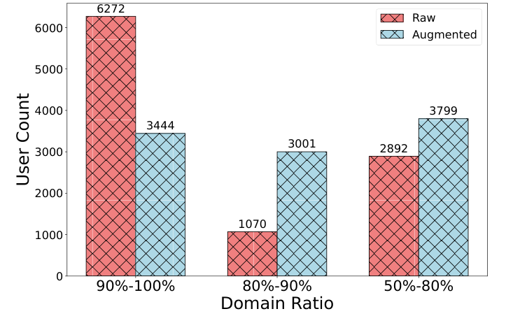
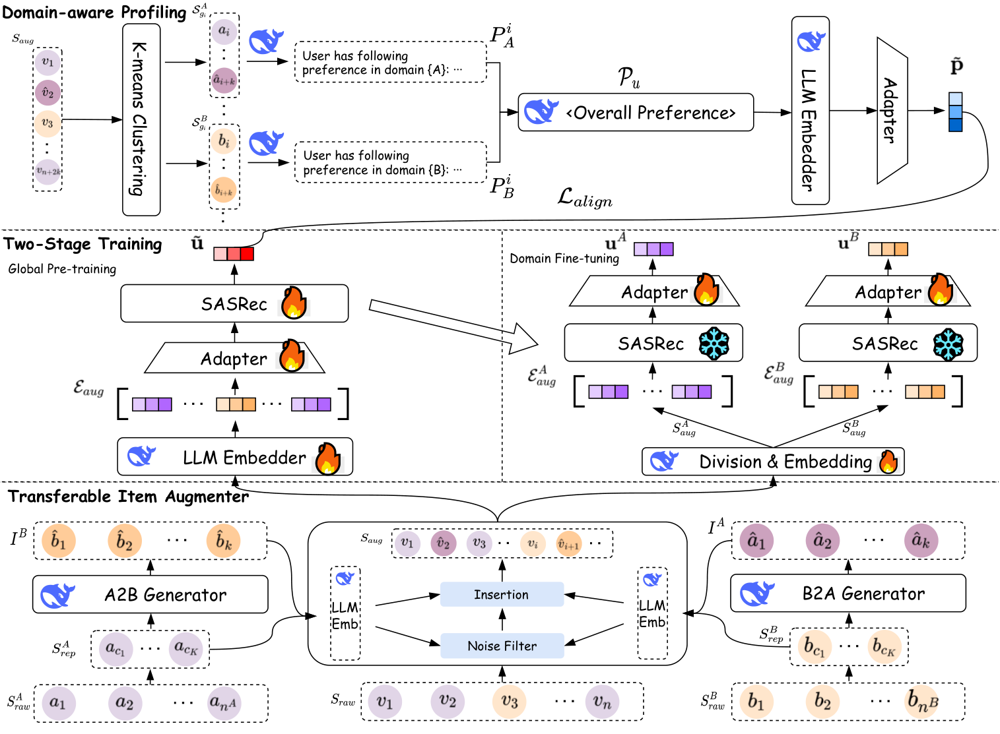
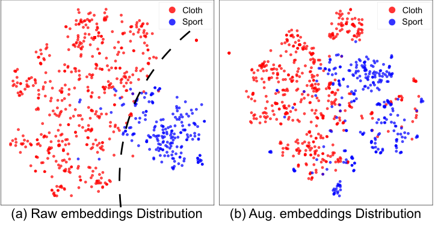
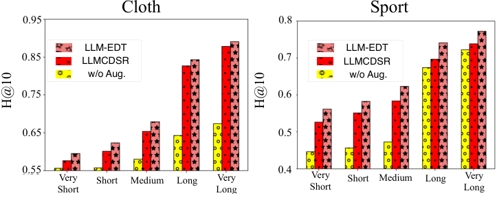
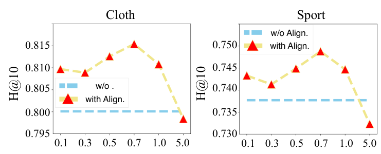
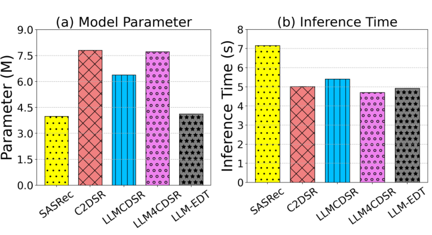

# LLM-EDT：通过大模型增强与双阶段训练改善跨域推荐

> 论文：LLM-EDT: Large Language Models Enhanced Cross-domain Sequential Recommendation with Dual-phase Training，SIGIR 2026。[https://doi.org/10.1145/3805712.3809748](https://doi.org/10.1145/3805712.3809748)
> 代码：https://github.com/Applied-Machine-Learning-Lab/SIGIR26_LLM-EDT
> 更新记录：2026-10-22 统一笔记顶部信息格式；保留原有阅读与复现记录，论文结果与本地结果分开。

---
# 一、文献阅读

## 1. 研究背景

跨域序列推荐 CDSR 利用多个领域的行为缓解单域稀疏，但仍存在两类障碍：一个领域占据历史大部分，使弱势领域偏好难以学习；混合序列中的域切换又使共享和专属偏好难以衔接。LLM 可以生成潜在交互、编码物品和总结画像，却可能引入无关生成样本，或用粗糙的一次总结掩盖各域细节。

原文图 1 的蓝色增强分布用于讨论已有 LLMCDSR 的增强效果，不能直接当作本论文全部增强实验的结果。另有重要记号差异：正文把 $r$ 解释为 A 域占比，但实际给出的公式为 $r=|n_A-n_B|/(n_A+n_B)$。按公式，$r=0$ 表示均衡，$r=1$ 表示只有一个域；它不是 $n_A/(n_A+n_B)$，也不包含哪个域占优势的方向。

## 2. 研究目的

通过可迁移物品增强减少领域不平衡与生成噪声；先学习共享偏好再适配各域，缓解领域转换；用分域细粒度画像增强全局表示。LLM 生成和嵌入提前缓存，使在线推荐沿用较轻量的序列模型。

## 3. 研究问题

1. 如何生成既关联源域兴趣、又符合目标域偏好的潜在物品？
2. 如何安排增强物品的位置，形成有效的域转换信号？
3. 如何把共享知识传递给领域专属表示？
4. 领域感知画像能否减少粗糙总结带来的信息损失？
5. 效果能否推广到不同历史长度、LLM 和序列骨干，成本如何？

以上为阅读归纳，原文以第 4.2–4.9 节组织对应实验。

## 4. 研究方法

LLM-EDT 的三个模块是可迁移物品增强器、双阶段训练及领域感知画像。增强器先按源域聚类选代表物品，再生成另一域物品，经两域相似度过滤后插在最相似源域物品之后。混合增强序列用于全局预训练；随后冻结 SASRec，训练两个域适配器。用户画像通过“总结—重构—分析”产生，并与全局表示对齐。

这里双阶段作用于共享到专属的训练过程；不是先微调 LLM 再训练推荐器。原文核心设计使用离线 LLM 嵌入与生成结果，在线阶段不调用 LLM。

## 5. 研究内容（公式分析）

### 5.1 任务定义与增强序列：第 2 节，式(1)–(3)

用户 $u$ 的混合序列为 $S_u$，A/B 域子序列为 $S_u^A,S_u^B$，$n=n_A+n_B$。原文用每域插入 $k$ 个样本的理想化记号表示：

$$S_{aug}=\{v_1,\hat v_2,\ldots,v_{n+2k-1},\hat v_{n+2k}\},\tag{1}$$

$$S_{aug}^A=\{a_1,\hat a_2,\ldots,a_{n_A+k}\},\quad S_{aug}^B=\{b_1,\hat b_2,\ldots,b_{n_B+k}\}.\tag{2}$$

分别在 A、B 域候选中最大化下一物品得分：

$$\arg\max_{v_i\in A_{aug}}P(v_{n+1}=v_i\mid S_{aug},S_{aug}^A,S_{aug}^B),\quad\arg\max_{v_i\in B_{aug}}P(v_{n+1}=v_i\mid S_{aug},S_{aug}^A,S_{aug}^B).\tag{3}$$

过滤后可能不足 $k$ 个，实际长度、截断方式与增强物品 ID 管理需要从实现确认。原表增强后物品数增加，不能先验假定所有生成物品都是原物品库中已有 ID。

### 5.2 可迁移生成、过滤及插入：第 3.2 节，式(4)–(6)

从源域历史通过 K-means 得到多样的代表物品，使用提示 $T$ 生成另一域物品：

$$I_B=\mathrm{LLMs}(T,S_{rep}^A),\qquad I_A=\mathrm{LLMs}(T,S_{rep}^B).\tag{4}$$

对候选 $i$，分别寻找两个域最相似代表物品及对应最高分。用更明确的等价记号整理式(5)：

$$s_i^A=\arg\max_{s\in S_{rep}^A}\cos(E_i,E_s),\quad score_i^A=\max_{s\in S_{rep}^A}\cos(E_i,E_s),\tag{5}$$

B 域同理。A2B 候选需同时满足“与源域关联强”和“与目标域兼容”：

$$T_{A2B}=\{i\in I_B:\operatorname{rank}(score_i^A)\le k\ \land\ score_i^B\ge\tau\}.\tag{6}$$

通过过滤的 B 域物品插在最相似的 A 域物品 $s_i^A$ 之后，B2A 对称。它用源域语义选择位置，区别于随机插入或追加到序列末尾。多个样本对应同一位置时的次序、生成名称的去重与映射仍需源码明确。

此处 $\tau$ 是过滤相似度阈值；式(13)也使用 $\tau$ 表示对比温度，复现时应分成两个配置项，不能因为符号相同就共享数值。

### 5.3 全局预训练：第 3.3.1 节，式(7)–(9)

离线 LLM 物品向量 $e_i\in\mathbb R^{d_L}$ 经适配器投影至推荐维度 $d$：

$$\tilde e_i=W_1(W_2e_i+b_2)+b_1.\tag{7}$$

原文 $W_2\in\mathbb R^{(d_L/2)\times d_L}$、$W_1\in\mathbb R^{d\times(d_L/2)}$；式中未写非线性激活，不自行补成某种 MLP 激活。SASRec 对混合序列编码：

$$\tilde u=f_{\tilde\theta}(S_{aug}),\qquad q(u,i)=\tilde e_i^T\tilde u.\tag{8}$$

原文将点积写为 $P$ 并称概率；笔记用 $q$ 表示未归一化打分，避免误解。损失是正负打分差上的 pairwise logistic 目标：

$$\mathcal L_{pre}=-\sum_{u\in\mathcal U}\sum_{j=1}^{n+2k}\log\sigma\big(q_j(u,v^+)-q_j(u,v^-)\big).\tag{9}$$

因此它与 FAERec 的逐正负样本 BCE 表达不同。训练用随机负物品；不能把它误写成全物品 softmax 交叉熵。

### 5.4 领域微调：第 3.3.2 节，式(10)–(12)

全局预训练后冻结主干，分别编码域内序列，再用两个适配器获得专属表示：

$$h_A=f_{\tilde\theta}^{F}(S_{aug}^A),\quad h_B=f_{\tilde\theta}^{F}(S_{aug}^B),$$

$$u_A=W_3(W_4h_A+b_4)+b_3,\quad u_B=W_5(W_6h_B+b_6)+b_5.\tag{10}$$

A 域评分融合专属与共享两项：

$$q_A(u,i)=(\tilde e_i^A)^Tu_A+\tilde e_i^T\tilde u,\quad i\in A_{aug}.\tag{11}$$

$$\mathcal L_A=-\sum_u\sum_{j=1}^{n_A+k}\log\sigma\big(q_{A,j}(u,v^+)-q_{A,j}(u,v^-)\big).\tag{12}$$

B 域对称。共享得分保留跨域背景，专属得分补足领域细节；不是只用两个完全独立的单域模型。根据式(15)，微调优化两个域适配器，冻结主干，不能把“微调”理解为全参数继续训练。

### 5.5 领域感知画像及对齐：第 3.4 节，式(13)

先在各域嵌入内聚类成子序列，再执行三步：

1. **Summarize：** 对各域各簇分别总结偏好，保留细分兴趣。
2. **Reform：** 根据不平衡程度 $r$，从五种人工构造的描述选项选择指令，再结合域背景重构。
3. **Analyze：** 综合各域偏好与重构指令，得到跨域画像 $P_u$。

画像经 LLM 编码和适配器得到 $\tilde p$，与全局用户表示对齐。原文一个方向为：

$$\mathcal L_{align}^{1}=-\frac1B\sum_{i=1}^{B}\log\frac{\exp(\cos(\tilde u_i,\tilde p_i)/\tau)}{\sum_{j=1}^{B}\mathbf1[i\ne j]\exp(\cos(\tilde u_i,\tilde p_j)/\tau)}.\tag{13}$$

交换 $\tilde u,\tilde p$ 得第二个方向，$\mathcal L_{align}=\mathcal L_{align}^{1}+\mathcal L_{align}^{2}$。

原式分母明确用 $i\ne j$ 排除正对，和常见含正对的 InfoNCE 不同，损失可能为负；批量为 1 时分母还会为空。这里按原文记录，复现时核对作者代码，而非悄悄改式后仍称完全一致。画像只能来自相应预测时刻已知历史，不能利用测试未来。

### 5.6 训练与推断：第 3.5 节，式(14)(15)

$$\min_{\tilde\theta,\Phi}\ \mathcal L_{pre}+\alpha\mathcal L_{align},\tag{14}$$

$$\min_{\Phi_a^1,\Phi_a^2}\ \mathcal L_A+\mathcal L_B.\tag{15}$$

预训练更新主干与适配器，微调更新域适配器。增强、画像、物品/用户 LLM 嵌入可离线生成并缓存；在线仍需完成序列编码和打分，只是不进行实时 LLM 调用。缓存如何随新交互更新，原文没有给出完整增量服务方案。

## 6. 所作实验与环境、数据集、参数配置

| 项目 | 原文第 4.1 节设置 |
| --- | --- |
| 数据集 | Amazon Cloth-Sport、Electronic-Cell Phone、Food-Kitchen 三个双域任务 |
| 普通序列基线 | GRU4Rec、BERT4Rec、SASRec |
| 跨域基线 | C2DSR、TriCDR、SyNCRec、ABXI |
| LLM 基线 | LLM-ESR、LLMCDSR、LLM4CDSR |
| 环境 | NVIDIA 4090，Python 3.11，PyTorch 2.4.1 |
| 生成与嵌入 | DeepSeek API；未充分列出具体版本及全部调用配置 |
| 代表物品聚类 | $K=10$ |
| 模型与 batch | 隐藏维度 128，batch 512 |
| 预训练 | 学习率 0.001 |
| 微调 | 适配器大小 64，学习率 $10^{-5}$ |
| 对齐权重搜索 | $\alpha\in\{0.1,0.3,0.5,0.7,1.0\}$ |
| 重复实验 | seed $\{42,44,46\}$，报告三次均值 |
| 指标 | H@10、N@10；主表单尾 t 检验 $p<0.05$ |

原文将其他设置指向参考文献 [31]，没有在本文完整展开数据划分、候选采样、最大长度与早停细节。因此不能未经源码确认便写成“全物品留一评价”。结果中较大的 H@10 也不能用于反向断定评价候选规模。

### 表 1：增强前后数据统计（原文第 6 页）

| 领域对 | 领域 | 用户数（前/后相同） | 增强前物品数 | 增强后物品数 | 领域对 Avg.len（前→后） |
| --- | ---: | ---: | ---: | ---: | ---: |
| Cloth-Sport | Cloth | 9,933 | 3,278 | 4,204 | 10.71 → 11.04 |
| Cloth-Sport | Sport | 4,263 | 1,021 | 2,237 | 同上 |
| Electronic-Cell Phone | Electronic | 20,728 | 10,492 | 11,023 | 8.30 → 8.51 |
| Electronic-Cell Phone | Cell Phone | 11,762 | 2,246 | 3,604 | 同上 |
| Food-Kitchen | Food | 14,858 | 8,343 | 8,742 | 8.13 → 8.47 |
| Food-Kitchen | Kitchen | 10,145 | 3,188 | 4,378 | 同上 |

Avg.len 在原表跨两个域合并显示，本表按领域对记录，不拆成各域分别测得的平均长度。

## 7. 完整实验结果表格

### 表 2：三组双域主实验（原文第 7 页）

按领域对拆表，保留所有方法与原文提升行；原表 LLM-EDT 全部主结果带显著性星号。

#### Cloth-Sport

| 方法 | Cloth H@10 | Cloth N@10 | Sport H@10 | Sport N@10 |
| --- | ---: | ---: | ---: | ---: |
| GRU4Rec | 0.5632 | 0.5117 | 0.5536 | 0.4769 |
| BERT4Rec | 0.6239 | 0.5583 | 0.5372 | 0.4525 |
| SASRec | 0.7081 | 0.6499 | 0.5911 | 0.4872 |
| C2DSR | 0.7166 | 0.6701 | 0.5948 | 0.5627 |
| TriCDR | 0.7219 | 0.6760 | 0.6114 | 0.5703 |
| SyNCRec | 0.7301 | 0.6783 | 0.6172 | 0.5594 |
| ABXI | 0.7474 | 0.6972 | 0.6440 | 0.6083 |
| LLM-ESR | 0.7433 | 0.6804 | 0.6394 | 0.5911 |
| LLMCDSR | 0.7646 | 0.7023 | 0.7138 | 0.6379 |
| LLM4CDSR | 0.7882 | 0.7205 | 0.7021 | 0.6249 |
| LLM-EDT | 0.8104 | 0.7488 | 0.7649 | 0.6848 |
| Improv. | 2.81% | 3.93% | 7.16% | 7.35% |

#### Electronic-Cell Phone

| 方法 | Electronic H@10 | Electronic N@10 | Cell Phone H@10 | Cell Phone N@10 |
| --- | ---: | ---: | ---: | ---: |
| GRU4Rec | 0.3187 | 0.1835 | 0.3079 | 0.1701 |
| BERT4Rec | 0.3272 | 0.1871 | 0.2967 | 0.1694 |
| SASRec | 0.3501 | 0.2194 | 0.3212 | 0.1979 |
| C2DSR | 0.4559 | 0.3156 | 0.2819 | 0.1789 |
| TriCDR | 0.4532 | 0.3196 | 0.2616 | 0.1575 |
| SyNCRec | 0.4272 | 0.3014 | 0.3332 | 0.2000 |
| ABXI | 0.4623 | 0.3047 | 0.3282 | 0.2153 |
| LLM-ESR | 0.4548 | 0.2767 | 0.3411 | 0.2103 |
| LLMCDSR | 0.4900 | 0.3292 | 0.3586 | 0.2417 |
| LLM4CDSR | 0.4818 | 0.3277 | 0.3423 | 0.2229 |
| LLM-EDT | 0.5289 | 0.3775 | 0.4553 | 0.3041 |
| Improv. | 7.94% | 14.67% | 26.96% | 25.82% |

#### Food-Kitchen

| 方法 | Food H@10 | Food N@10 | Kitchen H@10 | Kitchen N@10 |
| --- | ---: | ---: | ---: | ---: |
| GRU4Rec | 0.2916 | 0.1740 | 0.3911 | 0.2894 |
| BERT4Rec | 0.3025 | 0.1869 | 0.4087 | 0.3094 |
| SASRec | 0.3250 | 0.2078 | 0.4211 | 0.3208 |
| C2DSR | 0.3416 | 0.2293 | 0.4424 | 0.3417 |
| TriCDR | 0.3457 | 0.2301 | 0.4446 | 0.3442 |
| SyNCRec | 0.3362 | 0.2116 | 0.4383 | 0.3211 |
| ABXI | 0.3652 | 0.2453 | 0.4682 | 0.3546 |
| LLM-ESR | 0.3667 | 0.2487 | 0.4551 | 0.3485 |
| LLMCDSR | 0.3746 | 0.2594 | 0.4779 | 0.3601 |
| LLM4CDSR | 0.3976 | 0.2702 | 0.4901 | 0.3768 |
| LLM-EDT | 0.4349 | 0.3109 | 0.5406 | 0.4236 |
| Improv. | 9.38% | 15.06% | 10.30% | 12.42% |

### 表 3：Cloth-Sport 消融（原文第 7 页）

| 变体 | Cloth H@10 | Cloth N@10 | Sport H@10 | Sport N@10 |
| --- | ---: | ---: | ---: | ---: |
| LLM-EDT | 0.8078 | 0.7432 | 0.7529 | 0.6779 |
| w/o Aug. | 0.7919 | 0.7311 | 0.6854 | 0.6291 |
| w/o Filtering. | 0.7724 | 0.7148 | 0.6670 | 0.6079 |
| w/o Inserting. | 0.7802 | 0.7195 | 0.6703 | 0.6214 |
| Random Inserting. | 0.7842 | 0.7235 | 0.6774 | 0.6377 |
| w/o DFT | 0.7581 | 0.6753 | 0.7049 | 0.6022 |
| w/o Profiling | 0.7951 | 0.7377 | 0.7399 | 0.6617 |
| w/o S-R-A | 0.7901 | 0.7321 | 0.7278 | 0.6526 |

w/o Aug. 去掉全部增强；w/o Filtering 直接使用初始生成样本；w/o Inserting 改为末尾追加；Random Inserting 随机插入；DFT 指领域微调；Profiling 包含画像及对齐；S-R-A 指三步画像流程。

### 表 4、5：过滤阈值与聚类数（原文第 8 页）

| 过滤阈值 τ | Cloth | Sport |
| --- | ---: | ---: |
| 0.85 | 0.8078 | 0.7573 |
| 0.90 | 0.8104 | 0.7649 |
| 0.95 | 0.8066 | 0.7587 |

| 聚类数 k | Cloth | Sport |
| --- | ---: | ---: |
| 5 | 0.8099 | 0.7487 |
| 10 | 0.8104 | 0.7649 |
| 15 | 0.7924 | 0.7601 |

两表数值与 H@10 口径相对应，原表表头仅列域名，没有再次标注指标；不将它们误解为 N@10。阈值 0.90、聚类数 10 在列示配置中效果较好。簇数属于增强器采样超参数，不应自动等同于画像模块所有聚类设置。

### 表 6：增强注入比例与画像相似度（原文第 9 页）

| 注入比例 | 画像余弦相似度 |
| --- | ---: |
| 30% | 98.76% |
| 60% | 98.28% |
| 100% | 97.91% |

### 表 7：不同领域不平衡程度（原文第 9 页）

| 领域不平衡条件 | Cloth | Sport |
| --- | ---: | ---: |
| r ≥ 0.95 | 0.7945 | 0.7421 |
| 0.95 ≥ r ≥ 0.9 | 0.8035 | 0.7589 |
| r < 0.9 | 0.8104 | 0.7649 |

边界条件按原表保留，$r=0.95$ 同时出现在前两组写法中；实际分组需明确边界归属。画像高相似度说明整体偏好较少改变，不等同于逐个生成物品都真实、可售或相关。

### 表 8：不同 LLM 配置（原文第 9 页）

| LLM 设置 | Cloth H@10 | Cloth N@10 | Sport H@10 | Sport N@10 |
| --- | ---: | ---: | ---: | ---: |
| With DeepSeek | 0.8104 | 0.7488 | 0.7649 | 0.6848 |
| With GPT3.5 | 0.8091 | 0.7452 | 0.7581 | 0.6792 |

原文比较段称 GPT-3.5 与 “text-embedding-002”，此处保留原名，不擅自更正为另一嵌入模型。具体 API ID 与向量维度需要源码或配置确认。

### 表 9：不同骨干（原文第 9 页）

| 方法 | GRU4Rec Cloth H@10 | GRU4Rec Cloth N@10 | GRU4Rec Sport H@10 | GRU4Rec Sport N@10 | BERT4Rec Cloth H@10 | BERT4Rec Cloth N@10 | BERT4Rec Sport H@10 | BERT4Rec Sport N@10 |
| --- | ---: | ---: | ---: | ---: | ---: | ---: | ---: | ---: |
| - | 0.5632 | 0.5117 | 0.5536 | 0.4769 | 0.6239 | 0.5583 | 0.5372 | 0.4525 |
| LLMCDSR | 0.7703 | 0.6865 | 0.6810 | 0.6049 | 0.7835 | 0.7084 | 0.6826 | 0.6088 |
| LLM4CDSR | 0.7599 | 0.6672 | 0.7055 | 0.6201 | 0.7713 | 0.6908 | 0.7035 | 0.6302 |
| LLM-EDT | 0.8104 | 0.7226 | 0.7573 | 0.6546 | 0.8113 | 0.7409 | 0.7814 | 0.6865 |

“−”表示相应原始骨干。不同骨干下本方法仍领先所列对比方法，支持框架可迁移性；不代表已经验证所有推荐架构。

### 图 3–6：迁移、短历史、超参数与效率

增强后两域 t-SNE 分布更接近，为语义桥梁提供定性说明。二维投影受采样及参数影响，不能单独证明高维距离或因果迁移收益。

Very Short、Short、Medium、Long、Very Long 对应原文 0–5、5–10、10–15、15–20、20 以上。两种增强方法均优于去增强版本，本方法优于 LLMCDSR。原文区间写法边界重合，复现时需统一；不能据此声称已验证完全无历史用户。

Cloth 约 0.7、Sport 约 1.0 较好。正文叙述扫描范围 [0.1,5]，与实现设置列出的离散搜索范围不同，两个信息分别保留；原文没有给逐点数值表。

原文报告参数只略高于 SASRec，推断时间略高于 LLM4CDSR。每用户 API 成本为嵌入 0.00009 美元、生成 0.000194 美元、总结 0.000477 美元；相加为 0.000761 美元（笔记计算）。这些是论文条件下的历史测量，不是当前 API 报价或重新测得的成本。

## 8. 结果分析

表 2 的 12 项结果均领先，原文提升行范围为 2.81%–26.96%。例如 Cell Phone H@10 从 LLMCDSR 的 0.3586 到 0.4553，而 Cloth 从 0.7882 到 0.8104，弱势域受益更明显，但不同领域收益存在差异。

**主表与消融表基准不能混用。** 表 2 的 Cloth/Sport H@10 为 0.8104/0.7649，表 3 完整模型为 0.8078/0.7529，原文未解释差别。应在各表内部比较，不能跨表计算模块净贡献。表 3 中去过滤比完全去增强还差，支持无关生成噪声可能抵消增强收益；去领域微调也明显下降，说明单纯增加语义样本不足以替代训练安排。

可迁移生成和分域画像仍依赖提示、API 版本与缓存。相较 FAERec 对固定物品语义的融合对齐，本方法直接改变跨域行为序列并增加域适配训练；相较 FLAME，虽然都使用冻结参数，冻结的对象与知识传递位置不同。

# 二、代码复现

## 1. 环境配置与运行

原文第 1 页给出 [官方仓库地址](https://github.com/Applied-Machine-Learning-Lab/SIGIR26_LLM-EDT)，第 6 页另有 [匿名仓库地址](https://anonymous.4open.science/r/LLM-EDT-Annoy)。当前工作区没有对应源码目录，本次未联网检查两个地址的当前状态，未安装依赖、调用 API 或启动训练。

取得源码后先固定 commit，核对依赖及数据脚本，再确认能否直接使用作者缓存。论文中的 Python/PyTorch 配置是复现参考，不是本地已验收环境；在未读取 README 前不编造运行命令。

## 2. 源代码分析：公式或模块对应的代码

| 论文内容 | 取得代码后需定位的实现 |
| --- | --- |
| 式(1)–(6) 增强 | 域 ID、物品去重/映射、双相似度过滤、相同插入位置的顺序 |
| 式(7)–(9) 预训练 | LLM 缓存投影、SASRec、正负打分差与 padding |
| 式(10)–(12) 微调 | 主干冻结、两个适配器、共享+专属评分、域内负采样 |
| 第 3.4 节画像 | 分域聚类、五种重构选项、三步提示及预测时点 |
| 式(13) 对齐 | 双向损失、分母是否排除正对、温度配置 |
| 式(14)(15) 训练 | 两阶段检查点及优化器参数集合 |
| 第 4 节评价 | 数据划分、候选集、历史屏蔽与随机种子 |

此表是公式到模块的检查清单，尚无真实文件/函数定位。完整数据流为：原始双域历史 → 双向生成/过滤/插入 → 混合和分域序列＋画像缓存 → 全局预训练 → 冻结主干、训练域适配器 → 分域评分。

## 3. bug 检查及修复

尚无源码级修复。需验证 $r$ 的实现与公式一致、过滤阈值与对比温度不共用配置、正对掩码及 batch=1 行为、冻结主干仍会不会被优化器更新，以及生成/画像是否访问验证测试未来。原文公式疑点与表间差别已在文献部分标注，不将它们写成已确认的代码缺陷。

## 4. 代码修改及优化

当前没有代码修改。后续可建立可复用的生成/嵌入缓存，记录模型 ID、提示版本和种子，并分别保存全局与领域适配器检查点；离线生成耗时与费用、在线延迟分开统计，避免只计序列模型训练而忽略语义准备成本。

## 5. 实验结果复现

| 实验 | 当前状态 |
| --- | --- |
| 三个双域任务主实验 | 未开展 |
| 表 3 七种消融 | 未开展 |
| 阈值/聚类/画像对齐扫描 | 未开展 |
| 注入比例、短历史、LLM/骨干通用性 | 未开展 |
| API 成本及推断效率 | 未开展 |

## 6. 结果对比及分析

先确认候选集与数据版本，再以种子 42/44/46 复现主表均值，补记标准差和验证选模规则。消融使用其自己的完整模型参照，不拿主表更高的数字作基线。对生成物品需明确是否参与评价候选，增广前后物品库变化及过滤失败率也应记录，保证结果可解释。
