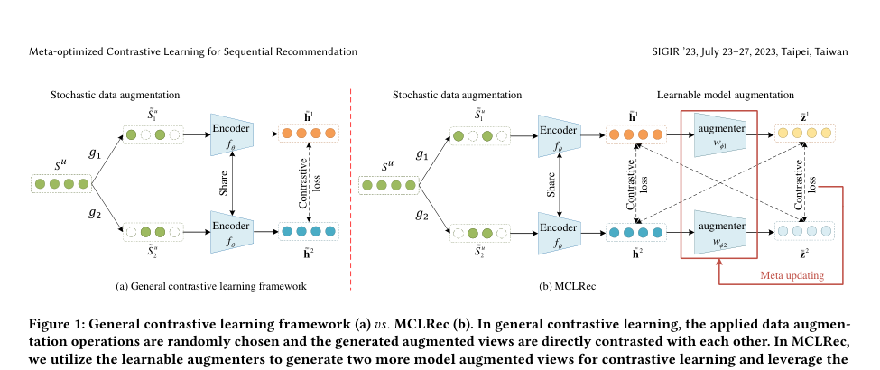

# MCLRec：通过元优化增强对比学习

> 论文：Meta-optimized Contrastive Learning for Sequential Recommendation，SIGIR 2023。[https://doi.org/10.1145/3539618.3591727](https://doi.org/10.1145/3539618.3591727)
> 代码：[https://github.com/QinHsiu/MCLRec](https://github.com/QinHsiu/MCLRec)
> 更新记录：2026-10-22 补充四种视图、元优化交替流程、正则项作用和消融解读；论文结果与本地复现分开记录，未进行的实验留空。

---

# 一、文献阅读

## 1. 为什么需要元优化的增强器

普通序列对比学习通常手工组合 Mask、Crop、Reorder 等操作，再把两条视图送入编码器。如果增强太弱，正样本几乎重复；如果增强太强，表示被迫对齐到错误语义。更关键的是，同一套增强器在不同数据集、不同训练阶段的有效性并不相同。

MCLRec 把问题拆成两层：一层学习“数据视图”本身是否保留了序列语义，另一层学习编码器输出经过投影后是否具有更好的对比结构；再用元目标反馈增强器，而不是让增强器只追求自身的相似度。

## 2. 四种视图和数据流

设原始序列为 $S$，两个增强器生成：

$$\tilde S_1=g_1(S),\qquad \tilde S_2=g_2(S).$$

| 视图 | 生成方式 | 表示 | 对应问题 |
|---|---|---|---|
| 数据视图 1 | $g_1$ 产生的序列 | $h_1=f_\theta(\tilde S_1)$ | 增强后是否仍描述同一用户 |
| 数据视图 2 | $g_2$ 产生的序列 | $h_2=f_\theta(\tilde S_2)$ | 第二种扰动是否提供互补信息 |
| 模型视图 1 | MLP $w_{\phi_1}$ 投影 $h_1$ | $z_1=w_{\phi_1}(h_1)$ | 在任务表示空间做对比 |
| 模型视图 2 | MLP $w_{\phi_2}$ 投影 $h_2$ | $z_2=w_{\phi_2}(h_2)$ | 防止编码器空间直接坍塌 |

四种视图不是四次独立采样：$h_1,h_2$ 来自两条增强序列，$z_1,z_2$ 是同一表示的模型变换。数据视图对比更关注输入变化，模型视图对比更关注表示空间的判别性，二者互补。

## 3. 损失项怎么分工

总目标可概括为：

$$\mathcal L=\mathcal L_{rec}+\lambda\mathcal L_{cl1}+\beta\mathcal L_{cl2}+\gamma\mathcal R.$$

| 项 | 作用 | 去掉后的预期 |
|---|---|---|
| $\mathcal L_{rec}$ | 下一物品预测，提供真实任务信号 | 只学到相似度而非推荐 |
| $\mathcal L_{cl1}$ | 在 $h_1,h_2$ 上对齐数据视图 | 输入增强不稳定 |
| $\mathcal L_{cl2}$ | 在 $z_1,z_2$ 上对齐模型视图/交叉视图 | 投影空间区分能力下降 |
| $\mathcal R$ | 约束两个增强器不要输出同质视图 | 两个增强器趋于相同 |

$\mathcal L_{cl1}$、$\mathcal L_{cl2}$ 的具体配对和温度需以官方实现为准；笔记只固定其功能，不把未核对的符号当成代码细节。正则项的直观形式是让“同一增强器的正对相似度”与“两个增强器之间的相似度”保持间隔，从而鼓励互补而非重复。

## 4. 元优化为什么不是普通联合训练

MCLRec 的关键是交替更新，而非把四个 loss 一次反向传播：

| 步骤 | 更新对象 | 计算方式 | 反馈含义 |
|---|---|---|---|
| 1. 内层 | 推荐编码器 $\theta$ | 用增强视图和推荐/对比损失得到临时更新 $\theta'$ | 这批增强对当前推荐模型是否有帮助 |
| 2. 外层 | 增强器参数 $\phi_1,\phi_2$ | 用验证/元目标评估 $\theta'$ 的推荐表现 | 只保留能改善推荐的增强 |
| 3. 正则 | 两个增强器 | 加入 $\mathcal R$，抑制相同输出 | 保持两条路径的互补性 |
| 4. 重复 | 交替内外层 | 继续更新 $\theta$ 与 $\phi$ | 增强策略随模型状态变化 |

普通联合训练会让增强器直接追逐当前 batch 的对比损失，可能生成“容易对齐但没有推荐信息”的视图；元优化把验证目标作为反馈，因而更接近“增强器服务于推荐”这一目标。元更新不等于额外的推理模块，测试时仍只保留编码器和预测头。

## 5. 训练与推理边界

训练时需要两条增强序列、两个编码器输出、两个 MLP 投影和元更新；推理时只输入原始序列，移除增强器、对比损失和元优化。故 MCLRec 的主要成本在训练阶段，线上开销接近原始骨干。若实现把 MLP 投影头保留到测试，需确认论文是否如此设定，不能默认投影表示就是最终推荐表示。

## 6. 论文实验设置

| 项目 | 论文设置 |
|---|---|
| 数据集 | Amazon Beauty、Amazon Sports、Yelp |
| 过滤与切分 | 用户和物品少于 5 次的记录过滤；最后一项测试、倒数第二项验证 |
| 骨干/基线 | GRU4Rec、Caser、SASRec、BERT4Rec、CL4SRec、DuoRec、SRMA 等 |
| 主要指标 | HR@5/10/20、NDCG@5/10/20 |
| 典型配置 | embedding 64；batch 256；Adam，学习率 0.001 |

## 7. 论文结果

### Sports 主表代表值

| 指标 | MCLRec | 最强基线 | 相对提升 |
|---|---:|---:|---:|
| HR@5 | 0.0328 | 0.0312 | 5.13% |
| HR@10 | 0.0501 | 0.0466 | 7.51% |
| HR@20 | 0.0734 | 0.0696 | 5.46% |
| NDCG@5 | 0.0204 | 0.0199 | 2.51% |
| NDCG@10 | 0.0260 | 0.0246 | 5.69% |

### 消融（HR@20/NDCG@20）

| 版本 | Sports | Beauty | Yelp |
|---|---|---|---|
| MCLRec | 0.0734/0.0319 | 0.1243/0.0539 | 0.0941/0.0467 |
| w/o $L_{cl1}$ | 0.0705/0.0299 | 0.1243/0.0539 | 0.0918/0.0462 |
| w/o $L_{cl2}$ | 0.0557/0.0238 | 0.1056/0.0394 | 0.0623/0.0254 |
| w/o regularization | 0.0691/0.0291 | 0.1236/0.0529 | 0.0873/0.0445 |

## 8. 结果分析与限制

- **$L_{cl2}$ 的下降最大。** 去掉模型视图对比后三个数据集都明显下降，说明仅在输入序列层面对齐不够，投影空间的判别性是主要贡献。
- **$L_{cl1}$ 仍有作用。** 其影响在 Beauty 较小，在 Sports/Yelp 更明显，可能与不同数据集的序列噪声和增强难度有关。
- **正则项是稳定器。** 去掉后不是完全失效，但指标下降，说明两个增强器会部分趋同。
- **元优化的解释边界。** 论文证明的是增强器由推荐反馈更新，并不等于对任意数据都能自动找到最优增强；元批次、学习率和验证划分仍会影响结果。
- **训练代价。** 内外层更新和两条视图使训练比普通 CL 更慢，但推理阶段不增加视图生成成本。

# 二、代码复现

## 1. 当前状态

未开始本地训练。论文表格不填入本地结果。

| 实验 | 数据集 | seed | HR@20 | NDCG@20 | 状态 |
|---|---|---:|---:|---:|---|
| 主实验 |  |  |  |  |  |
| $L_{cl1}/L_{cl2}/\mathcal R$ 消融 |  |  |  |  |  |
| 小 batch 鲁棒性 |  |  |  |  |  |

## 2. 公式到实现的核查重点

- 明确内层更新编码器、外层更新增强器，不能合并成一次普通反向传播。
- 确认 $L_{cl2}$ 的数据视图/模型视图配对和温度实现。
- 检查元目标使用的验证批次、是否 stop-gradient，以及正则项的归一化。
- 记录训练阶段和推理阶段实际保留的模块。

## 3. 本地实验记录

（留空，待实际运行后填写。）
