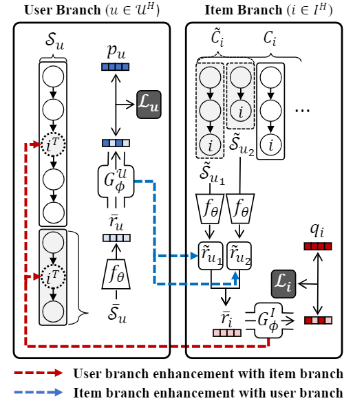
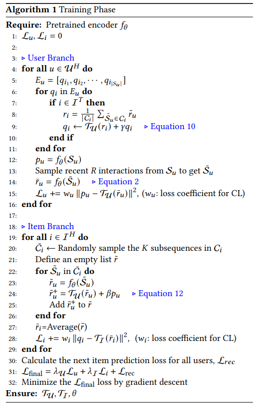

# MELT：通过长尾用户与物品互增强改善序列推荐

> 论文：MELT: Mutual Enhancement of Long-Tailed User and Item for Sequential Recommendation，SIGIR 2023。[https://doi.org/10.1145/3539618.3591725](https://doi.org/10.1145/3539618.3591725)
> 代码：[https://github.com/rlqja1107/MELT](https://github.com/rlqja1107/MELT)
> 更新记录：2026-10-31 新增笔记；2026-11-01 按 Zotero DOI 修正引用并汇总本地 MELT+SASRec 与 SASRec 运行结果；论文表格只录入可核对的代表值，数据集口径不同处单独说明。

---

# 一、文献阅读

## 1. 研究问题

序列推荐的长尾不只发生在物品侧，也发生在用户侧。交互多的头部用户通常有较长历史，头部物品也更容易被模型学到；短历史用户和低频物品同时处在信息不足的位置。只增强物品会忽略用户表示，单独增强用户又可能把低频物品推向热门分布。MELT 用两个分支同时处理两类长尾，并让它们互相提供表示监督。

## 2. 方法数据流

| 分支 | 输入 | 操作 | 监督目标 |
|---|---|---|---|
| 用户分支 | 头部用户的完整历史与随机短历史 | 用 $W_U$ 将短历史表示映射到完整历史表示 | 长尾/短历史用户的表示恢复 |
| 物品分支 | 头部物品的上下文与低频物品表示 | 用 $W_I$ 根据上下文和用户信息迁移到尾部物品 | 长尾物品的表示增强 |
| 推荐主干 | 用户序列、正负下一物品 | SASRec/FMLP 的下一物品预测 | 保持总体推荐目标 |
| 互增强 | 尾部物品更新后的表示回传到序列编码器；用户分支影响物品分支 | 两个分支交替提供教师信号 | 避免只优化一侧 |

官方训练流程图放在 `assets/MELT/train_flow.png`，推理流程放在 `assets/MELT/test_flow.png`。线上仍使用 SASRec/FMLP 预测，不额外检索用户或物品；新增分支主要增加训练阶段的表示学习成本。

## 3. 用户分支与物品分支

### 3.1 用户分支

对头部用户的完整序列 $S_u$ 和随机截取的短序列 $S_u^{short}$ 分别编码：

$$h_u^{full}=f(S_u),\qquad h_u^{short}=f(S_u^{short}).$$

用户分支学习：

$$\mathcal L_U=w_u\left\|W_U h_u^{short}-h_u^{full}\right\|_2^2.$$

$w_u$ 随训练 epoch 和序列长度变化，课程学习先从较容易的用户/长度差异开始，再逐渐加入更难的尾部用户。这样做的直觉是：尾部用户不是没有偏好，而是可见历史太少，模型需要从相似的完整历史迁移表示。

### 3.2 物品分支

物品分支利用物品出现过的上下文子序列，对头部物品表示和尾部物品表示进行映射。实现中的 $W_I$ 将低频物品的上下文表示拉近到更充分训练的表示空间，并由用户分支更新后的信息辅助训练。其损失可概括为：

$$\mathcal L_I=w_i\left\|W_I h_i^{context}-e_i^{target}\right\|_2^2.$$

$w_i$ 同样按训练进度和上下文覆盖程度调节。用户分支和物品分支不是两个独立的预处理器：训练每个 epoch 开始时，代码先用 `W_I` 更新尾部物品表示，再联合计算用户分支、物品分支和推荐损失。

总目标为：

$$\mathcal L=\mathcal L_{rec}+\lambda_U\mathcal L_U+\lambda_I\mathcal L_I.$$

官方实现中的 `lamb_u`、`lamb_i` 对应两个分支权重；`e_max` 控制课程学习的最大 epoch，`pareto_rule` 决定头尾划分阈值。

## 4. 训练与推理边界

| 阶段 | 主要操作 | 是否更新 MELT 分支 |
|---|---|---|
| SASRec 预训练 | 先得到基础序列编码器 | 否，得到 backbone checkpoint |
| MELT 训练 | 更新 $W_U$、$W_I$ 和推荐主干；每轮先迁移尾部物品表示 | 是 |
| 最优模型选择 | 每 2 个 epoch 在验证集评估，保存最佳 checkpoint | — |
| 推理 | 使用保存的 `MELT_SASRec_{dataset}.pth` 做全量/负采样排序 | 不再更新 |

MELT 的测试结果需要和 SASRec 基线在同一份数据、同一候选集及同一头尾划分上比较。代码会同时输出 Overall、Head/Tail User、Head/Tail Item 五组指标。

## 5. 论文设置与可比性

| 项目 | 官方设置 |
|---|---|
| 数据 | Amazon Clothing、Sports、Beauty、Grocery、Automotive、Music；另有 Behance、Foursquare |
| 骨干 | SASRec、FMLP |
| 训练 | 先训练 backbone，再训练 MELT 双分支；最大序列长度 50 |
| 长尾划分 | 按用户/物品频次和 Pareto 规则划分头尾 |
| 指标 | Overall、Head/Tail User、Head/Tail Item 的 Hit@10/NDCG@10（代码同时评估 @5） |
| 候选集 | `n_negative_samples=100` 的随机负例评估，不是全物品排序 |
| 代表超参 | SASRec 的 `lamb_u/lamb_i/e_max` 按数据集设置；Amazon 使用 `pareto_rule=0.8` |

已有 TADA 笔记中的论文表记录了 Amazon 5-core 口径下的 MELT+SASRec 代表值：

| 数据集 | H@10 | N@10 | H@20 | N@20 |
|---|---:|---:|---:|---:|
| Beauty | 0.0469 | 0.0224 | 0.0772 | 0.0300 |
| Sports | 0.0326 | 0.0168 | 0.0513 | 0.0214 |

这两行是论文报告值的摘录，不是本地运行结果；与下面本地原始 Amazon 数据口径不同，不能直接计算复现偏差。

# 二、代码复现

> 本地代码：`experiment/MELT/`。本次实际运行的是 `MELT_SASRec` 与其 SASRec backbone，数据集为 Beauty、Music、Sports。
> 日志：`experiment/MELT/log/{MELT_SASRec,SASRec}/{dataset}/log.txt`。
> 说明：日志中的每次结果会打印两遍；下表只保留每个运行的最终输出。Sports 的 MELT 日志包含两次结果，第二次为后续加载/评估得到的最新 checkpoint，单独列出，不将两次平均成论文结果。

## 1. 数据与运行配置

| 数据集 | 用户 | 物品 | 交互 | 平均序列长度 | MELT 参数 |
|---|---:|---:|---:|---:|---|
| Beauty | 52,204 | 57,289 | 394,908 | 5.63 | `lamb_u=0.1, lamb_i=0.4, e_max=180, pareto=0.8` |
| Music | 20,165 | 20,356 | 132,595 | 5.11 | `lamb_u=0.1, lamb_i=0.4, e_max=180, pareto=0.8` |
| Sports | 83,970 | 83,728 | 589,029 | 5.11 | `lamb_u=0.4, lamb_i=0.3, e_max=200, pareto=0.8` |

这些是官方代码预处理后的原始数据规模，不是 TADA 等笔记中的 Amazon 5-core 子集。运行入口默认 `seed=5`；当前日志未提供多随机种子均值和标准差，下面均为单次运行。

## 2. Overall 主结果

| 数据集 | SASRec N@10 | SASRec H@10 | MELT N@10 | MELT H@10 | ΔN@10 | ΔH@10 | 相对变化（N/H） |
|---|---:|---:|---:|---:|---:|---:|---:|
| Beauty | 0.2985 | 0.4595 | 0.3285 | 0.5001 | +0.0300 | +0.0406 | +10.05% / +8.84% |
| Music | 0.3740 | 0.5387 | 0.4059 | 0.5936 | +0.0319 | +0.0549 | +8.53% / +10.19% |
| Sports | 0.3196 | 0.4982 | 0.3420 | 0.5307 | +0.0224 | +0.0325 | +7.01% / +6.52% |

Sports 的 MELT 首次训练输出为 N@10=0.3184、H@10=0.4980；后续日志在 2026-10-28 输出 N@10=0.3420、H@10=0.5307。主表采用最新 checkpoint，首次输出保留为运行波动记录。

## 3. 头尾分组结果

下表为最终 MELT checkpoint 与同数据 SASRec 的 NDCG@10 / Hit@10；“Δ”均为 MELT 减 SASRec。

| 数据集 | 分组 | SASRec N/H | MELT N/H | ΔN / ΔH |
|---|---|---:|---:|---:|
| Beauty | Head User | 0.3671 / 0.5305 | 0.3825 / 0.5645 | +0.0154 / +0.0340 |
| Beauty | Tail User | 0.2829 / 0.4433 | 0.3161 / 0.4854 | +0.0332 / +0.0421 |
| Beauty | Head Item | 0.5008 / 0.7452 | 0.5572 / 0.7814 | +0.0564 / +0.0362 |
| Beauty | Tail Item | 0.0910 / 0.1663 | 0.0937 / 0.2114 | +0.0027 / +0.0451 |
| Music | Head User | 0.4649 / 0.6602 | 0.4826 / 0.7050 | +0.0177 / +0.0448 |
| Music | Tail User | 0.3470 / 0.5025 | 0.3831 / 0.5604 | +0.0361 / +0.0579 |
| Music | Head Item | 0.6277 / 0.8558 | 0.6843 / 0.8917 | +0.0566 / +0.0359 |
| Music | Tail Item | 0.1447 / 0.2520 | 0.1542 / 0.3241 | +0.0095 / +0.0721 |
| Sports | Head User | 0.3554 / 0.5441 | 0.3744 / 0.5795 | +0.0190 / +0.0354 |
| Sports | Tail User | 0.3124 / 0.4889 | 0.3355 / 0.5208 | +0.0231 / +0.0319 |
| Sports | Head Item | 0.5457 / 0.8101 | 0.5836 / 0.8237 | +0.0379 / +0.0136 |
| Sports | Tail Item | 0.0821 / 0.1704 | 0.0882 / 0.2227 | +0.0061 / +0.0523 |

相对变化 = Δ / SASRec × 100%，正值为 MELT 相对 SASRec 的提升，由表中四位小数计算：

| 数据集 | 分组 | NDCG@10 相对变化 | Hit@10 相对变化 |
|---|---|---:|---:|
| Beauty | Head User | +4.20% | +6.41% |
| Beauty | Tail User | +11.74% | +9.50% |
| Beauty | Head Item | +11.26% | +4.86% |
| Beauty | Tail Item | +2.97% | +27.12% |
| Music | Head User | +3.81% | +6.79% |
| Music | Tail User | +10.40% | +11.52% |
| Music | Head Item | +9.02% | +4.19% |
| Music | Tail Item | +6.57% | +28.61% |
| Sports | Head User | +5.35% | +6.51% |
| Sports | Tail User | +7.39% | +6.52% |
| Sports | Head Item | +6.95% | +1.68% |
| Sports | Tail Item | +7.43% | +30.69% |

## 4. 结果分析

1. **总体指标均提升。** 在三个本地数据集上，MELT 的 Overall NDCG@10 和 Hit@10 都高于 SASRec；绝对增益为 NDCG +0.0224–+0.0319、Hit +0.0325–+0.0549，对应相对提升 NDCG +7.01%–+10.05%、Hit +6.52%–+10.19%。
2. **尾部用户收益更明显。** 三个数据集的 Tail User NDCG 增益（+0.0231–+0.0361，相对 +7.39%–+11.74%）均高于 Head User（+0.0154–+0.0190，相对 +3.81%–+5.35%），符合用户分支从完整历史向短历史迁移信息的设计。
3. **尾部物品的 Hit 增益明显。** Tail Item Hit@10 增益为 +0.0451、+0.0721、+0.0523（相对 +27.12%、+28.61%、+30.69%）；但 NDCG 增益较小（+0.0027、+0.0095、+0.0061，相对 +2.97%、+6.57%、+7.43%），说明模型更常把尾部目标推入前十，却未必稳定推到更靠前的位置。
4. **头部物品也没有明显损失。** Head Item 的 NDCG/Hit 均上升，说明 MELT 的目标是互增强，不是把头部流量简单转移给尾部。
5. **Sports 需要重复实验。** 同一日志先后出现 0.3184/0.4980 与 0.3420/0.5307 两组 MELT 结果；在没有明确记录运行命令和随机种子的情况下，不应把后者解释成稳定提升。

## 5. 尚未完成的实验

| 实验 | 状态 |
|---|---|
| MELT+FMLP | 未运行 |
| Beauty/Music/Sports 多 seed 均值与标准差 | 未完成 |
| 论文八数据集完整主表复现 | 未完成 |
| 去掉用户分支 / 物品分支消融 | 未完成 |
| `lamb_u`、`lamb_i`、`e_max`、Pareto 规则敏感性 | 未完成 |
| 与 TADA 的同数据、同骨干直接对照 | 未完成 |

尚未运行的实验保持空白，不用当前单次结果推测。

## 6. 复现注意事项

- 本地 MELT 使用官方原始数据预处理，和论文表或 TADA 笔记中的 5-core 数据不是同一口径；日志还使用 100 个随机负例，不应与全物品排序结果直接比较。
- `MELT_SASRec` 首次运行会先检查 `save_model/{dataset}/SASRec_{dataset}.pth`；缺失时自动训练 backbone，再训练 MELT。
- 代码的测试评估会按用户/物品头尾集合分别统计，需确认集合阈值和 `pareto_rule` 后再比较。
- Sports 日志存在两次结果，报告时必须保留运行批次或 checkpoint 信息。
