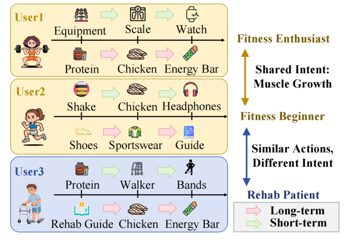
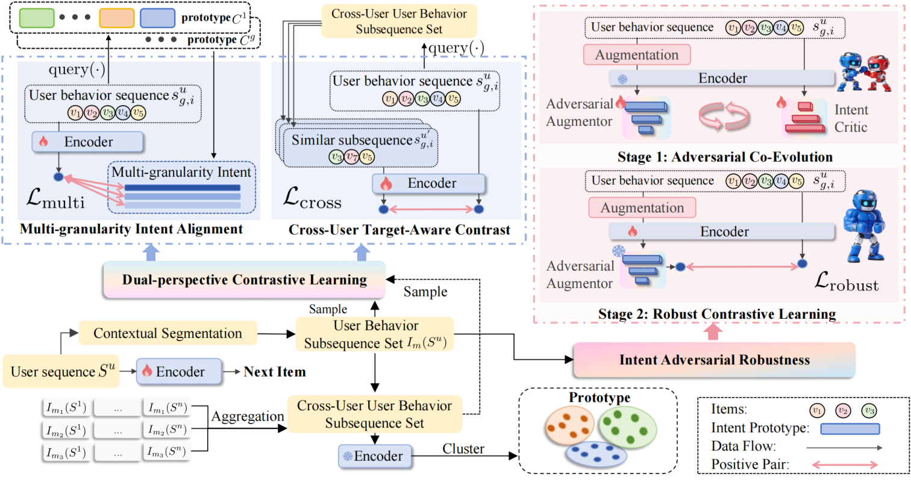
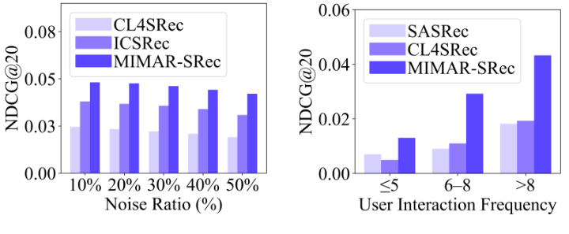
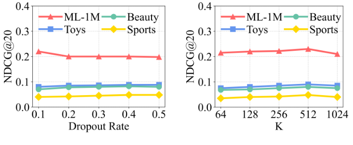

# MIMAR-SRec：结合多粒度意图与对抗训练增强序列推荐

> 论文：Multi-granularity Intent Modeling with Adversarial Robustness for Sequential Recommendation，AAAI 2026。[https://doi.org/10.1609/AAAI.V40I17.38489](https://doi.org/10.1609/AAAI.V40I17.38489)
> 代码：无
> 更新记录：2026-10-22 统一笔记顶部信息格式；保留原有阅读与复现记录，论文结果与本地结果分开。

---
# 一、文献阅读

## 1. 研究背景

序列推荐根据用户按时间排列的交互预测下一物品。把整条历史压缩成一种兴趣表示，容易混淆短期需求、过渡兴趣与长期偏好；随机点击、时间顺序扰动也会让表示偏离真实意图。原文引言以健康食品举例：相似的购物记录，可能分别对应“增肌”和“控制血糖”，仅按物品类别归纳用户难以区分。

原文图像与图注/引言的例子并不完全一致：图中实际展示三个用户，前两者共享增肌意图，第三者为康复患者；图注和引言则讲两个用户的增肌与血糖管理差异。这里分别记录，避免把图注叙述误当作图中实际标签。

## 2. 研究目的

同时实现不同时间尺度的意图建模和对行为噪声的鲁棒学习。通过多粒度分段发现共享意图，通过原型与跨用户的两种对齐增强监督，再用保留意图语义的对抗增强提高稳定性。

## 3. 研究问题

1. 如何从同一用户序列中提取不同上下文范围的意图？
2. 如何同时利用“相同意图原型”和“相似行为结果”的监督？
3. 如何产生有挑战性但不改变用户意图的增强样本？
4. 三个模块在稀疏、密集和含噪数据上的贡献是否一致？

以上按原文动机归纳，原文没有将它们逐项编号为 RQ1–RQ4。

## 4. 研究方法

MIMAR-SRec 包含多粒度上下文分段、双视角对比学习和意图相似性对抗鲁棒学习。分段后在每个粒度内进行 K-means，得到原型集合；MIA 将用户表示对齐到各粒度原型，CUTAC 将其对齐到结果相似的其他用户；ISAR 先训练增强器与评判器，再冻结增强器，训练推荐表示。

这里的“粒度”指上下文窗口范围，不等同于不同物品模态。Actor-Critic、PPO 和 RLHF 是对设计的启发；论文实际列出的优化是判别损失、对抗损失与 KL 语义约束，不能据此写成“实现了完整 PPO”。

## 5. 研究内容（公式与算法分析）

### 5.1 问题定义与上下文分段：第 3 节，式(1)

用户集合为 $\mathcal U$，物品集合为 $\mathcal V$，历史为 $S_u=[v_1^u,\ldots,v_{|S_u|}^u]$，目标为 $\arg\max_{v\in\mathcal V}P(v_{|S_u|+1}=v\mid S_u)$。

用区间写法重述原文式(1)：

$$
I_m(S_u)=\begin{cases}
\{S^u_{1:j}:j=2,\ldots,|S_u|\},&|S_u|\le m,\\
I_m(S^u_{1:m})\cup\{S^u_{a:a+m-1}:a=2,\ldots,|S_u|-m+1\},&|S_u|>m.
\end{cases}\tag{1}
$$

短序列保留从长度 2 开始的前缀，长序列再补充长度为 $m$ 的滑动窗口。例如 $S=[a,b,c,d,e],m=3$，得到 $[a,b]$、$[a,b,c]$、$[b,c,d]$、$[c,d,e]$。因此每个窗口下可能产生多个训练片段，并非仅把历史切成三个不重叠块。

原文要求 $m_1<m_2<m_3$，称具体窗口通过场景自适应优化确定，但没有列出每个数据集最终的窗口值。子序列由 SASRec 或 GRU 编码；原文还提出用 LLM 从物品描述中提取语义、与协同嵌入进入统一空间，未给出具体 LLM 型号、提示及完整融合公式。

每个粒度单独聚类，$C_g=\{c_1^g,\ldots,c_{K_g}^g\}$。原型具有粒度归属，不应直接合并全部片段后只做一次 K-means。

### 5.2 多粒度意图对齐 MIA：式(2)(3)

用户表示 $h_u=f(S_u)$ 与各粒度最近原型 $c_{k^*}^g$ 对齐：

$$\mathcal L_{multi}=\sum_{g=1}^{|M|}\beta_g\mathcal L_{ICL}(h_u,c_{k^*}^g).\tag{2}$$

原文使用双向意图对比：

$$
\mathcal L_{ICL}(x_1,x_2)=
-\log\frac{e^{\operatorname{sim}(x_1,x_2)}}{\sum_{x_i\notin F}e^{\operatorname{sim}(x_1,x_i)}}
-\log\frac{e^{\operatorname{sim}(x_2,x_1)}}{\sum_{x_i\notin F}e^{\operatorname{sim}(x_2,x_i)}}.\tag{3}
$$

$\operatorname{sim}$ 为点积，$\beta_g$ 可学习。集合 $F$ 用于缓解假负样本：序列对比时排除终止物品相同的潜在同意图序列，原型对比时排除同簇表示。式(3)没有显式温度，不能把实现中常见的温度项直接当成原式内容；式(9)则明确使用了温度。

**理解：** MIA 提供“当前用户靠近哪些共享意图”的监督。潜在同意图样本不应被当作负样本强行推远。实现时仍需核实正样本是否保留在分母、两个方向是否使用各自的排除掩码，原文记号没有完全展开这些细节。

### 5.3 跨用户目标感知对比 CUTAC：式(4)

从各粒度特定簇中采样行为结果相似的其他用户序列，得到 $h_g^{u'}$：

$$\mathcal L_{cross}=\sum_{g=1}^{|M|}\gamma_g\mathcal L_{ICL}(h_u,h_g^{u'}).\tag{4}$$

$\gamma_g$ 为可学习权重。它和 MIA 的差别是：MIA 使用簇中心，CUTAC 使用另一个真实序列的表示。即使历史不同，结果相近也可能意味着共同意图。采样只能使用训练阶段允许的结果标签，验证、测试未来物品不能用于构造训练正样本。

### 5.4 意图相似性对抗鲁棒 ISAR：式(5)–(11)，算法 1

增强器先扰动片段，再编码、细化：

$$h_{adv}^u=A(s_{g,i}^u,\omega)=f_a\big(\operatorname{Encoder}(\operatorname{Perturb}(s_{g,i}^u,\omega))\big).\tag{5}$$

$$\operatorname{Perturb}\in\{\mathrm{Mask},\mathrm{Substitute},\mathrm{Swap},\mathrm{Insert}\}.\tag{6}$$

评判器区分真实和扰动表示：

$$C(h)=\sigma(f_c(h)),\tag{7}$$

$$\mathcal L_{critic}=-\mathbb E\log C(h_u)-\mathbb E\log(1-C(h_{adv}^u)).\tag{8}$$

为避免扰动改变意图，用各粒度原型上的分布约束语义：

$$
p_g^u=\operatorname{softmax}(\operatorname{sim}(h_u,C_g)/\tau),\quad
p_g^{adv}=\operatorname{softmax}(\operatorname{sim}(h_{adv}^u,C_g)/\tau),
$$

$$\mathcal L_{sem}=\sum_g\mathrm{KL}(p_g^u\Vert p_g^{adv}).\tag{9}$$

$$\mathcal L_{aug}=\mathbb E\log C(h_u)+\mathbb E\log(1-C(h_{adv}^u))+\lambda\mathcal L_{sem}.\tag{10}$$

第一阶段交替最小化 $\mathcal L_{critic}$ 与 $\mathcal L_{aug}$。真实分布和扰动分布不仅需要骗过评判器，还要在意图原型上的软分布相近。KL 约束比要求两个向量完全相同更灵活。

第二阶段冻结 $A$，把扰动表示作为正样本：

$$\mathcal L_{robust}=\mathcal L_{ICL}(h_u,h_{adv}^u).\tag{11}$$

算法 1 的执行顺序可归纳为：准备各粒度原型 → 初始化增强器/评判器 → 交替对抗更新 → 冻结增强器 → 生成扰动表示 → 通过鲁棒对比更新推荐模型。冻结参数不自动意味着可以切断所有输入梯度；是否需要保留输入到冻结增强器的梯度路径，应依据具体训练图确认。

### 5.5 联合目标：式(12)

$$\mathcal L_{MIMAR}=\mathcal L_{Rec}+\mu\mathcal L_{multi}+\nu\mathcal L_{cross}+\eta\mathcal L_{robust}.\tag{12}$$

原文称 $\mu,\nu,\eta$ 自动学习；未说明其非负约束、归一化方式及初始化。不能任意把它们设为三个固定的默认数值并声称忠实复现。原文实验设置还复用了 $\eta,\gamma,\omega$ 等记号描述采样范围，需在源码中区分损失权重、粒度权重和扰动参数。

## 6. 所作实验与环境、数据集、参数配置

| 项目 | 原文设置或披露情况 |
| --- | --- |
| 数据 | Amazon Sports、Beauty、Toys；MovieLens-1M |
| 数据说明 | 原文称 Amazon 包含 2019 年后的交互与元数据；具体版本和过滤规则未充分展开 |
| 基线 | BPR；Caser、SASRec；BERT4Rec、CoSeRec、DuoRec；ICLRec、IOCRec、ICSRec |
| 评价 | 全物品排序，不采样评估候选；HR/NDCG@10/20 |
| 优化 | Adam，学习率 $10^{-3}$，batch 256，温度 $\tau=1.0$ |
| 搜索 | dropout、正则参数 $\{\lambda,\beta\}\in\{0.1,0.2,0.3,0.4,0.5\}$ |
| 原型数 | $\{64,128,256,512,1024\}$ |
| 其他搜索 | 原文采样比例 $\{\eta,\gamma,\delta\}\in[0.1,0.9]$，$\{\epsilon,\omega\}\in[0.5,1.0]$ |
| 硬件 | NVIDIA A100；采用早停，未给出耐心值 |
| 显著性 | 主表标星结果为双尾 t 检验 $p<0.05$ |
| 未充分披露 | 数据集规模表、具体划分、隐藏维度、窗口值、LLM 型号、训练轮数、重复运行数及聚类刷新频率 |

“全物品评估不负采样”描述的是评价阶段，不能据此推断推荐训练损失也不使用负样本。上述未披露项以本地所附 PDF 为范围，不能从其他同名数据集或相邻论文补入。

## 7. 完整实验结果表格

### 表 1：四个数据集主实验（原文第 6 页）

按数据集拆表，保留所有方法和指标。提升列照录原文，相对每行最佳基线；原表中本方法全部结果带显著性星号，以下统一在此说明。

#### Sports

| 指标 | BPR | Caser | SASRec | BERT4Rec | CoSeRec | DuoRec | ICLRec | IOCRec | ICSRec | MIMAR-SRec | 提升 |
| --- | ---: | ---: | ---: | ---: | ---: | ---: | ---: | ---: | ---: | ---: | ---: |
| HR@10 | 0.0210 | 0.0254 | 0.0327 | 0.0351 | 0.0432 | 0.0459 | 0.0429 | 0.0445 | 0.0549 | 0.0698 | 27.14% |
| HR@20 | 0.0362 | 0.0391 | 0.0493 | 0.0596 | 0.0628 | 0.0687 | 0.0638 | 0.0676 | 0.0782 | 0.0966 | 23.53% |
| NDCG@10 | 0.0100 | 0.0129 | 0.0171 | 0.0183 | 0.0237 | 0.0236 | 0.0231 | 0.0213 | 0.0321 | 0.0415 | 29.28% |
| NDCG@20 | 0.0138 | 0.0171 | 0.0211 | 0.0244 | 0.0286 | 0.0294 | 0.0284 | 0.0272 | 0.0381 | 0.0482 | 26.51% |

#### Beauty

| 指标 | BPR | Caser | SASRec | BERT4Rec | CoSeRec | DuoRec | ICLRec | IOCRec | ICSRec | MIMAR-SRec | 提升 |
| --- | ---: | ---: | ---: | ---: | ---: | ---: | ---: | ---: | ---: | ---: | ---: |
| HR@10 | 0.0289 | 0.0335 | 0.0616 | 0.0593 | 0.0717 | 0.0843 | 0.0736 | 0.0766 | 0.0935 | 0.1134 | 21.28% |
| HR@20 | 0.0467 | 0.0635 | 0.0886 | 0.0976 | 0.1026 | 0.1219 | 0.1050 | 0.1138 | 0.1286 | 0.1534 | 19.28% |
| NDCG@10 | 0.0141 | 0.0219 | 0.0335 | 0.0293 | 0.0402 | 0.0433 | 0.0396 | 0.0388 | 0.0564 | 0.0698 | 23.76% |
| NDCG@20 | 0.0185 | 0.0291 | 0.0379 | 0.0384 | 0.0479 | 0.0528 | 0.0476 | 0.0482 | 0.0652 | 0.0799 | 22.55% |

#### Toys

| 指标 | BPR | Caser | SASRec | BERT4Rec | CoSeRec | DuoRec | ICLRec | IOCRec | ICSRec | MIMAR-SRec | 提升 |
| --- | ---: | ---: | ---: | ---: | ---: | ---: | ---: | ---: | ---: | ---: | ---: |
| HR@10 | 0.0191 | 0.0326 | 0.0644 | 0.0517 | 0.0747 | 0.0951 | 0.0826 | 0.0796 | 0.1032 | 0.1212 | 17.44% |
| HR@20 | 0.0320 | 0.0535 | 0.0949 | 0.0752 | 0.1029 | 0.1284 | 0.1131 | 0.1124 | 0.1356 | 0.1596 | 17.70% |
| NDCG@10 | 0.0094 | 0.0162 | 0.0313 | 0.0302 | 0.0434 | 0.0482 | 0.0472 | 0.0374 | 0.0641 | 0.0756 | 17.94% |
| NDCG@20 | 0.0126 | 0.0214 | 0.0390 | 0.0361 | 0.0505 | 0.0566 | 0.0549 | 0.0457 | 0.0723 | 0.0852 | 17.84% |

#### ML-1M

| 指标 | BPR | Caser | SASRec | BERT4Rec | CoSeRec | DuoRec | ICLRec | IOCRec | ICSRec | MIMAR-SRec | 提升 |
| --- | ---: | ---: | ---: | ---: | ---: | ---: | ---: | ---: | ---: | ---: | ---: |
| HR@10 | 0.0406 | 0.1434 | 0.1802 | 0.2211 | 0.1853 | 0.3069 | 0.2265 | 0.2681 | 0.3222 | 0.3392 | 5.28% |
| HR@20 | 0.0743 | 0.2220 | 0.2737 | 0.3346 | 0.2942 | 0.4089 | 0.3360 | 0.3823 | 0.4336 | 0.4498 | 3.74% |
| NDCG@10 | 0.0206 | 0.0727 | 0.0941 | 0.1089 | 0.0907 | 0.1741 | 0.1167 | 0.1479 | 0.1928 | 0.2032 | 5.39% |
| NDCG@20 | 0.0291 | 0.0924 | 0.1149 | 0.1376 | 0.1239 | 0.1999 | 0.1442 | 0.1767 | 0.2202 | 0.2313 | 5.04% |

### 表 2：模块消融（原文第 7 页）

MIA 为多粒度意图对齐，CUTAC 为跨用户目标感知对比，ISAR 为意图相似性对抗鲁棒。

| 变体 | Sports H@20 | Sports N@20 | Beauty H@20 | Beauty N@20 | Toys H@20 | Toys N@20 | ML-1M H@20 | ML-1M N@20 |
| --- | ---: | ---: | ---: | ---: | ---: | ---: | ---: | ---: |
| Full Model | 0.0966 | 0.0482 | 0.1534 | 0.0799 | 0.1596 | 0.0852 | 0.4498 | 0.2313 |
| w/o MIA | 0.0912 | 0.0454 | 0.1456 | 0.0758 | 0.1531 | 0.0817 | 0.4421 | 0.2291 |
| w/o CUTAC | 0.0847 | 0.0423 | 0.1389 | 0.0719 | 0.1467 | 0.0779 | 0.4356 | 0.2264 |
| w/o ISAR | 0.0889 | 0.0437 | 0.1423 | 0.0741 | 0.1498 | 0.0798 | 0.4387 | 0.2276 |
| w/o MIA+CUTAC | 0.0798 | 0.0401 | 0.1312 | 0.0681 | 0.1398 | 0.0741 | 0.4289 | 0.2238 |
| w/o MIA+ISAR | 0.0834 | 0.0418 | 0.1356 | 0.0703 | 0.1442 | 0.0763 | 0.4312 | 0.2251 |
| w/o CUTAC+ISAR | 0.0801 | 0.0395 | 0.1298 | 0.0672 | 0.1381 | 0.0728 | 0.4267 | 0.2225 |

### 图 3：噪声与序列长度实验（原文第 7 页）

模型在干净数据上训练，在测试序列注入 10%–50% 噪声；比较 CL4SRec、ICSRec 与本方法的 Sports NDCG@20。噪声包括相似用户群中热门但未交互的物品、时间顺序扰动及上下文不相关行为。图中本方法下降较缓；另一面板比较不同历史长度，短序列用户优势明显。原文没有提供逐点数据表，不将图形读数写成精确实验值。短历史实验也不能直接证明零交互用户可用。

### 图 4：dropout 与原型数敏感性（原文第 7 页）

适中 dropout 和原型数效果较好。原型太少难以覆盖意图，太多会碎片化并增加计算量；该解释与曲线一致，但原文没有给出独立运行时间表来量化这一代价。

## 8. 结果分析

主表 16 个指标均优于基线，提升列范围为 3.74%–29.28%。Sports NDCG@20 从 ICSRec 的 0.0381 提升到 0.0482，Beauty 从 0.0652 到 0.0799；稀疏 Amazon 的相对增益比 ML-1M 更明显。

单模块移除中 CUTAC 损失最大。例如 Sports NDCG@20 从 0.0482 降至 0.0423，说明跨用户结果监督提供了单靠原型难以获得的信息。联合移除 CUTAC+ISAR 后为 0.0395；模块作用具有交互，不能把各消融下降简单相加。

**原文一致性核查：** 第 6 页正文声称相对 IOCRec 的四个 NDCG@20 提升为 13.41%、11.75%、9.23%、2.80%，与表 1 数值无法对应。笔记以原表作为定量依据；不能把这组正文百分比当作主表的计算结果。摘要提到长尾物品优势，但本 PDF 未列出独立头尾物品完整结果表，不能自行补成“长尾性能已被逐项量化”。

与已有笔记的联系：ADARec 利用扩散与专家融合增加意图多样性，MIMAR-SRec 用上下文窗口、意图原型和对抗增强组织监督；FLAME 在不同模块路径之间对齐，本方法在不同粒度及不同用户之间对齐。它们共享“多视图学习”的思想，但正样本来源与训练成本不同。

# 二、代码复现

## 1. 环境配置与运行

当前工作区没有 MIMAR-SRec 源码目录，所附原文未给出本方法的明确代码仓库地址。原文脚注“code is not publicly available”指 **IOCRec 基线**，不能用来断言 MIMAR-SRec 官方代码未公开。本次没有联网确认发布状态，也没有安装依赖或启动训练。

建议先明确数据版本与划分、LLM 特征来源、多粒度窗口、聚类刷新及两个训练阶段的轮数，再确定软件依赖；A100 仅是论文硬件设置，不代表已经核实本地环境可运行。

## 2. 源代码分析：公式或模块对应的代码

没有本地源码，以下为后续对照清单，不是已存在的类名或函数名。

| 论文模块 | 需定位的实现与核对点 |
| --- | --- |
| 式(1) 分段 | 前缀/滑动窗口是否重复、短序列处理、padding 是否进入聚类 |
| 语义与协同融合 | LLM 特征与 item ID 一一对应，原始特征是否冻结 |
| 各粒度 K-means | 聚类输入、原型数、更新周期以及空簇处理 |
| 式(2)–(4) 对比 | 原型/跨用户正样本，假负样本掩码，双向分母 |
| 式(5)–(10) 对抗 | 扰动策略是否可训练，离散操作的梯度，交替更新与 detach 边界 |
| 式(11) 冻结增强器 | 冻结参数、训练/评价模式、输入梯度是否保留 |
| 式(12) 联合优化 | 可学习权重的约束、各损失尺度与记录 |

数据流应核对为：训练历史 → 多粒度片段 → 编码与原型发现 → MIA/CUTAC → 对抗增强训练 → 冻结增强器 → 鲁棒推荐训练 → 全物品评价。

## 3. bug 检查及修复

尚未开展源码级检查，没有已确认或已修复的代码 bug。需重点验证假负样本掩码不会去掉全部候选、片段及用户标签不越界、训练正样本不访问验证/测试未来、KL 的目标分布与梯度方向一致。这些是检查建议，不是对作者代码的缺陷认定。

## 4. 代码修改及优化

当前没有代码修改。后续可缓存语义特征、批量生成片段、记录各粒度原型分布，并将两个训练阶段的权重分别保存；同时输出配置、随机种子、逐项损失和验证选模记录，以便区分训练收益与额外计算成本。

## 5. 实验结果复现

| 实验 | 当前状态 |
| --- | --- |
| 四数据集主实验 | 未开展 |
| 单模块/组合消融 | 未开展 |
| 噪声与长度分组 | 未开展 |
| dropout/原型数扫描 | 未开展 |

## 6. 结果对比及分析

复现后按相同物品库、划分和全排序口径比较表 1，使用验证集选择模型；保留多随机种子均值与标准差。原文正文与表格冲突的百分比单独记录，不通过改动本地数据处理来追逐无法对应的数值。原文没有完整效率结果，后续应补记训练总耗时、两个阶段耗时与推断开销。
