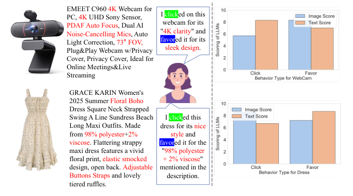
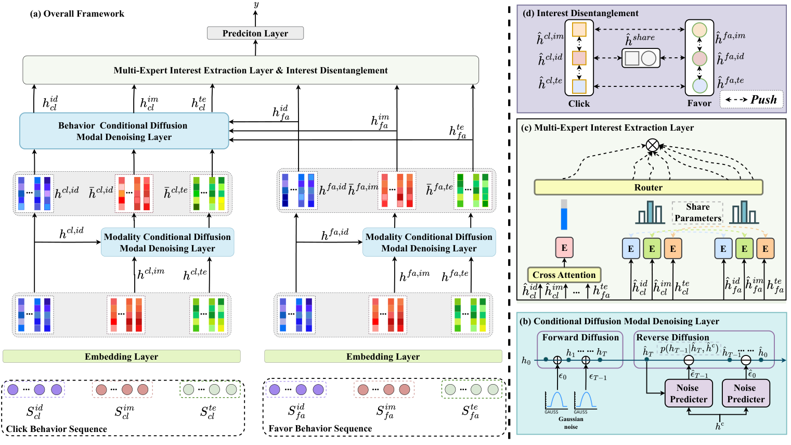
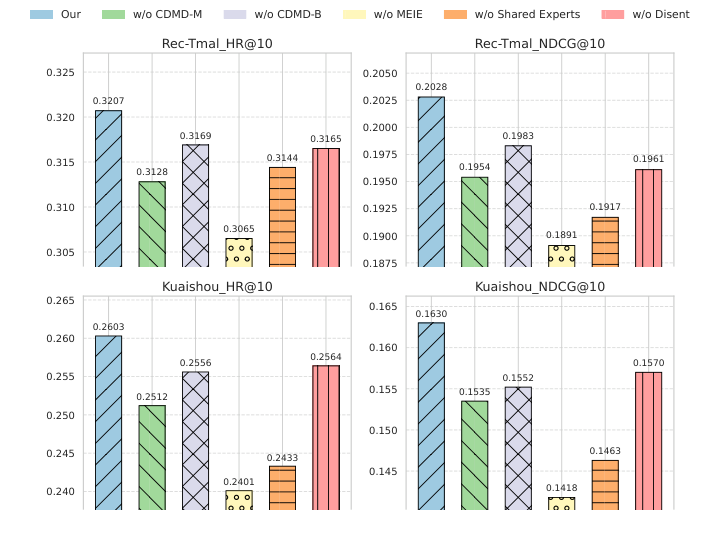
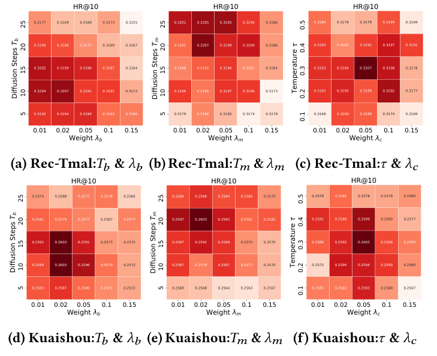
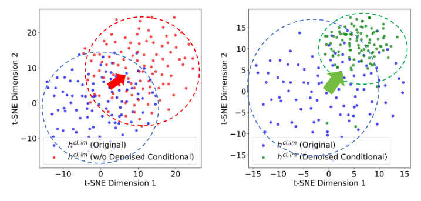

# M³BSR：通过条件扩散去噪建模多模态多行为偏好

> 论文：Multi-Modal Multi-Behavior Sequential Recommendation with Conditional Diffusion-Based Feature Denoising，SIGIR 2025。[https://doi.org/10.1145/3726302.3730044](https://doi.org/10.1145/3726302.3730044)
> 代码：无
> 更新记录：2026-10-22 统一笔记顶部信息格式；保留原有阅读与复现记录，论文结果与本地结果分开。

---
# 一、文献阅读

## 1. 研究背景



**图 1：不同行为对图像与文本信息的不同关注**（英文原文 PDF 第 2 页）。 同一物品在点击与收藏等行为中可能对应不同的模态关注，说明模态信息与行为类型需要联合建模。

序列推荐系统利用用户历史交互预测偏好。真实场景中，用户行为多样（浏览、点击、收藏、购买等），物品富含多模态信息（视觉、文本、听觉等）。有效整合多行为模式与多模态信息，成为序列推荐的重要方向。

近年来，多行为序列推荐和多模态序列推荐分别取得进展。多行为推荐利用不同行为交互更全面刻画用户兴趣；多模态推荐融合物品多模态特征提升兴趣表示质量。然而，将多行为与多模态信息有效结合仍面临三大挑战：

1. **不同行为下模态偏好表征不足**：用户在不同行为中对物品模态的关注不同。例如点击行为可能更受视觉元素吸引，而收藏行为可能更关注文本细节和商品规格。现有研究缺乏对多行为多模态序列推荐的全面探索，导致跨行为模态偏好表征方法无效。
2. **隐式用户行为噪声难以有效缓解**：隐式行为数据常包含误点击或冲动行为等噪声，扭曲真实兴趣建模，导致无关推荐。在多行为多模态场景中，识别并缓解此类噪声对模态偏好建模的影响是关键挑战。
3. **多模态表示噪声无法处理**：图像和文本嵌入常包含与用户偏好无关的模态特定噪声，这些噪声会在推荐流程中传播，进一步复杂化多模态与多行为信息的有效整合。

## 2. 研究目的

提出一种新的多模态多行为序列推荐模型（M³BSR），旨在更精确地建模不同行为下的用户模态偏好，同时有效缓解行为数据和多模态表示中的噪声，提升推荐性能。

## 3. 研究问题

论文通过实验回答以下研究问题：

- **RQ1（有效性）**：M³BSR 是否优于各种最先进的基线？
- **RQ2（彻底性）**：M³BSR 中的具体设计如何影响模型性能？
- **RQ3（鲁棒性）**：模块参数变化如何影响模型效果？
- **RQ4（冷启动）**：方法在冷启动场景下表现如何？
- **RQ5（可视化）**：方法能否有效去除噪声？

## 4. 研究方法

M³BSR 包含三个核心组件：

1. **条件扩散模态去噪层（Conditional Diffusion Modality Denoising, CDMD-M）**：以 ID 特征为条件，通过条件扩散模型去除图像和文本模态中的噪声，获得更准确的多模态偏好。
2. **条件扩散行为去噪层（Conditional Diffusion Behavior Denoising, CDMD-B）**：利用深层行为（如收藏）作为条件，引导扩散模型去噪浅层行为（如点击），提高用户行为表示的信噪比。
3. **多专家兴趣提取层（Multi-Expert Interest Extraction, MEIE）**：通过共享专家和专用专家网络，显式建模跨行为和模态的共性兴趣与特定兴趣，并通过对比损失解耦特征，路由网络融合。

## 5. 研究内容（公式与算法分析）

### 5.1 问题定义

用户集合 $U=\{u_1,u_2,\dots\}$，物品集合 $I=\{i_1,i_2,\dots,i_n\}$。行为集合 $B=\{cl,fa\}$，其中 $cl$ 表示点击（隐式反馈），$fa$ 表示收藏（显式反馈）。每个物品有三种模态：ID、图像 $im$、文本 $te$，模态集合 $M=\{id,im,te\}$。用户 $u$ 有两种行为序列 $S_{u,cl}$ 和 $S_{u,fa}$。每种行为序列对应三个模态序列，例如 $S_{u,cl}^{id},S_{u,cl}^{im},S_{u,cl}^{te}$。核心任务：基于多模态多行为序列预测用户下一个交互物品。

### 5.2 扩散模型基础

条件扩散模型包括前向扩散和反向去噪。前向扩散逐步加噪：

$$
q(h_t|h_{t-1}) = \mathcal{N}(h_t; (1-\beta_t)h_{t-1}, \beta_t \mathbf{I}) \tag{1}
$$

反向去噪学习逆变换：

$$
p(h_{t-1}|h_t) = \mathcal{N}(h_{t-1}; \mu_{t-1}(h_t, h^c), \Sigma_{t-1}(h_t, h^c)) \tag{2}
$$

其中 $h^c$ 为条件信息。

### 5.3 多模态多行为输入层

对 ID 模态序列直接嵌入：

$$
h^{id} = MLP(S_u^{id}) \tag{3}
$$

对图像和文本模态使用 CLIP 提取特征：

$$
h^{im} = CLIP(S_u^{im}) \tag{4}
$$
$$
h^{te} = CLIP(S_u^{te}) \tag{5}
$$

### 5.4 条件扩散模态去噪层

### 图 2：M³BSR 总体框架——结果描述与分析



**图 2：M³BSR 总体架构**（英文原文 PDF 第 4 页）。

Figure 2 是理解 M³BSR 整体算法流程最重要的图。图中从左到右、从底层表示到预测层，完整展示了**行为序列 → 模态/行为去噪 → 多专家兴趣提取 → 兴趣解耦 → 路由融合 → 推荐预测**的过程。

**(a) Overall Framework：总体结果**

左侧输入是不同用户行为序列，图中重点展示 **Click** 和 **Favor** 两类行为。每类行为首先经过 embedding，然后进入对应的 Conditional Diffusion Modal Denoising Layer。去噪后的多模态/行为表示继续送入 Multi-Expert Interest Extraction Layer，最后通过 Prediction Layer 完成下一物品预测。

**分析：** 这一结构体现了 M³BSR 的核心思想不是简单把 click 和 favor 拼接起来，而是先分别处理噪声，再显式提取共同兴趣和行为/模态特有兴趣。也就是说，模型把“数据清洗”和“兴趣建模”放在推荐预测之前完成。

**(b) Conditional Diffusion Modal Denoising Layer：模态去噪结果**

该子图展示 Forward Diffusion 与 Reverse Diffusion 两个过程。原始 image/text feature 在前向过程中逐步加入 Gaussian noise；反向过程中由 Noise Predictor 逐步恢复。关键点是反向去噪并非无条件恢复，而是使用 ID feature 作为 condition，引导模型恢复与用户/物品身份相关的有效模态信息。

**分析：** 这解决的是“模态特征中存在与用户真实兴趣无关的噪声”问题。ID feature 提供稳定的条件信息，因此去噪目标不是简单恢复原始视觉/文本 embedding，而是尽可能保留与推荐任务相关的部分。论文后续实验也表明，去掉 CDMD-M 后性能下降，说明模态去噪对最终推荐有效。

**(c) Multi-Expert Interest Extraction Layer：多专家兴趣结果**

图中首先通过 **Cross Attention** 建立不同特征之间的交互，然后设置多个 Transformer experts。中间的 **Shared Expert** 用于提取跨行为、跨模态的共同兴趣；周围的多个 experts 则分别处理 click/favor 与 ID/image/text 的特定兴趣信息。最后通过 Router 动态决定不同专家表示的融合权重。

**分析：** 这一结构对应论文对“common interest”和“specific interest”的区分。用户可能在 click 行为中更关注视觉信息，而在 favor 行为中更关注文本/属性信息。如果所有行为和模态共享一个表示，这种差异容易被平均掉；多专家结构则允许模型保留这些差异。

**(d) Interest Disentanglement：兴趣解耦结果**

右侧子图展示不同 modality 和 behavior 的表示如何进行 disentanglement。其目标不是让所有特征变得完全独立，而是减少不同兴趣因素之间的混淆，使共同兴趣和特定兴趣具有更清晰的表示边界。

**分析：** Figure 2(d) 与后续消融实验是对应的：论文去掉 Interest Disentanglement 后性能下降，说明兴趣解耦不是单纯的可视化设计，而是对最终表示学习有实际贡献。

**整张图的核心结论：**

```text
原始 Click / Favor 行为
          ↓
   Embedding / 多模态特征
          ↓
   Conditional Diffusion
      ↙          ↘
  模态去噪       行为去噪
      \          /
       ↓        ↓
    Multi-Expert Interest
          Extraction
              ↓
     Common / Specific
        Interest
              ↓
      Interest Routing
              ↓
        Prediction
```

因此，Figure 2 所表达的不是几个独立模块的简单堆叠，而是一条有明确逻辑关系的处理链：**先降低模态与行为噪声，再区分共同/特定兴趣，最后通过动态路由完成融合和预测。**


以 ID 特征为条件，对图像和文本模态去噪。前向扩散：

$$
q(h_{t+1}^m|h_t^m) = \mathcal{N}(\hat{h}_{t+1}^m; (1-\beta_t)h_t^m, \beta_t \mathbf{I}) \tag{6}
$$

重参数化：

$$
\tilde{h}_{t+1}^m = \sqrt{\alpha_t^m} h_t^m + \sqrt{1-\alpha_t^m} \epsilon_t^m \tag{7}
$$

反向扩散：

$$
\tilde{h}_{t-1}^m = \frac{1}{\sqrt{\alpha_t^m}}\left(\tilde{h}_t^m - \frac{1-\alpha_t^m}{\sqrt{1-\tilde{\alpha}_t}} \hat{\epsilon}_t^m\right) \tag{8}
$$

条件去噪使用交叉注意力：

$$
\hat{\epsilon}_t^m = CI(h_t^m, h^c), \quad CI(\tilde{h}_t^m, h_t^c) = CrossAttention(h_t^m, h^c, h^c) \tag{9}
$$

其中 $h^c = h^{id}$。模态去噪重建损失：

$$
\mathcal{L}_m = \sum_{t=1}^T \sum_{m}^{M} \left( \|\tilde{h}_t^m - \tilde{h}_t^m\|_2^2 + \|\tilde{h}_t^m - \tilde{h}_t^m\|_2^2 \right) \tag{10}
$$

（注：论文原文公式有 OCR 错误，此处按语义整理。）

### 5.5 条件扩散行为去噪层

以收藏行为特征为条件，对点击行为去噪。前向扩散：

$$
\tilde{h}_{t+1}^{cl,m} = \sqrt{\alpha_t^{cl,m}} \tilde{h}_t^{cl,m} + \sqrt{1-\alpha_t^{cl,m}} \epsilon_t^{cl,m} \tag{11}
$$

反向扩散：

$$
\hat{h}_{t-1}^{cl,m} = \frac{1}{\sqrt{\alpha_t^{cl,m}}}\left(\tilde{h}_{t+1}^{cl,m} - \frac{1-\alpha_t^{cl,m}}{\sqrt{1-\tilde{\alpha}_t^{cl,m}}} \hat{\epsilon}_t^{cl,m}\right) \tag{12}
$$

条件 $h^c = h^{fa,m}$。行为去噪重建损失：

$$
\mathcal{L}_b = \sum_{m=1}^M \sum_{t=1}^T \|\hat{h}_t^{cl,m} - \tilde{h}_t^{cl,m}\|_2^2 \tag{13}
$$

### 5.6 多专家兴趣提取层

**共性特征提取**：拼接点击和收藏行为的多模态特征：

$$
h_{cl} = [h_{cl}^{im}, h_{cl}^{te}, h_{cl}^{id}] \tag{14}
$$
$$
h_{fa} = [h_{fa}^{im}, h_{fa}^{te}, h_{fa}^{id}] \tag{15}
$$

交叉注意力对齐：

$$
\hat{h}^{share} = CrossAttention(h_{cl}, h_{fa}) \tag{16}
$$

Transformer 提取共性特征：

$$
h_{common} = Transformer(\hat{h}^{share}) \tag{17}
$$

**特定特征提取**：对每种行为和模态分别用 Transformer 专家提取：

$$
h_{cl}^m = Transformer(h_{cl}^m), \quad h_{fa}^m = Transformer(h_{fa}^m) \tag{18}
$$

**兴趣解耦**：对比损失鼓励不同特征表示分离：

$$
\mathcal{L}_{contrast} = -\sum_{i\neq j} \log \frac{\exp(sim(h_i,h_j)/\tau)}{\sum_{k\neq i}\exp(sim(h_i,h_k)/\tau)} \tag{20}
$$

其中 $h_i,h_j$ 为不同特征表示（如 $h_{cl}^{id},h_{cl}^{im},h_{cl}^{te},h_{fa}^{id},h_{fa}^{im},h_{fa}^{te},h_{common}$）。

**兴趣路由融合**：

$$
g = \sigma(W_g \cdot [h_{common}; h_{cl}; h_{fa}] + b_g) \tag{22}
$$
$$
y = g \cdot h_{common} + (1-g) \cdot [h_{cl}; h_{fa}]
$$

### 5.7 预测与优化

预测层：

$$
p(i|y) = \mathrm{softmax}(W y + b) \tag{23}
$$

主损失交叉熵：

$$
\mathcal{L}_{main} = -\sum_{u\in U} \log p(i_u|y_u) \tag{24}
$$

总损失：

$$
\mathcal{L} = \mathcal{L}_{main} + \lambda_c \mathcal{L}_{contrast} + \lambda_m \mathcal{L}_m + \lambda_b \mathcal{L}_b \tag{25}
$$

其中 $\lambda_c,\lambda_m,\lambda_b$ 为超参数。

## 5.8 条件扩散模块的实现细节补充

M³BSR 不是直接把普通 DDPM 套到推荐序列上，而是把**条件信息注入反向去噪过程**。论文的逻辑可以概括为：

```text
原始多模态 / 多行为表示 h0
        ↓
前向扩散 q：逐步加入 Gaussian noise
        ↓
ht
        ↓
条件网络 / Cross-Attention
        ↑
条件表示 hc
        ↓
预测噪声 ε̂t
        ↓
反向采样 p(ht-1 | ht, hc)
        ↓
去噪后的表示 ĥ0
```

### 5.8.1 CDMD-M：模态去噪

对图像和文本模态分别做条件扩散，而 **ID 表示作为条件**。论文的动机是：ID 更直接对应用户与物品之间的交互偏好，因此可作为条件帮助恢复图像/文本中真正与推荐相关的成分。条件网络通过 cross-attention 使用 ID 表示生成噪声预测 $\hat\epsilon_t^m$。

### 5.8.2 CDMD-B：行为去噪

点击是较浅层、较容易包含误点击的隐式反馈，而收藏被认为更能体现稳定偏好。因此论文用 **favor 作为 condition，click 作为待去噪对象**。这不是简单把两个行为拼接，而是让深层行为指导浅层行为的扩散反演。

### 5.8.3 为什么使用 conditional diffusion

普通去噪只利用当前 noisy representation；M³BSR 的 conditional diffusion 额外利用与目标表示相关的偏好条件，使恢复过程不是“恢复原始向量”这么简单，而是倾向于恢复**与用户兴趣相关的部分**。这也是该方法相较普通 MLP 去噪的重要区别。

## 5.9 MEIE：共享兴趣与特定兴趣并行建模

当前笔记已经给出 MEIE 的公式，但还缺少结构上的解释。论文实际上把兴趣拆成两个互补部分：

### A. Common Interest

先将 click/favor 的三种模态特征分别拼接：

$$
h_{cl}=[h_{cl}^{im};h_{cl}^{te};h_{cl}^{id}],\qquad
h_{fa}=[h_{fa}^{im};h_{fa}^{te};h_{fa}^{id}]
$$

再通过 cross-attention 让两个行为相互对齐，最后用 Transformer expert 提取跨行为、跨模态的 common interest。论文强调，这一部分用于捕获用户在不同交互行为下保持稳定的底层兴趣。

### B. Behavior/Modality-specific Interest

对于 click/favor × ID/image/text 的六组特征，分别使用 Transformer expert 提取特定兴趣。这样可以保留“点击时更关注图片”“收藏时更关注文字”等行为-模态组合差异，而不会被 shared representation 抹平。

### C. Interest disentanglement

对比损失并不是为了单纯提高 embedding 相似度，而是减少不同 interest representation 之间的冗余，使 common 与 specific、不同 modality/behavior 的表示更容易被区分。

### D. Routing

最终 gate 根据 common 与行为特定表示动态决定融合比例，因此模型不是固定加权，而是对每个用户/样本自适应选择更依赖共享兴趣还是特定兴趣。

## 5.10 训练目标的含义

总目标：

$$
\mathcal L=\mathcal L_{main}+\lambda_c\mathcal L_{contrast}+\lambda_m\mathcal L_m+\lambda_b\mathcal L_b
$$

四项分别承担不同作用：

| 损失 | 作用 |
|---|---|
| $\mathcal L_{main}$ | 保证最终 next-item prediction 有效 |
| $\mathcal L_{contrast}$ | 解耦 common / specific 与不同模态、行为的兴趣表示 |
| $\mathcal L_m$ | 约束图像/文本条件扩散的模态重建质量 |
| $\mathcal L_b$ | 约束 click 在 favor 条件下的行为去噪质量 |

因此 M³BSR 不是单一推荐 loss，而是“预测 + 表示解耦 + 模态去噪 + 行为去噪”的联合优化。

## 5.11 数据集与实验设置的事实校正

| 数据集 | 用户数 | 物品数 | 交互数 | 平均点击 | 平均收藏 |
|---|---:|---:|---:|---:|---:|
| Rec-Tmal | **72,051** | **93,466** | **328,387** | 4.16 | 1.73 |
| Kuaishou | **22,793** | **618,529** | **5,852,725** | 255.02 | 40.96 |

论文明确使用两个公开数据集：Rec-Tmal 来源于 Tmall，Kuaishou 来源于快手；序列至少包含 5 条历史交互，保留最近 50 条历史记录，以收藏作为目标行为、点击作为辅助行为，并采用最后一个收藏作为测试目标。

## 5.12 评价协议与负采样

评价使用 HR@10、NDCG@10、HR@20、NDCG@20。每个正样本配 99 个随机负样本，因此评价本质上是一个 sampled ranking / next-item ranking 场景，而不是对完整物品全集进行 softmax 排序。

这一区别在复现时非常重要：如果改成 full-ranking，HR/NDCG 数值不能直接与论文 Table 2 横向比较。

## 5.13 RQ1：为什么 M³BSR 能超过三类基线

论文 Table 2 的结果为：

| 数据集      | 指标      |         最强基线（表中） |      M³BSR | 相对提升（约） |
| -------- | ------- | ---------------: | ---------: | ------: |
| Rec-Tmal | HR@10   |     0.3083 (EBM) | **0.3207** |   +4.0% |
| Rec-Tmal | NDCG@10 | 0.1886 (CMCLRec) | **0.2028** |   +7.5% |
| Kuaishou | HR@10   |     0.2420 (EBM) | **0.2603** |   +7.6% |
| Kuaishou | NDCG@10 | 0.1450 (CMCLRec) | **0.1630** |  +12.4% |

论文原始 Table 2 显示 M³BSR 在两套数据集的四项指标上均为最佳。

## 5.14 RQ2：消融的具体数值

当前笔记只有定性结论，论文 Figure 3 还给出了可直接记录的 HR@10/NDCG@10 数值：

| 设置 | Rec-Tmal HR@10 | Rec-Tmal NDCG@10 | Kuaishou HR@10 | Kuaishou NDCG@10 |
|---|---:|---:|---:|---:|
| **Ours** | **0.3207** | **0.2028** | **0.2603** | **0.1630** |
| w/o CDMD-M | 0.3128 | 0.1954 | 0.2512 | 0.1535 |
| w/o CDMD-B | 0.3169 | 0.1983 | 0.2556 | 0.1552 |
| w/o MEIE | 0.3065 | 0.1891 | 0.2401 | 0.1418 |
| w/o Shared Expert | 0.3144 | 0.1917 | 0.2433 | 0.1463 |
| w/o Disent | 0.3165 | 0.1961 | 0.2564 | 0.1570 |

可以看到 **w/o MEIE 的下降最大**，说明兴趣提取/解耦/路由整体是最关键的模块；在两个数据集上，去掉 CDMD-M、CDMD-B 也都会稳定下降。

## 5.15 RQ3：扩散步数、损失权重与温度

论文 Figure 4 的主要结论：

- behavior denoising：约 **10 diffusion steps + $\lambda_b=0.02$** 最优；
- modality denoising：约 **10 diffusion steps + $\lambda_m=0.02$** 最优；
- contrastive learning：约 **$	au=0.3 + \lambda_c=0.05$** 最优；
- 过少的 diffusion steps 会导致去噪不足，过多 steps/过大 loss weight 则可能过度正则化。

例如 Rec-Tmal 上 behavior denoising 在 10 steps / 0.02 时达到 HR@10=0.3207，而 25 steps / 0.15 降至 0.3155；Kuaishou 在 5 steps / 0.01 时 HR@10 为 0.2583。

## 5.16 RQ4/RQ5：冷启动与可视化

### 冷启动

论文额外考察稀疏历史用户场景。M³BSR 的优势来自两点：一是即使行为历史较短，图像/文本仍提供额外信息；二是条件扩散和 MEIE 能降低噪声并利用跨行为共享兴趣。因此多模态信息并不是简单拼接，而是参与去噪与兴趣解耦。

### t-SNE

Figure 5 对比 CDMD 与 MLP 替代方案。CDMD 后的 embedding 更紧凑、更有聚类结构，而 MLP 替代主要表现为分布平移，不能有效实现去噪。这为“扩散模块确实改变表示质量”提供了可视化证据。

## 5.17 效率与代价

论文 Table 4 中 Kuaishou：

| 方法 | 每 epoch 训练时间 | 单次预测推理时间 |
|---|---:|---:|
| STOSA | 25.3 s | 0.07 s |
| MMMLP | 28.7 s | 0.09 s |
| EBM | 32.5 s | 0.13 s |
| **M³BSR** | **35.2 s** | **0.16 s** |

因此 M³BSR 不是计算最便宜的方法，而是用额外 diffusion + expert 计算换取更好的效果。当前笔记中的“适合在线推荐”应更谨慎理解：论文报告的 0.16s 是其实验环境下的单次预测时间，不能直接推广为所有在线系统的 SLA 保证。

## 5.18 与相关工作的定位补充

论文把已有工作分为三类：

1. **传统序列推荐**：GRU4Rec、SASRec、BERT4Rec、STOSA、SSDRec；
2. **多模态序列推荐**：MISSRec、MMSBR、MMMLP、M3SRec、CMCLRec；
3. **多行为序列推荐**：NMTR、DIPN、SGDL、MB-STR、KMCLR、EBM。

M³BSR 的区别不是单纯增加一个模态或一个行为，而是把“**行为条件 → 扩散去噪 → 模态/行为特定兴趣 → shared/specific expert → routing**”串成统一框架。论文明确将“显式建模跨行为的模态偏好”作为核心贡献之一。

## 5.19 复现时最容易出错的地方

1. **数据统计不能抄错**：Rec-Tmal/Kuaishou 的用户、物品、交互数应使用校正后的数字。
2. **目标行为不是 click，而是 favor**：click 是辅助行为。
3. **CDMD-B 的条件方向不能反**：favor → denoise click。
4. **CDMD-M 的条件是 ID**：不是 image/text 互相去噪。
5. **不是普通 Gaussian denoising**：反向过程必须使用条件信息。
6. **评价不是 full ranking**：论文使用 99 个随机负样本。
7. **MEIE 不只是 MoE**：其作用包括 common/specific interest extraction、contrastive disentanglement 与 routing。
8. **扩散步数与 loss weight 联动**：论文最优约为 10 steps/0.02，而不是“越多越好”。

## 6. 实验与环境、数据集、参数配置

### 6.1 数据集

论文引入两个新数据集：**Rec-Tmal**（来自天猫）和 **Kuaishou**（来自快手）。统计信息如下（Table 1）：

| 数据集      |     用户数 |     物品数 |     交互数 |  平均点击数 | 平均收藏数 |
| -------- | ------: | ------: | ------: | -----: | ----: |
| Rec-Tmal | 72,051 | 93,466 | 328,387 | 4.16 | 1.73 |
| Kuaishou | 22,793 | 618,529 | 5,852,725 | 255.02 | 40.96 |

- 行为类型：点击（隐式）和收藏（显式）。
- 模态：ID（物品 ID、品牌 ID、用户 ID、卖家 ID 等；Kuaishou 为用户 ID 和视频 ID）、图像（商品图片）、文本（商品标题）。
- 序列长度至少 5，保留最近 50 条历史记录。
- 目标行为：收藏；辅助行为：点击。
- 测试样本：每个用户序列最后一个收藏行为；验证样本：之前的收藏行为。
- 每个正样本配 99 个随机负样本。

### 6.2 评估指标

HR@K 和 NDCG@K，K=10 和 20。

### 6.3 实现细节

- PyTorch 框架。
- ID 模态嵌入大小 16；图像和文本模态嵌入大小 512。
- 批量大小 1024。
- 学习率搜索范围 $\{10^{-5}, 10^{-4}, 10^{-3}\}$；隐藏层大小 $\{64, 128, 256, 512\}$。
- 扩散模型时间步 $T=15$；扩散噪声水平 $\alpha$ 初始化范围 $[0.001, 0.1]$。
- 损失权重搜索范围 0.01 到 0.15。
- 早停策略：NDCG@10 连续 10 个 epoch 不提升则停止。

### 6.4 对比方法

- **传统序列推荐**：GRU4Rec (2015), SASRec (2018), BERT4Rec (2019), STOSA (2022), SSDRec (2024)。
- **多模态序列推荐**：MISSRec (2023), MMSBR (2023), MMMLP (2023), M3SRec (2023), CMCLRec (2024)。
- **多行为序列推荐**：NMTR (2019), DIPN (2019), SGDL (2022), MB-STR (2022), KMCLR (2023), EBM (2024)。

## 7. 完整实验结果表格

### 表 2：性能比较（论文 Table 2）

| 方法 | Rec-Tmal HR@10 | Rec-Tmal NDCG@10 | Rec-Tmal HR@20 | Rec-Tmal NDCG@20 | Kuaishou HR@10 | Kuaishou NDCG@10 | Kuaishou HR@20 | Kuaishou NDCG@20 |
|---|---:|---:|---:|---:|---:|---:|---:|---:|
| **传统序列推荐** | | | | | | | | |
| GRU4Rec | 0.1498 | 0.0431 | 0.2015 | 0.0492 | 0.0853 | 0.0021 | 0.1360 | 0.0103 |
| SASRec | 0.1662 | 0.0578 | 0.2145 | 0.0635 | 0.1001 | 0.0083 | 0.1490 | 0.0141 |
| BERT4Rec | 0.2123 | 0.0964 | 0.2629 | 0.1078 | 0.1435 | 0.0494 | 0.1958 | 0.0549 |
| STOSA | 0.2568 | 0.1370 | 0.3080 | 0.1420 | 0.1930 | 0.0908 | 0.2420 | 0.1135 |
| SSDRec | 0.2827 | 0.1637 | 0.3315 | 0.1680 | 0.2176 | 0.1151 | 0.2671 | 0.1198 |
| **多模态序列推荐** | | | | | | | | |
| MISSRec | 0.2786 | 0.1601 | 0.3322 | 0.1623 | 0.2179 | 0.1120 | 0.2654 | 0.1186 |
| MMSBR | 0.2897 | 0.1660 | 0.3336 | 0.1702 | 0.2209 | 0.1188 | 0.2711 | 0.1253 |
| MMMLP | 0.2928 | 0.1753 | 0.3421 | 0.1789 | 0.2284 | 0.1285 | 0.2769 | 0.1332 |
| M3SRec | 0.2997 | 0.1803 | 0.3486 | 0.1851 | 0.2315 | 0.1293 | 0.2859 | 0.1354 |
| CMCLRec | 0.3075 | 0.1886 | 0.3602 | 0.1937 | 0.2394 | 0.1375 | 0.2918 | 0.1450 |
| **多行为序列推荐** | | | | | | | | |
| NMTR | 0.2738 | 0.1524 | 0.3225 | 0.1563 | 0.2096 | 0.1061 | 0.2583 | 0.1088 |
| DIPN | 0.2786 | 0.1602 | 0.3307 | 0.1654 | 0.2153 | 0.1111 | 0.2623 | 0.1156 |
| SGDL | 0.2861 | 0.1670 | 0.3359 | 0.1708 | 0.2212 | 0.1181 | 0.2672 | 0.1209 |
| MB-STR | 0.2931 | 0.1741 | 0.3447 | 0.1795 | 0.2290 | 0.1282 | 0.2794 | 0.1344 |
| KMCLR | 0.3025 | 0.1800 | 0.3518 | 0.1857 | 0.2372 | 0.1334 | 0.2806 | 0.1382 |
| EBM | 0.3083 | 0.1877 | 0.3601 | 0.1953 | 0.2420 | 0.1395 | 0.2882 | 0.1423 |
| **M³BSR (Ours)** | **0.3207** | **0.2028** | **0.3815** | **0.2130** | **0.2603** | **0.1630** | **0.3101** | **0.1612** |

### 表 3：冷启动用户性能（Rec-Tmal，论文 Table 3）

| 方法 | HR@10 | NDCG@10 |
|---|---:|---:|
| STOSA | 0.2186 | 0.1459 |
| MMMLP | 0.2413 | 0.1672 |
| EBM | 0.2560 | 0.1819 |
| **M³BSR (Ours)** | **0.2897** | **0.2146** |

### 表 4：时间效率比较（Kuaishou，论文 Table 4）

| 方法 | 每 Epoch 训练时间 (s) | 每次预测推理时间 (s) |
|---|---:|---:|
| STOSA | 25.3 | 0.07 |
| MMMLP | 28.7 | 0.09 |
| EBM | 32.5 | 0.13 |
| **M³BSR (Ours)** | **35.2** | **0.16** |

### 图 3：消融研究（论文 Figure 3）



**图 3：关键组件消融实验**（英文原文 PDF 第 8 页）。

移除不同模块对 HR@10 和 NDCG@10 的影响：
- **w/o CDMD-M**：移除模态条件扩散去噪，性能下降。
- **w/o CDMD-B**：移除行为条件扩散去噪，性能下降。
- **w/o MEIE**：移除多专家兴趣提取层，性能下降最显著。
- **w/o Shared Expert**：移除共享专家，性能下降。
- **w/o Disent**：移除兴趣解耦，性能下降。

### 图 4：超参数热力图（论文 Figure 4）



**图 4：扩散步数、损失权重与温度的敏感性**（英文原文 PDF 第 9 页）。

- **行为去噪扩散**：最优约 10 步，损失权重 0.02。过少（5 步/0.01）或过多（25 步/0.15）均降低性能。
- **模态去噪扩散**：同样最优约 10 步，损失权重 0.02。
- **对比学习**：最优温度 0.3，损失权重 0.05。过低（0.01/0.01）或过高（0.5/0.15）均降低性能。

### 图 5：t-SNE 可视化（论文 Figure 5）



**图 5：条件扩散去噪效果的 t-SNE 可视化**（英文原文 PDF 第 9 页）。

经 CDMD 处理后的嵌入呈现紧凑聚类，表明有效去噪。若替换为 MLP，嵌入仅发生平移，分布仍然分散且噪声大。

## 8. 结果分析

- **RQ1（有效性）**：M³BSR 在两个数据集的所有指标上均取得最佳性能。相比传统序列推荐，提升显著，因其能利用多模态信息和行为间依赖。相比多模态推荐，M³BSR 的条件扩散去噪机制能更有效去除模态和行为噪声。相比多行为推荐，M³BSR 能联合建模多模态与多行为。
- **RQ2（消融）**：移除 MEIE 层性能下降最大，说明多专家兴趣提取最关键。移除模态去噪或行为去噪均导致性能下降，验证去噪必要性。移除共享专家或兴趣解耦也降低性能。
- **RQ3（超参数）**：行为去噪和模态去噪的最优扩散步数约 10，损失权重 0.02。对比学习最优温度 0.3，权重 0.05。过大或过小均导致过正则化或去噪不足。
- **RQ4（冷启动）**：在 Kuaishou 稀疏历史用户（≤10 次交互）上，M³BSR 显著优于强基线，因其能从多模态数据推断偏好，识别模态级兴趣，并通过去噪减少噪声影响。
- **RQ5（可视化）**：t-SNE 显示 CDMD 使嵌入聚类更紧凑，有效减少噪声；而 MLP 替代仅平移分布，无法去噪。
- **时间效率**：M³BSR 每 epoch 训练时间 35.2s，推理 0.16s，略高于复杂基线，但性能提升显著，且推理时间可接受，模块并行设计适合在线推荐。

## 9. 结论

论文提出 M³BSR 解决多模态多行为序列推荐挑战。通过条件扩散模态去噪层、条件扩散行为去噪层、多专家兴趣提取层和对比损失，有效去除多模态特征和行为序列中的噪声，并显式建模跨模态和行为的共性与特定兴趣。实验表明 M³BSR 优于最先进基线，提升偏好建模和推荐准确性。

# 二、代码复现

**无代码**。论文未提供公开代码仓库，实验基于 PyTorch 实现，但未开源。因此无环境配置、源代码分析、bug 修复、结果复现等内容。

# 三、总结

M³BSR 的核心创新在于将条件扩散模型引入多模态多行为序列推荐，分别对模态特征和行为特征进行去噪。模态去噪以 ID 特征为条件，行为去噪以深层收藏行为为条件，符合“ID 更直接反映偏好”“收藏比点击更可靠”的直觉。多专家兴趣提取层通过共享和专用专家网络、对比解耦和路由融合，显式建模共性与特定兴趣。实验在 Rec-Tmal 和 Kuaishou 上验证了有效性，消融和超参数分析支撑了各模块贡献，冷启动和 t-SNE 进一步展示鲁棒性和去噪效果。局限在于训练时间略高，且未开源代码。
