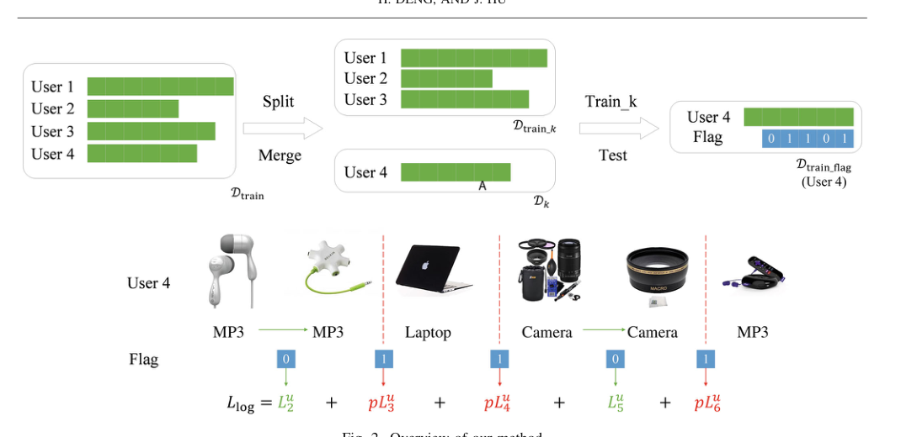

# Predictability-Aware：通过可预测性感知子序列建模序列推荐

> 论文：Predictability-Aware Subsequence Modeling for Sequential Recommendation，IEEJ Transactions on Electrical and Electronic Engineering 2024。[https://doi.org/10.1002/tee.24087](https://doi.org/10.1002/tee.24087)
> 代码：无
> 更新记录：2026-11-01 新增笔记；整理 leave-out 可预测性评估、子序列边界和加权损失。

---

# 一、方法理解

用户序列中的目标物品有的能由前一段历史稳定预测，有的代表兴趣切换。论文先估计每个 target 的可预测性，再用它确定子序列边界和训练权重：容易预测的 target 更可能属于当前子序列，难预测的 target 更可能是新意图；困难样本的损失权重降低，避免模型记忆无关跳转。

## 2. 流程

1. 用 leave-out 训练/预测策略得到每个 target 的可预测性标记，避免直接使用测试信息。
2. 根据标记把行为序列切成若干子序列，并记录边界。
3. 用子序列分配模块发现与当前用户相关的片段。
4. 在主交叉熵之外加入 subsequence assignment 辅助损失；对难预测 target 使用加权 CE。

## 3. 论文结果

论文在 Beauty、Games、Electronics、ML-1M 上测试，使用 GRU4Rec、SASRec 等骨干。主模型的 H@10/NDCG@10 为：Beauty `0.0923/0.0493`、Games `0.1265/0.0621`、Electronics `0.0528/0.0287`、ML-1M `0.3199/0.1826`。这些数字来自原文 Table II 的全物品排序结果。消融结果中的 H@10：

| 版本 | Beauty | Games | Electronics | ML-1M |
|---|---:|---:|---:|---:|
| 去掉 weighted loss 与 LOS | 0.0864 | 0.1071 | 0.0474 | 0.3050 |
| 去掉 weighted loss | 0.0870 | 0.1074 | 0.0478 | 0.3059 |
| 去掉 LOS | 0.0903 | 0.1236 | 0.0501 | 0.3151 |
| 完整模型 | 0.0923 | 0.1265 | 0.0528 | 0.3199 |

论文还扫描子序列数和阈值，结论是两个辅助项需要同时保留；阈值过高或过低会让模型退化到原始骨干。

## 4. 本地实验

| 项目 | 结果 |
|---|---|
| 主实验 |  |
| weighted loss / LOS 消融 |  |
| 阈值和子序列数 |  |
