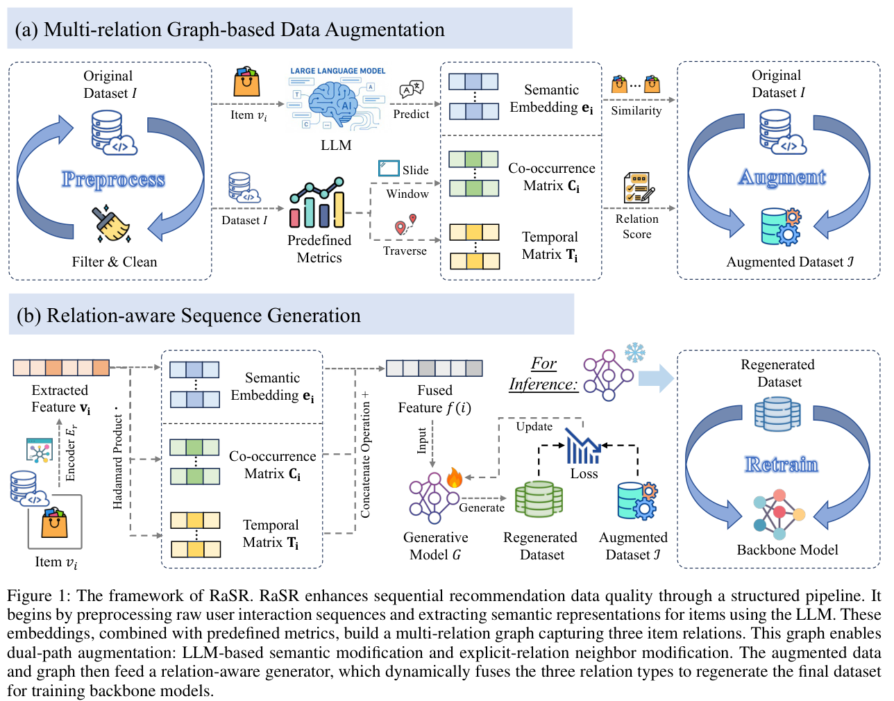
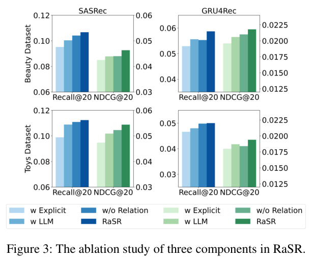
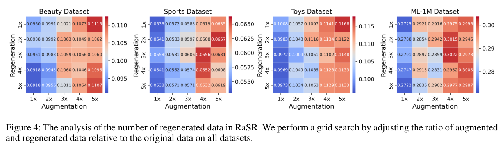

# RaSR：利用多关系图增强与再生成改进训练数据

> 论文：Data-Centric Sequential Recommendation with Relation-Augmented Generation，AAAI 2026。[https://doi.org/10.1609/aaai.v40i18.38540](https://doi.org/10.1609/aaai.v40i18.38540)
> 代码：https://github.com/JY1230/RaSR
> 更新记录：2026-10-22 补充多关系数据流、关系方向、插入/替换差异和结果分层分析；论文结果与本地结果分开，未进行实验留空。

---
# 一、文献阅读

## 1. 研究背景

序列推荐既可以改进模型，也可以改进用于训练模型的数据。数据中心方法通过再生成交互序列缓解稀疏和噪声，但若不保留物品之间的协同、时序及语义关系，生成数量增加也未必能提高数据质量。

## 2. 研究目的与问题

提出 Relation-augmented generation for Sequential Recommendation（RaSR），先利用多关系图增强序列，再训练关系感知生成器产生可供不同骨干使用的训练数据。问题包括：如何组合显式交互关系与 LLM 隐式语义；如何在再生成时保留关系信息；增加数据是否能稳定提升不同骨干。

## 3. 整体方法

图 1 位于 PDF 第 3 页。流程为：清洗交互与物品属性 → 提取 LLM 物品表示 → 构造共现、时序、语义关系 → 语义/关系引导插入或替换 → 关系感知编码与生成 → 使用再生成数据训练推荐骨干。骨干的线上结构不因数据生成而改变，但离线增强和生成仍有成本。

### 3.1 一条样本如何流过 RaSR

| 顺序 | 输入 | 处理 | 产物 |
|---|---|---|---|
| 1 | 用户原始序列 $S_u$、物品属性 | 用 LLM 得到每个物品的语义向量 | $e_i$ |
| 2 | 交互日志 | 统计相邻/窗口共现和时间方向 | $C$、$T$ |
| 3 | 物品语义向量 | 计算余弦相似度 | $S$ |
| 4 | $S$ 与 $C/T$ | 语义策略做插入/替换，显式关系策略按关系分数选候选 | 关系增强序列 $\tilde S_u$ |
| 5 | $S_u\rightarrow\tilde S_u$ | 关系特征融合并训练自回归生成器 | 生成器 $G$ |
| 6 | 原始序列和前 $K$ 个锚点 | 生成后续物品，筛掉不合法/重复样本 | 再生成训练集 |
| 7 | 任意推荐骨干 | 用原始数据+再生成数据训练 | 线上模型 |

RaSR 的关系图和生成器只负责离线造数据，预测时仍是普通推荐骨干。因此它属于数据中心方法，而不是给每个骨干增加一个关系推理层。

## 4. 研究内容与公式分析

### 4.1 语义表示（原文式 2）

$$
e_i=W_1\bigl(\operatorname{LLM}(v_i)\bigr)+b_1.
$$

由物品属性得到 LLM 最后一层隐藏表示，再投影到生成器和骨干使用的空间。模型版本、输入模板与语义缓存会影响可复现性。

### 4.2 多关系图（原文式 3–4，PDF 第 4 页）

$$
\begin{aligned}
C_{ij}&=\sum_{S_u\in\mathcal S}\sum_{k=1}^{|S_u|-1}
\mathbb I[(i_k,i_{k+1})=(i,j)],\\
T_{ij}&=\sum_{S_u\in\mathcal S}\sum_{k=1}^{|S_u|-1}
\lambda^k\mathbb I[i_k=i,i_{k+1}=j],\\
S_{ij}&=\frac{e_i^\top e_j}{\|e_i\|\|e_j\|}.
\end{aligned}
$$

原文文字说 $C$ 使用滑动窗口，但式 3 实际显示相邻位置计数；窗口如何进入实现应单独核查。$T$ 中 $k$ 的计数方向也重要：若从序列开头递增，$\lambda<1$ 会减小靠后位置权重，不能直接解释为按时间差衰减。

三类关系的方向和用途不同：$C_{ij}$ 是从物品 $i$ 指向后继/窗口邻居 $j$ 的共现强度，$T_{ij}$ 在同一方向上加入位置权重，$S_{ij}$ 是对称的语义相似度。实现中若把 $C$ 或 $T$ 反向，增强候选会从“用户可能接下来点击什么”变成“什么物品曾经点击过当前物品”，结果不可直接对齐论文。关系矩阵还应只用训练交互和训练期属性计算，不能把验证/测试交互用于建图。

语义策略根据相似度插入或替换物品；显式关系策略依据 $C_{i_t,k}+T_{i_t,k}$ 的关系分数选择替换候选。

插入和替换不是同一操作：插入会增加序列长度，替换保持长度不变。若一条序列同时采样两种策略，须记录最终长度截断规则，否则生成器看到的长度分布可能与论文不同。

### 4.3 关系特征融合（原文式 5–7）

$$
\begin{aligned}
f_c(i)&=\sum_{j\in N(i)}C_{ij}v_j,&
f_t(i)&=\sum_{j\in N(i)}T_{ij}v_j,\\
f_s(i)&=W_s e_i,&
f(i)&=\alpha_i f_c(i)+\beta_i f_t(i)+\gamma_i f_s(i).
\end{aligned}
$$

原文称该融合为 position-aware gating，但紧接式 7 又明确本实验把三个系数都设为 1。因此不能把报告结果解释成已证明“可学习自适应门控”的效果。正文对语义投影矩阵的文字说明和公式符号也不完全一致。

### 4.4 生成器训练（原文式 8）

用原始序列作为条件、增强序列作为生成目标，最小化自回归负对数似然。以紧凑形式表示其目标：

$$
\mathcal L_G=-\mathbb E_{u,t}\log
p_{G,E_r}(\tilde i_t^u\mid\langle\mathrm{sos}\rangle,
\tilde i_{<t}^u,I_u).
$$

此式为对式 8 的记号整理，$\tilde i$ 表示增强目标。推理保留原始序列前 $K$ 个物品作为生成锚点，再自主生成后续物品，以平衡结构稳定性和多样性。生成器学习的是“关系增强序列在给定原序列条件下的分布”，不是直接预测测试标签。生成比例过高时，推荐骨干会更多看到生成分布，可能产生分布偏移；因此论文还比较生成数据/原始数据比例，而不能只报告生成器的 loss。

## 5. 实验设置与数据

| 数据 | 用户数 | 物品数 | 交互数 | 平均长度 |
| --- | --- | --- | --- | --- |
| Beauty | 22,363 | 12,101 | 198,502 | 8.88 |
| Sports | 35,598 | 18,357 | 296,337 | 8.32 |
| Toys | 19,412 | 11,924 | 167,597 | 8.63 |
| ML-1M | 6,040 | 3,952 | 1,000,209 | 165.60 |

数据统计来自表 2（PDF 第 5 页）；不要与其他论文不同筛选口径的同名数据集直接对照。

| 设置 | 原文报告 |
| --- | --- |
| 对照 | 原始数据、DR4SR、RaSR |
| 主表骨干 | GRU4Rec、SASRec、FMLP、GCE-GNN、CL4Rec |
| 优化与网络 | Adam + 线性学习率日程；初始学习率 $10^{-3}$；batch size 256；维度 64；最大序列长度 50 |
| 增强 | 每条序列最多 4 个变体：语义 2 个、显式关系 2 个 |
| 关系配置 | 共现窗口 2，衰减系数 0.8 |
| 生成器 | 训练 100 epochs；diversity factor 5；选择最佳 checkpoint |
| 早停图配置 | 验证 NDCG@20 连续 20 轮不提升停止 |
| 计算资源 | 论文报告 8 张 RTX 4090 与 16 张 RTX 3090；不等于单次复现必须全部使用 |
| 官方代码入口 | [JY1230/RaSR](https://github.com/JY1230/RaSR)，本次未下载运行 |

正文引言提及六个骨干，但主表和实验设置列出五个；以实际表格范围为准。切分、负采样与测试候选范围需要再对照官方实现，不能仅因沿用 DR4SR 就默认与 TADA 一致。

## 6. 主实验（原文表 1，PDF 第 5 页）

将原表按数据集拆分，保留全部五个骨干的绝对值。R 表示 Recall，N 表示 NDCG；不混入本地实验。

### Beauty（表 1）

| 骨干与数据 | R@10 | R@20 | N@10 | N@20 |
| --- | --- | --- | --- | --- |
| GRU4Rec | 0.0281 | 0.0492 | 0.0127 | 0.0180 |
| GRU4Rec + DR4SR | 0.0324 | 0.0557 | 0.0148 | 0.0211 |
| GRU4Rec + RaSR | 0.0334 | 0.0587 | 0.0153 | 0.0218 |
| SASRec | 0.0648 | 0.0966 | 0.0343 | 0.0423 |
| SASRec + DR4SR | 0.0685 | 0.1021 | 0.0371 | 0.0455 |
| SASRec + RaSR | 0.0696 | 0.1067 | 0.0373 | 0.0463 |
| FMLP | 0.0516 | 0.0826 | 0.0265 | 0.0343 |
| FMLP + DR4SR | 0.0563 | 0.0904 | 0.0279 | 0.0365 |
| FMLP + RaSR | 0.0593 | 0.0976 | 0.0292 | 0.0388 |
| GCE-GNN | 0.0713 | 0.1033 | 0.0387 | 0.0468 |
| GCE-GNN + DR4SR | 0.0831 | 0.1193 | 0.0433 | 0.0524 |
| GCE-GNN + RaSR | 0.0885 | 0.1239 | 0.0503 | 0.0592 |
| CL4Rec | 0.0668 | 0.1004 | 0.0359 | 0.0444 |
| CL4Rec + DR4SR | 0.0722 | 0.1080 | 0.0387 | 0.0470 |
| CL4Rec + RaSR | 0.0725 | 0.1094 | 0.0398 | 0.0477 |

### Sports（表 1）

| 骨干与数据 | R@10 | R@20 | N@10 | N@20 |
| --- | --- | --- | --- | --- |
| GRU4Rec | 0.0193 | 0.0319 | 0.0095 | 0.0126 |
| GRU4Rec + DR4SR | 0.0228 | 0.0380 | 0.0112 | 0.0150 |
| GRU4Rec + RaSR | 0.0233 | 0.0396 | 0.0116 | 0.0157 |
| SASRec | 0.0320 | 0.0512 | 0.0166 | 0.0214 |
| SASRec + DR4SR | 0.0359 | 0.0553 | 0.0194 | 0.0243 |
| SASRec + RaSR | 0.0398 | 0.0621 | 0.0215 | 0.0271 |
| FMLP | 0.0219 | 0.0364 | 0.0112 | 0.0149 |
| FMLP + DR4SR | 0.0258 | 0.0445 | 0.0127 | 0.0164 |
| FMLP + RaSR | 0.0291 | 0.0496 | 0.0141 | 0.0185 |
| GCE-GNN | 0.0363 | 0.0575 | 0.0192 | 0.0245 |
| GCE-GNN + DR4SR | 0.0442 | 0.0660 | 0.0240 | 0.0294 |
| GCE-GNN + RaSR | 0.0481 | 0.0721 | 0.0259 | 0.0319 |
| CL4Rec | 0.0348 | 0.0531 | 0.0187 | 0.0233 |
| CL4Rec + DR4SR | 0.0365 | 0.0564 | 0.0196 | 0.0247 |
| CL4Rec + RaSR | 0.0378 | 0.0572 | 0.0202 | 0.0253 |

### Toys（表 1）

| 骨干与数据 | R@10 | R@20 | N@10 | N@20 |
| --- | --- | --- | --- | --- |
| GRU4Rec | 0.0258 | 0.0424 | 0.0125 | 0.0167 |
| GRU4Rec + DR4SR | 0.0304 | 0.0475 | 0.0143 | 0.0184 |
| GRU4Rec + RaSR | 0.0313 | 0.0500 | 0.0152 | 0.0194 |
| SASRec | 0.0674 | 0.0955 | 0.0373 | 0.0444 |
| SASRec + DR4SR | 0.0786 | 0.1069 | 0.0451 | 0.0523 |
| SASRec + RaSR | 0.0809 | 0.1124 | 0.0464 | 0.0544 |
| FMLP | 0.0546 | 0.0806 | 0.0303 | 0.0369 |
| FMLP + DR4SR | 0.0648 | 0.0956 | 0.0333 | 0.0410 |
| FMLP + RaSR | 0.0680 | 0.0910 | 0.0338 | 0.0436 |
| GCE-GNN | 0.0760 | 0.1048 | 0.0436 | 0.0509 |
| GCE-GNN + DR4SR | 0.0879 | 0.1208 | 0.0503 | 0.0586 |
| GCE-GNN + RaSR | 0.0894 | 0.1233 | 0.0507 | 0.0592 |
| CL4Rec | 0.0704 | 0.1026 | 0.0392 | 0.0473 |
| CL4Rec + DR4SR | 0.0739 | 0.1071 | 0.0405 | 0.0490 |
| CL4Rec + RaSR | 0.0750 | 0.1085 | 0.0414 | 0.0489 |

### ML-1M（表 1）

| 骨干与数据 | R@10 | R@20 | N@10 | N@20 |
| --- | --- | --- | --- | --- |
| GRU4Rec | 0.1642 | 0.2632 | 0.0802 | 0.1051 |
| GRU4Rec + DR4SR | 0.1737 | 0.2876 | 0.0836 | 0.1122 |
| GRU4Rec + RaSR | 0.1859 | 0.2887 | 0.0921 | 0.1180 |
| SASRec | 0.1740 | 0.2737 | 0.0878 | 0.1129 |
| SASRec + DR4SR | 0.1886 | 0.2902 | 0.0963 | 0.1218 |
| SASRec + RaSR | 0.1935 | 0.2930 | 0.0991 | 0.1240 |
| FMLP | 0.1825 | 0.2947 | 0.0922 | 0.1205 |
| FMLP + DR4SR | 0.1914 | 0.3048 | 0.0955 | 0.1241 |
| FMLP + RaSR | 0.1925 | 0.3121 | 0.0960 | 0.1261 |
| GCE-GNN | 0.1834 | 0.2795 | 0.0931 | 0.1171 |
| GCE-GNN + DR4SR | 0.1859 | 0.2856 | 0.0937 | 0.1188 |
| GCE-GNN + RaSR | 0.1982 | 0.3036 | 0.1004 | 0.1269 |
| CL4Rec | 0.1546 | 0.2392 | 0.0757 | 0.0970 |
| CL4Rec + DR4SR | 0.1583 | 0.2421 | 0.0765 | 0.0985 |
| CL4Rec + RaSR | 0.1594 | 0.2459 | 0.0779 | 0.1004 |

## 7. 后续实验（按原文顺序）

### 7.1 收敛（图 2，PDF 第 6 页）

比较原始数据、DR4SR 和 RaSR 的训练曲线。原文认为 RaSR 达到较高平台且收敛较平稳；这一观察仍需与生成器离线耗时分开，不能据此断言总训练成本更低。

### 7.2 模块消融（图 3，PDF 第 6 页）

检查语义增强、显式关系增强、关系感知再生成三部分。移除再生成器影响最大，说明只增加局部修改样本与利用多关系条件生成并不等价。图中结果保留原图，不把估读值当作精确数据。

### 7.3 参数敏感性（图 4–5，PDF 第 7 页）

先改变增强与再生成数据相对原始数据的比例，再检查共现窗口和时序衰减。过多生成数据可能引入分布偏移；较大窗口也可能引入噪声，因此不能简单认为增强数量越多越好。

## 8. 结果分析与疑点

RaSR 对多数设置带来收益，但“全面优于 DR4SR”的概括存在例外：FMLP/Toys 的 R@20 从 DR4SR 的 0.0956 降到 RaSR 的 0.0910；CL4Rec/Toys 的 N@20 从 0.0490 降到 0.0489。完整主表应保留这些反例。

原表的 $\Delta$ 行需要注意比较分母。例如 FMLP/Toys 的 RaSR R@20 相对原骨干为 $(0.0910-0.0806)/0.0806\approx12.90\%$，与该处提升行相符，但仍低于 DR4SR；GRU4Rec/Beauty 的 0.0334 相对 0.0281 约为 18.86%。这些提升行以原骨干为分母，不能解读为相对 DR4SR 的增幅。分析优先使用绝对值逐项计算。

对当前研究最有价值的是“用关系约束改进离线数据，再保持线上骨干不变”的设计。与 [TADA](<TADA - 通过尾部感知序列增强改善长尾推荐.md>) 比较时，应区分 RaSR 的多关系数据再生成与 TADA 的尾部感知增强，并统一数据筛选、骨干与评测协议。

结果应分三层读：第一层是 RaSR 相对同一骨干原始数据的提升，第二层是 RaSR 相对 DR4SR 的额外提升，第三层是各数据集和骨干是否存在反例。RaSR 在 Beauty、Sports、ML-1M 的多数设置同时超过原始数据和 DR4SR，但 Toys 的 FMLP R@20、CL4Rec N@20 低于 DR4SR，说明关系增强并非对所有骨干都单调有效。生成比例、窗口大小和语义模型版本都可能改变这一结论。

# 二、代码复现

## 1. 当前状态与实现映射

未运行本地训练。后续依次核对物品属性/LLM 缓存、三种关系矩阵、插入与替换、融合权重、生成前缀 $K$、增强混合比例以及骨干评测。

## 2. 本地实验记录

| 实验 | 数据集/骨干 | 种子 | Recall@20 | NDCG@20 | 备注 |
| --- | --- | --- | --- | --- | --- |
| 原始数据主实验 | | | | | |
| DR4SR 对照 | | | | | |
| RaSR 主实验 | | | | | |
| 无语义增强 | | | | | |
| 无显式关系增强 | | | | | |
| 无关系感知再生成 | | | | | |
| 数据比例与窗口参数 | | | | | |
| 多次重复实验 | | | | | |

尚未进行的实验保持空白。先确认主实验与论文最接近的数据集和骨干，再决定消融与参数实验的范围。
