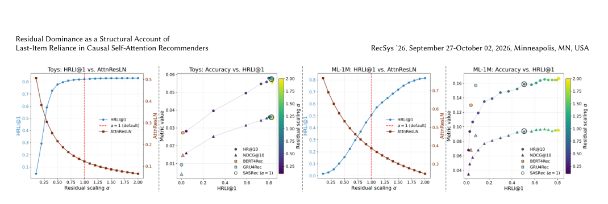

# Residual Dominance：因果自注意力中的残差主导性

> 论文：Residual Dominance as a Structural Account of Last-Item Reliance in Causal Self-Attention Recommenders，RecSys 2026。[https://doi.org/10.1145/3773078.3831798](https://doi.org/10.1145/3773078.3831798)
> 代码：[https://github.com/keito0329/Residual](https://github.com/keito0329/Residual)
> 更新记录：2026-11-01 新增笔记；整理注意力块分解、残差缩放和非末位置预测恢复实验。

---

# 一、研究问题

SASRec 的预测只读取最后一个位置，但注意力本身会聚合历史上下文。论文追问：为什么最终表示仍高度依赖最后一次交互？答案不是“最后物品一定最有用”，而是完整 attention block 中残差支路保留了当前位置输入，形成 **residual dominance**。

## 2. 分析方法

对 attention-only、加残差、再 layer norm 三个阶段做范数分解，计算跨位置的信息混合比例。随后在推理时将残差改为
$$h'=\alpha h+\operatorname{Attn}(h),$$
用 $\alpha$ 控制当前位置保留强度，观察准确率、混合程度和 last-item reliance 的变化。该干预只作用于推理，不重新训练模型。

## 3. 主要结果

| 数据集 | SASRec Attn | SASRec +Res | SASRec +LN | 解释 |
|---|---:|---:|---:|---|
| Beauty | 0.776 | 0.119 | 0.119 | 残差后混合比例显著下降 |
| Sports | 0.775 | 0.126 | 0.122 | layer norm 影响小于残差 |
| Toys | 0.772 | 0.123 | 0.123 | 稀疏数据同样存在主导性 |
| ML-1M | 0.856 | 0.395 | 0.386 | 稠密数据混合比例更高但趋势相同 |

在标准推理下，Beauty/Sports/Toys/Video 的 HR@10 分别为 `0.0381/0.0342/0.0574/0.0403`。减小 $\alpha$ 会提高上下文混合并形成准确率-新近性权衡；对部分“最后位置漏检、前一位置已命中”的样本，残差缩放可以恢复正确推荐。

## 4. 边界

残差缩放是机制诊断，不是一个训练方法；论文没有声称通过缩放就能普遍提升最终指标。位置混合率也不是因果效应估计，而是对已训练模型的结构性解释。

## 5. 本地实验

| 项目 | 结果 |
|---|---|
| SASRec/DuoRec 结构分解 |  |
| 推理残差 $\alpha$ 扫描 |  |
| 恢复样本比例 |  |
