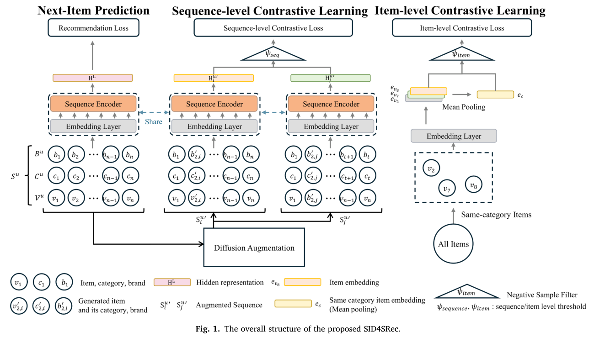
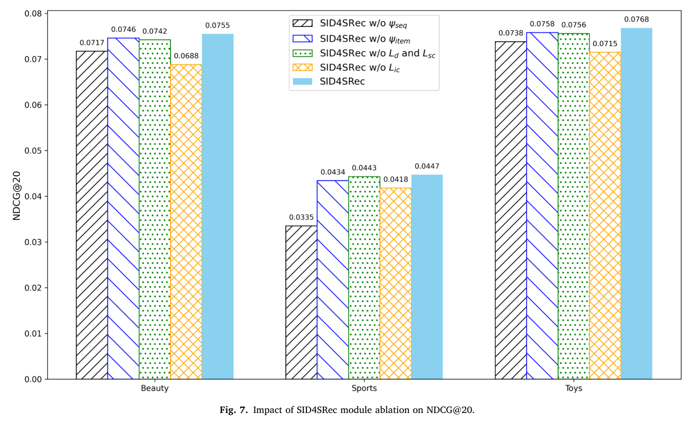

# SID4SRec：结合扩散增强与双层负例过滤改善序列推荐

> 论文：Sequence- and item-level contrastive learning via diffusion-based data augmentation for sequential recommendation，Knowledge-Based Systems 347 (2026)。[https://doi.org/10.1016/j.knosys.2026.116296](https://doi.org/10.1016/j.knosys.2026.116296)
> 代码：https://github.com/GitEricLin/SID4SRec
> 更新记录：2026-10-22 补充训练数据流、序列级/物品级对比的职责及负例过滤边界；保留原有代码核查，论文结果与本地结果分开。

---
# 一、文献阅读

## 1. 研究背景

对比学习常将同一批次中其他用户或物品作为负例，但推荐依赖共同偏好和物品语义相似性，这些“其他样本”可能是伪负例。扩散增强刻意生成保持用户意图的相近视图，若随后仍无差别排斥所有其他样本，增强与对比目标之间就可能产生冲突。

## 2. 研究目的与问题

在保留上下文感知扩散增强的基础上，同时在序列级与物品级执行对比学习，并过滤语义过近的候选负例。关键是检查收益来自增强、双层监督还是负例质量改善，以及额外训练模块能否在推理时移除。

## 3. 方法框架



图 1 位于 PDF 第 3 页。三个训练分支分别是下一物品预测、序列级对比和物品级对比。序列与增强视图共用编码器；类别和品牌作为轻量属性参与物品表示及正例构造。扩散增强沿用 CaDiRec 路线，其前向日程和反向去噪细节被原文明示省略，不能把本笔记写成论文完整给出了新的扩散推导。

### 3.1 训练数据流

| 顺序 | 数据/模块 | 输出 | 作用 |
|---|---|---|---|
| 1 | 原始序列 $S_u$ | 原始序列表示 $z_u$ | 保留真实下一物品监督 |
| 2 | context-aware diffusion | 增强视图 $\tilde S_u$、$z_u^+$ | 在上下文约束下改变部分物品 |
| 3 | 共享序列编码器 + 投影头 | $z_u,z_u^+$ | 序列级正对 |
| 4 | 语义相似度筛选 | $\mathcal N_u^{seq}$ | 从分母中移除过近伪负例 |
| 5 | 类别/品牌属性 | 物品正例集合 $\mathcal P(i)$ | 建立 item-level 语义正对 |
| 6 | 物品相似度筛选 | $\mathcal N_i^{item}$ | 移除物品级伪负例 |
| 7 | 联合损失 | $\mathcal L_{rec}+\beta\mathcal L_{seq}+\lambda\mathcal L_{item}$ | 训练序列编码器和扩散模块 |

推理时只输入原始序列并使用推荐头；扩散增强、投影头和两个对比损失都移除。$\psi_{seq}$ 与 $\psi_{item}$ 过滤的是对比损失分母中的候选负例，不是测试阶段的候选物品集合。

## 4. 公式分析（第 3–4 节，PDF 第 3–5 页）

### 4.1 推荐监督

$$
\mathcal L_{\mathrm{rec}}=-\sum_{(u,t)}\log
\frac{\exp g(h_u^{(t)},e_{i_{t+1}})}
{\sum_{j\in\mathcal I}\exp g(h_u^{(t)},e_j)}.
$$

序列表示预测下一物品；辅助对比损失不能替代该监督目标。

### 4.2 序列级对比与负例过滤

设 $z_u,z_u^+$ 是同一用户原始/增强序列的投影表示：

$$
\mathcal L_{\mathrm{seq}}=-\log
\frac{\exp(\operatorname{sim}(z_u,z_u^+)/\tau)}
{\exp(\operatorname{sim}(z_u,z_u^+)/\tau)
+\sum_{v\in\mathcal N_u^{\mathrm{seq}}}\exp(\operatorname{sim}(z_u,z_v)/\tau)}.
$$

负例仅保留满足下式的候选：

$$
1-\operatorname{sim}(z_u,z_v)\geq\psi_{\mathrm{seq}}.
$$

$\psi_{\mathrm{seq}}$ 越大，被保留的负例通常越少。语义相似样本从对比分母中移除，不等于自动增加到正例集合。实现还需确认相似度是否归一化，以及过滤后没有负例时的处理。

### 4.3 物品级对比

论文用类别或类别内品牌重合确定正例集合 $\mathcal P(i)$，对属性相关物品的表示 $y_i,y_p$ 进行对齐：

$$
\mathcal L_{\mathrm{item}}=-\mathbb E_{p\in\mathcal P(i)}\log
\frac{\exp(\operatorname{sim}(y_i,y_p)/\tau)}
{\exp(\operatorname{sim}(y_i,y_p)/\tau)
+\sum_{n\in\mathcal N_i^{\mathrm{item}}}\exp(\operatorname{sim}(y_i,y_n)/\tau)}.
$$

物品负例满足 $1-\operatorname{sim}(y_i,y_n)\geq\psi_{\mathrm{item}}$。类别相同并不保证用户偏好相同，因而此处依赖属性正例假设。

### 4.4 联合训练与推理

$$
\mathcal L=\mathcal L_{\mathrm{rec}}+\beta\mathcal L_{\mathrm{seq}}+\lambda\mathcal L_{\mathrm{item}}.
$$

推理只保留序列编码器与物品评分，不运行扩散增强或对比分支。负例过滤作用于训练的对比损失，不能用来缩小测试候选集。

## 5. 实验环境、数据与配置

| 数据集 | 用户 | 物品 | 原文交互数 | 平均长度 | 类别/品牌 |
| --- | --- | --- | --- | --- | --- |
| Beauty | 22,363 | 12,101 | 198,502 | 8.88 | 248 / 2,077 |
| Sports | 35,598 | 18,357 | 396,337 | 8.32 | 1,443 / 2,412 |
| Toys | 19,412 | 11,924 | 167,597 | 8.63 | 457 / 1,313 |
| ML-1M | 6,040 | 3,706 | 1,000,209 | 165.60 | 18 / 不适用 |

数据表来自原文表 2（PDF 第 5 页）；其中 Sports 的交互数与平均长度不相容，见第 8 节。

| 设置 | 原文报告 |
| --- | --- |
| 预处理与切分 | 5-core；每位用户最后一次测试、倒数第二次验证、此前训练 |
| 评测 | 全候选排序，按原文第 5.1.1 节排除训练前缀中交互过的候选；不通过负例过滤修改评测空间 |
| 指标 | HR/NDCG@5、10、20；ML-1M 主表报告 @10、20 |
| 网络 | 序列编码器与去噪编码器均为 2 层、2 个注意力头；维度 64 |
| 训练 | Adam，学习率 $10^{-3}$，batch size 256，100 epochs，dropout 0.1 |
| 序列与增强 | 最大长度 50，扩散替换比例 $\rho=0.1$ |
| ML-1M 属性 | 电影类型作为类别，不使用品牌分支；第 5.3.2 节称评分 $\geq4$ 视为正反馈 |
| 代码 | [GitEricLin/SID4SRec](https://github.com/GitEricLin/SID4SRec)，已核对并本地运行，详见第二部分 |

原文未在此配置段完整给出硬件、扩散日程和全部默认阈值；不能自行补成已核实设置。上表为论文报告值；代码实现中的序列编码器 192 维、dropout 默认值等差异见第二部分 4.2–4.3，不把代码默认值写成论文设置。

## 6. 主实验（按原文表 3–6 顺序）

### Beauty（表 3）

| 方法 | HR@5 | HR@10 | HR@20 | NDCG@5 | NDCG@10 | NDCG@20 |
| --- | --- | --- | --- | --- | --- | --- |
| SASRec | 0.0384 | 0.0628 | 0.0901 | 0.0249 | 0.0321 | 0.0387 |
| BERT4Rec | 0.0360 | 0.0601 | 0.0942 | 0.0216 | 0.0308 | 0.0386 |
| DreamRec | 0.0440 | 0.0687 | 0.1020 | 0.0274 | 0.0352 | 0.0462 |
| DiffuASR | 0.0388 | 0.0633 | 0.0989 | 0.0251 | 0.0316 | 0.0430 |
| CaDiRec | 0.0454 | 0.0688 | 0.1022 | 0.0301 | 0.0376 | 0.0460 |
| MCL4SRec | 0.0567 | 0.0842 | 0.1205 | 0.0376 | 0.0464 | 0.0556 |
| SID4SRec | 0.0774 | 0.1095 | 0.1533 | 0.0541 | 0.0645 | 0.0755 |

### Sports（表 4）

| 方法 | HR@5 | HR@10 | HR@20 | NDCG@5 | NDCG@10 | NDCG@20 |
| --- | --- | --- | --- | --- | --- | --- |
| SASRec | 0.0206 | 0.0320 | 0.0497 | 0.0135 | 0.0172 | 0.0216 |
| BERT4Rec | 0.0217 | 0.0359 | 0.0604 | 0.0143 | 0.0190 | 0.0251 |
| DreamRec | 0.0248 | 0.0374 | 0.0636 | 0.0151 | 0.0191 | 0.0309 |
| DiffuASR | 0.0217 | 0.0322 | 0.0608 | 0.0138 | 0.0166 | 0.0264 |
| CaDiRec | 0.0269 | 0.0403 | 0.0611 | 0.0179 | 0.0222 | 0.0274 |
| MCL4SRec | 0.0316 | 0.0474 | 0.0719 | 0.0209 | 0.0260 | 0.0321 |
| SID4SRec | 0.0447 | 0.0649 | 0.0939 | 0.0309 | 0.0374 | 0.0447 |

### Toys（表 5）

| 方法 | HR@5 | HR@10 | HR@20 | NDCG@5 | NDCG@10 | NDCG@20 |
| --- | --- | --- | --- | --- | --- | --- |
| SASRec | 0.0453 | 0.0675 | 0.0980 | 0.0306 | 0.0374 | 0.0447 |
| BERT4Rec | 0.0379 | 0.0524 | 0.0767 | 0.0259 | 0.0309 | 0.0368 |
| DreamRec | 0.0497 | 0.0643 | 0.1112 | 0.0316 | 0.0402 | 0.0511 |
| DiffuASR | 0.0448 | 0.0667 | 0.1007 | 0.0312 | 0.0382 | 0.0516 |
| CaDiRec | 0.0522 | 0.0785 | 0.1149 | 0.0356 | 0.0441 | 0.0507 |
| SID4SRec | 0.0797 | 0.1121 | 0.1513 | 0.0565 | 0.0669 | 0.0768 |

### ML-1M（表 6）

| 方法 | HR@10 | HR@20 | NDCG@10 | NDCG@20 |
| --- | --- | --- | --- | --- |
| SASRec | 0.0912 | 0.1338 | 0.0561 | 0.0673 |
| BERT4Rec | 0.0968 | 0.1411 | 0.0587 | 0.0706 |
| CaDiRec | 0.1049 | 0.1517 | 0.0630 | 0.0752 |
| SID4SRec | 0.1139 | 0.1627 | 0.0680 | 0.0812 |

## 7. 参数、消融与负例统计（按原文顺序）

1. **过滤阈值（图 3–4，PDF 第 7–8 页）**：改变 $\psi_{\mathrm{seq}}$、$\psi_{\mathrm{item}}$，用 NDCG@20 比较。适中过滤效果较好，过强过滤会丢失有用负例。
2. **损失权重（图 5–6，PDF 第 8–9 页）**：分别改变 $\beta$、$\lambda$。过大的序列对比权重会与推荐监督竞争，物品对比适中时提供补充收益。
3. **模块消融（图 7，PDF 第 9 页）**：正文概括移除序列负例过滤造成最大下降；但图中 Beauty、Toys 的最大下降来自移除物品级对比，Sports 才是移除序列过滤影响最大。下表按图上数值标签转录，不通过目测柱高估计。
4. **属性消融（图 8，PDF 第 10 页）**：检查类别与品牌提供的补充信息，应与移除物品级对比区分。



| 图 7 变体 | Beauty NDCG@20 | Sports NDCG@20 | Toys NDCG@20 |
| --- | --- | --- | --- |
| 无序列负例过滤 | 0.0717 | 0.0335 | 0.0738 |
| 无物品负例过滤 | 0.0746 | 0.0434 | 0.0758 |
| 无 $L_d$ 与 $L_{sc}$（沿用图例） | 0.0742 | 0.0443 | 0.0756 |
| 无物品级对比 $L_{ic}$（沿用图例） | 0.0688 | 0.0418 | 0.0715 |
| 完整 SID4SRec | 0.0755 | 0.0447 | 0.0768 |

图例使用 $L_d,L_{sc},L_{ic}$，正文方法节主要使用 $\mathcal L_{\mathrm{seq}},\mathcal L_{\mathrm{item}}$，尤其 $L_d$ 在最终目标中没有清晰对应项；代码核查时需确认是否包含单独扩散损失。

原文表 7（PDF 第 9 页）报告的平均负例数量：

| 数据集 | 物品过滤后 | 物品过滤前 | 序列过滤后 | 序列过滤前 |
| --- | --- | --- | --- | --- |
| Beauty | 11,871 | 11,876 | 138 | 510 |
| Sports | 18,236 | 18,241 | 48 | 510 |
| Toys | 11,606 | 11,611 | 14 | 510 |

## 8. 结果分析与原文疑点

- **收益与基线范围。** Beauty、Sports 的最强基线主要是 MCL4SRec；Toys 未列 MCL4SRec。Toys 各指标的最强基线也不相同，例如 NDCG@20 的最优基线是 DiffuASR 的 0.0516，不是 CaDiRec 的 0.0507。不能把表中所有提升都称为“相对 CaDiRec”。
- **Sports 数据统计。** 表 2 将交互数写为 396,337，而 $396337/35598\approx11.13$，不等于 8.32。若为 296,337 则约为 8.32；这是待核实的可能笔误，笔记保留原值。
- **ML-1M 提升比例。** 第 5.3.2 节文字称 HR@10/NDCG@10 相对 CaDiRec 提升 2.97%/3.46%；按表 6 重新计算应约为 8.58%/7.94%，与表内提升行一致。
- **ML-1M 预处理。** 评分 $\geq4$ 筛选与表 2 保留原始约 100 万交互的统计是否属于同一步骤，原文未解释清楚，需核对代码。
- **负例池定义。** 表 7 将物品负例数量表述为 mini-batch 内每锚点数量，但约 1.2 万至 1.8 万的计数远超 batch size 256；可能涉及全物品池或其他构造方式，需核实。序列的 510 与双视图批次相容，但仍应以实现为准。代码核对结果：序列级实际使用全部 510 个 in-batch 负例，**没有实现论文的 `1-sim >= ψ_seq` 过滤**；物品级实际是 item-vs-category（Beauty 248 个类别），不是论文的 item-item 全物品负例（约 11,876），详见第二部分 3.4。

可借鉴之处是把增强质量与负例质量一起考虑。复现时应先确认数据和评测一致，再依次检查主实验、过滤消融与权重，不宜用改变随机种子掩盖协议差异。

# 二、代码复现

> 核对日期：2026-10-22。代码为本地 SID4SRec 副本；运行环境 Python 3.12.12、torch 2.11.0+cu128、transformers 4.44.2、RTX 5060 Laptop 8GB。`requirements.txt` 写的是 torch 2.0.0，版本差异可能带来数值波动，但不足以解释 19% 的差距。

## 1. 当前状态

已完成数据、增强、损失、评测的代码核对，并跑通一次 Beauty 训练/测试。数据与论文表 2 完全一致；代码可运行，但**扩散增强的负例过滤、物品级对比的构造方式与论文描述不一致**，本地结果不能直接按论文表数值对标。当前判断：数据与评测协议基本没问题；差距主要来自训练配置/轮数（约 12%）和实现差异/论文口径（约 8%）。

## 2. 数据与评测协议

### 2.1 数据

| 数据集 | 本地（用户/物品/交互/平均长度） | 论文表 2 | 结论 |
| --- | --- | --- | --- |
| Beauty | 22,363 / 12,101 / 198,502 / 8.876 | 22,363 / 12,101 / 198,502 / 8.88 | 完全一致 |
| Sports | 35,598 / 18,357 / 296,337 / 8.32 | 35,598 / 18,357 / 396,337（原文疑为笔误）/ 8.32 | 用户、物品、均长一致；交互数按 296,337 才与均长自洽 |
| Toys | 19,412 / 11,924 / 167,597 / 8.63 | 19,412 / 11,924 / 167,597 / 8.63 | 一致 |

Beauty 最短序列 5、物品最小频次 5，确认是 5-core；序列内没有重复物品或相邻重复。

### 2.2 切分与评测

- 每位用户最后一次为 test、倒数第二次为 valid、其余为 train；`SASRecDataset` 分别取 `items[:-1]`、`items[:-2]`、`items[:-3]`。
- 全候选排序；valid 屏蔽 `items[:-2]`，test 屏蔽 `items[:-1]`（含 padding 列 0）；`test_batch_size=512`、`drop_last=True`，Beauty 实际评测 22,016/22,363 用户。
- `item_size=12,105`，比论文物品数多 4（padding/未知位）；候选集略大，但 padding 0 已被屏蔽。
- **test 本身比 valid 难**：流行度基线在 Beauty 上 valid N@20=0.0105、test=0.0081（test/valid=0.771）。因此不能用本地 valid 直接对论文 test 表；`paper` 运行的 valid 0.0745 / test 0.0609（比值 0.817）在正常范围。

## 3. 扩散增强的实际选择操作

代码路径：`data_generators/data_generator.py::mask_input_ids` → `models/gaussian_diffusion.py::training_losses_seq2seq` → `trainers/trainer.py::_train_one_epoch`。

### 3.1 掩码

- 每个非 padding token 以 `mlm_probability_train=0.1` 独立伯努利采样，得到 `masked_indices0`；padding 位置永不 mask。
- 掩码在 `Dataset.__getitem__` 中生成，因此每个 epoch/每个样本重新随机；替换比例是**期望 10%**，不是固定 10%。
- 只有一份 mask；`masked_indices1/2`（另两个视图）在代码中注释掉。

### 3.2 加噪与去噪

- `x_start = item_embedding(input_ids) + std * noise`（`_get_x_start`）。
- `q_sample(..., mask=mask)`：**未 mask 位置保留 x_start，mask 位置替换为扩散加噪的 x_t**；即未 mask 位置是“锚点”。
- 去噪器 `model.diffusion_reverse(x_t, t, attention_mask)` 预测 x_start；MSE/NLL 只在 mask 位置计算。

### 3.3 候选选择（关键）

```python
logits = model.get_logits(pred_xstart)              # 全物品打分
cands = torch.topk(logits, k=10, dim=-1).indices    # 每个位置保留 top-10
random_element = torch.randint(10, size=(B, L, 2))
cands = cands.gather(2, random_element)              # 从 top-10 随机抽 2 个（可重复）
aug = original * (1 - mask) + cands * mask           # 只替换 mask 位置
aug_seq1, aug_seq2 = aug[..., 0], aug[..., 1]
```

当前“增强选择”的准确含义：

1. **选位置**：随机 10% 非 padding token；
2. **选候选**：扩散模型预测 x_start，对全部物品打分，取 top-10，再**从 top-10 均匀随机抽 2 个**作为两个视图的替换值；
3. 两个视图共用同一 mask 和同一 top-10 池，仅随机抽样不同，因此可能抽到同一个候选；
4. 只替换 mask 位置，未 mask 位置保留原 item id；
5. 没有基于相似度/置信度/质量的筛选，也没有排除原物品或 padding。

因此它不是“top-1/top-2 确定性替换”，也不是论文序列级负例过滤；它只是**扩散引导的 top-10 随机候选替换**。

补充：这里的 `get_logits` 只使用 `item_embedding.weight`（64 维）给候选打分，不包含 category/brand；而推荐损失和 `full_sort_predict` 使用 item+category+brand 的 192 维拼接。增强候选的 top-10 分数空间与最终推荐打分空间并不完全一致。

### 3.4 增强后的对比使用

- 两个视图经同一个冻结的 item embedding 副本编码（`model_emb`），再走 `calculate_cl_loss`。
- 序列级 InfoNCE 使用**全部 in-batch 负例**（batch 256 → 每锚点 510 个），没有实现论文的 `1 - sim >= ψ_seq` 过滤；Beauty 论文过滤后约 138/510。
- 物品级对比 `CategoryContrastiveLearning.get_contrastive_loss` 实际是 **item vs 类别中心**：`raw_similarities = item_emb @ category_emb.T`，分母只有 248 个类别，不是约 12,000 个物品；正例是物品自己的类别，负例用 `sim < phi` 过滤；品牌没有参与正例构造。
- 结论：代码里的“双层负例过滤”只部分存在（物品级是类别级阈值），序列级没有；与论文的 item-item 过滤不是同一实现。

## 4. 损失、结构与训练配置

### 4.1 损失

`trainers/trainer.py` 的实际组合：

$$
L=L_{rec}+\gamma L_{diff}^{mse}+\beta L_{diff}^{nll}+\alpha L_{seq}+\lambda_{cl}L_{item}
$$

- 默认 `alpha=0.1`、`beta=0.2`、`gamma=0.0`、`lambda_cl=0.1`、`phi=0.1`、`item_temp=0.1`。
- `gamma=0` 时扩散 MSE 不参与反传；日志里的 `diff_mse_loss` 仍在计算（只作监控），所以会随训练上升，不代表优化目标在恶化。
- 论文式 (4.4) 只写 $L_{rec}+\beta L_{seq}+\lambda L_{item}$；代码的 `alpha` 对应序列对比、`lambda_cl` 对应物品对比，`beta/gamma` 是额外的扩散项；`L_d` 在论文中的对应关系仍需作者代码/补充材料确认。
- `warm_up_epochs=-1`，序列/物品对比从第 0 轮就参与；论文未说明 warm-up。

### 4.2 结构

- item/category/brand 各 64 维，拼接成 192 维进入 SASRec 序列编码器（2 层、2 头、hidden=192）；去噪 Deberta 编码器 hidden=64（2 层、2 头）。
- 论文表 2 写“维度 64”，更可能指单个 attribute embedding，不能据此断言序列编码器 hidden=64；以代码为准需作者确认。
- 推荐损失是对全部物品的 full softmax（`CrossEntropyLoss`），不是 BPR；`loss_type=BPR` 参数未使用。
- `full_sort_predict` 用 item+category+brand 拼接后打分；候选包含 padding 和额外未知 item（12,105），padding 被屏蔽。

### 4.3 论文文字与代码默认值的冲突

| 参数 | 代码默认 | 论文文字 | 说明 |
| --- | --- | --- | --- |
| `sasrec_dropout_prob` | 0.5 | dropout 0.1 | 论文的 0.1 更可能指 `--dropout`（扩散分支，默认 0.1），不应把 SASRec dropout 也改成 0.1 |
| `hidden_dropout_prob` | 0.2 | 0.1 | 同上 |
| `attention_probs_dropout_prob` | 0.2 | 0.1 | 同上 |
| `dropout` | 0.1 | 0.1 | 一致 |

本地对照：`paper` 运行把四个 dropout 全设 0.1，valid/test 均低于 10/22 0:20 的旧 checkpoint（后者疑似默认配置）；说明“论文 0.1”不能直接理解为所有 dropout 都设 0.1。

### 4.4 早停与日志（本地新增）

- `EarlyStopping`：默认监控 `ndcg@20`、patience 40、min_delta 1e-4；刷新最佳时保存 CPU state_dict，训练结束恢复最佳权重再 test；`--patience 0` 关闭早停但仍保留最佳模型。
- 日志：`main.py` 把 stdout/stderr 双写到 `<output_dir>/<model_name>-<dataset>-<model_idx>.txt`，UTF-8、追加；记录命令、全部超参、环境、数据规模、逐轮 loss/valid、早停、最终 test；tqdm 的 `\r`/ANSI/空行不写入。
- 这些是复现基础设施，不属于论文方法。

## 5. 本地实验记录

### 5.1 已完成的运行/评估

| 实验 | 设置 | 种子 | valid N@20 | test N@20 | 备注 |
| --- | --- | --- | --- | --- | --- |
| `paper` 运行 | Beauty，dropout 0.1，27 epochs，best epoch 16 | 2024 | 0.0745 | 0.0609 | test H@20=0.1248；epoch 26 早停 |
| 旧 `Beauty-0.pt` 评估 | 10/22 0:20 那次运行，配置未知，疑似默认 | 2024? | 0.0825 | 0.0695 | test H@20=0.1397；当前本地最佳 |
| 官方 Sports checkpoint | 仓库自带权重，strict load | — | 0.0476 | 0.0404 | 论文 test 0.0447；valid 高于论文 test |
| 流行度基线 | Beauty，按训练前缀频次 | — | 0.0105 | 0.0081 | 说明 test 更难 |
| 论文 Beauty | — | — | — | 0.0755 | H@20=0.1533 |
| 论文 Sports | — | — | — | 0.0447 | H@20=0.0939 |

说明：`saved_models/diffsas-Beauty-0.pt` 已在 10/22 0:20 被一次训练覆盖，不再是仓库原始权重；`paper` 运行复用同一路径，但最佳检查点来自 27 轮那次。

### 5.2 尚未做

| 实验 | 状态 |
| --- | --- |
| 无序列负例过滤 | 未做（当前代码即无过滤；需先实现过滤才能做 A/B） |
| 无物品负例过滤 | 未做 |
| 无物品级对比 | 未做 |
| 类别/品牌消融 | 未做 |
| 参数敏感性（alpha/beta/lambda/phi） | 未做 |
| 多次重复实验（3 seeds） | 未做 |

## 6. 复现差距分析

### 6.1 差距拆解

- 论文 Beauty 0.0755 → 旧 `Beauty-0.pt` 0.0695：**−8.0%**
- 旧 `Beauty-0.pt` 0.0695 → `paper` 运行 0.0609：**−12.4%**
- 合计：0.0755 → 0.0609，**−19.3%**
- 验证侧同样下降：0.0825 → 0.0745（−9.7%），说明不只是 test 协议，训练配置也确实让模型变差。

### 6.2 原因

1. **训练配置/轮数（约 12%）**：`paper` 运行 27 轮、best epoch 16；论文 100 轮。第一次 100 轮命令只跑了 0.4 min 就结束（无异常，疑似手动中断），有效训练是第二次 27 轮。训练损失从 2.566 降到 1.215，验证在 0.0745 平台化；旧 checkpoint 疑似默认 dropout + 更长训练。把四个 dropout 全设 0.1 很可能是对论文“dropout 0.1”的误读。
2. **代码实现差异（约 8%）**：
   - 序列级负例过滤缺失：代码用全部 510 个 in-batch 负例；论文过滤后 138/510；论文消融去掉该过滤 N@20 从 0.0755 降到 0.0717。
   - 物品级对比是 item-vs-category（248 类），不是 item-vs-item（约 12,000 负例）；论文去掉物品级对比为 0.0688，与旧 checkpoint 0.0695 几乎一致，说明当前物品级分支可能没有实现论文的作用。
   - `phi` 语义（`sim < phi` vs `1-sim >= ψ`）、品牌正例缺失、`gamma=0`/warm-up/默认 loss 权重均可能与论文不同。
3. **论文口径/选模**：论文未给重复实验、标准差、选模协议；官方 Sports 权重在同一评测下 test N@20=0.0404，仅论文 0.0447 的 90%；旧 Beauty 0.0695 为论文的 92%。剩余 8–10% 很可能含 best-test 选模、调参和单次运行方差。
4. **数据/评测不是主因**：Beauty 数据与论文完全一致；评测代码可加载官方权重并得到合理指标；test 比 valid 难是数据本身的性质（流行度基线 test/valid=0.771）。

### 6.3 结论

现有两个可评估权重在同一评测下达到论文 test 的约 **90–92%**（旧 Beauty 0.0695、官方 Sports 0.0404），但 `paper` 运行因配置/轮数只到 **81%**。若目标是论文数值，需同时做：默认 dropout + 100 轮 → 补序列级过滤与 item-item 对比 → 调 loss 权重/阈值 → 多 seed。只改随机种子或只加早停无法解释 19% 的差距。

## 7. 复现命令（建议先跑默认配置）

```powershell
python main.py --dataset Beauty --model_name diffsas --model_idx beauty-default `
  --train_batch_size 256 --learning_rate 0.001 --epochs 100 `
  --max_seq_length 50 --hidden_size 64 --inner_size 128 `
  --n_layers 2 --n_heads 2 --patience 40 --early_stop_metric ndcg@20 --seed 2024
```

- 不要覆盖 `sasrec_dropout_prob`/`hidden_dropout_prob`/`attention_probs_dropout_prob`；论文的 0.1 先用默认 `--dropout 0.1` 表达。
- 日志写到 `saved_models/diffsas-Beauty-beauty-default.txt`；checkpoint 为 `...-beauty-default.pt`，不会覆盖 `-0.pt`。
- 若要严格 100 轮：`--patience 0`。

## 8. 后续核对清单

- [ ] 默认 dropout + 100 轮，对比旧 `Beauty-0.pt`（0.0825/0.0695）。
- [ ] 单变量 dropout 0.5 vs 0.1（只改 `sasrec_dropout_prob`）。
- [ ] 实现序列级 `1-sim >= ψ_seq` 过滤，并做无过滤/有过滤 A/B。
- [ ] 把物品级对比改成 item-item（类别/品牌正例，`1-sim >= ψ_item`），核对 `phi` 方向。
- [ ] 在 valid 上扫 `alpha/beta/lambda_cl/phi`，不碰 test。
- [ ] 3 seeds 报告均值/方差。
- [ ] 用官方 Sports/Toys/Home 权重评估，建立本代码的复现上限；Beauty 原始权重已被覆盖。
