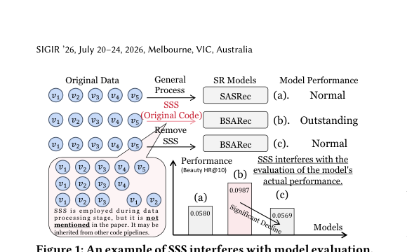

# SSS：关注序列切分对序列推荐的影响

> 论文：Pay Attention to Sequence Split: Uncovering the Impacts of Sub-Sequence Splitting on Sequential Recommendation Models，SIGIR 2026。[https://doi.org/10.1145/3805712.3808548](https://doi.org/10.1145/3805712.3808548)
> 代码：[https://github.com/KingGugu/SSS4SR](https://github.com/KingGugu/SSS4SR)
> 更新记录：2026-11-01 新增笔记；记录 SSS 的评测干扰、切分方式和四骨干控制实验。

---

# 一、文献阅读

## 1. 研究问题

Sub-sequence splitting（SSS）把一条用户序列拆成多条前缀、后缀或滑窗子序列，再把每条子序列作为训练样本。论文发现，许多近期代码在 data reader 中默认使用 SSS，却没有在论文中说明；模型的提升可能来自样本数量和目标分布改变，而非模型结构本身。

## 2. 论文分析框架

| 变量 | 对照设置 |
|---|---|
| split | Prefix、Suffix、Sliding、Original（不切分） |
| target | Single target、Multi target |
| loss | BCE、CE |
| backbone | GRU4Rec、SASRec、FMLPRec、BSARec |
| 数据 | Beauty、Sports、Douyin、LastFM，并扩展 ML-1M、CDs |

SSS 一方面均衡了训练样本的长度分布，另一方面增加了不同物品成为 target 的机会。它还会改变负例/正例比例、早期行为的监督次数和验证集规模，所以必须把 split、target、loss 一起报告。

## 3. 关键结果

论文表 3 的代表性结果如下（H/N@10，Beauty）：

| 模型 | 使用 SSS | H@10 | N@10 |
|---|---|---:|---:|
| SASRec | 否 | 0.0580 | 0.0301 |
| DuoRec | 是（官方实现） | 0.0844 | 0.0439 |
| DuoRec* | SSS 影响下的结果 | 0.0844 | 0.0439 |
| FMLPRec | 是 | 0.0620 | 0.0331 |
| FMLPRec | 去除 SSS | 0.0607 | 0.0331 |
| CSRec | 是 | 0.1016 | 0.0583 |
| CSRec | 去除 SSS | 0.0602 | 0.0363 |

在包含 SSS 的近期模型中，去掉 SSS 后有 8/10 个模型平均下降超过 40%，多个模型不再超过 SASRec。四骨干控制实验进一步显示，Prefix + Multi-target + CE 并不总是最好；合适的组合通常是单目标、BCE 与 Prefix，但结论依赖骨干和数据集。

## 4. 阅读结论

SSS 应被视为训练协议变量，而不是无害的数据读取细节。比较增强方法前，必须固定切分方式、目标策略、损失、候选集和评测集，否则会把数据增广带来的收益误归因给模型模块。

## 5. 本地复现

| 项目 | 结果 |
|---|---|
| 统一协议复现 SSS / w/o SSS |  |
| 对 DuoRec、MELT、MCLRec 的切分敏感性 |  |
| 小规模数据集的 split × target × loss 网格 |  |
