# TADA：通过尾部感知序列增强改善长尾推荐

> 论文：Tail-Aware Data Augmentation for Long-Tail Sequential Recommendation，WWW 2026。[https://doi.org/10.1145/3774904.3792171](https://doi.org/10.1145/3774904.3792171)
> 代码：https://github.com/KingGugu/TADA
> 更新记录：2026-11-13 统一论文-本地实验结果对照表为五列长表；2026-10-22 统一笔记顶部信息格式；保留原有阅读与复现记录，论文结果与本地结果分开。

---
# 一、文献阅读

## 1. 研究背景

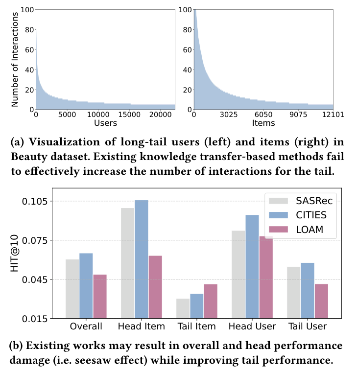

**图 1：长尾分布与头尾性能的跷跷板现象**（英文原文 PDF 第 2 页）。 上半部分为 Beauty 中用户与物品的长尾交互分布，下半部分展示部分既有方法改善尾部时损害总体或头部效果的现象。

序列推荐根据用户历史交互预测下一物品。真实数据中，多数用户序列短、绝大多数物品交互少。尾物品嵌入因此训练不足，短序列也难以完整表达用户偏好。既有头尾知识迁移方法可能提高尾部精度，却降低总体或头部精度，形成论文所称的“跷跷板”现象。

## 2. 研究目的

通过增加有意义的尾部训练交互，在改善尾用户和尾物品预测的同时保持总体与头部表现，缓解尾部数据稀疏及头尾性能之间的“跷跷板”现象。

## 3. 研究问题

1. 如何挑选与原序列语义相关的增强物品，增加尾物品的有效训练信号？
2. 如何根据序列长短选择插入或替换操作，增强短序列而保留用户偏好？
3. 如何跨用户融合表示，同时区分头偏好和尾偏好？
4. 方法能否在多骨干、多数据集上同时改善总体、头部和尾部指标？

## 4. 研究方法

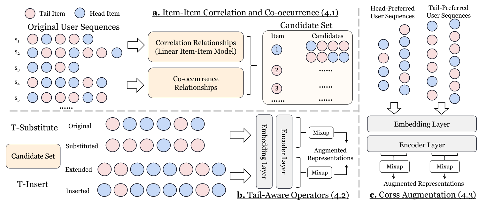

**图 2：TADA 总体框架**（英文原文 PDF 第 4 页）。 图中 a 构造相关性与共现候选集，b 执行尾部感知替换、插入与表示混合，c 按头尾偏好开展跨序列增强。

TADA 先用线性物品模型与局部共现构造增强候选集；随后按序列长度选择 T-Substitute 或 T-Insert，在表示层混合原始与增强视图；再按用户的头尾物品偏好分组，执行组内跨序列混合。训练采用先训练原骨干、再加入两种增强损失的两阶段流程。

## 5. 研究内容（公式分析）

以下依照论文第 4 章的 **4.1–4.5** 展开。设 $U,V$ 分别为用户、物品集合，$s_u=(v_1,\ldots,v_{|s_u|})$ 为用户 $u$ 的交互序列，$N$ 为最大序列长度，$B$ 为批量大小，$M_V$ 为物品嵌入矩阵，$M_D$ 为用户–物品二值交互矩阵。论文前一章的任务定义为预测下一物品 $\arg\max_{v\in V}P(v_{|s_u|+1}=v\mid s_u)$（式 1）；第 4 章围绕“候选集—序列增强—跨序列增强—训练目标”构建 TADA，如图 2 所示。

### 5.1 物品相关性与共现候选集

**相关性候选集。** 直接用余弦相似度在训练过程中反复筛选候选物品，会带来较高的物品对计算成本。作者在模型训练前用线性物品模型计算相似度；该模型也被认为更容易捕捉低流行度物品的共现关系。令 $M_D\in\mathbb R^{|U|\times|V|}$，其中 $M_D[u,v]=1$ 表示用户与物品有交互，未观察到的交互记为 0。求物品–物品矩阵 $M_S\in\mathbb R^{|V|\times|V|}$：

$$\hat M_S=\underset{M_S}{\arg\min}\ \|M_D-M_DM_S\|_F^2+\lambda_r\|M_S\|_F^2,\qquad \operatorname{diag}(M_S)\leq\xi,\quad \xi\in[0,1).\tag{2}$$

第一项要求其他物品的交互重构当前物品的交互，第二项用岭正则抑制过大的相似度系数；对角约束避免“物品只用自身重构自身”的平凡解，同时允许考虑重复物品。将论文在式(2)(3)中写作 $\lambda$ 的**岭系数**记作 $\lambda_r$，以区别后面的混合权重。其闭式解为：

$$P=(M_D^\top M_D+\lambda_r I)^{-1},\qquad \hat M_S=I-P\operatorname{diag}(\gamma),\qquad
\gamma_j=\begin{cases}\lambda_r,&1-\lambda_r P_{jj}\leq\xi,\\(1-\xi)/P_{jj},&\text{其他情况。}\end{cases}\tag{3}$$

对每个物品 $v$，按 $\hat M_S$ 的相关分数选前 $K$ 个物品，得到相关性候选集 $c_v^r$。这一集合侧重物品之间的**全局关联**。

**共现候选集。** 全局相似度不保留序列中的相对位置，因此还统计一阶邻接关系：对头物品，收集所有序列中位于它前后两侧的尾物品；对尾物品，收集所有序列中紧邻它之前的物品。后者可以视为可能引出该尾物品的行为。记这些物品为 $c_v^c$，最终候选集为

$$c_v=c_v^r\cup c_v^c.\tag{4}$$

由此，增强物品既能从线性相关性中取得，也能从顺序上下文中取得。源码 `LIS.py` 先在训练前缀上构造矩阵；`ht_process.py` 只统计训练前缀的邻接关系，避免把验证和测试答案引入候选集。源码另加了相似度阈值筛选和“无达标项时回退至前 $K$”的实现细节。

### 5.2 尾部感知算子

**T-Substitute：替换头物品。** 对每条原序列 $s_u$，先采样本次操作概率

$$p\sim\operatorname{Uniform}(a,b),\qquad 0<a<b<1.\tag{5}$$

逐个遍历序列，头物品以概率 $p$ 被选中；对每个被选中的位置 $\mathrm{idx}_i$，从该位置原物品的 $c_{v_{\mathrm{idx}_i}}$ 中随机取 $\bar v_{\mathrm{idx}_i}$，得到

$$s'_u=\operatorname{T\text{-}Substitute}(s_u)=(v_1,\ldots,\bar v_{\mathrm{idx}_i},\ldots,v_{|s_u|}).\tag{6}$$

通过在不同训练样本中改变 $p$，得到不同增强强度；优先替换头物品，增加相关候选物品（包括尾物品）出现在训练序列中的机会。作者不直接把 $s'_u$ 当作独立样本，而让原序列与增强序列通过同一嵌入表和编码器：

$$E'_u=\operatorname{Look\text{-}up}(M_V,s'_u),\qquad H'_u=\operatorname{Encoder}(E'_u),\tag{7}$$

并以 $\lambda_m\sim\operatorname{Beta}(\alpha,\alpha)$ 混合原表示 $H_u$ 与增强表示 $H'_u$：

$$H_u^{ao}=\lambda_m H_u+(1-\lambda_m)H'_u.\tag{8}$$

$\alpha$ 控制混合权重分布，表示层混合使新样本保留原有偏好信息；此处 $\lambda_m$ 与式(2)的岭系数无关。

**T-Insert：在尾物品之前插入。** 同样从式(5)采样 $p$，逐个遍历序列中的**尾物品**，以概率 $p$ 选中位置 $\mathrm{idx}_i$，并从该尾物品候选集随机取 $\bar v_c$ 插在它之前：

$$s'_u=\operatorname{T\text{-}Insert}(s_u)=(v_1,\ldots,\bar v_c,v_{\mathrm{idx}_i},\ldots,v_{|s_u|}).\tag{9}$$

插入后 $s'_u$ 比原序列长。为使两个表示能逐位置混合，作者在另一条视图中把对应的尾物品复制一次：

$$s_u^e=\operatorname{Extend}(s_u)=(v_1,\ldots,v_{\mathrm{idx}_i},v_{\mathrm{idx}_i},\ldots,v_{|s_u|}),\qquad |s'_u|=|s_u^e|.\tag{10}$$

然后像式(7)(8)那样编码并混合 $s'_u$ 与 $s_u^e$。插入的前驱物品提供预测尾物品的上下文，复制尾物品增加它在增强视图中的出现次数。两种算子也给短历史用户创造了更多训练信号。

**按长度选择算子。** 给不同长度的序列分配不同概率：

$$p_{\mathrm{insert}}=1-\frac{|s_u|}{N},\qquad p_{\mathrm{substitute}}=1-p_{\mathrm{insert}}=\frac{|s_u|}{N}.\tag{11}$$

短序列更常插入，长序列更常替换；对应 `datasets.py:augment`。这里按**用户历史长度**选择算子，不等同于下一小节按**尾物品占比**划分用户偏好。

### 5.3 尾部感知跨序列增强

单序列算子只混合同一用户的两个视图；作者进一步混合不同用户的序列表示，以学习用户之间的协同信号。先计算每条序列的尾物品占比，与阈值 $\beta$ 比较，得到头偏好组和尾偏好组，分别含 $B_h$、$B_t$ 条序列，且 $B_h+B_t=B$。这样分组是因为短历史用户未必偏好尾物品，长历史用户也可能购买大量尾物品；仅按用户历史长度跨序列混合会混淆这两种偏好。

以尾偏好组为例，组内打乱表示，得到另一条序列的配对表示：

$$\{H'_u\}_{u=1}^{B_t}=\operatorname{Shuffle}(\{H_u\}_{u=1}^{B_t}).\tag{12}$$

为每条序列采样 $\lambda_u\sim\operatorname{Beta}(\alpha,\alpha)$，令 $\Lambda=\operatorname{diag}(\lambda_1,\ldots,\lambda_{B_t})$，逐样本混合：

$$\{H_u^{ac}\}_{u=1}^{B_t}=\Lambda\{H_u\}_{u=1}^{B_t}+(I-\Lambda)\{H'_u\}_{u=1}^{B_t}.\tag{13}$$

论文排版中的式(13)把 $\lambda_t$ 视为逐样本权重；上式用对角矩阵明确其作用。头偏好组进行同样操作。正物品嵌入与负物品嵌入也沿用**同一配对与权重**进行混合，形成 $E_u^{ac+},E_u^{ac-}$。除原序列外，两种算子产生的增强序列也参与跨序列增强，并继承其原序列的头/尾偏好标签；对应 `trainers.py:split_batch_by_preference` 与 `whole_mix_learning`。

### 5.4 目标函数与两阶段训练

序列编码器在每个有效位置输出 $H_u$，正负目标嵌入分别为 $E_u^+,E_u^-$。论文用二元交叉熵表示主推荐目标。对单个有效位置，其展开式为

$$L_{main}=\operatorname{BCE}(H_u,E_u^+,E_u^-)=-\log\sigma(H_u\cdot E_u^+)-\log[1-\sigma(H_u\cdot E_u^-)],\tag{14}$$

其中 $\sigma$ 为 sigmoid；训练时对所有非填充位置求和或平均。算子内混合与跨序列混合分别产生

$$L_{operator}=\operatorname{BCE}(H_u^{ao},E_u^+,E_u^-),\tag{15}$$

$$L_{cross}=\operatorname{BCE}(H_u^{ac},E_u^{ac+},E_u^{ac-}).\tag{16}$$

**第一阶段**仅在原始序列上优化式(14)，先得到较可靠的物品嵌入，避免用尚未优化的表示产生噪声混合样本。**第二阶段**启用两种尾部算子和跨序列混合，优化

$$L=L_{main}+L_{operator}+L_{cross}.\tag{17}$$

论文没有给增强损失另设系数，等权看待原始样本和增强样本；自适应加权留待未来研究。仓库提供第一阶段预训练权重，`main.py` 在 `aug=1` 时加载它们，再由 `trainers.py:iteration` 累加三项损失。

### 5.5 方法讨论

1. **缓解尾部稀疏。** 既有方法主要从头部迁移知识，不能直接增加尾部交互频率；TADA 的替换、插入、扩展及跨序列增强在训练中增加与尾物品、短历史用户有关的信号，以减少头尾性能的“跷跷板”现象。
2. **增强阶段开销较低。** 线性相似度候选集在训练前预构建，训练时无需反复对全部物品两两比较；作者指出训练中的候选抽取、权重采样和表示混合随处理的数据量线性增长。这一论断针对**在线增强阶段**，不包括预处理时构造稠密 $|V|\times|V|$ 相似矩阵及求逆的成本。
3. **可接入不同骨干。** TADA 不要求额外可学习模块，也不依赖特定双向 Transformer 或扩散结构；论文把它接入不同架构的序列推荐模型。实际接入仍要求骨干能输出可混合的序列表示，并与物品嵌入和 BCE 训练接口兼容。

## 6. 所作实验与环境、数据集、参数配置

主实验覆盖 Toys and Games、Beauty、Sports and Outdoors 三个 Amazon 5-core 数据集，骨干为 GRU4Rec、SASRec、FMLP-Rec；对比 CMR、CMRSI、RepPad、CITIES、LOAM、MELT。附录增加 NARM、LightSANs、gMLP 骨干及 Yelp、Douyin 数据集。留一法将每条序列最后两项依次用于验证、测试，最大长度 50；全物品排序，报告 Hit@K 与 NDCG@K（$K=5,10,20$），表格主要展示 10 和 20。论文称每种方法运行 5 次并报告均值。

| 数据集    |     用户 |     物品 |      交互 | 平均长度 |    稀疏度 |
| ------ | -----: | -----: | ------: | ---: | -----: |
| Toys   | 19,412 | 11,924 | 167,597 |  8.6 | 99.93% |
| Beauty | 22,363 | 12,101 | 198,502 |  8.9 | 99.93% |
| Sports | 35,598 | 18,357 | 296,337 |  8.3 | 99.95% |
| Yelp   | 30,431 | 20,033 | 316,354 | 10.4 | 99.95% |
| Douyin | 20,398 |  8,299 | 139,834 |  6.9 | 99.92% |

论文固定嵌入维度 64、批量 256、Adam 学习率 0.001、$\beta_1=0.9,\beta_2=0.999$；搜索 $\alpha\in\{0.1,0.2,0.3,0.4,0.5\}$、$a\in\{0.1,0.2,0.3\}$、$b\in\{0.5,0.6,0.7,0.8\}$、偏好阈值 $\beta\in\{0.4,0.5,0.6\}$、$K\in\{10,20,30,40,50\}$。仓库默认值见后文，以代码为实际执行准则。

## 7. 完整实验结果表格

以下 H=Hit Ratio、N=NDCG。列顺序为总体 H@10/N@10/H@20/N@20，头物品 H@10/N@10，尾物品 H@10/N@10/H@20/N@20，头用户 H@10/N@10，尾用户 H@10/N@10/H@20/N@20。数值保持论文原表，未擅自更正异常值；例如表 8 Yelp/GRU4Rec/CMRSI 的总体 N@10 原文为 0.0990。

### 表 2：主实验（论文第 7 页，72 行）

| 数据集    | 方法       | 总体 H10 | 总体 N10 | 总体 H20 | 总体 N20 | 头物品 H10 | 头物品 N10 | 尾物品 H10 | 尾物品 N10 | 尾物品 H20 | 尾物品 N20 | 头用户 H10 | 头用户 N10 | 尾用户 H10 | 尾用户 N10 | 尾用户 H20 | 尾用户 N20 |
| ------ | -------- | -----: | -----: | -----: | -----: | ------: | ------: | ------: | ------: | ------: | ------: | ------: | ------: | ------: | ------: | ------: | ------: |
| Toys   | GRU4Rec  | 0.0364 | 0.0192 | 0.0580 | 0.0246 |  0.0581 |  0.0311 |  0.0230 |  0.0119 |  0.0355 |  0.0150 |  0.0456 |  0.0210 |  0.0341 |  0.0188 |  0.0531 |  0.0235 |
| Toys   | CMR      | 0.0415 | 0.0214 | 0.0662 | 0.0276 |  0.0633 |  0.0320 |  0.0281 |  0.0150 |  0.0419 |  0.0184 |  0.0428 |  0.0208 |  0.0412 |  0.0216 |  0.0651 |  0.0276 |
| Toys   | CMRSI    | 0.0405 | 0.0202 | 0.0647 | 0.0286 |  0.0669 |  0.0345 |  0.0273 |  0.0156 |  0.0425 |  0.0194 |  0.0411 |  0.0197 |  0.0399 |  0.0207 |  0.0630 |  0.0269 |
| Toys   | RepPad   | 0.0442 | 0.0243 | 0.0641 | 0.0293 |  0.0692 |  0.0368 |  0.0288 |  0.0166 |  0.0406 |  0.0196 |  0.0368 |  0.0182 |  0.0460 |  0.0258 |  0.0657 |  0.0308 |
| Toys   | CITIES   | 0.0393 | 0.0211 | 0.0617 | 0.0268 |  0.0636 |  0.0339 |  0.0244 |  0.0132 |  0.0380 |  0.0167 |  0.0404 |  0.0211 |  0.0390 |  0.0211 |  0.0590 |  0.0262 |
| Toys   | LOAM     | 0.0223 | 0.0116 | 0.0363 | 0.0151 |  0.0158 |  0.0076 |  0.0263 |  0.0141 |  0.0389 |  0.0172 |  0.0350 |  0.0178 |  0.0191 |  0.0101 |  0.0299 |  0.0128 |
| Toys   | MELT     | 0.0330 | 0.0174 | 0.0525 | 0.0223 |  0.0819 |  0.0432 |  0.0029 |  0.0016 |  0.0046 |  0.0020 |  0.0265 |  0.0127 |  0.0346 |  0.0186 |  0.0539 |  0.0234 |
| Toys   | TADA     | 0.0512 | 0.0280 | 0.0749 | 0.0340 |  0.0746 |  0.0412 |  0.0368 |  0.0200 |  0.0513 |  0.0236 |  0.0515 |  0.0265 |  0.0511 |  0.0284 |  0.0722 |  0.0337 |
| Toys   | SASRec   | 0.0716 | 0.0396 | 0.1015 | 0.0471 |  0.0892 |  0.0485 |  0.0607 |  0.0341 |  0.0821 |  0.0395 |  0.0675 |  0.0345 |  0.0726 |  0.0408 |  0.1009 |  0.0480 |
| Toys   | CMR      | 0.0652 | 0.0361 | 0.0959 | 0.0438 |  0.0994 |  0.0557 |  0.0414 |  0.0241 |  0.0639 |  0.0290 |  0.0608 |  0.0350 |  0.0663 |  0.0364 |  0.0985 |  0.0438 |
| Toys   | CMRSI    | 0.0683 | 0.0380 | 0.0984 | 0.0452 |  0.1013 |  0.0579 |  0.0455 |  0.0260 |  0.0694 |  0.0308 |  0.0657 |  0.0374 |  0.0716 |  0.0385 |  0.1024 |  0.0459 |
| Toys   | RepPad   | 0.0805 | 0.0476 | 0.1089 | 0.0547 |  0.1030 |  0.0599 |  0.0667 |  0.0399 |  0.0855 |  0.0447 |  0.0726 |  0.0408 |  0.0825 |  0.0479 |  0.1064 |  0.0548 |
| Toys   | CITIES   | 0.0723 | 0.0392 | 0.1024 | 0.0468 |  0.0971 |  0.0525 |  0.0570 |  0.0310 |  0.0805 |  0.0370 |  0.0711 |  0.0353 |  0.0726 |  0.0402 |  0.1015 |  0.0475 |
| Toys   | LOAM     | 0.0569 | 0.0321 | 0.0815 | 0.0383 |  0.0458 |  0.0225 |  0.0637 |  0.0380 |  0.0827 |  0.0428 |  0.0626 |  0.0333 |  0.0554 |  0.0318 |  0.0774 |  0.0374 |
| Toys   | MELT     | 0.0432 | 0.0216 | 0.0707 | 0.0286 |  0.0940 |  0.0474 |  0.0119 |  0.0058 |  0.0218 |  0.0082 |  0.0309 |  0.0133 |  0.0462 |  0.0237 |  0.0742 |  0.0308 |
| Toys   | TADA     | 0.0846 | 0.0491 | 0.1142 | 0.0566 |  0.1059 |  0.0597 |  0.0716 |  0.0427 |  0.0927 |  0.0480 |  0.0824 |  0.0459 |  0.0852 |  0.0500 |  0.1115 |  0.0565 |
| Toys   | FMLP-Rec | 0.0555 | 0.0325 | 0.0745 | 0.0373 |  0.0719 |  0.0400 |  0.0454 |  0.0279 |  0.0553 |  0.0304 |  0.0546 |  0.0308 |  0.0557 |  0.0330 |  0.0728 |  0.0373 |
| Toys   | CMR      | 0.0601 | 0.0342 | 0.0770 | 0.0380 |  0.0792 |  0.0441 |  0.0459 |  0.0283 |  0.0572 |  0.0306 |  0.0587 |  0.0326 |  0.0555 |  0.0339 |  0.0763 |  0.0366 |
| Toys   | CMRSI    | 0.0623 | 0.0360 | 0.0814 | 0.0405 |  0.0825 |  0.0463 |  0.0489 |  0.0295 |  0.0590 |  0.0322 |  0.0603 |  0.0347 |  0.0587 |  0.0355 |  0.0796 |  0.0387 |
| Toys   | RepPad   | 0.0562 | 0.0352 | 0.0778 | 0.0385 |  0.0861 |  0.0515 |  0.0410 |  0.0242 |  0.0542 |  0.0275 |  0.0556 |  0.0311 |  0.0575 |  0.0362 |  0.0774 |  0.0389 |
| Toys   | CITIES   | 0.0586 | 0.0334 | 0.0832 | 0.0396 |  0.0883 |  0.0511 |  0.0403 |  0.0225 |  0.0560 |  0.0265 |  0.0546 |  0.0279 |  0.0596 |  0.0347 |  0.0840 |  0.0409 |
| Toys   | LOAM     | 0.0468 | 0.0266 | 0.0651 | 0.0312 |  0.0460 |  0.0211 |  0.0473 |  0.0299 |  0.0596 |  0.0330 |  0.0513 |  0.0273 |  0.0457 |  0.0264 |  0.0621 |  0.0305 |
| Toys   | MELT     | 0.0351 | 0.0185 | 0.0549 | 0.0235 |  0.0890 |  0.0475 |  0.0020 |  0.0007 |  0.0048 |  0.0014 |  0.0309 |  0.0155 |  0.0362 |  0.0192 |  0.0563 |  0.0243 |
| Toys   | TADA     | 0.0664 | 0.0399 | 0.0869 | 0.0451 |  0.0883 |  0.0502 |  0.0528 |  0.0335 |  0.0653 |  0.0367 |  0.0649 |  0.0379 |  0.0667 |  0.0404 |  0.0853 |  0.0451 |
| Beauty | GRU4Rec  | 0.0383 | 0.0194 | 0.0639 | 0.0258 |  0.0730 |  0.0364 |  0.0119 |  0.0064 |  0.0204 |  0.0086 |  0.0604 |  0.0306 |  0.0328 |  0.0165 |  0.0544 |  0.0220 |
| Beauty | CMR      | 0.0449 | 0.0230 | 0.0750 | 0.0305 |  0.0813 |  0.0408 |  0.0173 |  0.0086 |  0.0263 |  0.0109 |  0.0711 |  0.0374 |  0.0384 |  0.0193 |  0.0641 |  0.0258 |
| Beauty | CMRSI    | 0.0503 | 0.0254 | 0.0797 | 0.0329 |  0.0932 |  0.0469 |  0.0176 |  0.0091 |  0.0278 |  0.0111 |  0.0756 |  0.0382 |  0.0437 |  0.0220 |  0.0702 |  0.0287 |
| Beauty | RepPad   | 0.0466 | 0.0243 | 0.0729 | 0.0309 |  0.0861 |  0.0449 |  0.0165 |  0.0083 |  0.0266 |  0.0110 |  0.0635 |  0.0318 |  0.0424 |  0.0214 |  0.0665 |  0.0281 |
| Beauty | CITIES   | 0.0394 | 0.0199 | 0.0655 | 0.0264 |  0.0741 |  0.0375 |  0.0130 |  0.0064 |  0.0220 |  0.0086 |  0.0613 |  0.0316 |  0.0340 |  0.0169 |  0.0561 |  0.0225 |
| Beauty | LOAM     | 0.0283 | 0.0135 | 0.0465 | 0.0180 |  0.0411 |  0.0188 |  0.0184 |  0.0094 |  0.0293 |  0.0121 |  0.0543 |  0.0253 |  0.0217 |  0.0105 |  0.0369 |  0.0143 |
| Beauty | MELT     | 0.0398 | 0.0191 | 0.0670 | 0.0259 |  0.0912 |  0.0434 |  0.0006 |  0.0005 |  0.0019 |  0.0008 |  0.0470 |  0.0220 |  0.0380 |  0.0184 |  0.0636 |  0.0247 |
| Beauty | TADA     | 0.0555 | 0.0279 | 0.0836 | 0.0350 |  0.1027 |  0.0515 |  0.0195 |  0.0100 |  0.0321 |  0.0131 |  0.0823 |  0.0409 |  0.0488 |  0.0247 |  0.0720 |  0.0305 |
| Beauty | SASRec   | 0.0605 | 0.0318 | 0.0918 | 0.0397 |  0.0999 |  0.0507 |  0.0304 |  0.0174 |  0.0452 |  0.0211 |  0.0825 |  0.0420 |  0.0549 |  0.0292 |  0.0842 |  0.0366 |
| Beauty | CMR      | 0.0580 | 0.0306 | 0.0916 | 0.0391 |  0.1067 |  0.0559 |  0.0210 |  0.0114 |  0.0343 |  0.0147 |  0.0774 |  0.0396 |  0.0532 |  0.0284 |  0.0856 |  0.0367 |
| Beauty | CMRSI    | 0.0594 | 0.0315 | 0.0936 | 0.0401 |  0.1079 |  0.0561 |  0.0224 |  0.0127 |  0.0358 |  0.0161 |  0.0704 |  0.0383 |  0.0566 |  0.0298 |  0.0888 |  0.0379 |
| Beauty | RepPad   | 0.0715 | 0.0391 | 0.1002 | 0.0479 |  0.1205 |  0.0652 |  0.0363 |  0.0210 |  0.0542 |  0.0258 |  0.1004 |  0.0541 |  0.0648 |  0.0355 |  0.0958 |  0.0432 |
| Beauty | CITIES   | 0.0652 | 0.0342 | 0.0941 | 0.0415 |  0.1059 |  0.0554 |  0.0342 |  0.0181 |  0.0479 |  0.0215 |  0.0946 |  0.0517 |  0.0579 |  0.0299 |  0.0836 |  0.0364 |
| Beauty | LOAM     | 0.0489 | 0.0266 | 0.0763 | 0.0335 |  0.0633 |  0.0310 |  0.0380 |  0.0232 |  0.0534 |  0.0271 |  0.0783 |  0.0434 |  0.0416 |  0.0224 |  0.0660 |  0.0285 |
| Beauty | MELT     | 0.0469 | 0.0224 | 0.0772 | 0.0300 |  0.1078 |  0.0516 |  0.0005 |  0.0002 |  0.0020 |  0.0006 |  0.0570 |  0.0278 |  0.0444 |  0.0211 |  0.0733 |  0.0283 |
| Beauty | TADA     | 0.0732 | 0.0407 | 0.1076 | 0.0493 |  0.1157 |  0.0612 |  0.0409 |  0.0251 |  0.0593 |  0.0297 |  0.0946 |  0.0517 |  0.0679 |  0.0379 |  0.0982 |  0.0455 |
| Beauty | FMLP-Rec | 0.0539 | 0.0289 | 0.0774 | 0.0349 |  0.0891 |  0.0465 |  0.0270 |  0.0155 |  0.0338 |  0.0173 |  0.0803 |  0.0440 |  0.0473 |  0.0251 |  0.0677 |  0.0303 |
| Beauty | CMR      | 0.0594 | 0.0324 | 0.0803 | 0.0386 |  0.1061 |  0.0552 |  0.0211 |  0.0111 |  0.0363 |  0.0149 |  0.0758 |  0.0407 |  0.0534 |  0.0199 |  0.0628 |  0.0227 |
| Beauty | CMRSI    | 0.0612 | 0.0335 | 0.0825 | 0.0409 |  0.1023 |  0.0586 |  0.0219 |  0.0115 |  0.0354 |  0.0147 |  0.0770 |  0.0405 |  0.0542 |  0.0209 |  0.0640 |  0.0234 |
| Beauty | RepPad   | 0.0604 | 0.0344 | 0.0838 | 0.0403 |  0.1053 |  0.0601 |  0.0262 |  0.0148 |  0.0356 |  0.0172 |  0.0832 |  0.0498 |  0.0547 |  0.0306 |  0.0745 |  0.0357 |
| Beauty | CITIES   | 0.0556 | 0.0301 | 0.0819 | 0.0367 |  0.1024 |  0.0546 |  0.0200 |  0.0115 |  0.0263 |  0.0130 |  0.0747 |  0.0422 |  0.0509 |  0.0271 |  0.0752 |  0.0332 |
| Beauty | LOAM     | 0.0396 | 0.0213 | 0.0616 | 0.0268 |  0.0502 |  0.0238 |  0.0314 |  0.0194 |  0.0409 |  0.0217 |  0.0709 |  0.0378 |  0.0317 |  0.0172 |  0.0503 |  0.0218 |
| Beauty | MELT     | 0.0475 | 0.0258 | 0.0728 | 0.0322 |  0.1061 |  0.0582 |  0.0028 |  0.0012 |  0.0056 |  0.0019 |  0.0586 |  0.0334 |  0.0447 |  0.0239 |  0.0678 |  0.0297 |
| Beauty | TADA     | 0.0658 | 0.0384 | 0.0917 | 0.0450 |  0.1099 |  0.0609 |  0.0322 |  0.0213 |  0.0429 |  0.0240 |  0.0977 |  0.0563 |  0.0579 |  0.0340 |  0.0812 |  0.0399 |
| Sports | GRU4Rec  | 0.0155 | 0.0073 | 0.0285 | 0.0105 |  0.0289 |  0.0135 |  0.0052 |  0.0025 |  0.0092 |  0.0035 |  0.0173 |  0.0081 |  0.0150 |  0.0071 |  0.0279 |  0.0103 |
| Sports | CMR      | 0.0220 | 0.0109 | 0.0383 | 0.0150 |  0.0410 |  0.0194 |  0.0080 |  0.0046 |  0.0121 |  0.0054 |  0.0233 |  0.0109 |  0.0221 |  0.0111 |  0.0386 |  0.0152 |
| Sports | CMRSI    | 0.0240 | 0.0119 | 0.0414 | 0.0159 |  0.0468 |  0.0233 |  0.0069 |  0.0035 |  0.0115 |  0.0047 |  0.0216 |  0.0105 |  0.0250 |  0.0125 |  0.0412 |  0.0164 |
| Sports | RepPad   | 0.0224 | 0.0111 | 0.0364 | 0.0136 |  0.0431 |  0.0212 |  0.0065 |  0.0033 |  0.0109 |  0.0044 |  0.0212 |  0.0103 |  0.0227 |  0.0105 |  0.0368 |  0.0148 |
| Sports | CITIES   | 0.0179 | 0.0084 | 0.0313 | 0.0118 |  0.0339 |  0.0159 |  0.0056 |  0.0027 |  0.0089 |  0.0035 |  0.0197 |  0.0087 |  0.0175 |  0.0083 |  0.0310 |  0.0117 |
| Sports | LOAM     | 0.0155 | 0.0079 | 0.0258 | 0.0105 |  0.0280 |  0.0144 |  0.0059 |  0.0029 |  0.0097 |  0.0039 |  0.0155 |  0.0074 |  0.0155 |  0.0080 |  0.0256 |  0.0105 |
| Sports | MELT     | 0.0246 | 0.0120 | 0.0421 | 0.0164 |  0.0564 |  0.0276 |  0.0001 |  0.0000 |  0.0001 |  0.0000 |  0.0256 |  0.0133 |  0.0243 |  0.0117 |  0.0418 |  0.0161 |
| Sports | TADA     | 0.0279 | 0.0140 | 0.0450 | 0.0183 |  0.0519 |  0.0258 |  0.0095 |  0.0049 |  0.0159 |  0.0065 |  0.0306 |  0.0148 |  0.0273 |  0.0138 |  0.0438 |  0.0179 |
| Sports | SASRec   | 0.0317 | 0.0177 | 0.0479 | 0.0218 |  0.0488 |  0.0260 |  0.0185 |  0.0113 |  0.0248 |  0.0129 |  0.0301 |  0.0160 |  0.0321 |  0.0181 |  0.0485 |  0.0222 |
| Sports | CMR      | 0.0336 | 0.0182 | 0.0550 | 0.0236 |  0.0673 |  0.0367 |  0.0076 |  0.0040 |  0.0151 |  0.0059 |  0.0315 |  0.0175 |  0.0332 |  0.0184 |  0.0554 |  0.0238 |
| Sports | CMRSI    | 0.0326 | 0.0180 | 0.0493 | 0.0222 |  0.0655 |  0.0360 |  0.0072 |  0.0042 |  0.0115 |  0.0052 |  0.0310 |  0.0173 |  0.0322 |  0.0172 |  0.0504 |  0.0226 |
| Sports | RepPad   | 0.0379 | 0.0205 | 0.0589 | 0.0248 |  0.0732 |  0.0362 |  0.0182 |  0.0099 |  0.0245 |  0.0119 |  0.0370 |  0.0196 |  0.0379 |  0.0215 |  0.0583 |  0.0258 |
| Sports | CITIES   | 0.0334 | 0.0187 | 0.0504 | 0.0229 |  0.0555 |  0.0302 |  0.0164 |  0.0098 |  0.0228 |  0.0114 |  0.0309 |  0.0171 |  0.0340 |  0.0190 |  0.0511 |  0.0233 |
| Sports | LOAM     | 0.0212 | 0.0111 | 0.0333 | 0.0142 |  0.0222 |  0.0106 |  0.0204 |  0.0116 |  0.0266 |  0.0131 |  0.0192 |  0.0102 |  0.0217 |  0.0114 |  0.0338 |  0.0144 |
| Sports | MELT     | 0.0326 | 0.0168 | 0.0513 | 0.0214 |  0.0748 |  0.0385 |  0.0001 |  0.0000 |  0.0002 |  0.0001 |  0.0320 |  0.0171 |  0.0327 |  0.0167 |  0.0512 |  0.0213 |
| Sports | TADA     | 0.0402 | 0.0217 | 0.0605 | 0.0267 |  0.0654 |  0.0338 |  0.0208 |  0.0123 |  0.0299 |  0.0146 |  0.0382 |  0.0209 |  0.0407 |  0.0219 |  0.0611 |  0.0270 |
| Sports | FMLP-Rec | 0.0242 | 0.0122 | 0.0365 | 0.0153 |  0.0404 |  0.0186 |  0.0118 |  0.0073 |  0.0149 |  0.0081 |  0.0202 |  0.0095 |  0.0252 |  0.0129 |  0.0372 |  0.0159 |
| Sports | CMR      | 0.0257 | 0.0129 | 0.0394 | 0.0163 |  0.0432 |  0.0199 |  0.0112 |  0.0065 |  0.0147 |  0.0078 |  0.0220 |  0.0102 |  0.0259 |  0.0140 |  0.0383 |  0.0164 |
| Sports | CMRSI    | 0.0265 | 0.0138 | 0.0419 | 0.0178 |  0.0471 |  0.0224 |  0.0125 |  0.0078 |  0.0160 |  0.0092 |  0.0247 |  0.0118 |  0.0279 |  0.0148 |  0.0419 |  0.0178 |
| Sports | RepPad   | 0.0272 | 0.0147 | 0.0415 | 0.0183 |  0.0522 |  0.0281 |  0.0105 |  0.0061 |  0.0147 |  0.0071 |  0.0277 |  0.0147 |  0.0269 |  0.0152 |  0.0401 |  0.0175 |
| Sports | CITIES   | 0.0239 | 0.0123 | 0.0353 | 0.0152 |  0.0405 |  0.0208 |  0.0111 |  0.0058 |  0.0154 |  0.0069 |  0.0229 |  0.0114 |  0.0241 |  0.0125 |  0.0353 |  0.0154 |
| Sports | LOAM     | 0.0169 | 0.0092 | 0.0259 | 0.0115 |  0.0197 |  0.0094 |  0.0147 |  0.0091 |  0.0183 |  0.0101 |  0.0171 |  0.0088 |  0.0168 |  0.0094 |  0.0255 |  0.0115 |
| Sports | MELT     | 0.0278 | 0.0150 | 0.0422 | 0.0186 |  0.0632 |  0.0342 |  0.0005 |  0.0002 |  0.0012 |  0.0003 |  0.0294 |  0.0164 |  0.0274 |  0.0146 |  0.0414 |  0.0181 |
| Sports | TADA     | 0.0304 | 0.0161 | 0.0450 | 0.0198 |  0.0483 |  0.0240 |  0.0166 |  0.0100 |  0.0207 |  0.0111 |  0.0298 |  0.0151 |  0.0305 |  0.0164 |  0.0448 |  0.0200 |


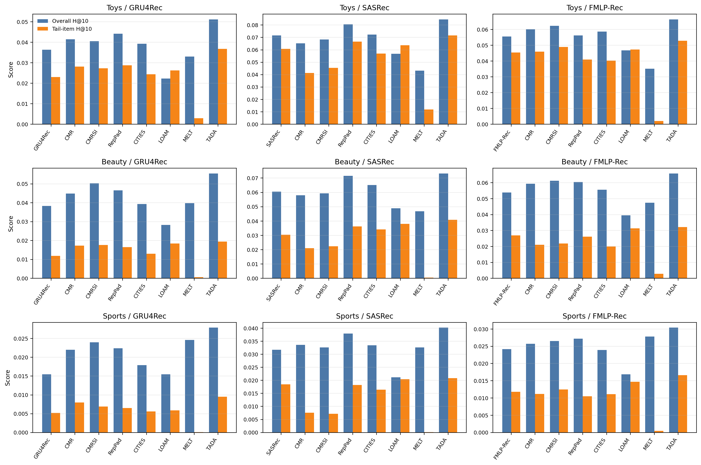

**图表：论文主实验总体与尾物品 H@10。** 每个面板对应一个数据集和骨干，蓝色为总体 H@10，橙色为尾物品 H@10；数据直接取表 2。

### 表 3：Sports/GRU4Rec 消融（论文第 8 页）

| 数据集    | 方法                              | 总体 H10 | 总体 N10 | 总体 H20 | 总体 N20 | 头物品 H10 | 头物品 N10 | 尾物品 H10 | 尾物品 N10 | 尾物品 H20 | 尾物品 N20 | 头用户 H10 | 头用户 N10 | 尾用户 H10 | 尾用户 N10 | 尾用户 H20 | 尾用户 N20 |
| ------ | ------------------------------- | -----: | -----: | -----: | -----: | ------: | ------: | ------: | ------: | ------: | ------: | ------: | ------: | ------: | ------: | ------: | ------: |
| Sports | TADA                            | 0.0279 | 0.0140 | 0.0450 | 0.0183 |  0.0519 |  0.0258 |  0.0095 |  0.0049 |  0.0159 |  0.0065 |  0.0306 |  0.0148 |  0.0273 |  0.0138 |  0.0438 |  0.0179 |
| Sports | w/o Correlation Relationships   | 0.0273 | 0.0139 | 0.0429 | 0.0178 |  0.0505 |  0.0251 |  0.0094 |  0.0052 |  0.0144 |  0.0064 |  0.0303 |  0.0153 |  0.0265 |  0.0135 |  0.0420 |  0.0174 |
| Sports | w/o Co-occurrence Relationships | 0.0248 | 0.0123 | 0.0414 | 0.0165 |  0.0448 |  0.0218 |  0.0094 |  0.0050 |  0.0151 |  0.0064 |  0.0268 |  0.0130 |  0.0243 |  0.0121 |  0.0401 |  0.0161 |
| Sports | w/o Tail-Aware Operators        | 0.0231 | 0.0118 | 0.0373 | 0.0153 |  0.0415 |  0.0204 |  0.0089 |  0.0051 |  0.0132 |  0.0062 |  0.0261 |  0.0125 |  0.0224 |  0.0116 |  0.0361 |  0.0150 |
| Sports | w/o Cross Augmentation          | 0.0213 | 0.0102 | 0.0358 | 0.0138 |  0.0403 |  0.0194 |  0.0067 |  0.0031 |  0.0100 |  0.0040 |  0.0206 |  0.0100 |  0.0215 |  0.0102 |  0.0359 |  0.0139 |
| Sports | GRU4Rec                         | 0.0155 | 0.0073 | 0.0285 | 0.0105 |  0.0289 |  0.0135 |  0.0052 |  0.0025 |  0.0092 |  0.0035 |  0.0173 |  0.0081 |  0.0150 |  0.0071 |  0.0279 |  0.0103 |

### 表 4：扩展骨干（论文第 11 页）

| 数据集    | 方法        | 总体 H10 | 总体 N10 | 总体 H20 | 总体 N20 | 头物品 H10 | 头物品 N10 | 尾物品 H10 | 尾物品 N10 | 尾物品 H20 | 尾物品 N20 | 头用户 H10 | 头用户 N10 | 尾用户 H10 | 尾用户 N10 | 尾用户 H20 | 尾用户 N20 |
| ------ | --------- | -----: | -----: | -----: | -----: | ------: | ------: | ------: | ------: | ------: | ------: | ------: | ------: | ------: | ------: | ------: | ------: |
| Toys   | NARM      | 0.0371 | 0.0205 | 0.0562 | 0.0253 |  0.0583 |  0.0328 |  0.0241 |  0.0130 |  0.0350 |  0.0158 |  0.0160 |  0.0076 |  0.0424 |  0.0238 |  0.0625 |  0.0288 |
| Toys   | w/ TADA   | 0.0500 | 0.0280 | 0.0725 | 0.0337 |  0.0725 |  0.0403 |  0.0361 |  0.0205 |  0.0496 |  0.0238 |  0.0255 |  0.0122 |  0.0561 |  0.0320 |  0.0801 |  0.0380 |
| Toys   | LightSANs | 0.0501 | 0.0297 | 0.0688 | 0.0344 |  0.0632 |  0.0348 |  0.0421 |  0.0266 |  0.0517 |  0.0291 |  0.0482 |  0.0276 |  0.0506 |  0.0303 |  0.0685 |  0.0348 |
| Toys   | w/ TADA   | 0.0649 | 0.0396 | 0.0833 | 0.0443 |  0.0830 |  0.0479 |  0.0537 |  0.0345 |  0.0653 |  0.0374 |  0.0600 |  0.0354 |  0.0661 |  0.0407 |  0.0822 |  0.0448 |
| Toys   | gMLP      | 0.0482 | 0.0309 | 0.0619 | 0.0343 |  0.0607 |  0.0351 |  0.0404 |  0.0283 |  0.0483 |  0.0303 |  0.0541 |  0.0318 |  0.0467 |  0.0307 |  0.0593 |  0.0339 |
| Toys   | w/ TADA   | 0.0660 | 0.0419 | 0.0844 | 0.0465 |  0.0884 |  0.0521 |  0.0522 |  0.0356 |  0.0631 |  0.0383 |  0.0680 |  0.0415 |  0.0655 |  0.0420 |  0.0826 |  0.0463 |
| Beauty | NARM      | 0.0410 | 0.0206 | 0.0649 | 0.0266 |  0.0803 |  0.0399 |  0.0111 |  0.0059 |  0.0170 |  0.0074 |  0.0403 |  0.0199 |  0.0412 |  0.0208 |  0.0639 |  0.0265 |
| Beauty | w/ TADA   | 0.0494 | 0.0255 | 0.0768 | 0.0324 |  0.0906 |  0.0457 |  0.0180 |  0.0101 |  0.0284 |  0.0127 |  0.0501 |  0.0263 |  0.0492 |  0.0253 |  0.0765 |  0.0321 |
| Beauty | LightSANs | 0.0566 | 0.0307 | 0.0788 | 0.0364 |  0.0964 |  0.0508 |  0.0262 |  0.0155 |  0.0345 |  0.0175 |  0.0872 |  0.0463 |  0.0489 |  0.0269 |  0.0686 |  0.0318 |
| Beauty | w/ TADA   | 0.0630 | 0.0356 | 0.0884 | 0.0420 |  0.1065 |  0.0579 |  0.0298 |  0.0186 |  0.0418 |  0.0216 |  0.0937 |  0.0544 |  0.0553 |  0.0309 |  0.0771 |  0.0364 |
| Beauty | gMLP      | 0.0473 | 0.0282 | 0.0657 | 0.0328 |  0.0811 |  0.0449 |  0.0216 |  0.0155 |  0.0268 |  0.0168 |  0.0725 |  0.0435 |  0.0410 |  0.0243 |  0.0562 |  0.0282 |
| Beauty | w/ TADA   | 0.0658 | 0.0383 | 0.0910 | 0.0446 |  0.1128 |  0.0625 |  0.0299 |  0.0198 |  0.0396 |  0.0222 |  0.0995 |  0.0575 |  0.0573 |  0.0335 |  0.0798 |  0.0391 |
| Sports | NARM      | 0.0213 | 0.0105 | 0.0360 | 0.0142 |  0.0442 |  0.0220 |  0.0037 |  0.0017 |  0.0067 |  0.0025 |  0.0209 |  0.0098 |  0.0214 |  0.0107 |  0.0362 |  0.0144 |
| Sports | w/ TADA   | 0.0297 | 0.0155 | 0.0455 | 0.0195 |  0.0584 |  0.0306 |  0.0077 |  0.0039 |  0.0110 |  0.0048 |  0.0284 |  0.0157 |  0.0301 |  0.0155 |  0.0463 |  0.0196 |
| Sports | LightSANs | 0.0212 | 0.0116 | 0.0319 | 0.0143 |  0.0353 |  0.0184 |  0.0103 |  0.0064 |  0.0129 |  0.0070 |  0.0214 |  0.0112 |  0.0212 |  0.0117 |  0.0320 |  0.0144 |
| Sports | w/ TADA   | 0.0293 | 0.0160 | 0.0421 | 0.0192 |  0.0499 |  0.0256 |  0.0134 |  0.0086 |  0.0175 |  0.0097 |  0.0295 |  0.0149 |  0.0292 |  0.0163 |  0.0416 |  0.0194 |
| Sports | gMLP      | 0.0217 | 0.0119 | 0.0298 | 0.0139 |  0.0367 |  0.0187 |  0.0101 |  0.0066 |  0.0123 |  0.0072 |  0.0199 |  0.0107 |  0.0221 |  0.0122 |  0.0303 |  0.0142 |
| Sports | w/ TADA   | 0.0317 | 0.0181 | 0.0454 | 0.0215 |  0.0567 |  0.0310 |  0.0125 |  0.0082 |  0.0167 |  0.0092 |  0.0324 |  0.0177 |  0.0315 |  0.0182 |  0.0452 |  0.0216 |


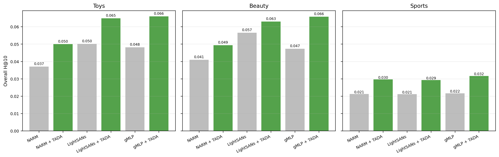

**图表：论文扩展骨干的总体 H@10。** 灰色为原骨干，绿色为加入 TADA 后的结果。

### 表 8：Yelp 与 Douyin（论文第 12 页）

| 数据集    | 方法       | 总体 H10 | 总体 N10 | 总体 H20 | 总体 N20 | 头物品 H10 | 头物品 N10 | 尾物品 H10 | 尾物品 N10 | 尾物品 H20 | 尾物品 N20 | 头用户 H10 | 头用户 N10 | 尾用户 H10 | 尾用户 N10 | 尾用户 H20 | 尾用户 N20 |
| ------ | -------- | -----: | -----: | -----: | -----: | ------: | ------: | ------: | ------: | ------: | ------: | ------: | ------: | ------: | ------: | ------: | ------: |
| Yelp   | GRU4Rec  | 0.0168 | 0.0076 | 0.0328 | 0.0116 |  0.0281 |  0.0124 |  0.0060 |  0.0030 |  0.0117 |  0.0044 |  0.0168 |  0.0083 |  0.0168 |  0.0074 |  0.0330 |  0.0114 |
| Yelp   | CMR      | 0.0189 | 0.0097 | 0.0356 | 0.0133 |  0.0366 |  0.0180 |  0.0063 |  0.0031 |  0.0120 |  0.0045 |  0.0188 |  0.0087 |  0.0190 |  0.0082 |  0.0355 |  0.0121 |
| Yelp   | CMRSI    | 0.0199 | 0.0990 | 0.0374 | 0.0142 |  0.0387 |  0.0196 |  0.0069 |  0.0031 |  0.0131 |  0.0047 |  0.0194 |  0.0092 |  0.0229 |  0.0101 |  0.0411 |  0.0139 |
| Yelp   | RepPad   | 0.0207 | 0.0102 | 0.0394 | 0.0148 |  0.0409 |  0.0203 |  0.0071 |  0.0032 |  0.0135 |  0.0049 |  0.0211 |  0.0105 |  0.0247 |  0.0110 |  0.0447 |  0.0154 |
| Yelp   | CITIES   | 0.0185 | 0.0087 | 0.0346 | 0.0127 |  0.0318 |  0.0148 |  0.0059 |  0.0030 |  0.0101 |  0.0040 |  0.0207 |  0.0097 |  0.0180 |  0.0085 |  0.0343 |  0.0126 |
| Yelp   | LOAM     | 0.0086 | 0.0038 | 0.0167 | 0.0059 |  0.0099 |  0.0044 |  0.0074 |  0.0033 |  0.0132 |  0.0047 |  0.0125 |  0.0057 |  0.0077 |  0.0034 |  0.0153 |  0.0053 |
| Yelp   | MELT     | 0.0251 | 0.0120 | 0.0465 | 0.0173 |  0.0514 |  0.0245 |  0.0000 |  0.0000 |  0.0005 |  0.0001 |  0.0217 |  0.0110 |  0.0259 |  0.0122 |  0.0471 |  0.0175 |
| Yelp   | TADA     | 0.0279 | 0.0135 | 0.0499 | 0.0190 |  0.0492 |  0.0238 |  0.0076 |  0.0037 |  0.0148 |  0.0054 |  0.0294 |  0.0143 |  0.0276 |  0.0133 |  0.0500 |  0.0189 |
| Yelp   | SASRec   | 0.0262 | 0.0129 | 0.0446 | 0.0175 |  0.0474 |  0.0235 |  0.0060 |  0.0027 |  0.0117 |  0.0042 |  0.0199 |  0.0096 |  0.0278 |  0.0137 |  0.0467 |  0.0184 |
| Yelp   | CMR      | 0.0272 | 0.0134 | 0.0474 | 0.0182 |  0.0493 |  0.0267 |  0.0064 |  0.0029 |  0.0129 |  0.0045 |  0.0214 |  0.0101 |  0.0263 |  0.0134 |  0.0450 |  0.0179 |
| Yelp   | CMRSI    | 0.0296 | 0.0148 | 0.0511 | 0.0201 |  0.0528 |  0.0279 |  0.0069 |  0.0032 |  0.0136 |  0.0051 |  0.0237 |  0.0109 |  0.0295 |  0.0144 |  0.0501 |  0.0196 |
| Yelp   | RepPad   | 0.0320 | 0.0161 | 0.0529 | 0.0208 |  0.0559 |  0.0288 |  0.0093 |  0.0047 |  0.0170 |  0.0065 |  0.0280 |  0.0139 |  0.0323 |  0.0163 |  0.0555 |  0.0212 |
| Yelp   | CITIES   | 0.0261 | 0.0130 | 0.0449 | 0.0177 |  0.0480 |  0.0240 |  0.0051 |  0.0025 |  0.0114 |  0.0040 |  0.0196 |  0.0096 |  0.0277 |  0.0138 |  0.0473 |  0.0187 |
| Yelp   | LOAM     | 0.0136 | 0.0065 | 0.0240 | 0.0091 |  0.0174 |  0.0081 |  0.0099 |  0.0050 |  0.0166 |  0.0066 |  0.0133 |  0.0059 |  0.0136 |  0.0066 |  0.0243 |  0.0093 |
| Yelp   | MELT     | 0.0327 | 0.0163 | 0.0559 | 0.0221 |  0.0669 |  0.0333 |  0.0001 |  0.0000 |  0.0006 |  0.0002 |  0.0271 |  0.0131 |  0.0341 |  0.0171 |  0.0584 |  0.0232 |
| Yelp   | TADA     | 0.0332 | 0.0169 | 0.0563 | 0.0227 |  0.0571 |  0.0292 |  0.0105 |  0.0052 |  0.0176 |  0.0070 |  0.0315 |  0.0164 |  0.0336 |  0.0171 |  0.0567 |  0.0228 |
| Yelp   | FMLP-Rec | 0.0196 | 0.0091 | 0.0349 | 0.0129 |  0.0345 |  0.0185 |  0.0053 |  0.0028 |  0.0094 |  0.0038 |  0.0191 |  0.0084 |  0.0193 |  0.0093 |  0.0348 |  0.0131 |
| Yelp   | CMR      | 0.0214 | 0.0097 | 0.0376 | 0.0142 |  0.0383 |  0.0203 |  0.0056 |  0.0031 |  0.0099 |  0.0040 |  0.0215 |  0.0097 |  0.0220 |  0.0102 |  0.0383 |  0.0149 |
| Yelp   | CMRSI    | 0.0235 | 0.0116 | 0.0395 | 0.0164 |  0.0426 |  0.0211 |  0.0062 |  0.0036 |  0.0105 |  0.0042 |  0.0237 |  0.0116 |  0.0255 |  0.0116 |  0.0415 |  0.0156 |
| Yelp   | RepPad   | 0.0249 | 0.0127 | 0.0409 | 0.0170 |  0.0487 |  0.0249 |  0.0067 |  0.0039 |  0.0114 |  0.0044 |  0.0256 |  0.0130 |  0.0288 |  0.0137 |  0.0455 |  0.0178 |
| Yelp   | CITIES   | 0.0185 | 0.0089 | 0.0314 | 0.0121 |  0.0320 |  0.0153 |  0.0056 |  0.0027 |  0.0104 |  0.0039 |  0.0168 |  0.0081 |  0.0189 |  0.0091 |  0.0318 |  0.0123 |
| Yelp   | LOAM     | 0.0088 | 0.0042 | 0.0174 | 0.0064 |  0.0114 |  0.0050 |  0.0064 |  0.0035 |  0.0119 |  0.0049 |  0.0097 |  0.0049 |  0.0086 |  0.0041 |  0.0176 |  0.0063 |
| Yelp   | MELT     | 0.0265 | 0.0132 | 0.0448 | 0.0177 |  0.0536 |  0.0267 |  0.0007 |  0.0003 |  0.0012 |  0.0004 |  0.0210 |  0.0103 |  0.0279 |  0.0139 |  0.0467 |  0.0186 |
| Yelp   | TADA     | 0.0305 | 0.0153 | 0.0496 | 0.0201 |  0.0549 |  0.0274 |  0.0071 |  0.0037 |  0.0119 |  0.0049 |  0.0299 |  0.0150 |  0.0306 |  0.0153 |  0.0497 |  0.0201 |
| Douyin | GRU4Rec  | 0.1023 | 0.0558 | 0.1467 | 0.0670 |  0.4002 |  0.2248 |  0.0639 |  0.0340 |  0.0973 |  0.0424 |  0.1424 |  0.0778 |  0.0923 |  0.0503 |  0.1334 |  0.0607 |
| Douyin | CMR      | 0.1125 | 0.0627 | 0.1549 | 0.0719 |  0.4235 |  0.2318 |  0.0719 |  0.0387 |  0.0106 |  0.0473 |  0.1514 |  0.0832 |  0.0986 |  0.0560 |  0.1436 |  0.0677 |
| Douyin | CMRSI    | 0.1204 | 0.0670 | 0.1670 | 0.0787 |  0.4337 |  0.2391 |  0.0789 |  0.0448 |  0.1123 |  0.0516 |  0.1618 |  0.0887 |  0.1087 |  0.0605 |  0.1520 |  0.0719 |
| Douyin | RepPad   | 0.1216 | 0.0677 | 0.1682 | 0.0795 |  0.4444 |  0.2423 |  0.0800 |  0.0452 |  0.1154 |  0.0532 |  0.1643 |  0.0900 |  0.1109 |  0.0621 |  0.1549 |  0.0733 |
| Douyin | CITIES   | 0.1064 | 0.0566 | 0.1460 | 0.0666 |  0.4199 |  0.2266 |  0.0660 |  0.0347 |  0.0962 |  0.0423 |  0.1429 |  0.0751 |  0.0973 |  0.0520 |  0.1355 |  0.0617 |
| Douyin | LOAM     | 0.0865 | 0.0453 | 0.1297 | 0.0562 |  0.2860 |  0.1352 |  0.0608 |  0.0337 |  0.0923 |  0.0416 |  0.1267 |  0.0674 |  0.0764 |  0.0398 |  0.1172 |  0.0500 |
| Douyin | MELT     | 0.0509 | 0.0250 | 0.0889 | 0.0346 |  0.3839 |  0.1950 |  0.0080 |  0.0031 |  0.0256 |  0.0075 |  0.0635 |  0.0311 |  0.0478 |  0.0235 |  0.0819 |  0.0321 |
| Douyin | TADA     | 0.1317 | 0.0737 | 0.1768 | 0.0850 |  0.4641 |  0.2572 |  0.0889 |  0.0500 |  0.1234 |  0.0587 |  0.1782 |  0.0972 |  0.1201 |  0.0678 |  0.1630 |  0.0786 |
| Douyin | SASRec   | 0.1269 | 0.0743 | 0.1699 | 0.0851 |  0.4311 |  0.2478 |  0.0877 |  0.0519 |  0.1210 |  0.0603 |  0.1468 |  0.0809 |  0.1219 |  0.0726 |  0.1620 |  0.0827 |
| Douyin | CMR      | 0.1305 | 0.0750 | 0.1739 | 0.0862 |  0.4423 |  0.2496 |  0.0886 |  0.0527 |  0.1247 |  0.0615 |  0.1490 |  0.0768 |  0.1241 |  0.0740 |  0.1676 |  0.0844 |
| Douyin | CMRSI    | 0.1332 | 0.0759 | 0.1806 | 0.0879 |  0.4504 |  0.2432 |  0.0923 |  0.0544 |  0.1283 |  0.0634 |  0.1535 |  0.0787 |  0.1281 |  0.0752 |  0.1730 |  0.0865 |
| Douyin | RepPad   | 0.1400 | 0.0816 | 0.1894 | 0.0926 |  0.4564 |  0.2521 |  0.0972 |  0.0582 |  0.1396 |  0.0679 |  0.1617 |  0.0860 |  0.1304 |  0.0795 |  0.1796 |  0.0903 |
| Douyin | CITIES   | 0.1190 | 0.0688 | 0.1630 | 0.0798 |  0.4088 |  0.2237 |  0.0816 |  0.0488 |  0.1145 |  0.0570 |  0.1412 |  0.0772 |  0.1134 |  0.0667 |  0.1543 |  0.0769 |
| Douyin | LOAM     | 0.1156 | 0.0681 | 0.1518 | 0.0773 |  0.3233 |  0.1673 |  0.0888 |  0.0553 |  0.1135 |  0.0615 |  0.1351 |  0.0722 |  0.1107 |  0.0670 |  0.1449 |  0.0757 |
| Douyin | MELT     | 0.0426 | 0.0226 | 0.0681 | 0.0290 |  0.3405 |  0.1851 |  0.0042 |  0.0016 |  0.0121 |  0.0036 |  0.0505 |  0.0272 |  0.0406 |  0.0214 |  0.0650 |  0.0275 |
| Douyin | TADA     | 0.1500 | 0.0889 | 0.2022 | 0.1021 |  0.4757 |  0.2707 |  0.1080 |  0.0655 |  0.1516 |  0.0764 |  0.1829 |  0.0997 |  0.1418 |  0.0862 |  0.1915 |  0.0987 |
| Douyin | FMLP-Rec | 0.1212 | 0.0717 | 0.1579 | 0.0809 |  0.4135 |  0.2372 |  0.0836 |  0.0503 |  0.1120 |  0.0575 |  0.1468 |  0.0799 |  0.1148 |  0.0696 |  0.1485 |  0.0781 |
| Douyin | CMR      | 0.1259 | 0.0764 | 0.1629 | 0.0876 |  0.4199 |  0.2473 |  0.0879 |  0.0519 |  0.1184 |  0.0620 |  0.1544 |  0.0861 |  0.1154 |  0.0732 |  0.1523 |  0.0844 |
| Douyin | CMRSI    | 0.1236 | 0.0722 | 0.1603 | 0.0825 |  0.4176 |  0.2402 |  0.0844 |  0.0510 |  0.1146 |  0.0596 |  0.1492 |  0.0827 |  0.1169 |  0.0716 |  0.1492 |  0.0803 |
| Douyin | RepPad   | 0.1276 | 0.0793 | 0.1634 | 0.0894 |  0.4223 |  0.2529 |  0.0908 |  0.0522 |  0.1197 |  0.0637 |  0.1568 |  0.0872 |  0.1207 |  0.0752 |  0.1517 |  0.0862 |
| Douyin | CITIES   | 0.1203 | 0.0709 | 0.1627 | 0.0817 |  0.3954 |  0.2271 |  0.0848 |  0.0508 |  0.1164 |  0.0588 |  0.1461 |  0.0786 |  0.1138 |  0.0690 |  0.1533 |  0.0790 |
| Douyin | LOAM     | 0.1119 | 0.0671 | 0.1443 | 0.0753 |  0.3091 |  0.1598 |  0.0864 |  0.0551 |  0.1085 |  0.0607 |  0.1319 |  0.0745 |  0.1069 |  0.0653 |  0.1360 |  0.0726 |
| Douyin | MELT     | 0.0562 | 0.0299 | 0.0846 | 0.0370 |  0.3886 |  0.2150 |  0.0134 |  0.0061 |  0.0288 |  0.0099 |  0.0677 |  0.0373 |  0.0534 |  0.0281 |  0.0808 |  0.0350 |
| Douyin | TADA     | 0.1343 | 0.0824 | 0.1745 | 0.0925 |  0.4315 |  0.2574 |  0.0960 |  0.0598 |  0.1283 |  0.0680 |  0.1652 |  0.0899 |  0.1266 |  0.0805 |  0.1636 |  0.0898 |


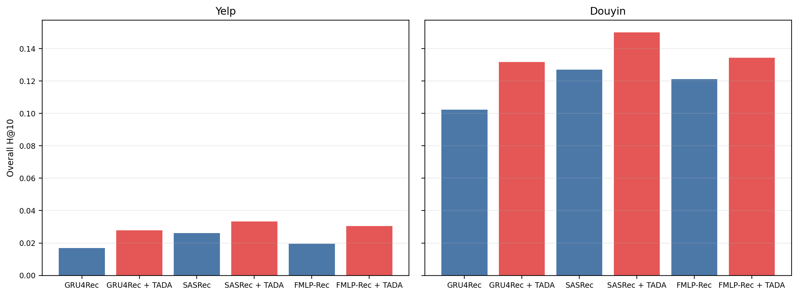

**图表：Yelp 与 Douyin 的总体 H@10。** 按骨干分组展示论文表 8 中的原骨干与 TADA 结果。

### 表 6：训练时间（分钟；括号为 TADA 候选集构建时间）

| 数据集    | GRU4Rec |  CMR | CMRSI | RepPad | CITIES | LOAM | MELT |       TADA | FMLP-Rec |  CMR | CMRSI | RepPad | CITIES | LOAM | MELT |        TADA |
| ------ | ------: | ---: | ----: | -----: | -----: | ---: | ---: | ---------: | -------: | ---: | ----: | -----: | -----: | ---: | ---: | ----------: |
| Beauty |    12.3 | 23.3 | 242.5 |   19.4 |   18.1 | 17.5 | 17.6 | 18.0 (0.7) |     21.3 | 39.7 | 279.4 |   44.5 |   23.2 | 30.7 | 36.5 |  25.9 (0.7) |
| Sports |    19.9 | 29.8 | 372.3 |   24.6 |   30.8 | 33.5 | 34.0 | 29.1 (1.7) |     37.6 | 58.2 | 442.3 |   69.7 |   36.2 | 48.6 | 61.8 | 35.35 (1.7) |

### 表 7：尾物品覆盖率 TCov@5

| 数据集    | 方法     | GRU4Rec | FMLP-Rec |
| ------ | ------ | ------: | -------: |
| Beauty | 原骨干    |  0.5719 |   0.6432 |
| Beauty | CMR    |  0.5333 |   0.5726 |
| Beauty | CMRSI  |  0.5529 |   0.6215 |
| Beauty | RepPad |  0.5805 |   0.6627 |
| Beauty | CITIES |  0.4504 |   0.2168 |
| Beauty | LOAM   |  0.4227 |   0.6483 |
| Beauty | MELT   |  0.0053 |   0.0872 |
| Beauty | TADA   |  0.5871 |   0.6777 |
| Sports | 原骨干    |  0.5381 |   0.6916 |
| Sports | CMR    |  0.4732 |   0.6533 |
| Sports | CMRSI  |  0.5005 |   0.6208 |
| Sports | RepPad |  0.5597 |   0.7025 |
| Sports | CITIES |  0.4287 |   0.5917 |
| Sports | LOAM   |  0.4588 |   0.6666 |
| Sports | MELT   |  0.0010 |   0.0319 |
| Sports | TADA   |  0.5772 |   0.7189 |


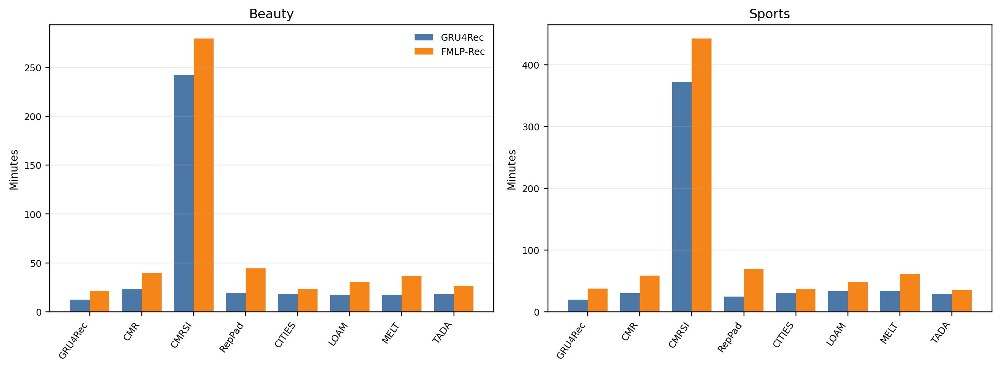

**图表：论文训练时间。** 分别比较 Beauty 与 Sports 上 GRU4Rec、FMLP-Rec 及各方法的训练时间；TADA 柱中括号内的候选集构建时间未重复计入柱高。

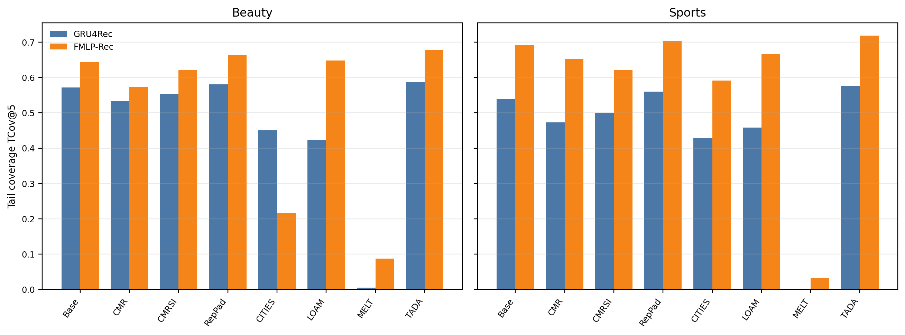

**图表：论文尾物品覆盖率 TCov@5。** TADA 与原骨干及其他方法的尾物品覆盖率并列展示。

## 8. 结果分析

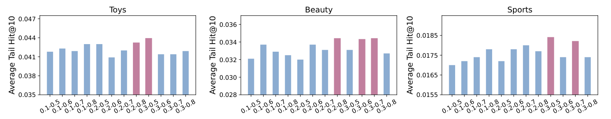

**图 3：增强概率区间 a、b 的敏感性**（英文原文 PDF 第 9 页）。 横轴为增强概率采样区间 (a,b)；骨干为 GRU4Rec，纵轴为尾物品与尾用户 Hit@10 的平均值。

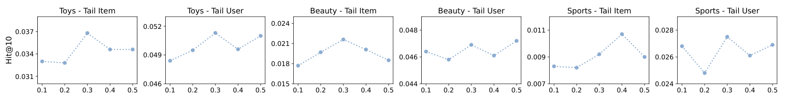

**图 4：Beta 分布参数 α 的敏感性**（英文原文 PDF 第 9 页）。 六个子图分别比较 Toys、Beauty、Sports 上尾物品与尾用户对混合权重分布参数 α 的响应。

主表中 TADA 在三个骨干、三个数据集上均提升总体 H@10；例如 Toys/SASRec 从 0.0716 到 0.0846，Beauty/SASRec 从 0.0605 到 0.0732，Sports/GRU4Rec 从 0.0155 到 0.0279。Sports/GRU4Rec 消融中，去掉跨序列混合的总体 H@10 从 0.0279 降至 0.0213，去掉尾部算子降至 0.0231。表 7 的尾物品覆盖率也显示 TADA 在所列两个骨干上超过原骨干。图 3、4 是曲线图而非原文数值表：作者认为较优的 $(a,b)$ 包括 (0.2,0.8)、(0.3,0.5)、(0.3,0.7)，$\alpha$ 较优范围为 0.3–0.5；图像未给出逐点精确值，不宜伪造。

# 二、代码复现

## 1. 环境配置与运行

本地复现环境：**Python 3.12，PyTorch 2.11.0+cu128**。其余直接依赖为 NumPy、SciPy、tqdm，列于 `experiment/TADA/src/requirements.txt`。预处理数据在 `experiment/TADA/data`，预训练权重在 `src/weight`。从 `experiment/TADA/src` 工作目录运行（相对路径依赖此位置）：

```bash
python main.py --aug=1 --gpu_id=0 --model_idx=5 --data_name=Toys_and_Games
python main.py --aug=1 --gpu_id=0 --model_idx=5 --data_name=Beauty
python main.py --aug=1 --gpu_id=0 --model_idx=5 --data_name=Sports_and_Outdoors --rate_a=0.61 --rate_b=0.81 --th=0.5
```

默认骨干 SASRec、隐藏维 64、SASRec/GRU4Rec 为 2 层、FMLPRec 为 4 层、注意力头数 2、最大长度 50、batch 256、Adam lr 0.001、epoch 上限 500、patience 10、随机种子 2024。默认 `aug=1` 加载同骨干/数据集的 `*-original.pt`，进入第二阶段。默认 `beta=0.3` 是 Beta 分布参数 $\alpha$，`head_ratio=0.2`、`rate_a=0.31`、`rate_b=0.51`、`top_k=10`、`th=0.3`。偏好分类阈值在 `ht_process.py` 中硬编码为 0.5，论文把它记为 $\beta$；两者不可混同。论文未给出确定的 Python/CUDA 版本，不能将某一环境版本当作已验证配置。

## 2. 源代码分析：论文公式到代码

| 论文内容                 | 实现位置                                                                                                  | 数据流与要点                                              |
| -------------------- | ----------------------------------------------------------------------------------------------------- | --------------------------------------------------- |
| 式(1)、留一划分            | `utils.py:get_user_seqs`、`datasets.py:__getitem__`                                                    | 每条序列倒数第二/第一项作验证/测试答案；训练输入和逐位置正目标错开一位。               |
| 头尾用户/物品划分            | `ht_process.py:classify_head_and_tail`                                                                | 只统计 `seq[:-2]`，按频次/序列长度前 20% 划头部。                   |
| 式(2)(3)线性相关          | `LIS.py:get_linear_item_similarity`                                                                   | 训练前缀二值矩阵 $X$、$X^TX$、求逆、对角系数 $\gamma$、相似矩阵 $B_S$。    |
| 式(4)候选集合             | `ht_process.py:build_head_tail_relation`、`LIS.py:get_LIS_topk`、`main.py`                              | 邻接共现与线性相似 top-k 做集合并。                               |
| 式(5)(6) T-Substitute | `datasets.py:substitute`                                                                              | 抽 $U(a,b)$ 概率，对头物品从联合集合采样替代项。                       |
| 式(9)(10) T-Insert    | `datasets.py:insert`                                                                                  | 尾物品前插候选，同时复制原尾物品和目标序列保持对齐。                          |
| 式(11)算子选择            | `datasets.py:augment`                                                                                 | `1-len(seq)/max_len` 决定插入概率。                        |
| 式(7)(8)(15)算子混合      | `trainers.py:iteration`、`self_mix_learning`                                                           | 两视图经共享 `model.encoder`，Beta 权重逐位置混合，再对同一正负目标计算 BCE。 |
| 式(12)(13)(16)跨序列混合   | `ht_process.py:classify_user_preference`、`trainers.py:split_batch_by_preference`、`whole_mix_learning` | 按尾物品占比分组，在组内打乱并混合序列表示与目标嵌入。                         |
| 式(14)(17)总损失         | `trainers.py:cross_entropy`、`iteration`                                                               | 主 BCE 加算子 BCE 加两组跨序列 BCE。                           |
| 三种骨干                 | `models.py`、`modules.py`                                                                              | SASRec 自注意力、GRU4Rec 门控循环、FMLPRec 频域滤波。              |
| 全量排序与分组指标            | `trainers.py:get_full_sort_score`、`utils.py`                                                          | 屏蔽已见物品，统计总体及头尾用户/物品指标。                              |

注意：线性相似矩阵为稠密 $|V|\times|V|$，计算 $X^TX$ 和逆矩阵会显著占用内存；论文所称增强阶段线性开销不包含这一预处理成本。候选集合转为 list 后随机抽样，若需逐位严格复现，还应固定集合迭代顺序及 DataLoader worker 的随机状态。当前代码将 `head_ratio` 同时用于用户和物品划分；偏好阈值与 Beta 参数名称不同。

## 3. bug 检查及修复

### FMLPRec 预训练权重层数不匹配

运行 `--aug=1 --model_name=FMLPRec` 且未指定 `--num_hidden_layers` 时，旧版 `main.py` 默认构建 2 层编码器，但仓库提供的 Toys and Games、Beauty、Sports and Outdoors 三份 FMLPRec 原始权重均包含 `item_encoder.layer.0` 到 `.3`，即 **4 层**。严格加载时会把第 3、4 层参数报告为 `Unexpected key(s)`。已将层数的缺省值改为按骨干设置：FMLPRec 为 4，SASRec/GRU4Rec 为 2；显式传入 `--num_hidden_layers` 仍优先采用用户值。验证时用 4 层 FMLPRec 对 Toys and Games 权重执行 `load_state_dict(..., strict=True)`，加载通过。这里需要匹配模型结构，不能用 `strict=False` 忽略多出的层。

旧版布尔参数采用 `type=bool`，使命令行字符串 `--no_filters=False` 被解析为 `True`。已改为显式解析 `true/false`；FMLPRec 在参数记录前统一启用滤波层，使日志与实际模型一致。上述修复只验证了参数解析和预训练权重加载，未据此认定完整训练已复现。

## 4. 代码修改及优化

无

### 实验入口与结果目录

使用 `main.py --experiment` 管理实验，可指定 `--backbone/--dataset`、`--seed`、`--experiment_type`（full、ablation、parameter）、`--experiment_id` 和 `--start_model_id`。输出目录为 `output/{骨干}-{数据集}-experiment-{实验ID}/`，其中包含 README、experiment.json、日志和权重；消融与参数实验分别保存。

已归档的复现实验命令：

```bash
python run_experiments.py --experiment --backbone FMLPRec --dataset Sports_and_Outdoors --seed 2025 --experiment_type ablation --experiment_id 2 --start_model_id 11 --rate_a 0.61 --rate_b 0.81 --th 0.5
python run_experiments.py --experiment --backbone FMLPRec --dataset Sports_and_Outdoors --seed 2025 --experiment_type parameter --experiment_id 3 --start_model_id 16 --rate_a 0.61 --rate_b 0.81 --th 0.5 --reference_dir output/FMLPRec-Sports_and_Outdoors-experiment-1 --reference_model_id 3
```

已完成且配置一致的实验会自动跳过；`--list_only` 只预览计划。

## 5. 实验结果复现

本节按论文的实验章节顺序组织：**5.1 实验设置 → 5.2 整体比较（表 2）→ 5.3 消融实验（表 3）→ 5.4 超参数研究（图 3、4）**，随后按附录 B.1、C.1、C.2、C.3 的顺序列出扩展实验。Beauty 随机种子实验属于主实验发现偏差后的补充排查，放在整体比较内部。

每项已完成实验按“实验目的与设置 → 结果表 → 对比分析 → 发现的问题 → 后续对比”展开。尚未开展的实验仅保留表格框架，**结果单元格和结果分析留空**；论文已发表的消融数值只保留在第一模块，不填入本地复现结果。

### 5.1 实验设置（对应论文 §5.1）

本地环境：Python 3.12，PyTorch 2.11.0+cu128，gpu_id=0。

model-1（编号为 1 的日志）为代码库自带的论文数据，是本节复现对比的统一基准；model-3 按 model-1 的记录配置复刻。model-2 的参数不同，仅在第 6 节保留历史记录。日志位于 `experiment/TADA/src/output/{model}-{data_name}-experiment-1/{model}-{data_name}-{id}.txt`，结果取加载最佳检查点后的最终测试输出。

共同参数：hidden_size=64，max_seq_length=50，batch_size=256，lr=0.001，weight_decay=0，epochs=500，patience=10，beta=0.3，head_ratio=0.2，top_k=10，full_sort=True。GRU4Rec、SASRec 为 2 层，FMLPRec 为 4 层并启用滤波。model-3 为 aug=1，加载预训练权重进行增强训练；最佳检查点按验证集总体 NDCG@20 选择。

model-3 参数如下，数值与对应 model-1 一致；model-1 使用 use_SI=True，model-3 使用 aug=1。

| 模型      | 数据集    | seed | dropout | star_test | rate_a | rate_b | th  |
| ------- | ------ | ---- | ------- | --------- | ------ | ------ | --- |
| GRU4Rec | Toys   | 2025 | 0.1     | 150       | 0.31   | 0.51   | 0.3 |
| GRU4Rec | Beauty | 2025 | 0.1     | 150       | 0.3    | 0.7    | 0.3 |
| GRU4Rec | Sports | 2025 | 0.1     | 150       | 0.3    | 0.5    | 0.3 |
| SASRec  | Toys   | 2024 | 0.2     | 100       | 0.31   | 0.51   | 0.3 |
| SASRec  | Beauty | 2024 | 0.2     | 100       | 0.31   | 0.51   | 0.3 |
| SASRec  | Sports | 2024 | 0.2     | 100       | 0.61   | 0.81   | 0.5 |
| FMLPRec | Toys   | 2025 | 0.2     | 100       | 0.61   | 0.81   | 0.5 |
| FMLPRec | Beauty | 2025 | 0.2     | 100       | 0.61   | 0.81   | 0.6 |
| FMLPRec | Sports | 2025 | 0.2     | 100       | 0.61   | 0.81   | 0.5 |

以下数值均取日志末尾加载最佳检查点后的测试输出，不取训练过程的验证指标。Toys、Sports 分别表示 Toys_and_Games、Sports_and_Outdoors，H=Hit Ratio，N=NDCG；“头用户/尾用户”按训练交互序列长度划分，与头尾物品分组、头尾偏好分组分别解释。

主结果沿用论文表 2 的 16 列指标顺序：总体 H@10/N@10/H@20/N@20，头物品 H@10/N@10，尾物品 H@10/N@10/H@20/N@20，头用户 H@10/N@10，尾用户 H@10/N@10/H@20/N@20。额外的 Top-5、头物品/头用户 Top-20 指标移至第 6 节保存。

### 5.2 整体比较（对应论文 §5.2、表 2）

#### 5.2.1 实验目的与结果表

**结果来源与表格口径**

| 标记           | 结果来源                  | 用途                  |
| ------------ | --------------------- | ------------------- |
| model-1（ID1） | 代码库自带的论文数据            | 作为论文对照基准，核对原配置与结果   |
| model-2（ID2） | 本地默认参数运行日志            | 历史记录，见 6.5；不参与主实验对比 |
| model-3（ID3） | 本地按 model-1 记录配置复刻的日志 | 主实验复现结果             |
| model-4～6    | GRU4Rec/Beauty 补充运行日志 | 排查随机种子变化与结果波动       |
| model-7       | GRU4Rec/Beauty 补充运行日志 | 排查随机种子变化与结果波动       |

检验 TADA 在 GRU4Rec、SASRec、FMLPRec 三种骨干及 Toys、Beauty、Sports 三个数据集上的复现程度。表格按论文的“数据集 → 骨干 → 方法/运行”顺序排列，同一组仅并列 ID1 论文数据与按其记录配置运行的 ID3 复刻结果。

本地现有记录均为启用 TADA 的运行；未增强骨干和 CMR、CMRSI、RepPad、CITIES、LOAM、MELT 的论文值见第一模块表 2，当前没有这些方法的本地对照结果。因此，本节先分析数值复现程度，TADA 相对其他方法的本地增益尚不能由完整模型的复现对照验证。

**表 2 复现对照（长表）**

论文宣称效果取表 2 的 `model-1`，本地实测效果取按论文配置复刻的 `model-3`。相对差异统一按 `(本地实测效果−论文宣称效果)/论文宣称效果×100%` 计算。

| 数据集名 | 指标名 | 论文宣称效果 | 本地实测效果 | 差异百分比 |
|---|---|---:|---:|---:|
| Toys / GRU4Rec | 总体 H@10 | 0.0512 | 0.0501 | -2.15% |
| Toys / GRU4Rec | 总体 N@10 | 0.0280 | 0.0279 | -0.36% |
| Toys / GRU4Rec | 总体 H@20 | 0.0749 | 0.0756 | +0.93% |
| Toys / GRU4Rec | 总体 N@20 | 0.0340 | 0.0343 | +0.88% |
| Toys / GRU4Rec | 头物品 H@10 | 0.0746 | 0.0752 | +0.80% |
| Toys / GRU4Rec | 头物品 N@10 | 0.0412 | 0.0419 | +1.70% |
| Toys / GRU4Rec | 尾物品 H@10 | 0.0368 | 0.0347 | -5.71% |
| Toys / GRU4Rec | 尾物品 N@10 | 0.0200 | 0.0193 | -3.50% |
| Toys / GRU4Rec | 尾物品 H@20 | 0.0513 | 0.0517 | +0.78% |
| Toys / GRU4Rec | 尾物品 N@20 | 0.0236 | 0.0236 | +0.00% |
| Toys / GRU4Rec | 头用户 H@10 | 0.0515 | 0.0505 | -1.94% |
| Toys / GRU4Rec | 头用户 N@10 | 0.0265 | 0.0263 | -0.75% |
| Toys / GRU4Rec | 尾用户 H@10 | 0.0511 | 0.0500 | -2.15% |
| Toys / GRU4Rec | 尾用户 N@10 | 0.0284 | 0.0284 | +0.00% |
| Toys / GRU4Rec | 尾用户 H@20 | 0.0722 | 0.0733 | +1.52% |
| Toys / GRU4Rec | 尾用户 N@20 | 0.0337 | 0.0342 | +1.48% |
| Toys / SASRec | 总体 H@10 | 0.0846 | 0.0859 | +1.54% |
| Toys / SASRec | 总体 N@10 | 0.0491 | 0.0494 | +0.61% |
| Toys / SASRec | 总体 H@20 | 0.1142 | 0.1158 | +1.40% |
| Toys / SASRec | 总体 N@20 | 0.0566 | 0.0569 | +0.53% |
| Toys / SASRec | 头物品 H@10 | 0.1059 | 0.1074 | +1.42% |
| Toys / SASRec | 头物品 N@10 | 0.0597 | 0.0596 | -0.17% |
| Toys / SASRec | 尾物品 H@10 | 0.0716 | 0.0726 | +1.40% |
| Toys / SASRec | 尾物品 N@10 | 0.0427 | 0.0431 | +0.94% |
| Toys / SASRec | 尾物品 H@20 | 0.0927 | 0.0947 | +2.16% |
| Toys / SASRec | 尾物品 N@20 | 0.0480 | 0.0486 | +1.25% |
| Toys / SASRec | 头用户 H@10 | 0.0824 | 0.0860 | +4.37% |
| Toys / SASRec | 头用户 N@10 | 0.0459 | 0.0462 | +0.65% |
| Toys / SASRec | 尾用户 H@10 | 0.0852 | 0.0858 | +0.70% |
| Toys / SASRec | 尾用户 N@10 | 0.0500 | 0.0502 | +0.40% |
| Toys / SASRec | 尾用户 H@20 | 0.1115 | 0.1131 | +1.43% |
| Toys / SASRec | 尾用户 N@20 | 0.0565 | 0.0570 | +0.88% |
| Toys / FMLPRec | 总体 H@10 | 0.0664 | 0.0671 | +1.05% |
| Toys / FMLPRec | 总体 N@10 | 0.0399 | 0.0405 | +1.50% |
| Toys / FMLPRec | 总体 H@20 | 0.0869 | 0.0884 | +1.73% |
| Toys / FMLPRec | 总体 N@20 | 0.0451 | 0.0459 | +1.77% |
| Toys / FMLPRec | 头物品 H@10 | 0.0883 | 0.0848 | -3.96% |
| Toys / FMLPRec | 头物品 N@10 | 0.0502 | 0.0498 | -0.80% |
| Toys / FMLPRec | 尾物品 H@10 | 0.0528 | 0.0563 | +6.63% |
| Toys / FMLPRec | 尾物品 N@10 | 0.0335 | 0.0347 | +3.58% |
| Toys / FMLPRec | 尾物品 H@20 | 0.0653 | 0.0686 | +5.05% |
| Toys / FMLPRec | 尾物品 N@20 | 0.0367 | 0.0379 | +3.27% |
| Toys / FMLPRec | 头用户 H@10 | 0.0649 | 0.0670 | +3.24% |
| Toys / FMLPRec | 头用户 N@10 | 0.0379 | 0.0384 | +1.32% |
| Toys / FMLPRec | 尾用户 H@10 | 0.0667 | 0.0672 | +0.75% |
| Toys / FMLPRec | 尾用户 N@10 | 0.0404 | 0.0410 | +1.49% |
| Toys / FMLPRec | 尾用户 H@20 | 0.0853 | 0.0867 | +1.64% |
| Toys / FMLPRec | 尾用户 N@20 | 0.0451 | 0.0460 | +2.00% |
| Beauty / GRU4Rec | 总体 H@10 | 0.0555 | 0.0515 | -7.21% |
| Beauty / GRU4Rec | 总体 N@10 | 0.0279 | 0.0265 | -5.02% |
| Beauty / GRU4Rec | 总体 H@20 | 0.0836 | 0.0815 | -2.51% |
| Beauty / GRU4Rec | 总体 N@20 | 0.0350 | 0.0340 | -2.86% |
| Beauty / GRU4Rec | 头物品 H@10 | 0.1027 | 0.0929 | -9.54% |
| Beauty / GRU4Rec | 头物品 N@10 | 0.0515 | 0.0471 | -8.54% |
| Beauty / GRU4Rec | 尾物品 H@10 | 0.0195 | 0.0199 | +2.05% |
| Beauty / GRU4Rec | 尾物品 N@10 | 0.0100 | 0.0108 | +8.00% |
| Beauty / GRU4Rec | 尾物品 H@20 | 0.0321 | 0.0328 | +2.18% |
| Beauty / GRU4Rec | 尾物品 N@20 | 0.0131 | 0.0141 | +7.63% |
| Beauty / GRU4Rec | 头用户 H@10 | 0.0823 | 0.0767 | -6.80% |
| Beauty / GRU4Rec | 头用户 N@10 | 0.0409 | 0.0390 | -4.65% |
| Beauty / GRU4Rec | 尾用户 H@10 | 0.0488 | 0.0452 | -7.38% |
| Beauty / GRU4Rec | 尾用户 N@10 | 0.0247 | 0.0234 | -5.26% |
| Beauty / GRU4Rec | 尾用户 H@20 | 0.0720 | 0.0706 | -1.94% |
| Beauty / GRU4Rec | 尾用户 N@20 | 0.0305 | 0.0298 | -2.30% |
| Beauty / SASRec | 总体 H@10 | 0.0732 | 0.0745 | +1.78% |
| Beauty / SASRec | 总体 N@10 | 0.0407 | 0.0413 | +1.47% |
| Beauty / SASRec | 总体 H@20 | 0.1076 | 0.1076 | +0.00% |
| Beauty / SASRec | 总体 N@20 | 0.0493 | 0.0497 | +0.81% |
| Beauty / SASRec | 头物品 H@10 | 0.1157 | 0.1165 | +0.69% |
| Beauty / SASRec | 头物品 N@10 | 0.0612 | 0.0622 | +1.63% |
| Beauty / SASRec | 尾物品 H@10 | 0.0409 | 0.0425 | +3.91% |
| Beauty / SASRec | 尾物品 N@10 | 0.0251 | 0.0255 | +1.59% |
| Beauty / SASRec | 尾物品 H@20 | 0.0593 | 0.0592 | -0.17% |
| Beauty / SASRec | 尾物品 N@20 | 0.0297 | 0.0297 | +0.00% |
| Beauty / SASRec | 头用户 H@10 | 0.0946 | 0.0991 | +4.76% |
| Beauty / SASRec | 头用户 N@10 | 0.0517 | 0.0536 | +3.68% |
| Beauty / SASRec | 尾用户 H@10 | 0.0679 | 0.0684 | +0.74% |
| Beauty / SASRec | 尾用户 N@10 | 0.0379 | 0.0383 | +1.06% |
| Beauty / SASRec | 尾用户 H@20 | 0.0982 | 0.0985 | +0.31% |
| Beauty / SASRec | 尾用户 N@20 | 0.0455 | 0.0459 | +0.88% |
| Beauty / FMLPRec | 总体 H@10 | 0.0658 | 0.0668 | +1.52% |
| Beauty / FMLPRec | 总体 N@10 | 0.0384 | 0.0386 | +0.52% |
| Beauty / FMLPRec | 总体 H@20 | 0.0917 | 0.0928 | +1.20% |
| Beauty / FMLPRec | 总体 N@20 | 0.0450 | 0.0452 | +0.44% |
| Beauty / FMLPRec | 头物品 H@10 | 0.1099 | 0.1120 | +1.91% |
| Beauty / FMLPRec | 头物品 N@10 | 0.0609 | 0.0624 | +2.46% |
| Beauty / FMLPRec | 尾物品 H@10 | 0.0322 | 0.0324 | +0.62% |
| Beauty / FMLPRec | 尾物品 N@10 | 0.0213 | 0.0205 | -3.76% |
| Beauty / FMLPRec | 尾物品 H@20 | 0.0429 | 0.0411 | -4.20% |
| Beauty / FMLPRec | 尾物品 N@20 | 0.0240 | 0.0227 | -5.42% |
| Beauty / FMLPRec | 头用户 H@10 | 0.0977 | 0.0988 | +1.13% |
| Beauty / FMLPRec | 头用户 N@10 | 0.0563 | 0.0589 | +4.62% |
| Beauty / FMLPRec | 尾用户 H@10 | 0.0579 | 0.0588 | +1.55% |
| Beauty / FMLPRec | 尾用户 N@10 | 0.0340 | 0.0336 | -1.18% |
| Beauty / FMLPRec | 尾用户 H@20 | 0.0812 | 0.0817 | +0.62% |
| Beauty / FMLPRec | 尾用户 N@20 | 0.0399 | 0.0393 | -1.50% |
| Sports / GRU4Rec | 总体 H@10 | 0.0279 | 0.0275 | -1.43% |
| Sports / GRU4Rec | 总体 N@10 | 0.0140 | 0.0139 | -0.71% |
| Sports / GRU4Rec | 总体 H@20 | 0.0450 | 0.0442 | -1.78% |
| Sports / GRU4Rec | 总体 N@20 | 0.0183 | 0.0181 | -1.09% |
| Sports / GRU4Rec | 头物品 H@10 | 0.0519 | 0.0512 | -1.35% |
| Sports / GRU4Rec | 头物品 N@10 | 0.0258 | 0.0257 | -0.39% |
| Sports / GRU4Rec | 尾物品 H@10 | 0.0095 | 0.0092 | -3.16% |
| Sports / GRU4Rec | 尾物品 N@10 | 0.0049 | 0.0047 | -4.08% |
| Sports / GRU4Rec | 尾物品 H@20 | 0.0159 | 0.0152 | -4.40% |
| Sports / GRU4Rec | 尾物品 N@20 | 0.0065 | 0.0062 | -4.62% |
| Sports / GRU4Rec | 头用户 H@10 | 0.0306 | 0.0291 | -4.90% |
| Sports / GRU4Rec | 头用户 N@10 | 0.0148 | 0.0146 | -1.35% |
| Sports / GRU4Rec | 尾用户 H@10 | 0.0272 | 0.0271 | -0.37% |
| Sports / GRU4Rec | 尾用户 N@10 | 0.0138 | 0.0137 | -0.72% |
| Sports / GRU4Rec | 尾用户 H@20 | 0.0438 | 0.0436 | -0.46% |
| Sports / GRU4Rec | 尾用户 N@20 | 0.0179 | 0.0179 | +0.00% |
| Sports / SASRec | 总体 H@10 | 0.0402 | 0.0402 | +0.00% |
| Sports / SASRec | 总体 N@10 | 0.0217 | 0.0215 | -0.92% |
| Sports / SASRec | 总体 H@20 | 0.0605 | 0.0592 | -2.15% |
| Sports / SASRec | 总体 N@20 | 0.0267 | 0.0263 | -1.50% |
| Sports / SASRec | 头物品 H@10 | 0.0654 | 0.0652 | -0.31% |
| Sports / SASRec | 头物品 N@10 | 0.0338 | 0.0338 | +0.00% |
| Sports / SASRec | 尾物品 H@10 | 0.0208 | 0.0210 | +0.96% |
| Sports / SASRec | 尾物品 N@10 | 0.0123 | 0.0120 | -2.44% |
| Sports / SASRec | 尾物品 H@20 | 0.0299 | 0.0287 | -4.01% |
| Sports / SASRec | 尾物品 N@20 | 0.0146 | 0.0140 | -4.11% |
| Sports / SASRec | 头用户 H@10 | 0.0382 | 0.0378 | -1.05% |
| Sports / SASRec | 头用户 N@10 | 0.0209 | 0.0201 | -3.83% |
| Sports / SASRec | 尾用户 H@10 | 0.0407 | 0.0408 | +0.25% |
| Sports / SASRec | 尾用户 N@10 | 0.0219 | 0.0218 | -0.46% |
| Sports / SASRec | 尾用户 H@20 | 0.0611 | 0.0594 | -2.78% |
| Sports / SASRec | 尾用户 N@20 | 0.0270 | 0.0265 | -1.85% |
| Sports / FMLPRec | 总体 H@10 | 0.0304 | 0.0301 | -0.99% |
| Sports / FMLPRec | 总体 N@10 | 0.0161 | 0.0160 | -0.62% |
| Sports / FMLPRec | 总体 H@20 | 0.0450 | 0.0453 | +0.67% |
| Sports / FMLPRec | 总体 N@20 | 0.0198 | 0.0199 | +0.51% |
| Sports / FMLPRec | 头物品 H@10 | 0.0483 | 0.0476 | -1.45% |
| Sports / FMLPRec | 头物品 N@10 | 0.0240 | 0.0239 | -0.42% |
| Sports / FMLPRec | 尾物品 H@10 | 0.0166 | 0.0167 | +0.60% |
| Sports / FMLPRec | 尾物品 N@10 | 0.0100 | 0.0100 | +0.00% |
| Sports / FMLPRec | 尾物品 H@20 | 0.0207 | 0.0207 | +0.00% |
| Sports / FMLPRec | 尾物品 N@20 | 0.0111 | 0.0110 | -0.90% |
| Sports / FMLPRec | 头用户 H@10 | 0.0298 | 0.0303 | +1.68% |
| Sports / FMLPRec | 头用户 N@10 | 0.0151 | 0.0154 | +1.99% |
| Sports / FMLPRec | 尾用户 H@10 | 0.0305 | 0.0301 | -1.31% |
| Sports / FMLPRec | 尾用户 N@10 | 0.0164 | 0.0162 | -1.22% |
| Sports / FMLPRec | 尾用户 H@20 | 0.0448 | 0.0448 | +0.00% |
| Sports / FMLPRec | 尾用户 N@20 | 0.0200 | 0.0199 | -0.50% |

**基准口径。** 本节只比较 ID3 与 ID1，所有“相对论文数据”的百分比均以 ID1 日志为分母。ID2 的参数配置不同，作为历史运行记录归档，不纳入主实验表格或结果分析。Sports/GRU4Rec 的尾用户 H@10 在 ID1 中为 0.0272，而第一模块论文表 2 为 0.0273；本节统一采用 ID1 的 0.0272，不混用两种来源。

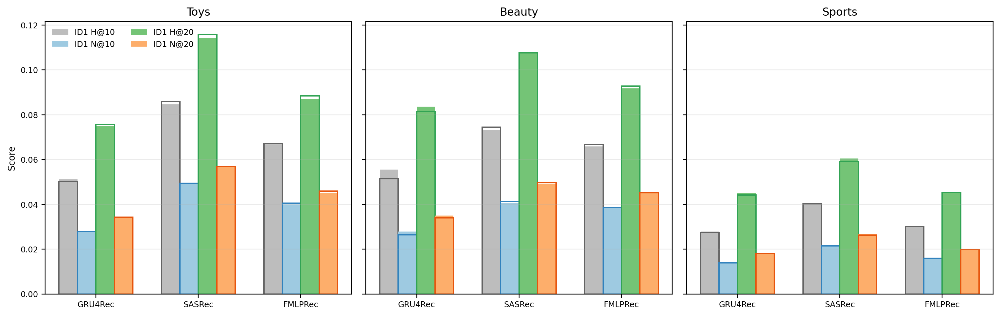

**图表：ID1（论文数据）与 ID3（复刻结果）的总体指标。** 每个面板对应一个数据集；实心柱为 ID1，空心边框柱为 ID3，四组颜色分别对应 H@10、N@10、H@20、N@20。

#### 5.2.2 总体结果与头尾分组分析

总体指标、头尾物品和头尾用户的论文值、本地值及差异百分比已在上方长表逐指标列出。该表同时覆盖总体 H/N、头物品、尾物品、头用户和尾用户的 Top-10/20 指标，因此不再另设宽格式差异表。

#### 5.2.3 发现的问题与补充实验设计

**发现的问题。** 按论文数据中的配置运行后，GRU4Rec/Beauty 的总体 Top-10 仍明显低于 model-1，下降集中在头物品及头尾用户指标；model-1 与 model-3 同为 seed=2025 也未得到相同结果。仅恢复日志参数没有解释这一差距。

**待检验的解释。** 训练中的随机采样、增强候选选择与表示混合可能使单次结果波动。跨版本实现、集合遍历顺序和运行环境也可能影响结果；相同 seed 数值不能排除这些差异。

**因此进行的下一步对比。** 仅针对 GRU4Rec/Beauty，保留 model-3 的预训练权重使用方式及其余记录参数，新增 seed=2026、42、520、1314 的 model-4、5、6、7，与 seed=2025 的 model-3 比较。该实验用于观察更换 seed 后的波动范围；不把 seed 当作可按测试集挑选的最优超参数，也不替代组件消融。

#### 5.2.4 Beauty 随机种子补充对比（主实验问题排查）

**设置。** 五次本地运行均为 GRU4Rec/Beauty，dropout=0.1、star_test=150、rate_a=0.3、rate_b=0.7、th=0.3，其余共同参数见 5.1；日志记录参数除 seed 和运行编号外一致。仍按验证集总体 NDCG@20 选检查点，再报告测试结果。

**随机种子补充对比（长表）**

论文基准为 `model-1`，本地实测为 `model-3`～`model-7`；每行给出一个 seed 运行的逐指标差异。

| 数据集名 | 指标名 | 论文宣称效果 | 本地实测效果 | 差异百分比 |
|---|---|---:|---:|---:|
| Beauty / GRU4Rec / model-3 | 总体 H@10 | 0.0555 | 0.0515 | -7.21% |
| Beauty / GRU4Rec / model-3 | 总体 N@10 | 0.0279 | 0.0265 | -5.02% |
| Beauty / GRU4Rec / model-3 | 总体 H@20 | 0.0836 | 0.0815 | -2.51% |
| Beauty / GRU4Rec / model-3 | 总体 N@20 | 0.0350 | 0.0340 | -2.86% |
| Beauty / GRU4Rec / model-3 | 头物品 H@10 | 0.1027 | 0.0929 | -9.54% |
| Beauty / GRU4Rec / model-3 | 头物品 N@10 | 0.0515 | 0.0471 | -8.54% |
| Beauty / GRU4Rec / model-3 | 尾物品 H@10 | 0.0195 | 0.0199 | +2.05% |
| Beauty / GRU4Rec / model-3 | 尾物品 N@10 | 0.0100 | 0.0108 | +8.00% |
| Beauty / GRU4Rec / model-3 | 尾物品 H@20 | 0.0321 | 0.0328 | +2.18% |
| Beauty / GRU4Rec / model-3 | 尾物品 N@20 | 0.0131 | 0.0141 | +7.63% |
| Beauty / GRU4Rec / model-3 | 头用户 H@10 | 0.0823 | 0.0767 | -6.80% |
| Beauty / GRU4Rec / model-3 | 头用户 N@10 | 0.0409 | 0.0390 | -4.65% |
| Beauty / GRU4Rec / model-3 | 尾用户 H@10 | 0.0488 | 0.0452 | -7.38% |
| Beauty / GRU4Rec / model-3 | 尾用户 N@10 | 0.0247 | 0.0234 | -5.26% |
| Beauty / GRU4Rec / model-3 | 尾用户 H@20 | 0.0720 | 0.0706 | -1.94% |
| Beauty / GRU4Rec / model-3 | 尾用户 N@20 | 0.0305 | 0.0298 | -2.30% |
| Beauty / GRU4Rec / model-4 | 总体 H@10 | 0.0555 | 0.0519 | -6.49% |
| Beauty / GRU4Rec / model-4 | 总体 N@10 | 0.0279 | 0.0270 | -3.23% |
| Beauty / GRU4Rec / model-4 | 总体 H@20 | 0.0836 | 0.0810 | -3.11% |
| Beauty / GRU4Rec / model-4 | 总体 N@20 | 0.0350 | 0.0343 | -2.00% |
| Beauty / GRU4Rec / model-4 | 头物品 H@10 | 0.1027 | 0.0935 | -8.96% |
| Beauty / GRU4Rec / model-4 | 头物品 N@10 | 0.0515 | 0.0482 | -6.41% |
| Beauty / GRU4Rec / model-4 | 尾物品 H@10 | 0.0195 | 0.0203 | +4.10% |
| Beauty / GRU4Rec / model-4 | 尾物品 N@10 | 0.0100 | 0.0108 | +8.00% |
| Beauty / GRU4Rec / model-4 | 尾物品 H@20 | 0.0321 | 0.0301 | -6.23% |
| Beauty / GRU4Rec / model-4 | 尾物品 N@20 | 0.0131 | 0.0132 | +0.76% |
| Beauty / GRU4Rec / model-4 | 头用户 H@10 | 0.0823 | 0.0776 | -5.71% |
| Beauty / GRU4Rec / model-4 | 头用户 N@10 | 0.0409 | 0.0405 | -0.98% |
| Beauty / GRU4Rec / model-4 | 尾用户 H@10 | 0.0488 | 0.0455 | -6.76% |
| Beauty / GRU4Rec / model-4 | 尾用户 N@10 | 0.0247 | 0.0236 | -4.45% |
| Beauty / GRU4Rec / model-4 | 尾用户 H@20 | 0.0720 | 0.0712 | -1.11% |
| Beauty / GRU4Rec / model-4 | 尾用户 N@20 | 0.0305 | 0.0300 | -1.64% |
| Beauty / GRU4Rec / model-5 | 总体 H@10 | 0.0555 | 0.0530 | -4.50% |
| Beauty / GRU4Rec / model-5 | 总体 N@10 | 0.0279 | 0.0275 | -1.43% |
| Beauty / GRU4Rec / model-5 | 总体 H@20 | 0.0836 | 0.0832 | -0.48% |
| Beauty / GRU4Rec / model-5 | 总体 N@20 | 0.0350 | 0.0351 | +0.29% |
| Beauty / GRU4Rec / model-5 | 头物品 H@10 | 0.1027 | 0.0952 | -7.30% |
| Beauty / GRU4Rec / model-5 | 头物品 N@10 | 0.0515 | 0.0495 | -3.88% |
| Beauty / GRU4Rec / model-5 | 尾物品 H@10 | 0.0195 | 0.0209 | +7.18% |
| Beauty / GRU4Rec / model-5 | 尾物品 N@10 | 0.0100 | 0.0108 | +8.00% |
| Beauty / GRU4Rec / model-5 | 尾物品 H@20 | 0.0321 | 0.0325 | +1.25% |
| Beauty / GRU4Rec / model-5 | 尾物品 N@20 | 0.0131 | 0.0137 | +4.58% |
| Beauty / GRU4Rec / model-5 | 头用户 H@10 | 0.0823 | 0.0787 | -4.37% |
| Beauty / GRU4Rec / model-5 | 头用户 N@10 | 0.0409 | 0.0406 | -0.73% |
| Beauty / GRU4Rec / model-5 | 尾用户 H@10 | 0.0488 | 0.0466 | -4.51% |
| Beauty / GRU4Rec / model-5 | 尾用户 N@10 | 0.0247 | 0.0242 | -2.02% |
| Beauty / GRU4Rec / model-5 | 尾用户 H@20 | 0.0720 | 0.0720 | +0.00% |
| Beauty / GRU4Rec / model-5 | 尾用户 N@20 | 0.0305 | 0.0306 | +0.33% |
| Beauty / GRU4Rec / model-6 | 总体 H@10 | 0.0555 | 0.0542 | -2.34% |
| Beauty / GRU4Rec / model-6 | 总体 N@10 | 0.0279 | 0.0283 | +1.43% |
| Beauty / GRU4Rec / model-6 | 总体 H@20 | 0.0836 | 0.0815 | -2.51% |
| Beauty / GRU4Rec / model-6 | 总体 N@20 | 0.0350 | 0.0352 | +0.57% |
| Beauty / GRU4Rec / model-6 | 头物品 H@10 | 0.1027 | 0.1005 | -2.14% |
| Beauty / GRU4Rec / model-6 | 头物品 N@10 | 0.0515 | 0.0520 | +0.97% |
| Beauty / GRU4Rec / model-6 | 尾物品 H@10 | 0.0195 | 0.0189 | -3.08% |
| Beauty / GRU4Rec / model-6 | 尾物品 N@10 | 0.0100 | 0.0103 | +3.00% |
| Beauty / GRU4Rec / model-6 | 尾物品 H@20 | 0.0321 | 0.0305 | -4.98% |
| Beauty / GRU4Rec / model-6 | 尾物品 N@20 | 0.0131 | 0.0131 | +0.00% |
| Beauty / GRU4Rec / model-6 | 头用户 H@10 | 0.0823 | 0.0778 | -5.47% |
| Beauty / GRU4Rec / model-6 | 头用户 N@10 | 0.0409 | 0.0408 | -0.24% |
| Beauty / GRU4Rec / model-6 | 尾用户 H@10 | 0.0488 | 0.0483 | -1.02% |
| Beauty / GRU4Rec / model-6 | 尾用户 N@10 | 0.0247 | 0.0252 | +2.02% |
| Beauty / GRU4Rec / model-6 | 尾用户 H@20 | 0.0720 | 0.0716 | -0.56% |
| Beauty / GRU4Rec / model-6 | 尾用户 N@20 | 0.0305 | 0.0310 | +1.64% |
| Beauty / GRU4Rec / model-7 | 总体 H@10 | 0.0555 | 0.0518 | -6.67% |
| Beauty / GRU4Rec / model-7 | 总体 N@10 | 0.0279 | 0.0265 | -5.02% |
| Beauty / GRU4Rec / model-7 | 总体 H@20 | 0.0836 | 0.0802 | -4.07% |
| Beauty / GRU4Rec / model-7 | 总体 N@20 | 0.0350 | 0.0336 | -4.00% |
| Beauty / GRU4Rec / model-7 | 头物品 H@10 | 0.1027 | 0.0937 | -8.76% |
| Beauty / GRU4Rec / model-7 | 头物品 N@10 | 0.0515 | 0.0472 | -8.35% |
| Beauty / GRU4Rec / model-7 | 尾物品 H@10 | 0.0195 | 0.0199 | +2.05% |
| Beauty / GRU4Rec / model-7 | 尾物品 N@10 | 0.0100 | 0.0107 | +7.00% |
| Beauty / GRU4Rec / model-7 | 尾物品 H@20 | 0.0321 | 0.0320 | -0.31% |
| Beauty / GRU4Rec / model-7 | 尾物品 N@20 | 0.0131 | 0.0137 | +4.58% |
| Beauty / GRU4Rec / model-7 | 头用户 H@10 | 0.0823 | 0.0725 | -11.91% |
| Beauty / GRU4Rec / model-7 | 头用户 N@10 | 0.0409 | 0.0356 | -12.96% |
| Beauty / GRU4Rec / model-7 | 尾用户 H@10 | 0.0488 | 0.0466 | -4.51% |
| Beauty / GRU4Rec / model-7 | 尾用户 N@10 | 0.0247 | 0.0242 | -2.02% |
| Beauty / GRU4Rec / model-7 | 尾用户 H@20 | 0.0720 | 0.0709 | -1.53% |
| Beauty / GRU4Rec / model-7 | 尾用户 N@20 | 0.0305 | 0.0303 | -0.66% |

**仍需解决的问题。** 若继续核对五次均值，应预先固定完整种子列表，再补足更多运行并汇总总体与头尾指标；若继续追查相同 seed 的差异，应核对预训练权重、实现版本及运行环境。上述后续核对目前没有新增结果，仍保留 model-3 为主实验复现行；model-6、model-7 不替换主结果。

### 5.3 消融实验

先对照论文使用的 Sports/GRU4Rec，再记录补充的 Sports/FMLPRec。两组实验都固定 seed=2025，使用同一预训练权重起点；本地结果是日志中的最终测试结果。

**Sports/GRU4Rec：与论文结果对比**

**论文完整 TADA 与本地 model-3 对照（长表）**

| 数据集名 | 指标名 | 论文宣称效果 | 本地实测效果 | 差异百分比 |
|---|---|---:|---:|---:|
| Sports / GRU4Rec | 总体 H@10 | 0.0279 | 0.0275 | -1.43% |
| Sports / GRU4Rec | 总体 N@10 | 0.0140 | 0.0139 | -0.71% |
| Sports / GRU4Rec | 总体 H@20 | 0.0450 | 0.0442 | -1.78% |
| Sports / GRU4Rec | 总体 N@20 | 0.0183 | 0.0181 | -1.09% |
| Sports / GRU4Rec | 头物品 H@10 | 0.0519 | 0.0512 | -1.35% |
| Sports / GRU4Rec | 头物品 N@10 | 0.0258 | 0.0257 | -0.39% |
| Sports / GRU4Rec | 尾物品 H@10 | 0.0095 | 0.0092 | -3.16% |
| Sports / GRU4Rec | 尾物品 N@10 | 0.0049 | 0.0047 | -4.08% |
| Sports / GRU4Rec | 尾物品 H@20 | 0.0159 | 0.0152 | -4.40% |
| Sports / GRU4Rec | 尾物品 N@20 | 0.0065 | 0.0062 | -4.62% |
| Sports / GRU4Rec | 头用户 H@10 | 0.0306 | 0.0291 | -4.90% |
| Sports / GRU4Rec | 头用户 N@10 | 0.0148 | 0.0146 | -1.35% |
| Sports / GRU4Rec | 尾用户 H@10 | 0.0273 | 0.0271 | -0.73% |
| Sports / GRU4Rec | 尾用户 N@10 | 0.0138 | 0.0137 | -0.72% |
| Sports / GRU4Rec | 尾用户 H@20 | 0.0438 | 0.0436 | -0.46% |
| Sports / GRU4Rec | 尾用户 N@20 | 0.0179 | 0.0179 | +0.00% |

后续去除模块的结果属于本地消融，没有对应的论文逐项实测值，因此保留为本地消融记录，不填入论文差异。

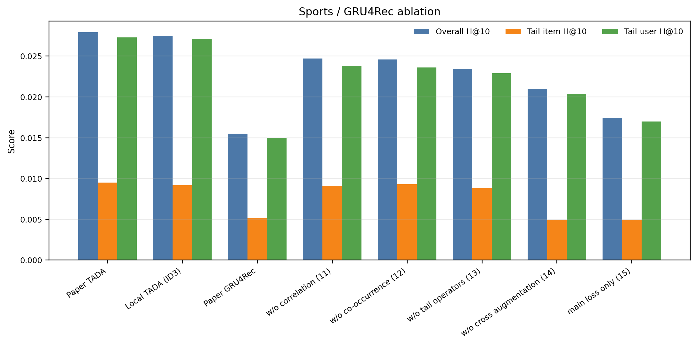

**图表：Sports/GRU4Rec 消融。** 以总体 H@10、尾物品 H@10 和尾用户 H@10 并列显示论文完整 TADA、复刻结果和各去除模块设置。

论文中的完整 TADA 总体 H@10 为 0.0279，本地 model-3 为 0.0275，差距较小；总体 N@10、H@20、N@20 也接近。头尾指标方面，本地头物品 H@10 为 0.0512，低于论文 0.0519；尾物品 H@10 为 0.0092，低于论文 0.0095，说明总体结果接近，但头尾没有完全对齐。消融结果中，去掉跨序列增强后总体 H@10 降到 0.0210，尾物品 H@10 降到 0.0049；仅保留主任务时总体 H@10 降到 0.0174，下降最大。相关候选、共现候选和尾部算子也都有不同程度影响。该组与论文的骨干和数据集一致，可以作为主要消融复现结果，但目前只有一个 seed。

**Sports/FMLPRec：补充实验**

这组实验用来观察 TADA 接入 FMLPRec 后各模块的变化。model-3 是完整 TADA，model-11～15 为 seed=2025 的消融结果。

| 方法             | 总体 H@10 | 总体 N@10 | 总体 H@20 | 总体 N@20 | 头物品 H@10 | 头物品 N@10 | 尾物品 H@10 | 尾物品 N@10 | 尾物品 H@20 | 尾物品 N@20 | 头用户 H@10 | 头用户 N@10 | 尾用户 H@10 | 尾用户 N@10 | 尾用户 H@20 | 尾用户 N@20 |
| -------------- | ------: | ------: | ------: | ------: | -------: | -------: | -------: | -------: | -------: | -------: | -------: | -------: | -------: | -------: | -------: | -------: |
| TADA（model-3）  |  0.0301 |  0.0160 |  0.0453 |  0.0199 |   0.0476 |   0.0239 |   0.0167 |   0.0100 |   0.0207 |   0.0110 |   0.0303 |   0.0154 |   0.0301 |   0.0162 |   0.0448 |   0.0199 |
| w/o 相关候选（11）   |  0.0264 |  0.0138 |  0.0405 |  0.0173 |   0.0409 |   0.0194 |   0.0153 |   0.0095 |   0.0203 |   0.0107 |   0.0254 |   0.0125 |   0.0267 |   0.0141 |   0.0404 |   0.0175 |
| w/o 共现候选（12）   |  0.0325 |  0.0174 |  0.0466 |  0.0210 |   0.0539 |   0.0278 |   0.0160 |   0.0095 |   0.0202 |   0.0105 |   0.0327 |   0.0167 |   0.0324 |   0.0176 |   0.0463 |   0.0211 |
| w/o 尾部感知算子（13） |  0.0217 |  0.0115 |  0.0325 |  0.0142 |   0.0339 |   0.0164 |   0.0124 |   0.0078 |   0.0149 |   0.0084 |   0.0199 |   0.0102 |   0.0222 |   0.0119 |   0.0326 |   0.0145 |
| w/o 跨序列增强（14）  |  0.0279 |  0.0148 |  0.0419 |  0.0183 |   0.0477 |   0.0245 |   0.0127 |   0.0074 |   0.0168 |   0.0085 |   0.0295 |   0.0149 |   0.0275 |   0.0148 |   0.0411 |   0.0182 |
| 仅主任务损失（15）     |  0.0224 |  0.0118 |  0.0330 |  0.0144 |   0.0353 |   0.0175 |   0.0125 |   0.0074 |   0.0152 |   0.0081 |   0.0219 |   0.0115 |   0.0225 |   0.0119 |   0.0331 |   0.0145 |

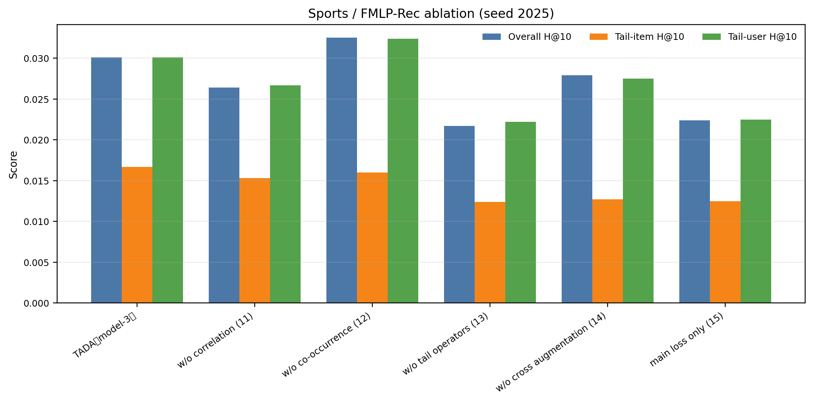

**图表：Sports/FMLP-Rec 消融（seed=2025）。** 展示完整 TADA 与五种模块去除设置的三项 H@10 指标。

seed=2025 的结果显示，去掉尾部感知算子后总体 H@10 从 0.0301 降到 0.0217，去掉跨序列增强后尾物品 H@10 从 0.0167 降到 0.0127；仅保留主任务时总体 H@10 为 0.0224。去掉共现候选后总体 H@10 为 0.0325，单次结果反而升高，说明模块作用会随架构和随机状态变化。

**同一消融实验更换随机种子：** 新增 seed=1314，其他参数保持不变。

| 方法             | 总体 H@10 | 总体 N@10 | 总体 H@20 | 总体 N@20 | 头物品 H@10 | 头物品 N@10 | 尾物品 H@10 | 尾物品 N@10 | 尾物品 H@20 | 尾物品 N@20 | 头用户 H@10 | 头用户 N@10 | 尾用户 H@10 | 尾用户 N@10 | 尾用户 H@20 | 尾用户 N@20 |
| -------------- | ------: | ------: | ------: | ------: | -------: | -------: | -------: | -------: | -------: | -------: | -------: | -------: | -------: | -------: | -------: | -------: |
| w/o 相关候选（11）   |  0.0252 |  0.0134 |  0.0387 |  0.0168 |   0.0397 |   0.0189 |   0.0140 |   0.0091 |   0.0179 |   0.0101 |   0.0242 |   0.0122 |   0.0254 |   0.0137 |   0.0383 |   0.0169 |
| w/o 共现候选（12）   |  0.0299 |  0.0168 |  0.0440 |  0.0203 |   0.0501 |   0.0262 |   0.0145 |   0.0095 |   0.0183 |   0.0105 |   0.0312 |   0.0167 |   0.0296 |   0.0168 |   0.0432 |   0.0202 |
| w/o 尾部感知算子（13） |  0.0215 |  0.0114 |  0.0309 |  0.0138 |   0.0330 |   0.0162 |   0.0126 |   0.0078 |   0.0151 |   0.0084 |   0.0206 |   0.0106 |   0.0217 |   0.0116 |   0.0311 |   0.0140 |
| w/o 跨序列增强（14）  |  0.0258 |  0.0138 |  0.0396 |  0.0173 |   0.0439 |   0.0218 |   0.0119 |   0.0076 |   0.0149 |   0.0084 |   0.0256 |   0.0134 |   0.0259 |   0.0139 |   0.0395 |   0.0173 |
| 仅主任务损失（15）     |  0.0229 |  0.0118 |  0.0340 |  0.0146 |   0.0370 |   0.0179 |   0.0120 |   0.0070 |   0.0144 |   0.0077 |   0.0233 |   0.0115 |   0.0228 |   0.0118 |   0.0338 |   0.0146 |

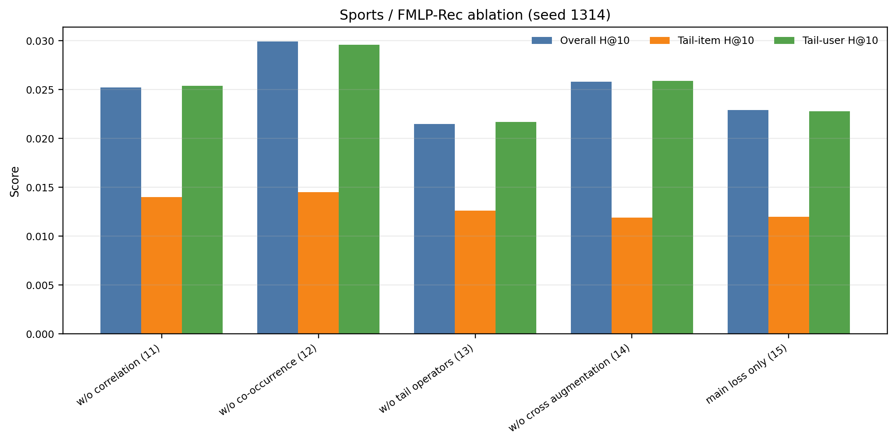

**图表：Sports/FMLP-Rec 消融（seed=1314）。** 用相同指标观察更换随机种子后的模块排序变化。

seed=1314 下，五组总体 H@10 为 0.0215～0.0299，和 seed=2025 的 0.0217～0.0325 相比有明显变化；尾物品 H@10 也从 0.0124～0.0160 变为 0.0119～0.0145。说明只改变随机种子就可能改变模块排序和指标大小，当前结果用于记录随机种子带来的波动，本阶段不再追加实验。

### 5.4 超参数研究

仅在 Sports/FMLPRec 上扫描参数，不增加其他数据集或骨干。先核对已有完整模型 ID3 与新增消融的结果；发现问题时先分析，再开始下一阶段。各扫描点固定 seed=2025、同一预训练起点和其余参数，每次只改变所研究的参数；不按测试集选择新配置。

**a、b 敏感性（对应图 3）：** 固定 α=0.3，扫描 a∈{0.1,0.2,0.3}、b∈{0.5,0.6,0.7,0.8}，共 12 组。ID3 的 (0.61,0.81) 另作为原复刻配置参照，不混入论文扫描网格。

|  ID |   a |   b | Sports 尾物品 H@10 | Sports 尾用户 H@10 | Sports 尾部平均 H@10 |
| --: | --: | --: | --------------: | --------------: | ---------------: |
|  16 | 0.1 | 0.5 |          0.0142 |          0.0265 |           0.0204 |
|  17 | 0.1 | 0.6 |          0.0151 |          0.0283 |           0.0217 |
|  18 | 0.1 | 0.7 |          0.0148 |          0.0281 |           0.0215 |
|  19 | 0.1 | 0.8 |          0.0142 |          0.0274 |           0.0208 |
|  20 | 0.2 | 0.5 |          0.0147 |          0.0255 |           0.0201 |
|  21 | 0.2 | 0.6 |          0.0147 |          0.0285 |           0.0216 |
|  22 | 0.2 | 0.7 |          0.0157 |          0.0285 |           0.0221 |
|  23 | 0.2 | 0.8 |          0.0150 |          0.0282 |           0.0216 |
|  24 | 0.3 | 0.5 |          0.0149 |          0.0278 |           0.0214 |
|  25 | 0.3 | 0.6 |          0.0150 |          0.0283 |           0.0216 |
|  26 | 0.3 | 0.7 |          0.0152 |          0.0282 |           0.0217 |
|  27 | 0.3 | 0.8 |          0.0151 |          0.0285 |           0.0218 |

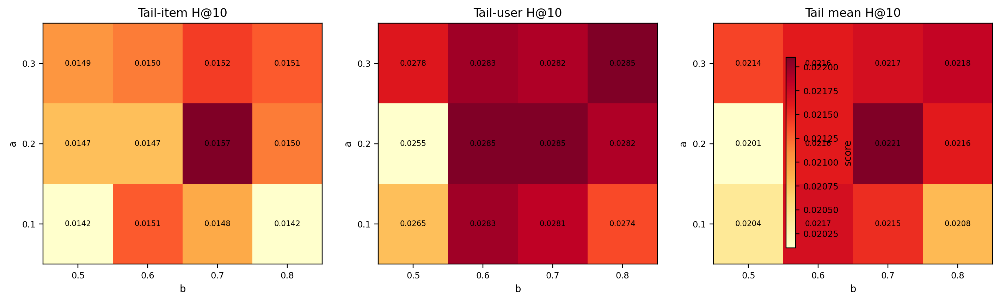

**图表：a、b 参数扫描。** 三张热力图分别对应尾物品 H@10、尾用户 H@10 和两者平均值；颜色越深表示分数越高。

**α 敏感性（对应图 4；代码参数名 beta）：** 固定 a=0.61、b=0.81，扫描 α∈{0.1,0.2,0.3,0.4,0.5}。α=0.3 直接复用同配置的主实验 ID3，另外训练 4 组。

|    ID |   α | Sports 尾物品 H@10 | Sports 尾用户 H@10 |
| ----: | --: | --------------: | --------------: |
|    28 | 0.1 |          0.0157 |          0.0311 |
|    29 | 0.2 |          0.0158 |          0.0284 |
| 3（复用） | 0.3 |          0.0167 |          0.0301 |
|    30 | 0.4 |          0.0166 |          0.0306 |
|    31 | 0.5 |          0.0161 |          0.0288 |

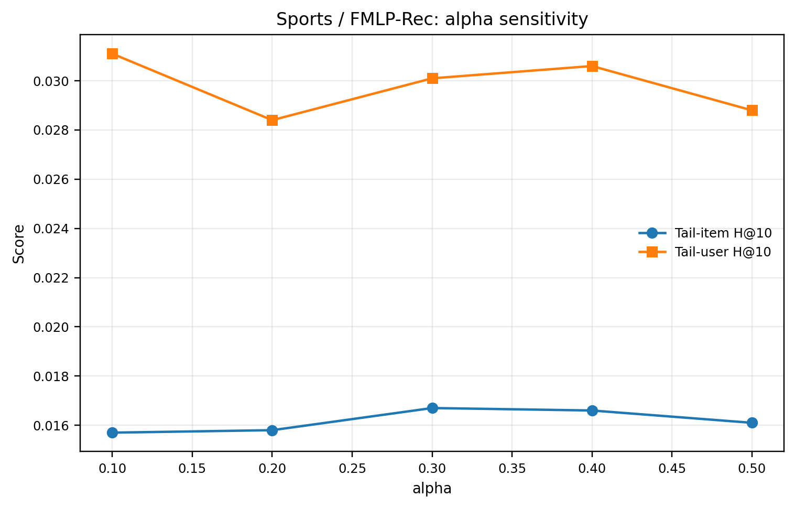

**图表：alpha 参数扫描。** 折线分别显示尾物品和尾用户 H@10，alpha=0.3 为复用的 ID3 配置。

图 3 的尾部平均 H@10 为尾物品与尾用户 H@10 的平均值；图 4 分别报告两组指标。初轮为固定 seed 的探索，本次参数扫描用于观察变化范围，不再追加多种子实验。

**FMLPRec 参数结果分析：** a、b 扫描中，尾物品 H@10 最高为 ID22 的 0.0157，尾用户 H@10 最高为 ID21/22 的 0.0285；不同组合差距较小，单个 seed 下不能确定最优区域。α 扫描中，α=0.4（ID30）尾物品 H@10 最高为 0.0166，α=0.1（ID28）尾用户 H@10 最高为 0.0311，说明物品尾部和用户尾部的最优 α 不一致。参数结果显示当前范围内变化较小，足以支持本阶段的鲁棒性判断。

**阶段性小结：** SASRec 的主实验结果整体更稳定，也更接近论文；GRU4Rec 的结果波动较大，和论文存在更明显偏差。不同架构对模块的反应不完全相同，同一个模块在 SASRec、GRU4Rec 和 FMLPRec 上的影响不能直接类推。FMLPRec 消融中仅改变 seed 就出现明显差异，说明方法稳定性会受到随机种子影响，本阶段记录这一现象。当前参数扫描的指标变化相对有限，说明在这组范围内 TADA 对 a、b、α 具有一定鲁棒性。
