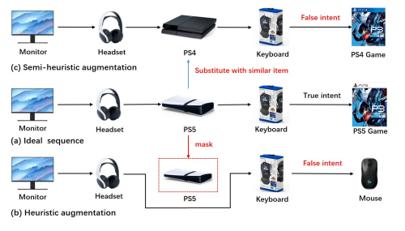
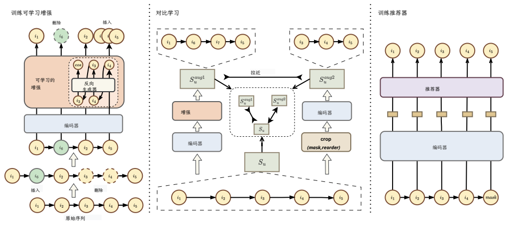

# TCLA：三元组对比学习与可学习序列增强

> 论文：Triplet Contrastive Learning with Learnable Sequence Augmentation for Sequential Recommendation，SIGIR 2025。[https://doi.org/10.1145/3726302.3730101](https://doi.org/10.1145/3726302.3730101)
> 代码：https://github.com/anonymityww/TCLA
> 更新记录：2026-11-13 统一论文-本地实验结果对照表为五列长表；2026-10-22 统一笔记顶部信息格式；保留原有阅读与复现记录，论文结果与本地结果分开。

---
# 一、文献阅读

## 1. 研究背景



**图 1：两种增强方法的示例**（英文原文 PDF 第 2 页）。子图 (a) 是用户真实购买意图（显示器 → 耳机 → PS5 → 键盘 → PS5 游戏），(b)(c) 分别展示随机掩码与相似物品替换如何误读用户意图。

对比学习（CL）通过自监督信号缓解序列推荐的稀疏性与噪声问题，但其收益高度依赖**增强数据的质量**。论文指出当前增强方法存在两类局限：

1. **启发式增强**（掩码、裁剪、重排、替换）随机性过强。如图 1(b)，把序列中的 PS5 掩码后，模型可能把“显示器 + 耳机 + 键盘”误读为电脑配件意图，生成的正样本与用户真实意图不符。
2. **半启发式增强**（CoSeRec 等的相似物品/相似序列替换）仍依赖“替换位置”的人工选择。如图 1(c)，用 PS4 替换 PS5 会把“PS5 游戏”意图误读成“PS4 游戏”；不同样本对模型优化的价值并不相同，而现有方法把两类增强同等对待，无法提供细粒度监督。

表 1 从“策略 / 编辑单元 / 级别”三个维度对比了现有方法与 TCLARec：

| 模型 | 策略 | 编辑单元 | 级别 |
|---|---|---|---|
| CL4SRec | Heuristic | Input | Item |
| CoSeRec | Semi-heuristic | Input | Sequence |
| DuoRec | Heuristic | Hidden | Item |
| RCL | Semi-heuristic | Hidden | Sequence |
| CCL | Heuristic + Model | Input | Item |
| **TCLARec** | **Model** | **Input** | **Item** |

## 2. 研究目的

提出 **TCLARec**：用可学习的序列增强模块替代启发式规则，自动决定在序列的哪些位置执行“保留 / 删除 / 插入”，生成与用户真实意图更一致的增强序列；再用**三元组对比损失**强化原始序列与增强序列之间的细粒度监督。

核心设计目标：

- 增强模块从全局自监督信息中学习修改位置与操作，而不是按预定义概率随机修改；
- 用“随机修改 → 恢复”的自监督任务预训练增强模块，无需人工标注；
- 构造 `[原始序列, SSL 增强序列, 随机增强序列]` 三元组，用排序式对比损失让正样本更靠近原始序列；
- 不改推荐器 backbone，仅在训练阶段引入增强模块与对比损失。

## 3. 研究问题

论文实验围绕四个 RQ 展开：

1. **RQ1**：TCLARec 相比 SOTA 序列推荐与对比学习基线表现如何？
2. **RQ2**：可学习增强模块与三元组对比损失各自贡献多少？
3. **RQ3**：在含噪声的模拟测试集上鲁棒性如何？
4. **RQ4**：对增强操作概率 $[p_k,p_d,p_i]$ 与损失权重 $\alpha,\beta$ 是否敏感？

## 4. 研究方法



**图 2：TCLARec 总体框架**（英文原文 PDF 第 4 页）。左：训练可学习增强模块（删除/插入后由反向生成器恢复）；中：对比学习（SSL 增强与随机增强互为对照，拉近原始序列）；右：训练推荐器。

TCLARec 由三个模块组成，编码器在增强模块与推荐器之间**共享**：

1. **可学习增强模块**：对输入序列逐位置预测 keep / delete / insert；执行 insert 时，用反向生成器生成一段逆序子序列插入该位置。训练时先随机修改序列 $S \to S_m$，要求模块恢复出 $S$，以自监督方式预训练。
2. **对比学习模块**：预训练后的增强模块为每个用户生成一个 SSL 增强序列 $S_u^{aug1}$，同时用传统随机方法生成 $S_u^{aug2}$；把 $S_u^{aug1}$、$S_u^{aug2}$ 与原始序列 $S_u^{raw}$ 组成三元组做对比学习。
3. **推荐模块**：单 Transformer 编码器 + 物品嵌入内积，预测下一个物品。

## 5. 研究内容（公式分析）

### 5.1 问题定义

用户集合 $U$，物品集合 $I$，用户 $u$ 的交互序列 $S=[i_1,i_2,\ldots,i_{|S|}]$，$i_t\in I$。下一物品预测：

$$
P\left(i_{|S|+1}\mid S\right)=\mathrm{softmax}\left(Eh_t\right)
$$

其中 $E\in\mathbb{R}^{|I|\times d}$ 为物品嵌入矩阵，$h_t\in\mathbb{R}^d$ 为序列最后位置的隐藏表示。

### 5.2 序列编码器

嵌入与位置编码相加得到初始表示：

$$
h_t^0=e_t+p_t
$$

堆叠 $L$ 层 Transformer（因果掩码）更新：

$$
H_e^{l}=\mathrm{Trm}\left(H_e^{l-1}\right),\qquad H_e=h_t^{L}
$$

### 5.3 可学习增强模块

**操作预测**：对每个位置 $t$，用线性层 $W\in\mathbb{R}^{3\times e}$ 预测三种操作的概率：

$$
P\left(\hat o_t\mid S\right)=\mathrm{softmax}\left(Wh_t\right)
$$

取概率最大的操作执行 keep / delete / insert。

**反向生成器**：执行 insert 时，不是插入单个物品，而是允许在选定位置插入长度不超过 $n$ 的子序列。对被删除的 $n-1$ 个物品做嵌入后，与当前隐藏表示拼接并加位置编码，得到反向生成器的初始矩阵：

$$
H_t^0=\begin{bmatrix} h_t+p_1\\ c_1+p_2\\ \vdots\\ c_{n-1}+p_n \end{bmatrix}
$$

经 Transformer 更新后，逐位置预测插入物品：

$$
P\left(\hat i_n\mid S_{t-1}^{c}\right)=\mathrm{softmax}\left(Eh_n\right)
$$

**增强模块预训练**：随机删除/插入得到 $S_m$，模块需恢复原序列 $S$，损失为恢复概率的负对数似然：

$$
\mathcal{L}_{aug}=-\log P\left(S\mid S_m\right)
=-\left(\log P\left(O\mid S_m\right)+\sum_{t\in M}\log P\left(i_t^{c}\mid S_m\right)\right)
$$

即同时监督“操作是否正确”（keep/delete/insert 三分类）与“插入/恢复的物品是否正确”（全物品表分类）。

### 5.4 三元组对比学习

对每个用户生成 SSL 增强序列 $S_u^{aug1}$ 与随机增强序列 $S_u^{aug2}$。粗粒度对比损失把 $S_u^{aug1}$ 与 $S_u^{aug2}$ 作为正对，其余 $2N-2$ 个序列作为负样本：

$$
\mathcal{L}_{cl}=-\log\frac{\exp\left(\mathrm{sim}\left(S_u^{aug1},S_u^{aug2}\right)\right)}
{\exp\left(\mathrm{sim}\left(S_u^{aug1},S_u^{aug2}\right)\right)+\sum_{S^-}\exp\left(\mathrm{sim}\left(S_u^{aug1},S^-\right)\right)}
$$

三元组损失则不把两个增强序列同等看待，而是让原始序列与 SSL 增强序列的相似度**高于**原始序列与随机增强序列的相似度：

$$
\mathcal{L}_{tri}=-\log\frac{\exp\left(\mathrm{sim}\left(S_u^{raw},S_u^{aug1}\right)\right)}
{\exp\left(\mathrm{sim}\left(S_u^{raw},S_u^{aug1}\right)\right)+\exp\left(\mathrm{sim}\left(S_u^{raw},S_u^{aug2}\right)\right)}
$$

### 5.5 模型学习与总损失

推荐损失为下一物品的负对数似然：

$$
\mathcal{L}_{rec}=-\log P\left(\hat i_t\mid S\right)
$$

联合损失：

$$
\mathcal{L}=\mathcal{L}_{rec}+\alpha\mathcal{L}_{cl}+\beta\mathcal{L}_{tri}
$$

训练流程：先固定推荐器、用 $\mathcal{L}_{aug}$ 预训练增强模块若干 epoch；再联合训练推荐器与对比学习（增强模块冻结/推理模式）。论文 §5.3 的实验表明“先单独预训练增强模块、再训练推荐器”是三种训练策略中最好的。

### 5.6 算法流程

```text
输入：序列 batch S，增强模块预训练轮数 ae，总轮数 e，超参数 α, β, p_k/p_d/p_i
1. for epoch = 1..ae:                      # 预训练增强模块
2.     随机删除/插入得到 S_m
3.     前向增强模块，计算 L_aug（操作分类 + 恢复物品分类）
4.     反向传播更新增强模块
5. for epoch = ae+1..e:                    # 联合训练
6.     用冻结的增强模块生成 S^aug1，用 mask/crop/reorder 生成 S^aug2
7.     编码 S、S^aug1、S^aug2，计算 L_rec、L_cl、L_tri
8.     L = L_rec + α L_cl + β L_tri，反向传播更新推荐器
9. 评估：HR/NDCG/MRR @5/10/20
```

### 5.7 复杂度观察（复现时的分析，非论文原文）

- 编码器：$O(T^2d+Td^2)$；
- 增强模块的插入头需要为每个位置的每个插入槽预测全物品分布，logits 规模为 $O(B\cdot T\cdot n\cdot|I|)$。以 Beauty 为例，$B=512,T=60,n=5,|I|=12{,}104$ 时单个张量约 **7.4 GB**，这是复现时显存的主要来源（见第二节）。

## 6. 实验环境、数据集、参数配置

### 6.1 数据集

三个公开数据集，统计如表 2：

| 数据集 | 用户数 | 物品数 | 交互数 | 平均长度 | 密度 |
|---|---:|---:|---:|---:|---:|
| Beauty | 22,362 | 12,101 | 194,682 | 8.7 | 0.07% |
| Yelp | 22,844 | 16,552 | 236,999 | 10.4 | 0.06% |
| Sports | 35,597 | 18,357 | 294,483 | 8.3 | 0.05% |

来源：Beauty、Sports 为 Amazon 评论数据（McAuley 2014 版 5-core），Yelp 为 Yelp Open Dataset。**论文明确说明：由于 Yelp 规模较大，只使用 2019 年的记录**（§4.2）。

预处理遵循文献 [16]：过滤交互数少于 5 的用户与物品；按时间排序；最后一项作测试、倒数第二项作验证、其余作训练；序列最大长度 50。

### 6.2 评估协议

- leave-one-out：最后一项测试、倒数第二项验证；
- 每个验证/测试样本随机采样 **99 个未交互物品**作负样本，全候选排序；
- 指标：HR@K、NDCG@K、MRR@K，$K\in\{5,10,20\}$。

### 6.3 基线

- 序列推荐：SASRec、BERT4Rec；
- 对比学习：CL4SRec、DuoRec、CoSeRec、CCL、ICSRec、STEAM。

### 6.4 实现细节

| 项目 | 设置 |
|---|---|
| 初始化 / 优化器 | Xavier / Adam |
| 学习率 | 0.001 |
| 嵌入维度 | 64 |
| batch size | Beauty、Yelp 512；Sports 256 |
| Transformer | 1 层、1 头、dropout 0.5 |
| 原始序列最大长度 | 50 |
| 增强序列最大长度 | 60 |
| 单次连续插入上限 | 5 |
| 负样本数 | 99 |
| GPU | RTX 4090 |

## 7. 完整实验结果表格

### 表 3：整体性能（Beauty）

| 模型 | HR@5 | HR@10 | HR@20 | MRR@5 | MRR@10 | MRR@20 | NDCG@5 | NDCG@10 | NDCG@20 |
|---|---:|---:|---:|---:|---:|---:|---:|---:|---:|
| SASRec | 0.3721 | 0.4639 | 0.5804 | 0.2611 | 0.2732 | 0.2812 | 0.2887 | 0.3182 | 0.3476 |
| BERT4Rec | 0.3666 | 0.4728 | 0.6011 | 0.2337 | 0.2478 | 0.2566 | 0.2570 | 0.2907 | 0.3227 |
| CL4SRec | 0.4067 | 0.5056 | 0.6199 | 0.2785 | 0.2916 | 0.2994 | 0.3104 | 0.3422 | 0.3710 |
| DuoRec | 0.4094 | 0.5078 | 0.6200 | 0.2884 | 0.3015 | 0.3092 | 0.3194 | 0.3494 | 0.3774 |
| CoSeRec | 0.4124 | 0.5187 | 0.6356 | 0.2749 | 0.2890 | 0.2971 | 0.3090 | 0.3434 | 0.3728 |
| CCL | 0.4093 | 0.5087 | 0.6279 | 0.2857 | 0.2989 | 0.3071 | 0.3165 | 0.3486 | 0.3786 |
| ICSRec | 0.4250 | 0.5188 | 0.6345 | 0.2963 | 0.3087 | 0.3167 | 0.3284 | 0.3586 | 0.3878 |
| STEAM | 0.4284 | 0.5256 | 0.6486 | 0.2899 | 0.3028 | 0.3112 | 0.3181 | 0.3508 | 0.3807 |
| **TCLARec** | **0.4446** | **0.5460** | **0.6606** | **0.3161** | **0.3297** | **0.3376** | **0.3482** | **0.3810** | **0.4099** |

### 表 3（续）：整体性能（Yelp）

| 模型 | HR@5 | HR@10 | HR@20 | MRR@5 | MRR@10 | MRR@20 | NDCG@5 | NDCG@10 | NDCG@20 |
|---|---:|---:|---:|---:|---:|---:|---:|---:|---:|
| SASRec | 0.5847 | 0.7833 | 0.9194 | 0.3543 | 0.3808 | 0.3907 | 0.4113 | 0.4756 | 0.5105 |
| BERT4Rec | 0.6118 | 0.7972 | 0.9235 | 0.3764 | 0.4013 | 0.4104 | 0.4257 | 0.4870 | 0.5218 |
| CL4SRec | 0.6292 | 0.8223 | 0.9486 | 0.3991 | 0.4251 | 0.4343 | 0.4662 | 0.5188 | 0.5513 |
| DuoRec | 0.6400 | 0.8263 | 0.9564 | 0.4085 | 0.4334 | 0.4429 | 0.4647 | 0.5245 | 0.5590 |
| CoSeRec | 0.6454 | 0.8241 | 0.9444 | 0.4140 | 0.4380 | 0.4467 | 0.4714 | 0.5293 | 0.5602 |
| CCL | 0.6392 | 0.8211 | 0.9459 | 0.4084 | 0.4328 | 0.4418 | 0.4657 | 0.5246 | 0.5566 |
| ICSRec | 0.6618 | 0.8337 | 0.9531 | 0.4302 | 0.4533 | 0.4619 | 0.4877 | 0.5434 | 0.5741 |
| STEAM | 0.6683 | 0.8460 | 0.9511 | 0.4293 | 0.4531 | 0.4607 | 0.4895 | 0.5461 | 0.5735 |
| **TCLARec** | **0.6833** | **0.8569** | **0.9554** | **0.4482** | **0.4716** | **0.4788** | **0.5066** | **0.5630** | **0.5883** |

### 表 3（续）：整体性能（Sports）

| 模型 | HR@5 | HR@10 | HR@20 | MRR@5 | MRR@10 | MRR@20 | NDCG@5 | NDCG@10 | NDCG@20 |
|---|---:|---:|---:|---:|---:|---:|---:|---:|---:|
| SASRec | 0.3450 | 0.4597 | 0.5942 | 0.2204 | 0.2357 | 0.2449 | 0.2513 | 0.2883 | 0.3222 |
| BERT4Rec | 0.3515 | 0.4791 | 0.6280 | 0.2154 | 0.2323 | 0.2426 | 0.2448 | 0.2862 | 0.3236 |
| CL4SRec | 0.3935 | 0.5152 | 0.6562 | 0.2600 | 0.2762 | 0.2859 | 0.2931 | 0.3324 | 0.3680 |
| DuoRec | 0.3980 | 0.5192 | 0.6583 | 0.2597 | 0.2758 | 0.2854 | 0.2936 | 0.3335 | 0.3686 |
| CoSeRec | 0.4074 | 0.5305 | 0.6650 | 0.2653 | 0.2817 | 0.2910 | 0.3005 | 0.3403 | 0.3743 |
| CCL | 0.4050 | 0.5297 | 0.6695 | 0.2628 | 0.2794 | 0.2890 | 0.2981 | 0.3383 | 0.3736 |
| ICSRec | 0.4220 | 0.5459 | 0.6861 | 0.2741 | 0.2906 | 0.3003 | 0.3108 | 0.3508 | 0.3862 |
| STEAM | 0.4190 | 0.5496 | 0.6916 | 0.2685 | 0.2858 | 0.2956 | 0.3058 | 0.3479 | 0.3838 |
| **TCLARec** | **0.4379** | **0.5645** | **0.7017** | **0.2896** | **0.3064** | **0.3159** | **0.3264** | **0.3673** | **0.4020** |

TCLARec 在三个数据集的 9 项指标上全部最优。相对 CL4SRec 的平均提升为 Beauty 10.8%、Yelp 8.14%、Sports 10.18%；相对最强基线（ICSRec/STEAM）的平均提升为 5.28%、2.73%、4.23%（§5.1 原文数值）。

### 表 4：消融实验

| 数据集 | 模型 | HR@5 | HR@10 | HR@20 | MRR@5 | MRR@10 | MRR@20 | NDCG@5 | NDCG@10 | NDCG@20 | Sum |
|---|---|---:|---:|---:|---:|---:|---:|---:|---:|---:|---:|
| Beauty | **TCLARec** | **0.4446** | **0.5460** | **0.6606** | **0.3161** | **0.3297** | **0.3376** | **0.3482** | **0.3810** | **0.4099** | **3.7740** |
| Beauty | Base | 0.4066 | 0.5067 | 0.6202 | 0.2806 | 0.2939 | 0.3017 | 0.3119 | 0.3442 | 0.3729 | 3.4391 |
| Beauty | w/o-Tri | 0.4311 | 0.5263 | 0.6429 | 0.3076 | 0.3203 | 0.3283 | 0.3384 | 0.3691 | 0.3985 | 3.6628 |
| Beauty | TestAug | 0.3661 | 0.4717 | 0.5934 | 0.2416 | 0.2555 | 0.2639 | 0.2725 | 0.3065 | 0.3371 | 3.1087 |
| Beauty | TestRand | 0.3484 | 0.4512 | 0.5713 | 0.2300 | 0.2437 | 0.2520 | 0.2595 | 0.2926 | 0.3229 | 2.9719 |
| Beauty | DuoAug | 0.4097 | 0.5032 | 0.6173 | 0.2943 | 0.3067 | 0.3145 | 0.3230 | 0.3531 | 0.3818 | 3.5041 |
| Beauty | Co-Train | 0.4381 | 0.5332 | 0.6529 | 0.3102 | 0.3229 | 0.3311 | 0.3421 | 0.3728 | 0.4029 | 3.7066 |
| Yelp | **TCLARec** | **0.6833** | **0.8569** | **0.9554** | **0.4482** | **0.4716** | **0.4788** | **0.5066** | **0.5630** | **0.5883** | **5.5523** |
| Yelp | Base | 0.6319 | 0.8216 | 0.9482 | 0.4012 | 0.4267 | 0.4360 | 0.4584 | 0.5199 | 0.5525 | 5.1968 |
| Yelp | w/o-Tri | 0.6661 | 0.8378 | 0.9436 | 0.4355 | 0.4586 | 0.4663 | 0.4927 | 0.5485 | 0.5757 | 5.4252 |
| Yelp | TestAug | 0.6211 | 0.8116 | 0.9433 | 0.3895 | 0.4150 | 0.4246 | 0.4469 | 0.5086 | 0.5425 | 5.1036 |
| Yelp | TestRand | 0.5686 | 0.7612 | 0.9012 | 0.3518 | 0.3774 | 0.3875 | 0.4055 | 0.4677 | 0.5036 | 4.7250 |
| Yelp | DuoAug | 0.6354 | 0.8138 | 0.9339 | 0.4051 | 0.4290 | 0.4377 | 0.4622 | 0.5199 | 0.5508 | 5.1881 |
| Yelp | Co-Train | 0.6744 | 0.8481 | 0.9548 | 0.4379 | 0.4612 | 0.4690 | 0.4966 | 0.5529 | 0.5803 | 5.4755 |
| Sports | **TCLARec** | **0.4379** | **0.5645** | **0.7017** | **0.2896** | **0.3064** | **0.3159** | **0.3264** | **0.3673** | **0.4020** | **3.7122** |
| Sports | Base | 0.3946 | 0.5161 | 0.6585 | 0.2615 | 0.2776 | 0.2875 | 0.2945 | 0.3337 | 0.3697 | 3.3941 |
| Sports | w/o-Tri | 0.4157 | 0.5403 | 0.6751 | 0.2766 | 0.2932 | 0.3025 | 0.3112 | 0.3514 | 0.3854 | 3.5519 |
| Sports | TestAug | 0.3657 | 0.4916 | 0.6391 | 0.2286 | 0.2453 | 0.2554 | 0.2626 | 0.3031 | 0.3403 | 3.1321 |
| Sports | TestRand | 0.3449 | 0.4722 | 0.6264 | 0.2113 | 0.2281 | 0.2388 | 0.2444 | 0.2854 | 0.3243 | 2.9762 |
| Sports | DuoAug | 0.3897 | 0.5119 | 0.6504 | 0.2578 | 0.2739 | 0.2835 | 0.2905 | 0.3298 | 0.3648 | 3.3528 |
| Sports | Co-Train | 0.4352 | 0.5588 | 0.6980 | 0.2843 | 0.3006 | 0.3102 | 0.3217 | 0.3615 | 0.3966 | 3.6674 |

变体含义：**Base** 去掉可学习增强、两个增强序列都由启发式方法生成；**w/o-Tri** 保留可学习增强但去掉三元组对比损失；**TestAug** 把 SSL 增强序列送入不使用对比学习的推荐器；**TestRand** 把随机增强序列送入不使用对比学习的推荐器；**DuoAug** 对增强模块输出概率加随机扰动、生成两个增强序列；**Co-Train** 增强模块与推荐器联合训练。

### 表 5：鲁棒性（模拟测试集，保留、删除、插入按 4:3:3 随机生成）

| 数据集 | 模型 | HR@5 | HR@10 | HR@20 | MRR@5 | MRR@10 | MRR@20 | NDCG@5 | NDCG@10 | NDCG@20 | Sum | Raw | dist |
|---|---|---:|---:|---:|---:|---:|---:|---:|---:|---:|---:|---:|---:|
| Beauty | **TCLARec** | **0.4306** | **0.5276** | **0.6424** | **0.3057** | **0.3186** | **0.3265** | **0.3368** | **0.3681** | **0.3971** | **3.6540** | **3.7740** | **-3.17%** |
| Beauty | ICSRec | 0.4045 | 0.5100 | 0.6278 | 0.2709 | 0.2849 | 0.2931 | 0.3041 | 0.3381 | 0.3679 | 3.4013 | 3.5748 | -4.85% |
| Beauty | STEAM | 0.4081 | 0.5080 | 0.6279 | 0.2718 | 0.2851 | 0.2933 | 0.3057 | 0.3379 | 0.3681 | 3.4062 | 3.5561 | -4.21% |
| Beauty | CoSeRec | 0.3925 | 0.5020 | 0.6262 | 0.2567 | 0.2714 | 0.2799 | 0.2905 | 0.3259 | 0.3572 | 3.3022 | 3.4529 | -4.36% |
| Beauty | CCL | 0.3907 | 0.4881 | 0.6123 | 0.2680 | 0.2808 | 0.2893 | 0.2985 | 0.3299 | 0.3611 | 3.3187 | 3.4814 | -4.67% |
| Beauty | CL4SRec | 0.3911 | 0.4882 | 0.6008 | 0.2690 | 0.2819 | 0.2896 | 0.2993 | 0.3307 | 0.3590 | 3.3100 | 3.4253 | -3.36% |
| Beauty | DuoRec | 0.3925 | 0.4928 | 0.6040 | 0.2705 | 0.2839 | 0.2915 | 0.3009 | 0.3333 | 0.3613 | 3.3311 | 3.4825 | -4.34% |
| Yelp | **TCLARec** | **0.6536** | **0.8357** | 0.9514 | **0.4193** | **0.4437** | **0.4522** | **0.4774** | **0.5364** | **0.5662** | **5.3365** | **5.5523** | **-3.88%** |
| Yelp | ICSRec | 0.6183 | 0.8092 | **0.9551** | 0.3875 | 0.4129 | 0.4235 | 0.4447 | 0.5064 | 0.5438 | 5.1014 | 5.3993 | -5.51% |
| Yelp | STEAM | 0.6328 | 0.8160 | 0.9355 | 0.3991 | 0.4237 | 0.4324 | 0.4571 | 0.5165 | 0.5472 | 5.1606 | 5.4176 | -4.74% |
| Yelp | CoSeRec | 0.6148 | 0.7966 | 0.9293 | 0.3853 | 0.4097 | 0.4192 | 0.4421 | 0.5011 | 0.5350 | 5.0331 | 5.2734 | -4.56% |
| Yelp | CCL | 0.6112 | 0.7843 | 0.9167 | 0.3860 | 0.4094 | 0.4188 | 0.4419 | 0.4981 | 0.5319 | 4.9984 | 5.2360 | -4.54% |
| Yelp | CL4SRec | 0.6003 | 0.7910 | 0.9280 | 0.3721 | 0.3977 | 0.4077 | 0.4286 | 0.4905 | 0.5257 | 4.9419 | 5.1849 | -4.68% |
| Yelp | DuoRec | 0.6063 | 0.8011 | 0.9525 | 0.3757 | 0.4017 | 0.4128 | 0.4329 | 0.4959 | 0.5348 | 5.0141 | 5.2557 | -4.59% |
| Sports | **TCLARec** | **0.4186** | **0.5440** | **0.6803** | **0.2740** | **0.2906** | **0.3000** | **0.3099** | **0.3503** | **0.3847** | **3.5527** | **3.7122** | **-4.29%** |
| Sports | ICSRec | 0.3988 | 0.5246 | 0.6701 | 0.2552 | 0.2719 | 0.2820 | 0.2908 | 0.3314 | 0.3682 | 3.3931 | 3.5668 | -4.87% |
| Sports | STEAM | 0.3929 | 0.5259 | 0.6724 | 0.2475 | 0.2652 | 0.2753 | 0.2836 | 0.3265 | 0.3635 | 3.3530 | 3.5476 | -5.48% |
| Sports | CoSeRec | 0.3813 | 0.5019 | 0.6377 | 0.2420 | 0.2580 | 0.2674 | 0.2765 | 0.3154 | 0.3497 | 3.2300 | 3.4559 | -6.53% |
| Sports | CCL | 0.3817 | 0.5043 | 0.6451 | 0.2402 | 0.2564 | 0.2661 | 0.2753 | 0.3147 | 0.3502 | 3.2341 | 3.4454 | -6.13% |
| Sports | CL4SRec | 0.3648 | 0.4854 | 0.6251 | 0.2404 | 0.2563 | 0.2659 | 0.2712 | 0.3100 | 0.3452 | 3.1647 | 3.3805 | -6.38% |
| Sports | DuoRec | 0.3746 | 0.4961 | 0.6362 | 0.2398 | 0.2558 | 0.2655 | 0.2732 | 0.3123 | 0.3477 | 3.2016 | 3.3921 | -5.62% |

`Raw` 为真实测试集总分，`dist = (Sum − Raw) / Raw`。TCLARec 在三个数据集上总分下降最小（-3.17% / -3.88% / -4.29%）。

### 表 6：增强操作比例 $[p_k,p_d,p_i]$ 的影响

| 数据集 | $[p_k,p_d,p_i]$ | HR@5 | HR@10 | HR@20 | MRR@5 | MRR@10 | MRR@20 | NDCG@5 | NDCG@10 | NDCG@20 | Sum | 实际操作比例 |
|---|---|---:|---:|---:|---:|---:|---:|---:|---:|---:|---:|---|
| Beauty | [0.4, 0.5, 0.1] | **0.4446** | **0.5460** | **0.6606** | **0.3161** | **0.3297** | **0.3376** | **0.3482** | **0.3810** | **0.4099** | **3.7740** | [53%, 1%, 46%] |
| Beauty | [0.5, 0.4, 0.1] | 0.4439 | 0.5470 | 0.6631 | 0.3137 | 0.3274 | 0.3354 | 0.3461 | 0.3795 | 0.4087 | 3.7652 | [58%, 1%, 41%] |
| Beauty | [0.5, 0.3, 0.2] | 0.4431 | 0.5450 | 0.6571 | 0.3147 | 0.3282 | 0.3359 | 0.3467 | 0.3796 | 0.4078 | 3.7587 | [74%, 1%, 25%] |
| Yelp | [0.4, 0.5, 0.1] | **0.6833** | **0.8569** | **0.9554** | **0.4482** | **0.4716** | **0.4788** | **0.5066** | **0.5630** | **0.5883** | **5.5523** | [50%, 2%, 48%] |
| Yelp | [0.5, 0.4, 0.1] | 0.6781 | 0.8505 | 0.9556 | 0.4444 | 0.4676 | 0.4753 | 0.5024 | 0.5584 | 0.5855 | 5.5180 | [72%, 1%, 27%] |
| Yelp | [0.5, 0.3, 0.2] | 0.6767 | 0.8511 | 0.9578 | 0.4406 | 0.4641 | 0.4719 | 0.4992 | 0.5558 | 0.5833 | 5.5008 | [83%, 4%, 13%] |
| Sports | [0.4, 0.5, 0.1] | 0.4336 | 0.5626 | 0.7016 | 0.2877 | 0.3049 | 0.3145 | 0.3240 | 0.3656 | 0.4007 | 3.6956 | [49%, 1%, 50%] |
| Sports | [0.5, 0.4, 0.1] | **0.4379** | **0.5645** | 0.7017 | **0.2896** | **0.3064** | **0.3159** | **0.3264** | **0.3673** | **0.4020** | **3.7122** | [61%, 1%, 38%] |
| Sports | [0.5, 0.3, 0.2] | 0.4355 | 0.5628 | 0.7005 | 0.2883 | 0.3052 | 0.3148 | 0.3248 | 0.3660 | 0.4008 | 3.6992 | [83%, 2%, 15%] |

“实际操作比例”是增强模块真实执行的保留/删除/插入占比，与请求的 $[p_k,p_d,p_i]$ 并不相同。总体结论：模型对该设置不敏感，提高插入比例可略微提升性能。

### 表 7：损失权重 $\alpha,\beta$ 的影响（Beauty）

| $\alpha$ | $\beta$ | HR@5 | HR@10 | HR@20 | MRR@5 | MRR@10 | MRR@20 | NDCG@5 | NDCG@10 | NDCG@20 | Sum |
|---:|---:|---:|---:|---:|---:|---:|---:|---:|---:|---:|---:|
| 0.1 | 0.005 | **0.4446** | **0.5460** | **0.6606** | **0.3161** | **0.3297** | **0.3376** | **0.3482** | **0.3810** | **0.4099** | **3.7740** |
| 0.1 | 0.01 | 0.4466 | 0.5491 | 0.6608 | 0.3147 | 0.3283 | 0.3359 | 0.3476 | 0.3806 | 0.4087 | 3.7727 |
| 0.1 | 0.05 | 0.4352 | 0.5349 | 0.6495 | 0.3048 | 0.3180 | 0.3259 | 0.3373 | 0.3694 | 0.3984 | 3.6738 |
| 0.1 | 0.1 | 0.4181 | 0.5228 | 0.6340 | 0.2834 | 0.2973 | 0.3050 | 0.3170 | 0.3507 | 0.3788 | 3.5076 |
| 0.2 | 0.005 | 0.4418 | 0.5426 | 0.6551 | 0.3124 | 0.3258 | 0.3336 | 0.3446 | 0.3772 | 0.4056 | 3.7390 |
| 0.5 | 0.005 | 0.4410 | 0.5342 | 0.6477 | 0.3111 | 0.3235 | 0.3313 | 0.3435 | 0.3735 | 0.4022 | 3.7084 |
| 1.0 | 0.005 | 0.4395 | 0.5349 | 0.6463 | 0.3112 | 0.3239 | 0.3315 | 0.3431 | 0.3739 | 0.4020 | 3.7066 |

论文结论：$\alpha$ 的影响相对温和（0.1 → 1.0，Sum 仅从 3.7740 降到 3.7066）；$\beta$ 的影响更明显，$\beta$ 从 0.005 增到 0.1 时 Sum 降到 3.5076。原因是实验中 $\mathcal{L}_{tri}$ 的尺度大于 $\mathcal{L}_{rec}$，需要仔细平衡，因此模型对三元组损失权重更敏感；表中 (0.1, 0.005) 为最优组合。

## 8. 结果分析

1. **整体性能**：TCLARec 在三个数据集、每数据集 9 项指标上均排名第一，且相对最强基线仍有 2.73%–5.28% 的平均提升，说明“可学习增强 + 三元组损失”不是单纯调参收益。
2. **消融**：去掉可学习增强（Base）后性能大幅下降（Beauty Sum 3.7740 → 3.4391），是单项贡献最大的模块；去掉三元组损失（w/o-Tri）也稳定下降（Beauty → 3.6628），说明细粒度监督有效。
3. **增强方式对比**：TestAug / TestRand 明显低于 Base，说明把增强序列直接喂给不使用对比学习的推荐器收益有限；DuoAug（概率扰动）与 Co-Train（联合训练）均不如“预训练增强模块 + 分别训练推荐器”，支持论文 §5.3 的训练策略结论。
4. **鲁棒性**：在模拟噪声测试集上，TCLARec 的总分下降幅度最小（-3.17% / -3.88% / -4.29%），说明学到的增强不易被随机噪声带偏。
5. **超参数**：对 $[p_k,p_d,p_i]$ 不敏感；对 $\beta$ 敏感，$\beta$ 从 0.005 增到 0.1 时 Beauty Sum 从 3.7740 降到 3.5076。

## 9. 结论与局限

论文结论：可学习的序列增强 + 三元组对比损失能生成比启发式增强更高质量的增强序列，在三个公开数据集上优于 8 个序列推荐/对比学习基线，且鲁棒性更好。

论文自述局限：预训练后的增强模块对每个目标用户**只生成一个**增强序列，相比启发式方法缺少多样性；未来计划设计协同增强模块，利用相似用户序列增强目标用户。

---

# 二、代码复现

> 官方仓库：<https://github.com/anonymityww/TCLA>；本地路径：`experiment/ELSE/TCLA`。本节只记录实际执行过的步骤与结果。

## 1. 仓库与数据现状

| 项目 | 状态 | 说明 |
|---|---|---|
| 代码 | 已获取 | `main_traincr.py`、`model.py`、`dataloader.py`、`dataprocessing/` |
| Beauty 原始数据 | 已下载 | `reviews_Beauty_5.json.gz`（约 42.7 MB） |
| Sports 原始数据 | 已下载 | `reviews_Sports_and_Outdoors_5.json.gz`（约 65.1 MB） |
| Yelp 原始数据 | 已下载并解压 | `Yelp-JSON.zip`（4.35 GB）→ `yelp_dataset/yelp_academic_dataset_review.json`（5.09 GB，6,990,280 条） |
| Beauty 预处理 | 已完成 | `train.dat / valid.dat / test.dat / valid_neg.dat / test_neg.dat` |
| Beauty 噪声集 | 已完成 | `noisy_433_{train,valid,test}.dat` |
| Sports 预处理 | 部分完成 | 已有 `train.txt / valid.txt / test.txt`，尚未生成 `.dat` |
| Yelp 预处理 | 未完成 | 已完成 2019 过滤的规模测算，脚本 `readlines()` 内存不足需改流式 |

## 2. 环境

- Python 3.12（`D:\.conda\envs\python312`）
- PyTorch 2.11.0 + cu128
- GPU：RTX 5060 Laptop，**显存 8 GB**
- 依赖：`torch`、`numpy`、`tqdm`

## 3. 数据预处理复现

### 3.1 流程

```bash
python DataProcessing-beauty.py     # 读取 reviews_Beauty_5.json.gz，5-core + 2019 时间窗（Yelp）
python DataProcessing-sports.py
python DataProcessing-yelp.py       # 只保留 date ∈ [2019-01-01, 2019-12-31]
python further_process.py           # 生成 train.dat / valid.dat / test.dat / *_neg.dat
python create_noise_data.py         # 生成 noisy_433_* 模拟测试集
```

### 3.2 Beauty 实测（与论文表 2 对齐）

| 数据集名 | 指标名 | 论文宣称效果 | 本地实测效果 | 差异百分比 |
|---|---|---:|---:|---:|
| Beauty | 用户数 | 22,362 | 22,362（`train.dat` 行数） | 0.00% |
| Beauty | 物品数 | 12,101 | 12,101 | 0.00% |
| Beauty | 交互数 | 194,682 | 194,682（`test.dat` 序列总长） | 0.00% |

> 注：`train.txt` 原始用户数是 22,363，`further_process.py` 的 `train_process` 只在“用户 id 变化时”写出上一段，**最后一个用户的序列不会写出**，因此少 1 个用户、5 条交互。论文表 2 恰好是这个行为的结果，复现时保持原样。

### 3.3 Yelp 实测与差异

论文用 2019 年记录，本地对官方最新快照做同样过滤：

| 数据集名 | 指标名 | 论文宣称效果 | 本地实测效果 | 差异百分比 |
|---|---|---:|---:|---:|
| Yelp | 2019 年评论数 | — | 904,684（全量 6,990,280） | — |
| Yelp | 5-core 后用户 | 22,844 | 19,855 | −13.09% |
| Yelp | 5-core 后物品 | 16,552 | 14,541 | −12.15% |
| Yelp | 交互数 | 236,999 | 207,045（截断 50 后 202,775） | −12.64% |
| Yelp | 平均长度 | 10.4 | 10.43 | +0.29% |

差异原因：Yelp 官方数据是**滚动更新**的，旧评论与商家会被周期性移除，最新快照的 2019 年评论比作者当年下载的版本少。要严格对齐表 2 需要作者那版快照，官方不再提供历史版本；用当前快照复现时，Yelp 规模会小约 13%，属可接受的数据版本差异。

## 4. 论文公式到代码模块映射

| 论文内容                                  | 代码位置                                                         | 要点                                              |
| ------------------------------------- | ------------------------------------------------------------ | ----------------------------------------------- |
| 式 (1)：$h_t^0=e_t+p_t$                 | `model.py` `Model.forward`                                   | `item_embedding` + `position_embedding`         |
| 式 (2)：$H_e^l=\mathrm{Trm}(H_e^{l-1})$ | `model.py` `self.net`（`nn.ModuleList`）                       | 单层 `TransformerEncoderLayer`，因果掩码               |
| 式 (3)(4)：用户表示与下一物品预测                  | `Model.forward`、`Model.rec_loss`                             | 取最后位置表示，与 `item_embedding.weight` 内积            |
| 式 (5)：操作概率 $\mathrm{softmax}(Wh_t)$   | `Model.augmentor_forward` 中的 `self.full_layer`               | `nn.Linear(64, 3)` → keep/delete/insert         |
| 式 (6)：反向生成器初始矩阵                       | `Model.insert`                                               | 隐藏表示 + 待恢复物品嵌入 + 位置嵌入                           |
| 式 (7)：插入物品概率                          | `Model.insert` 末行 `matmul(..., item_embedding.weight.T)`     | 全物品表分类                                          |
| 式 (10)：增强模块预训练损失                      | `Model.augmentor_loss` → `l1_loss` + `l2_loss`               | 操作三分类 CE + 插入物品 CE                              |
| 式 (8)：$\mathcal{L}_{cl}$              | `Model.info_nce`                                             | batch 内正负样本，`tau=1`，dot 相似度                     |
| 式 (9)：$\mathcal{L}_{tri}$             | `Model.tri_cl_loss`                                          | 原始 vs SSL 增强 vs 随机增强的排序式损失                      |
| 式 (11)(12)：$\mathcal{L}_{rec}$、联合损失   | `Model.rec_loss`                                             | CE + `alpha * nce_loss + beta * tri_cl_loss`    |
| 算法流程                                  | `main_traincr.py` `train()`                                  | `epoch ≤ ae` 预训练增强模块，之后训练推荐器                    |
| 数据增强与负采样                              | `dataloader.py` `TrainDataset` / `random_modify` / `augment` | `plist=[p_k, p_k+p_d]`，mask/crop/reorder，99 负样本 |

代码中的损失权重是硬编码：`model.py` 第 25–26 行 `self.alpha = 0.1`、`self.beta = 0.001`、`self.tau = 1`、`self.sim = 'dot'`。**论文表 7 的最优组合是 $\alpha=0.1,\beta=0.005$**，要严格对齐需把 `beta` 改为 0.005（当前默认 0.001）。

## 5. 复现中发现并修复的问题

| 文件 | 问题 | 处理 |
|---|---|---|
| `dataprocessing/further_process.py` L73 | Python 3.11+ 的 `random.sample()` 不再接受 set，报 `TypeError: Population must be a sequence` | 改为 `random.sample(list(item_set), 99)` |
| `further_process.py`、`create_noise_data.py` | 输出文件用 `'a+'` 追加模式，崩溃后重跑会重复写入、序列错位 | 全部改为 `'w'` |
| `create_noise_data.py` L111 | Beauty 的 `item_num` 误用 Sports 的 18,360（Beauty 应为 12,104 = 12,101 + padding/EOS/mask） | 改为 12,104 |
| `create_noise_data.py` L17/L64 | 候选池是 set，`random.sample(pool, 1)` 同样在 3.12 报错；且每次插入都 `remove`，O(n) | 改为 list + 随机下标 + 与末尾交换后 `pop`，O(1) |

修复后 `create_noise_data.py` 实测：22,362 条序列，最大物品 id 12,101（< 12,104），长度 3–60，最后两项（验证/测试标签）保持不变，8,061 条序列长度发生变化。

## 6. 训练与显存（当前阻塞点）

### 6.1 现象

按论文设置 `-b 512` 训练，首个 backward 即 `torch.OutOfMemoryError`：

```text
Tried to allocate 6.93 GiB. GPU 0 has a total capacity of 7.93 GiB ...
Of the allocated memory 21.69 GiB is allocated by PyTorch
```

### 6.2 原因

增强模块的插入头要为 `(batch, 60, 5)` 个位置预测 12,104 个物品的分布：

| batch | 单个 logits 张量 |
|---:|---:|
| 512 | 7.44 GB |
| 128 | 1.86 GB |
| 64 | 0.93 GB |

8 GB 显存下 batch 512 不可能；且 Windows 允许显存溢出到共享内存，PyTorch 会继续向系统内存申请（日志中的 21.69 GiB 即此），严重时拖死整机。实测 batch 128 峰值已达 **7.71 GB**，只剩不到 300 MB 余量。

### 6.3 性能

batch=128 实测单步 4.75 s：forward 0.03 s、loss 0.25 s、**backward 5.21 s**。backward 主要集中在 `l2_loss` 的四维 `CrossEntropyLoss`（先 `permute` 成 `(B, 12104, 60, 5)`，非连续大张量走慢路径，单独测 5.9 s）；把同样的 logits reshape 成二维 `(B*60*5, 12104)` 再算 CE 只要 0.03 s，数值完全等价。这是一个尚未提交的优化点：预计能把单步降到 0.5 s 以内、峰值降到 5 GB 左右，之后 batch 128 才有机会稳定跑。

### 6.4 可用命令（8 GB 卡）

```powershell
cd F:\recsys-research-training-zhangxinyu\experiment\ELSE\TCLA
& 'D:\.conda\envs\python312\python.exe' main_traincr.py -m train -tf ./dataprocessing/Beauty/train.dat -vf ./dataprocessing/Beauty/valid.dat -ef ./dataprocessing/Beauty/test.dat -vn ./dataprocessing/Beauty/valid_neg.dat -en ./dataprocessing/Beauty/test_neg.dat -n 12104 -b 64 -lr 0.001 -hd 64 -hn 1 -ln 1 -dr 0.5 -ml 50 -mml 60 -mi 5 -mb 0.5 -p 0.4 0.9 -ae 50 -e 150 -pt 0 -o ./save_model/Beauty/2026-10-21
```

参数来源：论文 §4.4（batch 512 在 8 GB 上改为 64）、表 6（$[p_k,p_d,p_i]=[0.4,0.5,0.1]$ → `-p 0.4 0.9`，代码用累计阈值）、表 7（$\alpha=0.1$ 已默认，$\beta$ 需改 `model.py`）。评估时把 `-m` 换成 `valid`/`test` 并保留相同 `-o`。

## 7. 复现清单与状态

| 实验 | 状态 | 备注 |
|---|---|---|
| Beauty 数据预处理 | 已完成 | 22,362 用户 / 194,682 交互，与表 2 一致 |
| Sports 数据预处理 | 部分完成 | 已生成 txt，待 `further_process.py` |
| Yelp 数据预处理 | 未完成 | 2019 过滤后 19,855 用户 / 207,045 交互；脚本需改流式读取 |
| 主实验表 3 | 待补 | 受 8 GB 显存限制，尚未完成训练 |
| 消融表 4 | 待补 | 同上 |
| 鲁棒性表 5 | 待补 | 噪声测试集已生成（Beauty） |
| 超参数表 6/7 | 待补 | 需先完成训练 |
| 显存优化（2D CE） | 未实施 | 预计可让 batch 128 稳定运行 |

## 8. 复现风险与检查清单

- **Yelp 版本**：论文用 2019 年记录，官方数据滚动更新，当前快照无法精确复现表 2 的 22,844/16,552；引用论文数值时需注明数据版本差异。
- **增强模块预训练轮数**：论文未给出 `ae` 与总 epoch 数，代码默认 50/150，需在复现时说明。
- **损失权重**：代码 `beta=0.001` 与论文最优 0.005 不一致，需显式修改。
- **`train_process` 边界**：最后一个用户不写出，是论文表 2 数值的来源，不要“修正”。
- **显存**：8 GB 卡不要尝试 batch ≥ 128；batch 512 需要 24 GB 级别显卡（论文用 RTX 4090）。
- **随机性**：负采样与增强均有随机性，复现需固定 `--seed`。
