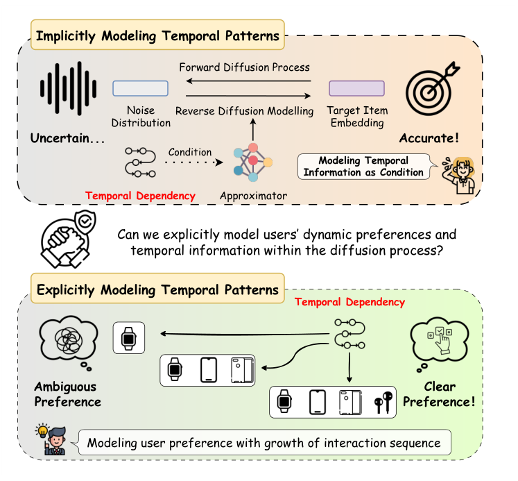
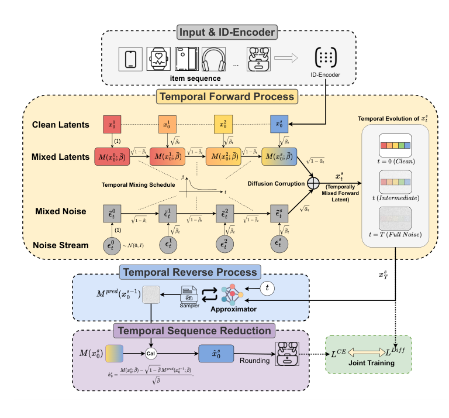
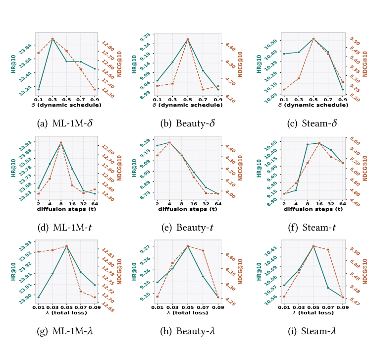

# TDRec：在扩散过程中显式建模用户序列的时间演化

> 论文：Beyond Static Diffusion: Explicitly Modeling Temporal Patterns in Sequential Recommendation，SIGIR 2026。[https://doi.org/10.1145/3805712.3809536](https://doi.org/10.1145/3805712.3809536)
> 代码：https://github.com/wuyaoericyy/TDRec
> 更新记录：2026-10-22 统一笔记顶部信息格式；保留原有阅读与复现记录，论文结果与本地结果分开。

---
# 一、文献阅读

## 1. 研究背景

序列推荐按时间顺序建模用户历史并预测下一物品。已有的扩散式推荐（DiffuRec、DreamRec、InDiRec 等）通常只对**目标物品的嵌入**加噪，把历史序列作为条件输入给去噪器；序列内部的位置顺序与依赖关系始终停留在条件信号里，扩散过程本身对序列结构是不敏感的。原文引言据此认为，这类模型难以在生成过程中体现用户兴趣“从模糊到清晰”的演化。

原文用一个类比说明动机：序列增长时用户偏好从模糊逐渐明确，最终收敛到目标物品；扩散过程则是给精确嵌入逐步加噪再逐步去噪。两者形状相似，于是问题变成——能否把时间演化直接写进扩散动力学，而不只当作条件。



## 2. 研究目的

在每个扩散步内，把当前位置的含噪潜在表示与前一位置的同阶潜在表示按时间步相关的系数混合，使混合后的潜在表示显式携带历史依赖；同时给出闭式解、DDPM-like 反向过程与可重参数化目标，保证训练可以并行、复杂度与标准扩散模型同阶。

## 3. 研究问题

原文第 7 页明确列出三个问题：

1. **RQ1**：TDRec 与当前先进基线相比表现如何？
2. **RQ2**：δ、总扩散步数 $t$、损失权重 λ 等超参数如何影响性能？
3. **RQ3**：框架中各组件分别贡献多少？

## 4. 研究方法

整个框架由四部分组成（图 2）：产生时变混合权重的 Temporal Forward Scheduler、以历史与步数 $t$ 为条件去噪混合潜在表示的 Transformer Approximator、从预测的混合潜在表示中还原目标物品嵌入的 Temporal Sequence Reduction，以及把连续嵌入映射回物品的 rounding。

- **前向**：位置 $s$ 的潜在表示 = 自身加噪嵌入与前一位置同阶潜在表示的加权和，权重由 $\bar\beta_t$ 控制；展开递推可得闭式权重，进而写成下三角矩阵乘法 $\mathbf{M}=\mathbf{W}\mathbf{X}_0$，避免逐位置递推。
- **反向**：去噪器预测混合潜在表示中的噪声；再按式(19)–(21) 的 DDPM-like 形式采样。
- **还原与排序**：由预测的混合干净潜在表示减去历史项、除以当前项系数得到目标嵌入（式(32)），再与原物品嵌入做内积 softmax（式(33)(34)）。
- **训练**：去噪损失与推荐交叉熵按 λ 加权（式(35)）。



## 5. 研究内容（公式与算法分析）

### 5.1 预备：标准 DDPM（式 1–7，第 3 页）

前向为 $q(\mathbf{x}_t\mid\mathbf{x}_{t-1})=\mathcal N(\sqrt{1-\beta_t}\mathbf{x}_{t-1},\beta_t\mathbf{I})$，任意步可直接采样 $q(\mathbf{x}_t\mid\mathbf{x}_0)=\mathcal N(\sqrt{\bar\alpha_t}\mathbf{x}_0,(1-\bar\alpha_t)\mathbf{I})$，其中 $\bar\alpha_t=\prod_{s=1}^{t}\alpha_s$、$\alpha_s=1-\beta_s$。反向后验均值与方差为式(5)(6)，训练用重参数化噪声 MSE（式(7)）。这部分是后续推导的基线，本身没有新内容。

### 5.2 问题定义与总览（§4.1–4.2，第 4 页）

用户 $u$ 的时间序序列 $s_u=(i^0,\dots,i^{S-1})$，$x_0^s\in\mathbb R^d$ 为位置 $s$ 的干净潜在表示，目标是预测位置 $S$ 的物品。与标准扩散的关键差别是：TDRec 在**序列层面**构造潜在表示，每个位置都同时携带自身与历史的成分。

### 5.3 时间前向过程与闭式混合（式 8–17，第 4–5 页）

对 $s\ge 1$，混合前向潜在表示为

$$
x_t^s=\sqrt{\bar\beta_t}\left(\sqrt{\bar\alpha_t}x_0^s+\sqrt{1-\bar\alpha_t}\epsilon_t^s\right)+\sqrt{1-\bar\beta_t}\,x_t^{s-1},\tag{8}
$$

基例 $x_t^0=\sqrt{\bar\alpha_t}x_0^0+\sqrt{1-\bar\alpha_t}\epsilon_t^0$。展开后定义混合干净潜在表示

$$
M(x_0^s;\bar\beta_t)=\sqrt{\bar\beta_t}\,x_0^s+\sqrt{1-\bar\beta_t}\,M(x_0^{s-1};\bar\beta_t),\tag{9}
$$

于是 $x_t^s=\sqrt{\bar\alpha_t}M(x_0^s;\bar\beta_t)+\sqrt{1-\bar\alpha_t}\tilde\epsilon_t^s$，混合噪声

$$
\tilde\epsilon_t^s=\sqrt{\bar\beta_t}\,\epsilon_t^s+\sqrt{1-\bar\beta_t}\,\tilde\epsilon_t^{s-1}\sim\mathcal N(0,\mathbf I).\tag{11}
$$

**定理 1（闭式混合）**：递推可展开为历史嵌入的加权和 $M(x_0^s;\bar\beta)=\sum_{k=0}^{s}w_{s,k}x_0^k$，权重为

$$
w_{s,k}=
\begin{cases}
\sqrt{\bar\beta_k}\prod_{j=k+1}^{s}\sqrt{1-\bar\beta_j}, & 0<k\le s,\\[2pt]
\prod_{j=1}^{s}\sqrt{1-\bar\beta_j}, & k=0.
\end{cases}\tag{16}
$$

由于 $\bar\beta$ 是固定超参数，$\mathbf W\in\mathbb R^{L\times L}$ 可预计算为下三角常数矩阵，训练时 $\mathbf M=\mathbf W\mathbf X_0$ 一次矩阵乘法并行完成（式(17)）。**理解：**这一步是把 $O(L)$ 的逐位置递推换成一次矩阵乘法，收益在并行度，不在渐近阶（见 5.7）。

**记号冲突：**式(12)(16) 中 $\bar\beta$ 的下标是**序列位置**（$\bar\beta_s,\bar\beta_k,\bar\beta_j$），而式(8) 与式(18) 把它定义为**扩散步** $t$ 的函数。同一个符号在“位置”和“时间步”两种含义下混用，原文没有说明二者如何统一；若按式(18) 的时变值代入式(16)，权重还会随 $t$ 变化，矩阵 $\mathbf W$ 就不再是与步数无关的常数。

### 5.4 时间前向调度器（式 18，第 5 页）

为使 $t$ 越大越依赖历史，要求 $\bar\beta_t$ 关于 $t$ 非增，取

$$
\bar\beta_t=\delta\bar\alpha_t+(1-\delta),\qquad \delta\in[0,1].\tag{18}
$$

因为 $\bar\alpha_t$ 非增，式(18) 自动满足非增要求；$\delta=0$ 时 $\bar\beta_t\equiv1$（不做混合），$\delta=1$ 时退化为标准 DDPM 的 $\bar\alpha_t$。原文只在 §5.5 给出扫描，没有给出各数据集最终采用的 $\delta$。

### 5.5 时间反向过程与存在性（式 19–31，第 5–6 页）

在“已知历史、预测位置 $s$”的设定下，原文给出边际分布

$$
q(x_t^s\mid x_0^{0:s-1})=\mathcal N\!\left(\sqrt{\bar\alpha_t}\,M(x_0^{s-1};\bar\beta_t),\,(1-\bar\alpha_t)\mathbf I\right),\tag{19}
$$

并据此写出 DDPM-like 的噪声 MSE（式(20)）与采样分布（式(21)）。§4.4.2 仿照 DDPM 的证明，构造式(22)–(24) 的马尔可夫前向与式(25) 的边际，再对 $t$ 归纳得到式(28)(29)，并用贝叶斯式(30)(31) 说明反向后验仍是高斯。证明骨架与 DDPM 一致。

**需要注意的两点：**

1. 式(10) 在给定 $x_0^s$ 时的均值是 $M(x_0^s)$，而式(19) 在只给定历史时的均值换成了 $M(x_0^{s-1})$，方差仍写 $(1-\bar\alpha_t)\mathbf I$。这等于把当前目标位置的贡献 $\sqrt{\bar\beta_t}x_0^s$ 吸收进了噪声项，隐含对目标嵌入分布的额外假设（例如近似零均值、单位尺度）；原文没有说明这一点，也没有讨论该近似的误差。
2. §4.4.2 在式(23) 附近写到 “$\bar\beta_t=\prod_{i=1}^{t}\beta_i$”，与式(18) 的 $\bar\beta_t=\delta\bar\alpha_t+(1-\delta)$ 直接冲突。前者是累计乘积，后者是插值后的混合系数，两者不可能同时成立。阅读推导时应以式(18) 为准，否则方差项的化简不成立。

### 5.6 时间序列还原（式 32，第 6 页）

由预测的混合干净潜在表示 $\hat M(x_0^s;\bar\beta_t)$ 与已知历史算出的 $M(x_0^{s-1};\bar\beta_t)$，代数解出

$$
\hat x_0^s=\frac{\hat M(x_0^s;\bar\beta_t)-\sqrt{1-\bar\beta_t}\,M(x_0^{s-1};\bar\beta_t)}{\sqrt{\bar\beta_t}}.\tag{32}
$$

这是 TDRec 与 DiffuRec 类方法在“预测对象”上的关键差别：去噪器输出的是混合潜在表示，必须减去历史成分才得到用于排序的目标嵌入。式(32) 对 $\bar\beta_t$ 敏感，$\bar\beta_t\to0$ 时除以 $\sqrt{\bar\beta_t}$ 会放大误差，原文未讨论数值稳定性。

### 5.7 损失、取整与复杂度（式 33–36，§4.7，第 6–7 页）

推荐概率用还原后的目标嵌入与原物品嵌入的内积 softmax（式(33)），交叉熵为式(34)，联合目标为

$$
\mathcal L_{\text{total}}=\lambda\,\mathcal L_{\text{diff}}+(1-\lambda)\,\mathcal L_{CE},\qquad \lambda\in[0,1].\tag{35}
$$

推理时从学习到的反向过程采样得到混合潜在表示，经式(32) 还原后做 rounding：$\arg\max_{i\in I}(\hat x_0^s\cdot e_i)$（式(36)）。

复杂度方面，§4.3.1 与摘要强调“相对序列长度 $O(1)$”，而 §4.7 明确给出训练复杂度 $O(L^2d)$（矩阵乘法 $\mathbf W\mathbf X_0$ 与 Transformer 都是 $L^2d$），推理 $O(T\cdot L^2d)$。两种表述并不矛盾：$O(1)$ 指消除了逐位置的顺序递推，使每个位置的混合向量可并行计算；整个模型的时间复杂度仍与 Transformer 同阶。摘要把“$O(1)$ complexity relative to sequence length”与“asymptotic training complexity”并列，容易被读成降低了总复杂度。

## 6. 所作实验与环境、数据集、参数配置

| 项目 | 原文设置或披露情况 |
| --- | --- |
| 数据 | Amazon Beauty、MovieLens-1M、Steam，共三个 |
| 预处理 | 隐式反馈；按时间排序；过滤交互少于 5 次的用户与物品；leave-one-out（最后一项测试、倒数第二项验证） |
| 最大长度 | ML-1M 为 200；Beauty、Steam 为 50（§5.1） |
| 评价 | 全物品排序；HR@5/10/20、NDCG@5/10/20；5 个随机种子平均；验证集最高 HR@10 选配置 |
| 基线 | 传统：FPMC、GRU4Rec、SASRec；VAE：SVAE、ACVAE；扩散：DiffRec、DreamRec、CaDiRec、DiffuRec、InDiRec |
| 优化 | Adam，初始学习率 0.001；batch size 1024 |
| 结构 | 嵌入与隐藏维 128；Transformer 4 层；去噪器 Xavier 初始化；dropout 0.1、物品嵌入 dropout 0.3 |
| 噪声日程 | truncated linear |
| λ | 正文称“在高斯分布（均值 0.001、方差 0.001）给出的范围内选取”，后文又称最优约 0.05，图 3 扫描 0.01–0.09 |
| δ 与 T | 只给扫描图，未给各数据集最终取值 |
| 显著性 | 配对 t 检验，$p<0.05$ |
| 硬件 | 未披露；致谢提到香港理工大学 CLAIM 的计算资源 |
| 未充分披露 | 训练轮数、早停策略、学习率调度、运行时间、标准差、各模块实现细节、代码版本 |

**参数描述的疑点：**“均值 0.001、方差 0.001 的正态分布范围”会包含负值，而 λ 是 $[0,1]$ 内的权重；这句话无法直接作为可复现的搜索空间。图 3 实际扫描的是 0.01–0.09，应以图为准。

## 7. 完整实验结果表格

### 表 1：三个数据集的统计（第 7 页）

| 数据集 | #Users | #Items | #Inter. | Avg.u | Sparsity |
| --- | ---: | ---: | ---: | ---: | ---: |
| ML-1M | 6,040 | 3,416 | 999,611 | 165.50 | 95.16% |
| Beauty | 22,363 | 12,101 | 198,502 | 8.53 | 99.93% |
| Steam | 281,428 | 13,044 | 3,485,022 | 12.40 | 99.90% |

§5.1 正文称 ML-1M 为“6,000 用户、4,000 电影、100 万评分”，与表 1 的精确值不一致，属于正文取整；以表 1 为准。

### 表 2：主实验（第 9 页）

表中数值为百分比，原文按 5 次运行平均；`%Improve` 为相对该指标最强基线的提升。原表中 TDRec 的每个数值都带显著性星号（配对 t 检验 $p<0.05$），这里统一说明，单元格不再逐项标注。

#### ML-1M

| 指标 | FPMC | GRU4Rec | SASRec | SVAE | ACVAE | DiffRec | DreamRec | CaDiRec | DiffuRec | InDiRec | TDRec | 提升 |
| --- | ---: | ---: | ---: | ---: | ---: | ---: | ---: | ---: | ---: | ---: | ---: | ---: |
| H@5 | 4.325 | 5.1140 | 9.3791 | 1.4865 | 12.7178 | 12.0179 | 13.0328 | 14.5665 | 14.8601 | 15.0455 | **15.5752** | 3.52% |
| H@10 | 8.954 | 10.1660 | 16.8895 | 2.7192 | 19.9322 | 18.3967 | 18.5088 | 19.8088 | 21.2354 | 22.9654 | **23.9276** | 4.19% |
| H@20 | 15.0406 | 18.6998 | 28.325 | 5.0328 | 28.9730 | 30.8756 | 30.8657 | 32.8122 | 33.0124 | 34.6127 | **35.1071** | 1.43% |
| N@5 | 2.8133 | 3.0532 | 5.3160 | 0.9566 | 8.2291 | 9.6742 | 9.6982 | 9.9125 | 9.9342 | 9.7202 | **10.2644** | 3.32% |
| N@10 | 3.5738 | 4.6759 | 7.7288 | 1.2356 | 10.5423 | 11.2401 | 11.2598 | 11.2876 | 11.5078 | 12.3368 | **12.8382** | 4.06% |
| N@20 | 5.9066 | 6.8248 | 10.6012 | 1.8288 | 12.8217 | 14.6704 | 14.8237 | 14.9378 | 15.1026 | 15.2343 | **15.7580** | 3.44% |

#### Beauty

| 指标 | FPMC | GRU4Rec | SASRec | SVAE | ACVAE | DiffRec | DreamRec | CaDiRec | DiffuRec | InDiRec | TDRec | 提升 |
| --- | ---: | ---: | ---: | ---: | ---: | ---: | ---: | ---: | ---: | ---: | ---: | ---: |
| H@5 | 2.0133 | 3.0116 | 5.2691 | 0.9950 | 4.4681 | 5.3679 | 5.3456 | 5.3862 | 5.4396 | 5.5167 | **5.9302** | 7.50% |
| H@10 | 1.8436 | 1.9365 | 8.1645 | 1.9748 | 3.8835 | 8.2904 | 8.1743 | 8.3545 | 8.3912 | 8.5132 | **9.2652** | 8.83% |
| H@20 | 3.7669 | 5.8641 | 10.8766 | 5.1561 | 8.1128 | 10.8012 | 10.8796 | 10.8902 | 10.9358 | 11.8629 | **12.5668** | 5.93% |
| N@5 | 0.5133 | 0.6090 | 2.3995 | 0.6711 | 1.6868 | 2.9801 | 2.9646 | 3.7810 | 3.9196 | 3.3262 | **4.2124** | 7.47% |
| N@10 | 0.8231 | 0.9035 | 3.3155 | 0.9878 | 2.1405 | 3.8376 | 3.8309 | 3.8321 | 3.8827 | 4.2329 | **4.4256** | 4.55% |
| N@20 | 1.2289 | 1.3795 | 3.6559 | 1.2865 | 2.7031 | 5.4721 | 5.4825 | 5.4516 | 5.4742 | 5.5848 | **5.8110** | 4.05% |

#### Steam

| 指标 | FPMC | GRU4Rec | SASRec | SVAE | ACVAE | DiffRec | DreamRec | CaDiRec | DiffuRec | InDiRec | TDRec | 提升 |
| --- | ---: | ---: | ---: | ---: | ---: | ---: | ---: | ---: | ---: | ---: | ---: | ---: |
| H@5 | 2.6251 | 3.0124 | 4.7418 | 3.2388 | 5.5831 | 6.1937 | 6.1892 | 6.2125 | 6.2189 | 6.2871 | **6.5035** | 3.44% |
| H@10 | 3.9228 | 5.4355 | 8.3759 | 5.8281 | 9.2788 | 9.9954 | 9.9876 | 10.0091 | 10.1079 | 10.3339 | **10.6094** | 2.67% |
| H@20 | 7.8356 | 9.2291 | 13.6178 | 7.8002 | 14.4852 | 15.6425 | 15.6399 | 15.9483 | 16.0582 | 16.1707 | **16.6592** | 3.02% |
| N@5 | 1.6137 | 1.8342 | 2.8895 | 1.8832 | 3.5428 | 3.8096 | 3.8988 | 3.9456 | 3.9874 | 3.9627 | **4.2328** | 6.15% |
| N@10 | 2.4122 | 2.6122 | 4.4088 | 2.6883 | 4.7288 | 4.9194 | 5.1147 | 5.0219 | 5.1298 | 5.2625 | **5.4958** | 4.43% |
| N@20 | 3.2149 | 3.5454 | 5.3677 | 2.3233 | 6.0378 | 6.0865 | 6.2493 | 6.3081 | 6.4624 | 6.7296 | **6.9225** | 2.87% |

### 表 3：消融（第 9 页）

原文变体：去掉序列还原（w/o DSR）、去掉前向调度（w/o DSFS）、去掉全部时间扩散（w/o TD）、只保留 CE（w/o Diff loss）、只保留扩散损失（w/o CE loss）。

| 变体 | ML-1M H@10 | ML-1M N@10 | Beauty H@10 | Beauty N@10 | Steam H@10 | Steam N@10 |
| --- | ---: | ---: | ---: | ---: | ---: | ---: |
| w/o DSR | 20.9678 | 10.5385 | 7.6497 | 3.6612 | 9.5293 | 4.5514 |
| w/o DSFS | 22.7328 | 12.0088 | 8.6187 | 3.9963 | 9.8516 | 5.2737 |
| w/o TD | 22.9516 | 12.2336 | 8.7184 | 4.0976 | 10.1209 | 5.3557 |
| w/o Diff loss | 23.8856 | 12.7576 | 9.1204 | 4.2967 | 10.5755 | 5.4188 |
| w/o CE loss | 20.8975 | 11.1398 | 6.8213 | 2.9186 | 8.3614 | 3.9203 |
| TDRec（完整） | 23.9276 | 12.8382 | 9.2652 | 4.4256 | 10.6094 | 5.4958 |

### 图 3：参数敏感性（第 8 页）



九个面板分别扫描 δ（0.1–0.9）、扩散步数（2–64）与 λ（0.01–0.09）。正文结论是：δ 在 0.5 附近最好，太大偏向近期物品、丢失历史；步数取中等值最好，太少表达不足、太多收益递减；λ 取较小值（约 0.05），让 CE 主导、扩散损失做辅助正则。图中没有给出逐点数值表，本文不把图形读数写成精确实验值。

## 8. 结果分析

主表 18 个指标（3 数据集 × 6 指标）中 TDRec 全部最优，`%Improve` 范围为 1.43%–8.83%。相对基线 InDiRec 的优势在 H@10 上最明显（ML-1M 22.9654 → 23.9276，+4.19%；Beauty 8.5132 → 9.2652，+8.83%），H@20 的提升最小（ML-1M +1.43%），说明方法主要改善头部排序而非长列表召回。

消融的排序值得单独看：

- **去掉 CE 损失的跌幅最大**（ML-1M H@10 −3.03、Beauty −2.44、Steam −2.25），支持“推荐目标是主要驱动”的说法。
- **去掉序列还原（DSR）在 ML-1M 上几乎与去掉 CE 相当**（23.9276 → 20.9678，−2.96），在 Beauty/Steam 上则小于 CE。也就是说“CE 主导”在三个数据集上并不完全一致，ML-1M 上还原模块同样关键。
- **去掉扩散损失只下降 0.03–0.15 个点**（ML-1M −0.042、Beauty −0.145、Steam −0.034），与 λ 取很小的设计一致。这既是论文的解释（辅助正则），也意味着扩散分支的独立贡献在报告的数字里很弱。
- 去掉调度（DSFS）与去掉全部时间扩散（TD）的跌幅接近（ML-1M −1.19 与 −0.98），说明“混合调度”和“序列级混合”两者的作用有重叠，不能把两项消融下降相加。

**原文一致性核查：**

1. **表 2 的 Beauty 面板破坏 HR 的单调性**：FPMC 的 H@10 = 1.8436 小于其 H@5 = 2.0133；ACVAE 的 H@10 = 3.8835 小于 H@5 = 4.4681。同一模型在更大的 K 上命中率不应下降，这两处只能是录入或对齐问题。本文照录原表，不擅自修正，也不把这些数值用于横向比较。
2. **λ 的搜索范围前后不一致**：§5.3 说从“均值 0.001、方差 0.001 的高斯分布范围”选取，§5.5 与图 3 则是 0.01–0.09、最优约 0.05。前者不可复现。
3. **图 3 的纵轴跨度很小**：ML-1M 的 λ 面板 HR@10 范围约 23.90–23.93（0.03 个点），而表 2 同一指标为 23.9276。曲线差异接近 5 次运行的波动，正文“λ≈0.05 最优”的结论应结合标准差看；原文没有报告方差。
4. **显著性检验的样本量**：5 个种子做配对 t 检验，$n=5$，原文没有给出标准差或效应量，$p<0.05$ 的结论对单个指标较敏感。
5. **缩写不统一**：§4.5 为 Temporal Sequence Reduction（TSR），表 3 的消融行写成 “w/o DSR”，首次出现处还写作 “(DSR)”；下文按论文原写法保留，但应理解为同一模块。

与已有笔记的联系：DiffuRec 与 InDiRec 都只把序列作为条件，TDRec 把序列混合写进前向链；ADARec 用扩散过程做数据增强、M³BSR 用条件扩散净化多模态特征、InfoDCL 用扩散噪声构造对比视图，它们改造的是“扩散用来做什么”，TDRec 改造的是“扩散在什么表示上做”。四者对照可以看出扩散式推荐目前的两条改造路线：换预测目标/用途，还是换扩散动力学本身。

# 二、代码复现

## 1. 环境配置与运行

本地工作副本位于 [experiment/ELSE/TDRec（运行时间太长）](<../../experiment/ELSE/TDRec（运行时间太长）/>)，目录名是复现后改的，表示训练耗时过长。结构为 `src/{main,trainer,model,tdrec,step_sample,utils}.py`、`script/run_{beauty,ml-1m,steam}.sh` 与 `datasets/<dataset>/dataset.pkl`。`requirements.txt` 只声明 `numpy` 与 `torch`，没有锁定版本。

数据文件需包含 `train`、`val`、`test`、`smap` 四个键，物品编号 0 保留给补齐；仓库不含原始数据清洗脚本。

```bash
cd "experiment/ELSE/TDRec（运行时间太长）/src"
python main.py --dataset ml-1m --batch_size 1024 --diffusion_steps 8 \
    --eta 0.3 --total_loss_lambda 0.005 --delta 0.5 --epochs 500
```

本地环境：`__pycache__` 显示为 CPython 3.12，训练日志中的 `device` 为 `cuda`；日志只记录 `args`，**没有记录 Python、PyTorch、CUDA 与 GPU 型号**，因此不能凭日志复述精确版本。笔记中的源码核对基于静态阅读；另外用合成小数据在 CPU 上验证过“训练→评估→保存检查点→只评估”的流程，该验证不属于论文复现。

### 1.1 两次本地运行

| 时间 | 代码状态 | 结果 |
| --- | --- | --- |
| 2026-10-20 11:40 → 10-21 12:20 | 原始代码（无检查点、每 20 轮评估） | 完成 406 个 epoch（下标 0–405），在第 407 个 epoch 中途被手动终止；**没有保存任何权重**，因此没有测试集结果 |
| 2026-10-21 16:45 → 16:47 | 改为每轮评估 + 检查点 + 只评估后 | 启动约 2 分钟后在 epoch 0 内部被终止，日志仅 1.6 KB，没有指标 |

单轮耗时约 3.6 分钟（960 个 batch），按 500 轮估算约 30 小时；这是目录被改名为“运行时间太长”的直接原因，也是本次未完成复现的主要障碍。

### 1.2 改动后的训练与评估入口

2026-10-21 的改动只涉及训练循环外围，没有改模型和损失：

| 参数 | 默认值 | 作用 |
| --- | --- | --- |
| `--eval_interval` | 1 | 每轮评估（原为 20，且首轮不评估） |
| `--select_metric` | `HR@10` | 保存最佳模型与早停依据；`any` 复现旧的“任一指标刷新即保存” |
| `--min_delta` | 0.0 | 判定提升所需的最小百分点增益 |
| `--patience` | 5 | 连续多少次**评估**无提升即早停（原实现按 epoch 语义使用，实际以评估次数计数） |
| `--ckpt_dir` / `--ckpt_path` | `checkpoints` / 空 | 检查点根目录与只评估时加载的文件 |
| `--only_eval` | `False` | 只评估：跳过训练，从检查点恢复结构参数，评估验证/测试集 |
| `--log_path` | 空 | 指定日志；只评估默认追加到该检查点记录的训练日志 |

检查点写入 `checkpoints/<dataset>/best_model.pth` 与 `last_model.pth`，payload 含 `model_state`、`args`、`epoch`、验证指标、训练日志路径与保存时间；训练结束后回读 `best_model.pth` 再做测试。

## 2. 源代码分析：公式或模块对应的代码

| 论文内容                   | 源码位置                                                                                         | 实现要点                                                                                                                                                                           |
| ---------------------- | -------------------------------------------------------------------------------------------- | ------------------------------------------------------------------------------------------------------------------------------------------------------------------------------ |
| 式(8)(9)(10)(11) 时间前向混合 | [`tdrec.py:400`](<../../experiment/ELSE/TDRec（运行时间太长）/src/tdrec.py#L400>) `dynamic_q_sample` | 先把 `dy_t` 与其沿位置的累积乘积相乘再翻转，得到历史系数 $h_j=\text{mask}_j\cdot\log(1+d^{L-j+1})$，混合信号为 $\sum_j h_j\cdot\text{history}_j+d_t\cdot\text{target}$，混合噪声用同一组系数；不是式(16) 的平方根递推权重，也没有平方和归一化 |
| 式(16)(17) 闭式混合矩阵       | 无对应实现                                                                                        | 只计算目标位置的混合向量，不构造 $L\times L$ 下三角矩阵，训练仍是逐 batch 计算                                                                                                                              |
| 式(18) 调度               | [`tdrec.py:355`](<../../experiment/ELSE/TDRec（运行时间太长）/src/tdrec.py#L355>) `TDRec.__init__`   | $d_t=1-\delta+2\delta\,t/(T-1)$，$t$ 从 0 起；$\delta=0.5$ 时从 0.5 升到 1.5，与式(18) 的 $\delta\bar\alpha_t+(1-\delta)$ 方向与量纲都不同                                                         |
| 式(20) 噪声 MSE           | [`model.py:113`](<../../experiment/ELSE/TDRec（运行时间太长）/src/model.py#L113>) `loss_rmse_dy`     | $\sqrt{\text{MSE}(\text{真实目标嵌入},\text{预测目标嵌入})}$，在整个 batch 与维度上取均值后开方；不是噪声估计误差                                                                                                 |
| 式(32) 序列还原             | [`tdrec.py:542`](<../../experiment/ELSE/TDRec（运行时间太长）/src/tdrec.py#L542>) `dynamic_p_sample` | 计算了 `dy_x_s_1` 并传入 `dynamic_p_mean_variance`，但后者未使用该参数；训练与推理都没有显式减法还原                                                                                                          |
| 式(33)(34) CE           | [`model.py:67`](<../../experiment/ELSE/TDRec（运行时间太长）/src/model.py#L67>) `loss_diffu_ce`      | Steam 用原始内积；其余数据集对预测与物品嵌入做 L2 归一化并除温度 0.07                                                                                                                                     |
| 式(35) 联合损失             | [`trainer.py`](<../../experiment/ELSE/TDRec（运行时间太长）/src/trainer.py>) `model_train`           | $(1-\lambda)\cdot$CE$+\lambda\cdot$RMSE，$\lambda$ 为 `total_loss_lambda`；`loss_lambda` 未参与                                                                                      |
| 式(36) 取整与排序            | [`model.py:92`](<../../experiment/ELSE/TDRec（运行时间太长）/src/model.py#L92>) `diffu_rep_pre`      | 全物品余弦相似度；未屏蔽 0 号 padding，也未屏蔽历史物品                                                                                                                                              |
| 反向采样                   | [`tdrec.py:588`](<../../experiment/ELSE/TDRec（运行时间太长）/src/tdrec.py#L588>) `reverse_p_sample` | 从 `randn` 的 $[B,D]$ 开始，按 $T-1,\dots,0$ 逐步采样，每步重新运行 Transformer 并加噪（$t=0$ 除外）                                                                                                   |
| 数据与指标                  | `utils.py`、`trainer.py`                                                                      | 训练前缀逐条展开、leave-one-out 验证/测试、HR/NDCG 乘 100 输出、batch 指标算术平均                                                                                                                     |

**结论**：代码具备”**历史混合加噪 + Transformer 去噪 + 迭代反向采样**“的骨架，但式(16)(17) 的闭式权重、式(20) 的噪声目标、式(32) 的序列还原三项都没有按论文实现；训练实际是在预测目标物品嵌入并对其做 RMSE。因此它不是论文方法的逐式实现。

## 3. bug 检查及修复

已修复（2026-10-21，仅训练循环）：

- 指标只在“有提升”时打印，平台期日志只剩 `start predicting`，无法判断早停；改为每轮无条件记录。
- 早停按“6 项指标任一刷新”清零；该次运行的 20 次评估里 `bad_count` 最大只累计到 3，`patience=5` 永不触发。改为单一选择指标 + `min_delta`。
- 最佳模型只存在内存、进程结束即丢失；改为原子写入 `best_model.pth`，并在测试前回读。
- 没有独立评估入口；新增 `--only_eval`。
- `eval_interval` 默认 20 且跳过首轮；改为 1 并评估每一轮。

未修复（记录为已知边界，不等于论文方法错误）：

- `LSHT_inference` 只解包 6 项，而 `TDRecModel.forward` 返回 8 项，开启 `--long_head` 会报错。
- `diversity_measure` 分支把列表自身追加为元素，形成循环引用。
- 除 `--only_eval` 外的布尔参数没有显式解析，命令行传 `False` 会被当作非空字符串（真值）。
- EMA 只更新参数、不更新 buffer；`Embedding` 未设 `padding_idx=0`，0 号补齐槽位可训练并参与排序。
- 注意力只有 padding mask、没有因果 mask；输入 token 都来自已观测历史，因此不等同标签泄漏。
- 指标按 batch 算术平均，末批较小时权重被放大。

## 4. 代码修改及优化

本次改动的目标是“让训练过程可观测、可停止、可复评”，不触碰模型：

1. 抽出 `evaluate_model`，训练与只评估共用同一套指标计算。
2. 每轮评估并记录本轮实测值、是否提升、`bad_count` 进度。
3. 按 `HR@10` 保存 `best_model.pth`，每轮覆盖 `last_model.pth`，写入 `args` 与日志路径。
4. 训练结束回读最佳权重再测；从未保存时回退内存模型并告警。
5. `--only_eval` 从检查点恢复结构参数，默认把结果追加到对应训练日志。
6. `--min_delta` 抑制噪声级提升。

后续若要真正复现论文，建议优先补三件事：按式(16) 预计算下三角混合矩阵并作用于全序列；把训练目标换成噪声 $\epsilon$；实现式(32) 的减法还原并在推理链上执行。此外需把 ML-1M 的 `max_len` 改为 200、每个数据集跑 5 个种子，并记录标准差。

## 5. 实验结果复现

| 实验 | 当前状态 |
| --- | --- |
| 表 2 三数据集主实验 | 未完成（无测试集结果，无检查点） |
| 表 3 消融 | 未开展（代码也没有 DSR/DSFS 开关） |
| 图 3 参数扫描 | 未开展 |
| 5 种子平均与显著性 | 未开展（现有配置单种子 1996） |

唯一可记录的是第一次运行的**验证集**曲线。旧代码只在指标刷新时打印，而且 140、220、260、280、300、380、400 轮的六项指标都没有刷新，所以下表是“历史最佳”而非该轮实测值；原日志文件已不在工作区（只剩第二次运行的 1.6 KB 日志），数值按当时读取记录整理，不能再次核对。

| 轮次 | HR@5 | NDCG@5 | HR@10 | NDCG@10 | HR@20 | NDCG@20 |
| ---: | ---: | ---: | ---: | ---: | ---: | ---: |
| 20 | 10.6004 | 6.4750 | 17.5249 | 8.6969 | 26.4879 | 10.9474 |
| 40 | 13.5018 | 8.5433 | 22.5968 | 11.4584 | 34.4111 | 14.4375 |
| 60 | 14.9147 | 9.1932 | 24.1706 | 12.1729 | 35.9017 | 15.1354 |
| 80 | 15.1318 | 9.4523 | 24.9270 | 12.6016 | 36.9384 | 15.6219 |
| 100 | 15.4069 | 9.5853 | 25.2672 | 12.7490 | 37.3091 | 15.7783 |
| 160 | 15.5497 | 9.7135 | 25.2672 | 12.7883 | 37.3091 | 15.7828 |
| 200 | 15.9225 | 9.9684 | 25.2998 | 12.9898 | 37.3091 | 16.0050 |
| 240 | 15.9225 | 9.9684 | 25.3651 | 12.9898 | 37.3091 | 16.0050 |
| 320 | 15.9225 | 9.9684 | 25.4775 | 12.9898 | 37.3091 | 16.0050 |
| 360 | 16.0023 | 9.9684 | 25.5697 | 13.0024 | 37.3201 | 16.0050 |

这份曲线的形状比数值更有信息量：第 100 轮后 HR@10 只从 25.27 升到 25.57，HR@20 长期停在 37.31，而训练损失在 5.2 附近波动；模型在 150 轮左右就进入平台期，之后的有效变化接近噪声。评估本身带随机性（反向过程从随机高斯初态开始），同一权重多次评估也不会完全相同，这也是旧代码“任一指标刷新即重置耐心”永远停不下来的原因。

## 6. 结果对比及分析

本地没有测试集结果，不能与表 2 做数值对比。即便补跑，也需先处理以下可比性问题：

1. **协议**：论文 ML-1M 用 `max_len=200`，本地脚本全部用 50；论文每数据集 5 个种子，本地只有单种子。
2. **评估模型**：非 Steam 数据集用 decay=0.999 的 EMA 影子模型评估，论文未提 EMA。
3. **训练目标**：本地是目标嵌入 RMSE，论文是噪声 MSE；`total_loss_lambda` 的 0.005/0.05 不能直接对应论文的 λ。
4. **还原缺失**：式(32) 未实现，打分直接用去噪器输出，等价于“没有序列还原”的变体。
5. **数据版本**：本地 ML-1M 为 3,706 个物品 / 1,000,209 次交互，论文表 1 为 3,416 / 999,611；Beauty 一致，Steam 多 3,863 次交互。
6. **耗时**：单轮约 3.6 分钟，5 个数据集种子组合的完整主实验代价过高，需要先缩短序列长度或减少轮数，但这又会改变协议。

因此现阶段只能给出定性判断：代码能跑通训练与评估、验证指标在 40 轮内快速上升，说明数据管线和模型骨架可用；但由于缺少式(16)(17)(32) 与噪声目标，它测的不是论文的 TDRec。把这三处补齐后再谈“是否复现论文数值”才有意义。

## 7. 备注

- 本地目录名“（运行时间太长）”属于复现记录，不是论文内容；引用代码位置时保留了该名称。
- 论文原文中的 $\bar\beta_t$ 同时表示混合系数与累计乘积、$O(1)$ 与 $O(L^2d)$ 的表述并存，这些是**原文**的记号与措辞问题，与本地代码无关。
- 本文的论文数值全部照录 PDF，未做单位换算；本地指标日志为百分数，与论文口径一致（除以 100 后可与其他笔记的 0–1 表格比较）。
