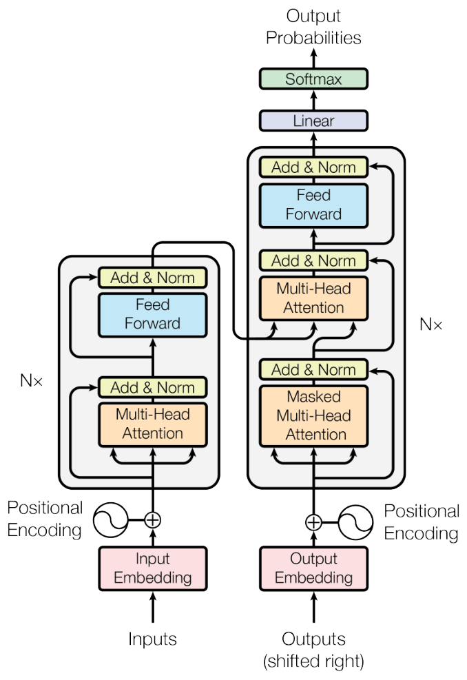
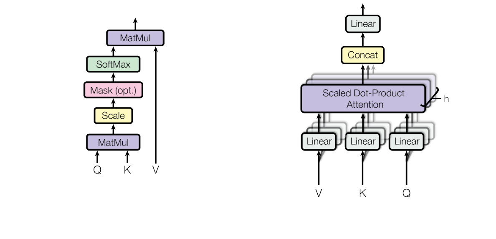
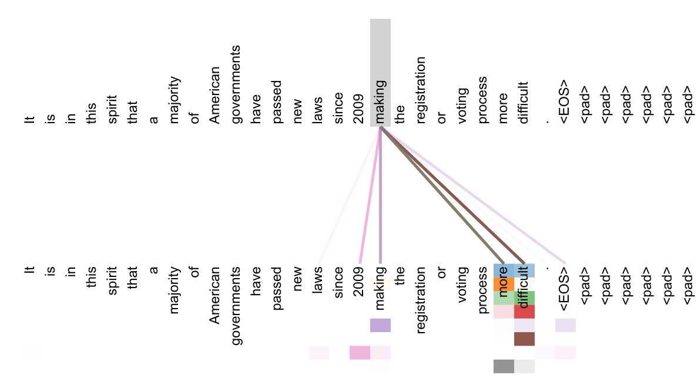
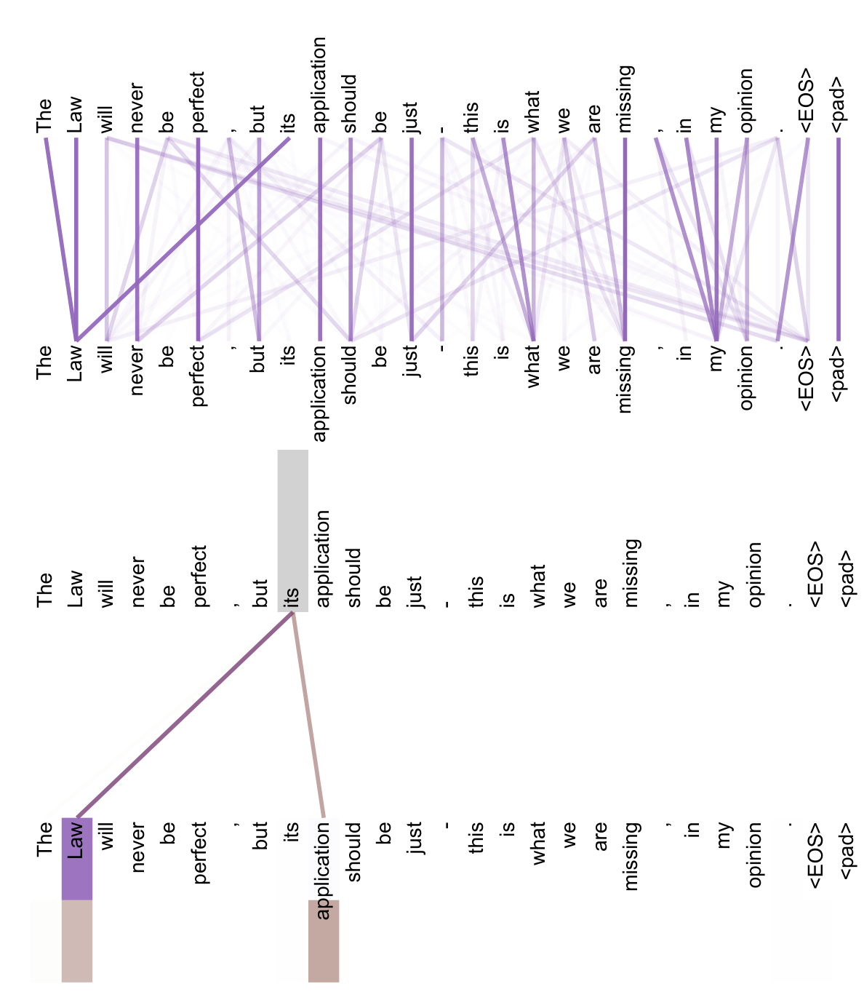
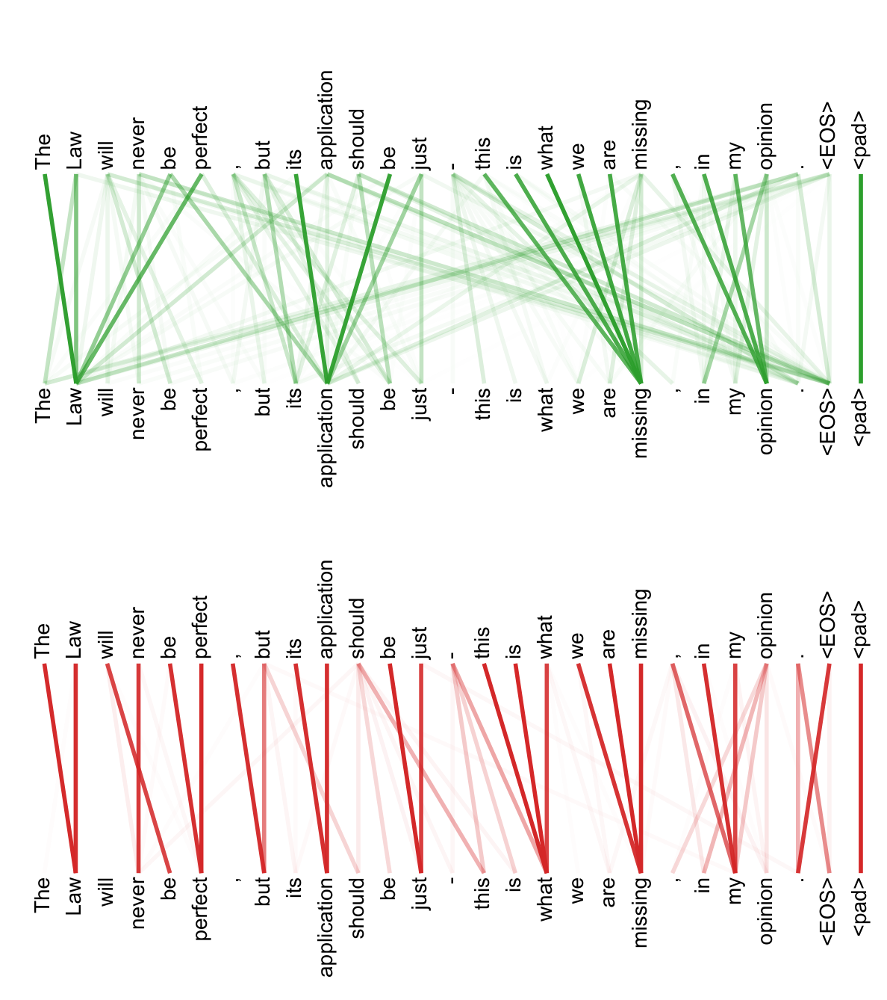

# Transformer：基于自注意力建模序列并对比四种编码解码架构

> 论文：Attention Is All You Need，NeurIPS 2017 / arXiv。[https://doi.org/10.48550/arXiv.1706.03762](https://doi.org/10.48550/arXiv.1706.03762)
> 代码：无
> 更新记录：2026-10-22 统一笔记顶部信息格式；保留原有阅读与复现记录，论文结果与本地结果分开。

---
# 一、实验全景（论文原版）

## 模型架构与注意力计算



**图 1：Transformer 编码器与解码器架构**（英文原文 PDF 第 3 页）。 左侧为编码器堆叠，右侧为含掩码自注意力及编码器—解码器注意力的解码器堆叠；残差连接后执行 Add & Norm。



**图 2：缩放点积注意力与多头注意力**（英文原文 PDF 第 4 页）。 左侧按 Q、K、V 计算缩放点积注意力；右侧并行计算多个注意力头，拼接后进行线性映射。

## 实验 1：WMT 2014 EN-DE 机器翻译 —— 主结果

| 项目 | 论文设置 |
|---|---|
| 数据 | WMT14 EN-DE，4.5M 句对 |
| 分词 | BPE，共享源目标词表，37000 tokens |
| batching | 每组 batch ≈ 25000 src + 25000 tgt tokens |
| 硬件 | 8×P100 |
| base 训练 | 100k 步 / 12 小时，每步 0.4s |
| big 训练 | 300k 步 / 3.5 天，每步 1.0s |
| 优化器 | Adam β=(0.9, 0.98), ε=1e-9 |
| LR | `d_model^-0.5 · min(step^-0.5, step·warmup^-1.5)`，warmup=4000 |
| 正则 | dropout=0.1 (base) / 0.3 (big)，label smoothing=0.1 |
| 推理 | beam search, beam=4，length penalty α=0.6 |
| checkpoint | 最后 5 个 checkpoint 平均 |
| 集成 | base 平均 3 个；big 平均 8 个 |
| 结果 | base: 27.3 BLEU／big: 28.4 BLEU |

## 实验 2：WMT 2014 EN-FR 机器翻译

| 项目 | 论文设置 |
|---|---|
| 数据 | WMT14 EN-FR，36M 句对 |
| 分词 | WordPiece，32000 词表 |
| dropout | 0.1 |
| 结果 | base: 38.1 BLEU；big: 41.8 BLEU |

## 实验 3：模型变体（Table 3）

| 变体 | 变化项 | 取值 |
|---|---|---|
| (A) | attention head 数 | h=1, 4, 16, 32 |
| (B) | key 维度 d_k | 16, 32 |
| (C) | 模型规模 | base(256/1024), (1024/4096), big |
| (D) | dropout | 0.0, 0.2, 0.3 |
| (E) | 位置编码 | sinusoidal vs learned |

**关键结论**：h=1 掉 ~0.9 BLEU；d_k 太小明显变差；dropout 0.1 最好；sinusoidal ≈ learned。

## 实验 4：英语成分句法分析（Table 4）

| 项目 | 论文设置 |
|---|---|
| 任务 | English Constituency Parsing (WSJ) |
| 数据 | WSJ 40K 训练句；半监督 17M 句 |
| 模型 | 4 层 Transformer，d_model=1024 |
| 结果 | WSJ only: 91.3 F1；半监督: 92.7 F1 |

## 实验 5：Attention 可视化



**图 3：编码器自注意力捕捉长距离依赖**（英文原文 PDF 第 13 页）。 编码器第 5 层（共 6 层）的示例：不同注意力头将 making 与远处的 more difficult 等词关联。



**图 4：编码器注意力头中的指代关系**（英文原文 PDF 第 14 页）。 编码器第 5 层的两个注意力头展示与指代消解有关的模式，例如 its 与 Law 的关联。



**图 5：编码器注意力头中的句子结构**（英文原文 PDF 第 15 页）。 仍为编码器第 5 层的两个注意力头；不同颜色对应不同头，展示与句子结构相关的连接模式。

- 图 3：编码器自注意力中的长距离依赖。
- 图 4：编码器注意力头中与指代消解有关的模式。
- 图 5：编码器注意力头中与句子结构有关的模式。

原文图 3–5 均展示编码器第 5 层（共 6 层）的自注意力。

---

# 二、Transformer 论文复现修正笔记

| 项目                 | 原实现                        | 论文要求                  | 本地修正                    |
| ------------------ | -------------------------- | --------------------- | ----------------------- |
| LayerNorm 顺序       | Pre-norm                   | Post-norm             | 已改为 Post-norm            |
| Encoder/Decoder 末尾 | 额外 `LayerNorm`             | 无                     | 已移除                     |
| LayerNorm 方差       | 无偏                         | 有偏（除以 N）              | `x.var(unbiased=False)` |
| 权重共享               | 未启用                        | 源/目标嵌入、pre-softmax 共享 | 本地词表不同，未共享              |
| Generator 偏置       | 有                          | 共享权重时通常无 bias         | `bias=False`            |
| 学习率 warmup         | 3000                       | 4000（base 模型）         | 本地配置 warmup=400         |
| 梯度累积               | 每 batch `scheduler.step()` | 每 `accum_iter` 步更新    | 已修正                     |

**本地 Transformer 实际配置**：4 层 encoder + 4 层 decoder，d_model=68，4 heads，d_ff=4×，正弦位置编码，dropout=0.1，Post-LN。参数量 1.913M。

---

# 三、ConvS2S / GNMT / MoE 论文对齐修正笔记

## 3.1 ConvS2S（Gehring et al. 2017）

| 项目 | 本地实现 | 论文要求 |
|---|---|---|
| 归一化 | 无 LayerNorm | 无 LayerNorm |
| 残差缩放 | `(GLU(conv(x)) + x) * sqrt(0.5)` | 同 |
| Decoder attention | 直接点积 `softmax(Q·K^T/√d)·V` | 同 |
| GLU | 保留 | 保留 |
| 因果卷积 | 左侧 padding | 左侧 padding |
| 本地配置 | N=8, d=65, k=3, 学习式位置嵌入 | 论文 N=15, d=512 |

**直接点积注意力实现**：

```python
class ConvS2SAttention(nn.Module):
    """
    Gehring et al. 2017 的直接点积注意力:
        a_ij = softmax(h_i^T z_j / sqrt(d))
        c_i  = sum_j a_ij z_j
    query: decoder 状态, key/value: encoder 输出
    """
    def __init__(self, d_model, dropout=0.1):
        super().__init__()
        self.scale = math.sqrt(d_model)
        self.dropout = nn.Dropout(dropout)

    def forward(self, query, key_value, key_padding_mask=None):
        # query:      [B, T, D]
        # key_value:  [B, S, D]
        # key_padding_mask: [B, S]  True 表示 pad
        scores = torch.bmm(query, key_value.transpose(1, 2)) / self.scale
        if key_padding_mask is not None:
            scores = scores.masked_fill(
                key_padding_mask.unsqueeze(1), -1e9)
        weights = F.softmax(scores, dim=-1)
        weights = self.dropout(weights)
        return torch.bmm(weights, key_value)
```

`ConvS2SDecoderLayer` 中使用：

```python
self.attn = ConvS2SAttention(d_model, dropout)
...
key_padding_mask = (src_mask.squeeze(1) == 0)
attn_out = self.attn(y, memory, key_padding_mask=key_padding_mask)
y = y + self.dropout(attn_out)
```

这使 ConvS2S 的 attention 与 Gehring 2017 论文严格一致。

## 3.2 GNMT（Wu et al. 2016）

| 项目 | 本地实现 |
|---|---|
| Encoder 第 0 层 | 双向 H→2H |
| Encoder 第 1 层 | 单向 2H→H |
| Encoder 第 2 层起 | 单向 H→H + 残差 |
| Decoder 第 0 层输入 | embedding（H） |
| Decoder 第 l 层输入 | `[h_{l-1}, context_{l-1}]`（2H） |
| Decoder attention | 每层用自身 hidden 做 Bahdanau attention |
| Decoder 残差 | 从第 2 层起，残差取 `layer_in` 前 H 维 |
| LayerNorm | 本地保留 LayerNorm（论文无） |
| 本地配置 | N=4, hidden=73, 首层 BiLSTM，SCST RL 微调 5ep |

## 3.3 MoE（Shazeer et al. 2017 + Wu et al. 2016）

| 项目 | 本地实现 |
|---|---|
| 结构 | 与修正版 GNMT 一致（N=3, hidden=41） |
| MoE 插入 | 每层 LSTM 后，残差方式加回 |
| 门控 | Noisy Top-2 Gating（8 experts） |
| 辅助损失 | importance loss + load loss（w_importance=0.01, w_load=0.01） |
| 本地配置 | N=3, h=41, 8 experts, Top-2 |

**辅助损失实现**：

```python
# Importance loss
clean_softmax = F.softmax(clean_logits, dim=-1)    # [N, E]
importance = clean_softmax.sum(dim=0)              # [E]
mean_imp = importance.mean()
L_importance = ((importance - mean_imp) ** 2).mean() / (mean_imp ** 2 + 1e-9)

# Load loss
one_hot = F.one_hot(top_k_idx, num_classes=self.n_experts).float()
load = one_hot.sum(dim=(0, 1)) / (one_hot.size(0) * self.k)
mean_load = load.mean()
L_load = ((load - mean_load) ** 2).mean() / (mean_load ** 2 + 1e-9)

aux_loss = L_importance + L_load
```

---

# 四、模型配置（小规模复现，参数量约 2M）

> 四个模型参数量均压至约 2M，通过二分搜索匹配 `--target-params`（默认 2,000,000）。

| 参数 | transformer | convs2s | gnmt | moe |
|---|---|---|---|---|
| `batch_size` | 128 | 64 | 64 | 32 |
| `max_padding` | 64 | 64 | 64 | 64 |
| `accum_iter` | 1 | 2 | 2 | 2 |
| `n_layers` | **4** | **8** | **4** | **3** |
| `n_heads` | **4** | 1 | — | — |
| `d_ff_ratio` | **4** | —（GLU 内部 2×） | — | — |
| `n_experts` | — | — | — | **8** |
| `k` | — | — | — | **2** |
| `kernel_size` | — | **3** | — | — |
| `dropout` | 0.1 | 0.1 | 0.3 | 0.2 |
| `w_importance` | — | — | — | 0.01 |
| `w_load` | — | — | — | 0.01 |
| 实际参数量 | 1.913M | 1.959M | 2.014M | 1.954M |
| 实际宽度 | d=68 | d=65 | h=73 | h=41 |

**与论文原版的对比**：

| 模型 | 论文 | 本实现 |
|---|---|---|
| Transformer base | N=6, d_model=512, h=8, d_ff=2048 | **N=4, h=4, d_ff=4×d_model**，d_model 由 `--target-params` 搜索 |
| ConvS2S | N=15, d_model=512 | **N=8**，d_model 由 `--target-params` 搜索 |
| GNMT | N=8, hidden=1024 | **N=4**，hidden 由 `--target-params` 搜索 |
| MoE | N=8, n_experts 数千 | **N=3, n_experts=8** |

---

# 五、训练配置

| 参数 | transformer | convs2s | gnmt | moe |
|---|---|---|---|---|
| `optimizer` | **adam_noam** | **nesterov** | **adam** | **adam** |
| Adam betas | (0.9, **0.98**) | — | (0.9, **0.999**) | (0.9, **0.999**) |
| Adam eps | **1e-9** | — | **1e-8** | **1e-8** |
| Momentum | — | **0.9** | — | — |
| `base_lr` | **1.0**（Noam factor） | **0.01** | **5e-4** | **5e-4** |
| `scheduler` | **noam** | **plateau** | **plateau** | **plateau** |
| `warmup` | **400** | — | — | — |
| `lr_decay_factor` | — | 0.5 | 0.8 | 0.8 |
| `clip` | 1.0 | 1.0 | 5.0 | 5.0 |
| Label smoothing | 0.1 | 0.1 | 0.1 | 0.1 |
| `patience` | 5 | 5 | 5 | 5 |
| `min_epochs` | 10 | 10 | 10 | 10 |
| `num_epochs` | 100 | 100 | 100 | 100 |
| 实际训练耗时 | 0.30h | 1.02h | 3.85h | 8.40h |

**早停规则**：验证损失连续 5 轮无 >1e-3 相对改善即停，恢复 best_state；至少训练 10 epoch。

## 5.1 优化器/调度器实现

`main.py` 的 `build_optimizer_scheduler` 按 `cfg["optimizer"]` 分支：

```python
if cfg["optimizer"] == "nesterov":
    optimizer = torch.optim.SGD(
        model.parameters(), lr=cfg["base_lr"],
        momentum=0.9, nesterov=True)
elif cfg["optimizer"] == "adam_noam":
    # Transformer：lr=1.0，Noam 直接决定学习率
    optimizer = torch.optim.Adam(
        model.parameters(), lr=1.0,
        betas=(0.9, 0.98), eps=1e-9)
elif cfg["optimizer"] == "adam":
    # GNMT / MoE：β2=0.999, eps=1e-8
    optimizer = torch.optim.Adam(
        model.parameters(), lr=cfg["base_lr"],
        betas=(0.9, 0.999), eps=1e-8)
```

调度器分支：

```python
if cfg["scheduler"] == "noam":
    scheduler = LambdaLR(
        optimizer=optimizer,
        lr_lambda=lambda step: rate(
            step, actual_d_model, factor=1.0, warmup=cfg["warmup"]))
    step_per_batch = True
elif cfg["scheduler"] == "plateau":
    scheduler = ReduceLROnPlateau(
        optimizer, mode="min",
        factor=cfg.get("lr_decay_factor", 0.5),
        patience=2)
    step_per_batch = False
```

- **Transformer**：`adam_noam` + `noam`，每 batch 步进，`warmup=400`。
- **ConvS2S/GNMT/MoE**：各自 optimizer + `plateau`，每 epoch 根据 `val_loss` 调整。

## 5.2 与论文的对应关系

| 模型 | 论文优化器/调度 | 本实现 |
|---|---|---|
| Transformer | Adam(0.9, 0.98, 1e-9) + Noam | ✅ 一致（warmup 从 4000 缩到 400） |
| ConvS2S | Nesterov SGD + lr halving | ✅ 一致（plateau 减半） |
| GNMT | Adam(β2=0.999) + 自定义衰减 | ✅ 一致（plateau） |
| MoE | 同 GNMT + 辅助损失 | ✅ 一致 |

---

# 六、训练脚本改进

## 6.1 `--model-id`：区分同一模型的多次训练

所有产物文件名都带 `model_id`：

- `best_{model_id}.pt`
- `final_{model_id}.pt`
- `summary_{model_id}.json`
- `history_{model_id}.json`
- `bleu_{model_id}.json`（仅评估模式）

## 6.2 日志命名

```python
prefix = "eval" if args.eval_only else "train"
log_path = f"{prefix}_{args.model}_{args.model_id}_{timestamp}.log"
```

例如：`train_moe_m1_20250101_120000.log`。

## 6.3 Beam Search

```python
def beam_search(adapter, src_tensor, src_mask, max_len,
                start_symbol, eos_id, pad_idx, device,
                beam_size=3, alpha=0.6):
    memory = adapter.encode(src_tensor, src_mask)

    def length_penalty(seq_len):
        return ((5 + seq_len) / 6) ** alpha
    ...
```

- `beam_size=3`（CLI 可调，`--beam-size`）
- `alpha=0.6`（CLI 可调，`--length-penalty`）
- 长度惩罚公式：`((5 + seq_len) / 6) ** alpha`

## 6.4 Checkpoint Averaging

```python
def average_state_dicts(state_dicts):
    """对多个 state_dict 做等权平均。"""
    avg = {}
    for key in state_dicts[0]:
        tensors = [sd[key].float() for sd in state_dicts]
        avg[key] = torch.stack(tensors, dim=0).mean(dim=0)
        avg[key] = avg[key].to(state_dicts[0][key].dtype)
    return avg
```

`train` 函数中：

```python
avg_ckpt_k = 5
recent_states = []
...
recent_states.append(
    {k: v.detach().cpu().clone() for k, v in model.state_dict().items()})
if len(recent_states) > avg_ckpt_k:
    recent_states.pop(0)
```

训练结束后分别报告 **best single model BLEU** 和 **averaged BLEU**。

## 6.5 BLEU 评估

`evaluate_bleu()` 在 Multi30k 测试集上用 **beam search** 解码：

```python
output_ids = beam_search(
    adapter, src_tensor, src_mask, max_len,
    bos_id, eos_id, pad_idx, device,
    beam_size=beam_size, alpha=alpha)
```

结果写入 `summary_{model_id}.json` 的 `bleu_best` / `bleu_avg` 字段。

## 6.6 `--eval-only`：只评估不训练

- 跳过训练，从 `--output-dir` 加载 checkpoint。
- 优先从 `summary_{model_id}.json` 读取 `matched_width` 重建模型。
- `--eval-checkpoint` 指定 checkpoint 文件名。
- 评估结果写入 `bleu_{model_id}.json`。

## 6.7 MoE 辅助损失自动加入总损失

`GNMTMoE` 把 `_aux_loss` 缓存在模型上，`run_epoch` 自动读取：

```python
if hasattr(adapter, "model") and \
   getattr(adapter.model, "_aux_loss", None) is not None:
    aux = adapter.model._aux_loss
    if isinstance(aux, torch.Tensor):
        loss = loss + w_importance * aux
```

## 6.8 报告指标

`summary_{model_id}.json` 中的关键字段：

- `params`、`matched_width`、`actual_d_model`、`param_err_pct`
- `forward_flops_per_sample`、`flops_at_convergence_T`、`time_at_convergence_s`
- `total_train_flops_T`、`total_wall_time_s`
- `approx_tokens_per_sec_last_epoch`
- `beam_size`、`length_penalty_alpha`
- `bleu_best_pct`、`bleu_avg_pct`、`avg_ckpt_k`

---

# 七、运行命令

## 7.1 训练四个模型（默认 target-params=2M）

```bash
# Transformer（Adam + Noam，N=4, h=4, d=68）
CUDA_VISIBLE_DEVICES=0 python main.py --model transformer --model-id t1 \
    --target-params 2000000 --output-dir runs/transformer

# ConvS2S（SGD + Nesterov + plateau，N=8，直接点积 attention）
CUDA_VISIBLE_DEVICES=0 python main.py --model convs2s --model-id c1 \
    --target-params 2000000 --output-dir runs/convs2s

# MoE（GNMT + SparseMoE，N=3, 8 experts，importance + load loss）
CUDA_VISIBLE_DEVICES=0 python main.py --model moe --model-id m1 \
    --target-params 2000000 --output-dir runs/moe

# GNMT（Adam + plateau，N=4）
CUDA_VISIBLE_DEVICES=0 python main.py --model gnmt --model-id g1 \
    --target-params 2000000 --output-dir runs/gnmt
```

## 7.2 使用更小的参数量

```bash
CUDA_VISIBLE_DEVICES=0 python main.py --model transformer --model-id t_tiny \
    --target-params 1000000 --output-dir runs/transformer_tiny
```

## 7.3 手动覆盖训练参数

```bash
# Transformer 用论文 warmup=400
CUDA_VISIBLE_DEVICES=0 python main.py --model transformer --model-id t1 \
    --target-params 2000000 --output-dir runs/transformer \
    --warmup 400

# 更长训练 + 调整 base_lr
CUDA_VISIBLE_DEVICES=0 python main.py --model moe --model-id m1 \
    --target-params 2000000 --output-dir runs/moe \
    --num-epochs 60 --base-lr 1e-3
```

## 7.4 训练时关闭 BLEU 评估

```bash
CUDA_VISIBLE_DEVICES=0 python main.py --model convs2s --model-id c1 \
    --target-params 2000000 --output-dir runs/convs2s \
    --no-eval-bleu-after-train
```

## 7.5 只评估已训练好的模型

```bash
# 评估 Transformer 的 best checkpoint
python main.py --model transformer --model-id t1 \
    --output-dir runs/transformer --eval-only \
    --eval-checkpoint best_t1.pt

# 评估 MoE 的 final checkpoint
python main.py --model moe --model-id m1 \
    --output-dir runs/moe --eval-only \
    --eval-checkpoint final_m1.pt

# 快速验证（限制 BLEU 样本数）
python main.py --model gnmt --model-id g1 \
    --output-dir runs/gnmt --eval-only \
    --bleu-max-samples 500
```

## 7.6 Beam search 参数调整

```bash
# 使用更大的 beam 和更强的长度惩罚
CUDA_VISIBLE_DEVICES=0 python main.py --model transformer --model-id t1 \
    --target-params 2000000 --output-dir runs/transformer \
    --beam-size 5 --length-penalty 0.8
```

---

# 八、与 Table 2 复现的对应关系

| Table 2 列 | 本仓库对应 | 说明 |
|---|---|---|
| GNMT + RL | `gnmt.py` + `GNMT` | 已对齐层维度、逐层 attention、残差范围；**RL 未实现**，本地做了简化 SCST RL 微调 5ep |
| ConvS2S | `convs2s.py` + `ConvS2S` | 已对齐无 LayerNorm、残差 `sqrt(0.5)`、直接点积 attention；N=8, d=65 |
| MoE | `moe.py` + `GNMTMoE` | 对应 Table 2 的 MoE，importance + load loss 完整实现；N=3, 8 experts, Top-2 |
| Transformer (base) | `transformer.py` + `make_model` | 严格复现 Post-norm、有偏方差、bias=False；N=4, d=68, h=4 |
| Transformer (big) | 同 `make_model`，通过 CLI 切换 | 本地未跑 big |

## 8.1 与论文的主要差异

1. **数据规模**：Multi30k 约 29K 句对，比 WMT14 小两个数量级。
2. **分词方式**：spaCy 词级分词（词表约 8K/6K），论文用 BPE/WordPiece（37K）。
3. **模型规模**：d_model=68/65，hidden=73/41，论文为 512/1024。
4. **序列长度**：max_len=64，论文约 100+。
5. **训练配方**：优化器、batch size、warmup 均不同。
6. **RL**：GNMT 仅做简化 SCST RL 微调，非论文 MIXED 目标。
7. **评估**：beam=3，α=0.6，测试集 1,000 句，论文 newstest2014 全集、beam=4。

**结论**：本地 BLEU 只能用于四种架构之间的相对比较，**不能与 Table 2 的数值直接对齐**。

---

# 九、实验结果汇总（Multi30k，test 全量 1,000 句）

| 模型 | 参数量 | 总 FLOPs | 至最佳 FLOPs | 训练耗时 | tokens/s | best epoch / 总 epoch | BLEU best | BLEU avg (last-5) |
|---|---|---|---|---|---|---|---|---|
| Transformer | 1.913M | 341.1T | 289.4T | **0.30h** | **28,056** | 28 / 33 | **39.43** | **40.05** |
| ConvS2S | 1.959M | 982.1T | 982.1T | 1.02h | 25,399 | 100 / 100 | 21.49 | 21.35 |
| GNMT（RL后） | 2.014M | 2545.0T | 2343.0T | 3.85h | 4,388 | 58 / 63 | 36.12 | 35.85 |
| MoE | 1.954M | **316.3T** | 259.8T | 8.40h | 856 | 23 / 28 | 32.00 | 33.51 |

**关键结论**：
- Transformer 质量与效率综合最优，并行自注意力大幅缩短训练时间。
- ConvS2S 卷积路径未转化为更高 BLEU，且跑满 100 epoch 未早停。
- GNMT 经 SCST RL 微调后 BLEU 第二，但串行递归导致耗时是 Transformer 的 12.8 倍。
- MoE 理论 FLOPs 最低，但路由与调度开销导致 wall time 最高，稀疏收益被工程开销抵消。

---

# 十、复现边界

- 参数量约 2M，单机可跑通完整链路。
- 单随机种子，方差未评估。
- 训练配方未完全统一（优化器不同），架构差异不能全部归因于结构本身。
- 评估样本量有限，BLEU 方差较大。
- 结论仅支持架构间的相对趋势，不支持对论文 Table 2 的绝对复现。
