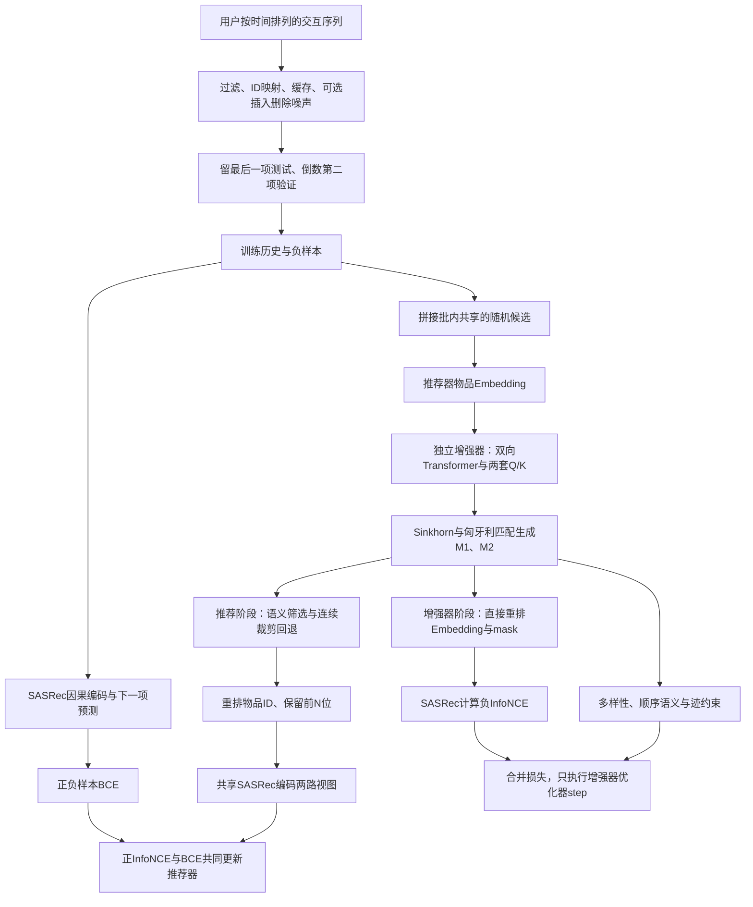

# AsarRec-2完整逻辑架构

整理日期：2026-10-20。分析对象：`experiment/AsarRec/AsarRec-2` 当前源码。

> **2026-10-21 更新**：已为该目录逐行加注释（只增注释、不改代码，25 个文件共 389 行，AST 与非注释 token 不变、可逐字节还原），并新增逐条对照文档[《AsarRec-2 代码与论文逐项对照》](../../experiment/ELSE/AsarRec/AsarRec-2/论文代码逐项对照.md)。同日把 `utls/mydataset.py` 的负采样从 `random.sample(set, …)` 改为 `range` 上过采样再过滤，修复 Python 3.11+ 的 `TypeError`（语义不变，见对照文档 §9）。下文第 12 节的"论文对应"表是当时的粗粒度结论，细化条款、证据与还原方式以新文档为准。
>
> **2026-10-21 追加**：`AsarRec-3` 以 AsarRec-2 当前源码为基线，只把论文写明的算法替换为 `paper` 实现（默认），其余保持 AsarRec-2（`official` 逐行一致）。逐文件差异见[《与 AsarRec-2 的差异》](../../experiment/ELSE/AsarRec/AsarRec-3/与AsarRec-2对比.md)，论文条款对照见[《AsarRec-3 论文实现对照》](../../experiment/ELSE/AsarRec/AsarRec-3/论文实现对照.md)。本笔记第 7 段"推荐器拉近双视图"的说法已在该文档 §2.5 更正为论文式(11) 的交叉视图目标。

**AsarRec-2由一个SASRec推荐器和一个独立的双分支增强器组成，通过交替优化训练：推荐器学习预测下一物品并拉近双视图表示，增强器在语义和保序约束下寻找更难对齐的双视图。预测时只使用SASRec。**

> 注（2026-10-21 核查）：推荐器侧的 `InfoNCE` 因分母含本样本分数而对整体平移不变，实测"完全对齐"与"完全相反"同值，实际不能"拉近"双视图；该句为 10-20 的表述，更正见对照文档 §2.6。

当前目录的Git提交为`9cd0e0721365f9da577d2698b6918f58f8b4d99a`，跟踪文件未修改，只有`.idea/`未跟踪项。它属于官方原始代码路线，不是此前补全后含`main_paper.py`、`main_official.py`的工程。下文按本目录实际代码说明，不把论文公式或AsarRec-1的修复混入。

本次（2026-10-20）是静态架构分析，未启动训练、未修改AsarRec-2源码。21个Python文件均通过语法解析；源码指纹、缺失导入及Games包清单见[核查记录](../../output/asarrec2_architecture/2026-10-20/source_inventory.json)。源码不完整，不能据语法通过断言能直接运行。

## 1. 总体数据流



这张图的推荐阶段和增强器阶段交替执行，不是两个优化器在同一个损失上同时更新。语义筛选和裁剪只在推荐阶段使用；增强器阶段直接优化原始生成矩阵。

## 2. 文件分工与调用关系

| 文件或类 | 职责 | 关键入口 |
|---|---|---|
| `main.py` | 遍历噪声和种子，组装配置，按名称选择训练器 | `main()` |
| `meta_config.py` | 命令行、设备、数据集学习率及权重衰减 | 导入时直接解析参数 |
| `utls/model_config.py` | 分别生成推荐器和增强器配置 | `get_SASrec_config()`、`get_AdaptiveSSL_config()` |
| `utls/mydataset.py` | 数据缓存、切分、噪声、负采样、左侧补零 | `SASDataset` |
| `utls/trainer.py` | 主训练调度、选模和测试 | `BasicTrainer.train()` |
| 同上 | 推荐器初始化、BCE与评估 | `SASrecTrainer` |
| 同上 | 交替训练、筛选和裁剪 | `AdaptiveSSL4SASrecTrainer` |
| `backbone_methods/SASrec/model.py` | 物品Embedding、下一项预测、双视图表示 | `BasicSASrec`、`AdaptiveSSLSASrec` |
| `backbone_methods/SASrec/encoders.py`及`modules.py` | 因果自注意力编码器 | `User_Encoder`、`TransformerEncoder` |
| `model/Adaptive.py` | 两套Q/K、矩阵生成、顺序评分 | `AdaptiveSSL` |
| `model/Transformer_Block/` | 增强器自己的双向Transformer | `TransformerBlock` |

默认`model=SASrec`、`method=AdaptiveSSL`时，入口动态拼出`AdaptiveSSL4SASrecTrainer`。继承链为：

```text
BasicTrainer
└── SASrecTrainer
    └── AdaptiveSSL4SASrecTrainer
```

`SASrecTrainer.__init__()`依次创建数据、DataLoader、模型、优化器；在子类实例上调用时，模型和优化器方法会分派到自适应子类，最终创建两个模型和两个AdamW优化器。不是先训练一个完整基线，再创建增强器。

`Adaptive_old.py`及`model-old.py`等历史文件不在当前默认导入链中。`ArgumentationSASrec`是传统增强分支，也不属于默认自适应训练主链。

## 3. 数据层：从用户历史到一个batch

对应`utls/mydataset.py:31–143`。

### 3.1 读取与预处理

1. 路径固定为工作目录下的`data/<dataset>`，不是相对脚本文件自动定位。
2. 优先读取`processed/user_interactions_more_<min_interaction>.pickle`。
3. 没有缓存才读取`data.json`，保留至少5次交互的用户。
4. 用户映射为从0开始的整数；物品通过集合枚举映射为从1开始的整数，0专作padding。
5. 先建立完整物品词表，再对每个用户保留最近`max_interaction+3`项，默认53项。
6. 保存用户序列、用户数、物品数和物品映射；加载后再施加可选噪声。

物品ID不是按原始ID排序生成的。重建缓存时，字符串集合的枚举顺序可能受Python哈希随机化影响；已有缓存则保留已有映射。缓存文件名只包含最少交互数，没有原数据指纹或最大长度，修改来源或截断参数后可能仍加载旧缓存。

**当前目录只放了`data/Games.zip`，加载器没有解压或直接读zip的逻辑。** 实际运行需要先将包内Games目录准备到`data/Games/`。Arts、MIND的数据也未在本目录中提供。不能把AsarRec-1的zip优先加载规则套用到这里。

### 3.2 切分、负采样和噪声

设处理后用户序列为`[a,b,c,d,e]`，默认无噪声时：

| 用途 | 输入 | 目标 |
|---|---|---|
| 训练 | `[a,b,c]` | 移位预测`a→b、b→c` |
| 验证 | `[a,b,c]`，最多最近50项 | `d` |
| 测试 | `[a,b,c,d]`，最多最近50项 | `e` |

负样本从该用户**整个存储序列之外**不放回抽取，因此也排除了验证和测试物品。每次训练取batch都会重新抽样；增强器训练也调用该方法，虽然随后不使用返回的负例，仍会消耗采样时间和随机数。

默认`noise=0`。非零噪声按`floor(noise×(序列长度−2))`次操作执行，每次随机选位置，再按当前长度和`add_p`决定插入未见物品或删除。位置上界包含倒数第二项，删除可能改变验证答案；不是固定留出答案后只替换训练历史。数据切分发生在噪声之后，应按实际流程理解噪声实验。

### 3.3 关键张量形状

令`B`为batch大小，`d=64`，`C=5`，`N`为补零后的历史宽度，`L=N+C`为扩展宽度。默认`max_interaction=50`、无噪声且缓存与配置一致时：

| 张量 | 默认形状 | 含义 |
|---|---|---|
| `seq, mask, neg` | `B×51` | 最多51个训练物品，左侧补零 |
| 推荐器预测向量 | `B×50×64` | 前50个位置预测下一项 |
| 正负logits | `B×50` | 向量点积得分 |
| 扩展ID和mask | `B×56` | 51个历史槽加5个候选 |
| 扩展Embedding | `B×56×64` | 来自推荐器同一张物品表 |
| `M1, M2` | `B×56×56` | 行为输出槽，列为源槽 |
| 两路增强输入 | 各`B×51×64` | 矩阵作用后取前51槽 |
| 两路序列表示 | 各`B×64` | 最后有效位置的编码结果 |

验证/测试最多取50个有效物品，但也补到51槽。`model_config`中的`maxlen=55`是推荐器位置表容量，不代表训练数据会自动变成55个有效历史。增强器位置表容量为55+C，默认60，可容纳56槽输入。

## 4. 推荐器：SASRec负责什么

对应`backbone_methods/SASrec/model.py:11–52`及`encoders.py:41`起。

推荐器包含一张`(物品数+1)×64`的可训练物品Embedding、一张可训练位置Embedding，以及2层、2头的Transformer。推荐器FFN宽度为256，dropout为0.1，注意力同时使用历史有效key掩码和下三角因果掩码，当前位置不能读取未来物品。

训练时，完整51槽输入先经过编码器，再取输出的前50槽，与输入物品的后50槽Embedding做点积，形成正样本logits；负样本Embedding与相同预测向量点积形成负样本logits。

推荐损失为有效位置上的两项BCE均值之和：

$$
\mathcal L_{rec}=\operatorname{mean}\,\mathrm{BCE}(s^+,1)+\operatorname{mean}\,\mathrm{BCE}(s^-,0).
$$

有效位置来自`mask[:, :-1] != 0`。这不是对全物品词表做softmax交叉熵；全词表只在评估时打分。模型定义了`mip_norm`线性层，但默认前向没有使用它。

## 5. 增强器：如何生成两张矩阵

对应`model/Adaptive.py:9–87`。

### 5.1 候选物品池

推荐阶段和增强器阶段都使用：

```python
torch.randint(1, n_items, (candidate_num,))
```

一次只抽C个候选，再扩展给整个batch。它不排已见、允许重复，且上界不包含`n_items`，因此最高物品编号不会被抽到。候选是额外物品池，不是推荐BCE中的负样本，两者用途不同。

### 5.2 双向编码与双分支打分

扩展序列先通过推荐器物品表取Embedding，再加固定正弦/余弦位置编码。增强器使用自己的2层、4头双向Transformer，FFN宽度128，dropout为0.1，不与SASRec共享Transformer参数。

每层前执行`seq *= mask`，但调用Transformer时**没有传注意力mask，也没有因果mask**。因此把padding向量置零，不等于屏蔽padding作为注意力key；带bias投影和层归一化仍可能使这些位置参与计算。

设共享双向编码结果为H，两路分别计算：

$$
Q_k=\mathrm{ReLU}(HW_{Q_k}+b_{Q_k}),\qquad
K_k=\mathrm{ReLU}(HW_{K_k}+b_{K_k}),\qquad
A_k=Q_kK_k^T,\quad k\in\{1,2\}.
$$

这里最终矩阵打分没有再除以`√d`或做行softmax；增强器内部自注意力本身仍有常规scaled softmax。两套Q/K不是两个完全独立的增强网络，它们共享前面的双向Transformer。

### 5.3 Sinkhorn、完整匹配与直通梯度

对每路`log(A+1e-6)`除以`tau=0.01`，做10次log域行归一化和列归一化，再指数还原为软矩阵S。迭代次数有限，不能保证数值上已经精确双随机。

随后逐用户把S复制到CPU，调用SciPy匈牙利匹配，生成每行每列恰好一个1的完整置换矩阵P。默认返回：

$$
M=\operatorname{stopgrad}(P-S)+S.
$$

所以即使`hard=False`，**前向仍使用硬置换**，反向才沿软矩阵S传播；并不是前向输出软混合序列。`hard=True`仅去掉这条直通梯度路径。

矩阵覆盖历史、padding和候选的全部槽位，没有论文Algorithm 1的平坦行列删除。把56槽重排后仅保留前51槽，会让候选进入历史窗口、历史移出窗口，或者padding移入窗口，从而实现插入、丢弃和重排的组合效果。完整置换本身不保证截取后的两路都非空。

## 6. 推荐阶段：筛选后才使用增强

对应`utls/trainer.py:241–298、341–427`。

epoch0～19，推荐器只计算BCE。从epoch20开始，每个batch实时重新抽候选、生成矩阵，逐用户执行语义筛选。没有预生成一份视图后跨epoch复用的机制。

### 6.1 语义筛选的真实规则

设用户有效历史长h，候选数C。筛选只截取矩阵中历史对应的`h×h`子块，不把候选源列作为历史相关度。把历史位置赋为`1…h`，矩阵作用后除以h，反转顺序计算DCG。

阈值使用`offset=floor(0.1h)`，按较短的理想顺序构造`min_dcg`。虽然函数名为`get_vali_ndcg`，这里比较的是**内部顺序DCG与语义阈值**，没有使用验证集答案，也不是评估推荐质量的NDCG@20。

| 两路分数状态 | 最终视图 | 返回标记 |
|---|---|---:|
| 两路都过阈值，且分数不相等 | 保留两路生成视图 | 1 |
| 两路都不过阈值 | 两路都换成随机连续裁剪 | 0 |
| 只有一路不过阈值 | 保留合格一路，另一路用裁剪 | 1 |
| 两路都过阈值，但分数相等 | 保留第一路，第二路换成裁剪 | 1 |

代码比较的是分数相等，不是矩阵相等；不同矩阵也可能因为同分触发回退。`Updating Percentage`是标记总和除以用户数，表示至少保留一路生成视图的用户比例，不能当作两路全部合格率或增强器参数更新率。

裁剪默认保留`floor(0.9h)`个连续历史项，在原槽位上把其余历史行清零，没有把保留项压紧成连续输出。padding和候选的对角线仍保留，最终候选尾部因只取前N槽而被丢弃。两次裁剪独立随机选起点，可能恰好相同。

### 6.2 通过ID重排训练推荐器

筛选后的矩阵在`update_ssl()`中被`detach()`。`adaptiveSSL_forward_loss()`计算：

```text
物品ID → M×ID → round并转long → 取前N槽 → 查物品Embedding
mask  → M×mask → 取前N槽
双路Embedding → 同一个SASRec编码器 → 各自最后有效位置 → InfoNCE
```

最终推荐器目标为：

$$
\mathcal L_{R}=\mathcal L_{rec}+0.1\,\mathcal L_{CL}.
$$

两路表示希望相近。这里只有推荐器AdamW执行`step()`；增强矩阵已断梯度，增强器不会被这个推荐损失更新。`ssl.eval()`只是关闭dropout等训练行为，真正切断矩阵梯度的是后续的`detach()`。

最后有效位通过`max(mask×位置编号)`选出，而不是始终读取最后一槽。两路共用同一套SASRec参数；推荐器处于`train()`，两次编码可受不同dropout采样影响。

## 7. 增强器阶段：生成更难的视图并限制偏离

对应`utls/trainer.py:300–338`、`model/Adaptive.py:89–178`以及推荐模型的`SSL_forward_loss()`。

每次增强器阶段都重新遍历训练用户5轮。推荐器设为`eval()`；通过推荐器物品表取得的扩展Embedding执行`detach()`，作为当前增强器优化的输入。

这条路径直接计算`M×Embedding`和`M×mask`，截取前N槽后送入SASRec。**这里不能像推荐器阶段一样把物品ID转long后再查表，否则会切断关键矩阵梯度。** 虽然前向用硬置换，反向通过STE回到Sinkhorn和Q/K。

### 7.1 四项增强器目标

按默认参数，源码目标可写为：

$$
\mathcal L_G=
-\mathcal L_{CL}
+100\mathcal L_{div}
+0.5\max(\mathcal L_{rank},0.05)
+0.1\left[L-\min(T,0.85L)\right].
$$

| 项 | 源码定义 | 最小化时的作用 |
|---|---|---|
| 对比项 | `-InfoNCE` | 尝试让两路视图更难对齐，与推荐器正InfoNCE形成相反目标 |
| 多样性 | `-mean(abs(M1-M2))` | 鼓励两张矩阵不同，含padding槽差异 |
| 语义 | `1-(ndcg1+ndcg2)/2`，下限0.05 | 约束顺序偏离；低于下限后该分支不再提供梯度 |
| 迹项 | `L-min(T,0.85L)` | 鼓励保留更多原位，达到软迹上限后梯度停止 |

其中T是两路**软矩阵平均迹**，不是硬置换矩阵的固定点数量。迹损失达到上限后仍有`0.15L`常数值，不会变成零；判断是否起约束作用要看梯度，不能只看损失数值。

增强器训练的顺序NDCG，把有效历史和候选**一起计入有效长度**，截取尾部有效矩阵，再将位置相关度归一化并计算DCG/IDCG。它与推荐阶段的筛选不同：筛选只看历史子块，使用裁短的参考阈值。二者也都不是最终推荐NDCG@K。

负InfoNCE和负L1共同推动“更难、更不同”，语义项和迹项限制扰动不要过度。代码没有把这几项目标自动平衡，也没有直接用验证或测试指标训练增强器。

### 7.2 实际梯度边界

| 阶段 | 推荐器模式 | 增强器模式 | 切断位置 | 执行step的优化器 |
|---|---|---|---|---|
| 推荐预热 | train | 不参与该batch的推荐损失 | 无增强路径 | 推荐器AdamW |
| 推荐+增强 | train | eval | 筛选后的M被detach；ID转long | 推荐器AdamW |
| 更新增强器 | eval | train | 输入物品Embedding被detach | 增强器AdamW |

原代码并没有用`requires_grad_(False)`冻结整个推荐器。增强器阶段的SASRec编码器仍会产生并积累参数梯度，只是没有对推荐器执行`step()`；下一次推荐训练的`opt.zero_grad()`再清空。**“eval模式”和“冻结参数”不是同一件事。** 这是实际计算开销与梯度管理问题，不等于该阶段在更新推荐器参数。

## 8. 完整训练时间线

所有epoch从0计数。默认60个推荐epoch；增强器在推荐epoch0、10、20、30、40、50完成后分别训练5个内部epoch，共30个额外数据遍历。

```text
epoch 0   ：推荐BCE → 增强器5轮
epoch 1–9 ：推荐BCE
epoch 10  ：推荐BCE → 增强器5轮
epoch 11–18：推荐BCE
epoch 19  ：推荐BCE → 第一次验证与选模
epoch 20  ：BCE+双视图对比 → 增强器5轮
epoch 21–29：BCE+双视图对比
epoch 30  ：BCE+双视图对比 → 增强器5轮
epoch 39  ：BCE+双视图对比 → 第二次验证与选模
epoch 40  ：BCE+双视图对比 → 增强器5轮
epoch 50  ：BCE+双视图对比 → 增强器5轮
epoch 59  ：BCE+双视图对比 → 第三次验证与选模
最后：恢复最佳SASRec权重 → 测试
```

所以“推荐器预热20轮”不表示增强器前20轮不训练。第20个epoch开始使用增强时，已经有epoch0和10各5轮的增强器训练结果；epoch20自己的增强器更新发生在该轮推荐训练之后。

推荐器优化器使用数据集学习率；Games/Arts为0.001、weight_decay为0.0001，MIND为0.005、weight_decay为0.001。增强器AdamW固定lr=0.01、weight_decay=0.01。`meta_config.py`在解析后覆盖已知数据集的lr/weight_decay，因此命令行显式传值也会被覆盖。

入口写死每个噪声设置运行5个种子2024～2028，覆盖命令行seed；`noise_list`在可见源码中没有定义，因缺失通配导入模块，无法确认原作者完整工程如何提供这一变量。

`ssl_cache=[(),(),…]`只在初始化创建，此后没有填充或读取缓存条目。非空列表在条件判断中恒为真，不能理解为“缓存已更新才启用增强”。

## 9. 验证、选模、存储与推断

对应`BasicTrainer.train()`和`SASrecTrainer._eval_rec()`。

1. 每20个推荐epoch验证一次，默认检查epoch19、39、59。
2. 达到最少20轮后，取返回HR列表的最后一项做选模；默认K=[10,20]，所以是HR@20。若更改K顺序，选模指标也随最后一项变化。
3. 指标严格变大才保存；相等也视为未改善。未改善时patience减去20，达到0早停。
4. 训练结束恢复最佳模型，再用测试集报告HR/NDCG。

评估只走`物品Embedding → SASRec → 最后位置表示 → 与全部物品Embedding点积`，屏蔽输入历史并去掉padding列，随后完整排序；重复出现于输入历史的目标不会被恢复分数。K=10/20分别计HR和折损命中。

评估复用训练DataLoader，因此也按batch=256打乱用户，`test_batch_size=2048`参数没有真正接入这一实现。单目标用户下HR可理解为目标是否进入前K项，不是多正例召回率。

**增强器不参与验证和测试打分。最佳检查点只保存`SASrec`参数，未保存增强器、两个优化器、随机状态或选模元数据。** 因而可以用于推荐推断，但不足以精确恢复整套交替训练。若最佳是epoch19，最终成绩来自尚未使用增强训练的推荐器。

默认日志按`log/<数据集>/<模型_方法>/<按小时的时间>/`保存，文件细节依赖缺失的`init_run()`；检查点按`checkpoints/<模型_方法>/<数据集>/<时间>/<noise>_<seed>.pth`保存。同一小时运行可能使用同一个时间目录。

每20轮还可能把部分batch第一路矩阵的均值写入硬编码路径`log/Games_epoch_0/`。这个目录名不是实际数据集或当前epoch含义；矩阵文件不是用户级视图缓存，也不是完整模型检查点。

## 10. 从架构看训练耗时

不考虑独立验证，60轮训练包含：

- 60次推荐数据遍历；从epoch20起的40次遍历，每批额外执行增强器生成、两路SASRec编码和逐用户筛选。
- 30次额外增强器数据遍历；每批有两张矩阵及两路SASRec前向/反向。
- 每张矩阵逐用户调用CPU匈牙利匹配，存在GPU到CPU的数据传输。
- 推荐阶段逐用户DCG判断、`.item()`和随机裁剪循环；增强器语义评分也逐用户循环。
- 验证/测试对全词表完整排序，而不是只取top-K。

原代码的推荐epoch计时在`update_ssl()`前后分段，**跳过了语义筛选和裁剪时间**；5轮增强器更新则另行打印。因此日志里的`Rec Loss ... Time`小于完整墙钟耗时，不能直接拿它表示全部训练时间。论文表5每epoch秒数的历史核查见主笔记第16节。

## 11. 当前代码边界与需避免的误读

| 已确认情况 | 对使用或理解的影响 |
|---|---|
| 缺`utls/utilize.py` | InfoNCE温度、相似度、负例集合、对称性以及日志/随机种子初始化无法从源码确认；本说明只确认调用方向与损失符号 |
| 缺`utls/baslines_trainer.py`、`baseline_methods/Argumentation.py` | 默认入口和推荐模型均有顶层导入，未选传统增强也会受影响 |
| README要求的`requirements.txt`不存在 | 快速开始说明与实际发布文件不齐 |
| 只有CPython3.8格式的相关`__pycache__` | 不能在现代Python中当作缺失`.py`的通用替代；未据字节码猜测完整算法 |
| 默认只提供未解压的Games.zip | 读取器不会自动解压；不能直接认为数据已准备完成 |
| `random.sample()`直接接收set | Python3.11及以上需要兼容处理，原写法会报类型错误（2026-10-21 已修复，见对照文档 §9） |
| `idx.squeeze().tolist()`及`len(seq[1])` | 尾批只有1人时会出现标量不可迭代或索引越界 |
| 增强器循环里的`seq *= mask` | 对现代PyTorch反向保存的中间值存在原地版本检查风险；本次没有通过运行重现它 |
| 整批空视图、NaN/Inf未显式拦截 | 最后有效位对空视图会退到位置0，不能把有输出等同于增强有效 |
| 缓存和检查点没有来源/映射指纹校验 | 更换数据后混用缓存或权重可能造成语义错配 |
| `--device cpu`不单独决定设备 | 原逻辑仍依据CUDA是否可用及`use_gpu`；默认GPU编号是3 |

这些是本目录的真实发布状态，不代表AsarRec-1补全版仍有相同问题。本次只整理架构，没有将修复写入AsarRec-2。

## 12. 阅读顺序与论文对应

建议按以下链路阅读，每一步都能接到下一步的数据或调用：

1. `main.py` → `meta_config.py` → `utls/model_config.py`：确定运行哪条路线、默认调度和参数。
2. `utls/mydataset.py`：确认输入宽度、答案位置、负例及噪声。
3. `BasicTrainer.train()`：看外层epoch、验证、保存、恢复和测试。
4. `AdaptiveSSL4SASrecTrainer._train_epoch()`：区分推荐更新和额外增强器循环。
5. `model/Adaptive.py`：理解M的生成、STE、语义评分和迹。
6. `get_vali_ndcg()` → `update_ssl()` → `generate_valid_permutation_pair()`：确认哪些生成视图真正进入推荐器。
7. `AdaptiveSSLSASrec`两个SSL方法：对照ID重排和Embedding重排的梯度差别。
8. `User_Encoder` → `TransformerEncoder` → `_eval_rec()`：确认因果掩码、最终表示与评估口径。

| 项目 | AsarRec-2实际架构 | 论文明确描述的路线 |
|---|---|---|
| 增强器编码 | 双向Transformer、带bias的ReLU Q/K | 共享线性W、两套Q/K、scaled softmax |
| 矩阵 | Sinkhorn后匈牙利完整匹配 | Semi-Sinkhorn删除平坦行列并允许部分匹配 |
| 多样性 | 负L1均值 | 平方矩阵距离hinge |
| 语义 | 1减平均顺序NDCG并设置下限 | 两路相对参考NDCG的hinge |
| 额外限制 | 软迹约束、推荐阶段筛选/裁剪 | 论文总目标没有这套迹项及完整筛选流程 |
| 候选与噪声 | 批共享候选、插入/删除 | 历史外候选、随机替换 |

这份架构说明的依据是当前代码。论文与代码不一致的地方需分别报告；不能用论文公式替换阅读时遇到的实际分支，也不能把未公开的InfoNCE补成一个确定版本。
