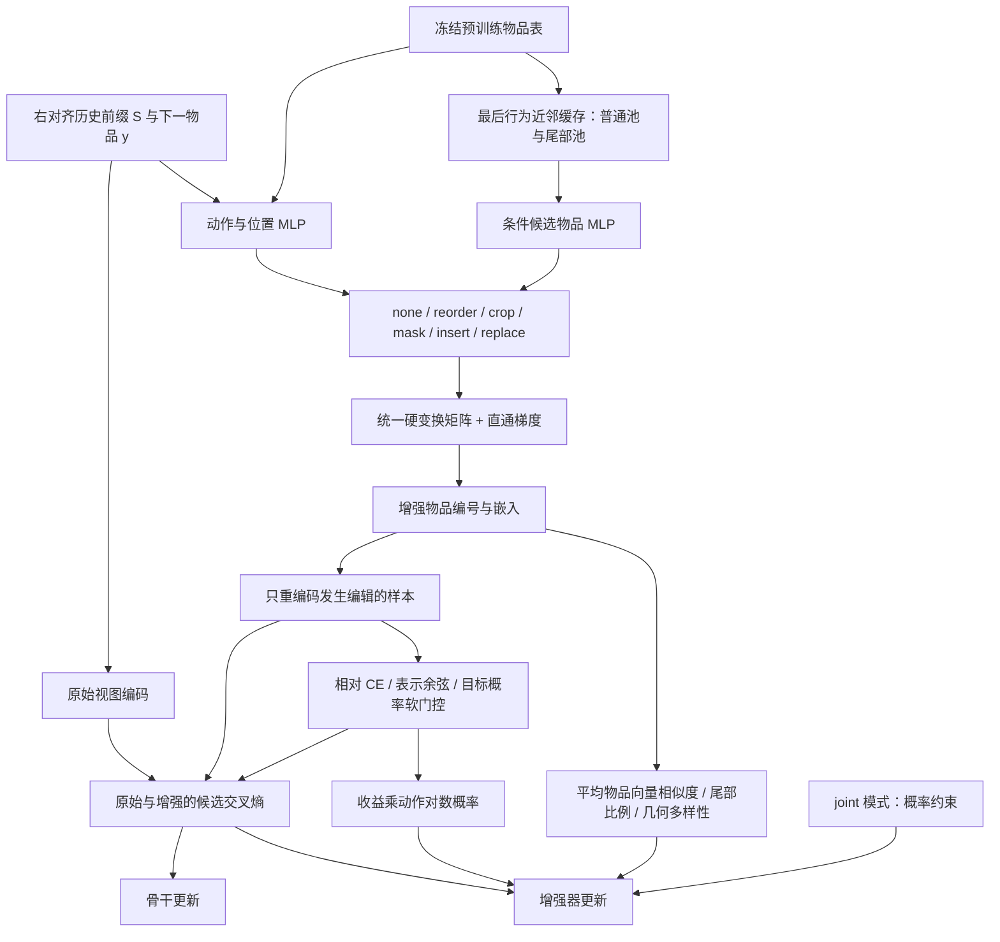

# LDAS-8 架构审查与研究驱动的优化方案

审查日期：2026-10-26。对象：`experiment/ELSE/LDAS/LDAS-8` 当前磁盘代码，以及该目录下 6 份 Beauty / SASRec 历史运行日志。

> 实施更新：同日已按四项顺序修改 LDAS-8，当前架构版本 18。本文保留修改前审查结论；运行说明与消融入口见 [README-8.md](../../experiment/ELSE/LDAS/LDAS-8/README-8.md)，实施验证记录见 `output/ldas8_optimization_2026-10-26/`。下文探针和源文件指纹均指修改前版本。

**结论：保留“离散编辑器 + 推荐骨干”的主体，先修复采样和编辑语义，再把优化目标收敛为“语义预算内的有效长尾编辑”。当前证据尚不支持 LDAS-8 稳定优于 TADA；继续叠加扩散、专家网络或更多损失，优先级低于修复现有学习闭环。**

本次完成静态审查、联网研究检索、4 项小规模行为探针和日志提取；未修改模型代码，未重训。探针与检索记录位于 `output/ldas8_review_2026-10-26/`。已记录 26 个源文件的 SHA-256，便于区分当前审查版本与之后的修改。历史日志未附对应源码版本，因此不能把当前发现直接认定为每次历史运行的失败原因。

## 1. 当前架构实际是什么



### 1.1 数据与骨干

- 数据按每个用户最后两次交互作验证/测试留出；训练使用其余历史的所有非空前缀。物品流行度只统计 `sequence[:-2]`。
- 输入长度默认 50，**左侧补零、右对齐**。Beauty 有 22,363 个用户、131,413 个训练前缀；其中 127,895 个前缀不足 50，约 97.3%。因此短序列的插入语义直接影响大多数训练样本。
- 默认骨干 SASRec：64 维、2 个注意力头；层数按预训练结构恢复。还支持 GRU4Rec、FMLPRec、TVRec、ELCRec。
- 推荐使用当前实际序列的最后有效位置表示；训练是正物品加最多 100 个采样负例的候选交叉熵，验证与测试是严格全物品排序。不能把训练目标概率称为全目录预测概率。

### 1.2 策略与候选

- 动作头是两层 MLP，输出 `[batch, 6, L+1]` 的动作—位置 logits，展平后归一化。实际是**五种编辑 + 一个 none 动作**，而非 README 所述五类动作。
- 输入由冻结物品表中的局部邻居、序列均值、相邻余弦差、位置坐标和长度组成；不是基于 SASRec 上下文化状态的序列策略编码器。
- 候选头也是 MLP，输出查询向量，在默认 64 个候选中选择物品；默认一半候选来自尾部池。每条序列的所有编辑位置共享由**最后一个真实行为**检索出的候选池。
- 训练时过滤当前历史、训练正目标和采样负例；推理接口要求目标不可见。当前默认评估原始视图，增强器可以只用于训练。
- 每条选中序列只执行一次动作。`max_replacement_ratio=0.2` 在当前代码中主要是替换资格条件，并非一个可以学习的多次编辑预算。

### 1.3 梯度与损失

- 硬物品编号与硬嵌入前向共享源位置映射；动作选择通过期望变换矩阵传直通梯度，候选选择也使用直通估计。
- `utility` 默认训练路径实际走 `epsilon`；`joint` 走 Gumbel 采样并额外启用概率约束。两种动态模式均在训练器中加入 `direct_policy_loss`，因此不能理解成两个完全互斥的梯度方案。
- `relative_policy_loss` 有定义和导出，但当前训练器没有调用；README 提到的“冻结骨干、多提案相对收益监督”不是当前主训练路径。
- 三项增强辅助损失通过 detached 的当前物品嵌入计算，梯度只给增强器；候选检索和 joint 几何约束则基于冻结参考表。README 将它们统称为固定参考几何并不精确。

值得保留的设计包括：训练统计与留出数据分离、独立随机流、统一硬映射、只重编码编辑行、原始视图监督、严格全排序，以及默认关闭推理增强。

## 2. 已确认的实现问题

### P0-1：默认 utility 路径的 epsilon 探索没有执行

位置：`src/learning_augment/augmentation.py:133` 与 `:145`。

`epsilon` 分支计算了探索或贪心的 `index`，但最终硬动作仍由 `soft.argmax()` 构造，计算出的 `index` 没有被使用。这个问题同时影响该模式下动作/位置选择与候选物品选择。

**实测：** logits 为 `[4,1,0]`，探索率设为 1.0，在 2,000 次选择中得到 `[2000,0,0]`，而非分散到 3 个合法动作。

修复选项：保留 epsilon 时，应以实际 `index` 构造硬 one-hot，反向再接 soft surrogate；或者先统一成标准 Gumbel 直通采样，减少路径分歧。修复后再评估探索率的效果。

### P0-2：插入会丢失最新行为，短序列也未必增长

位置：`src/learning_augment/transform_matrix.py:38`。

当前实现右移指定位置之后的内容，再截掉最后一列，与右对齐数据协议冲突：

| 输入 | 位置与候选 | 当前输出 | 问题 |
|---|---|---|---|
| `[1,2,3,4,5]` | 位置 1 插入 6 | `[1,6,2,3,4]` | 丢掉最新行为 5 |
| `[0,0,1,2,5]` | 位置 2 插入 6 | `[0,0,6,1,2]` | 有空位仍丢掉 5，有效长度仍为 3 |

README 写的是满长时丢弃最早事件；当前实现丢弃的是最新事件。另一个边界是：`L` 这个附加插入位置会在底层被夹到 `L-1`，不能表示真正的末尾追加，可能产生两个槽位映射到同一编辑。

建议统一成“有效事件序列编辑 → 超长保留最近 L 个 → 左侧补零”。上述两个例子按相同有效事件间隙编辑后应分别得到 `[6,2,3,4,5]`、`[0,6,1,2,5]`。硬编号、硬矩阵、软期望矩阵和多样性增益必须共用同一语义。

### P0-3：尾部辅助目标与真实编辑结果不一致

位置：`src/learning_augment/augmentation.py:291`。

当前插入按“尾物品数增加候选尾部标志、有效长度加一”估算比例，没有正确扣除被截掉的事件。探针设置原序列末项 5 与插入项 6 为尾部，输出 `[1,6,2,3,4]`：

- 代码返回尾部比例 `0.333333`；
- 按实际编号计算为 `1/5=0.200000`。

这会使增强器优化错误的长尾收益。`SelectionConstraints.geometry` 的满长插入增益还假定删除首项，与当前硬插入删除末项也不一致。

修复原则：前向统计以真实输出编号为准；反向需要可微时，构造与同一源映射一致的软计数和软有效长度，并采用明确的直通代理。不能只修日志数字而保留错误训练目标。

### P0-4：none 分支存在学习退化与原始 CE 重复计权

位置：`augmentation.py:277`、`components/models.py` 的编辑行重编码分支、`trainers.py:174`、`:190`、`:384`、`:398`。

选择 none 时 `active=False`：

1. 模型复用原始表示，不重编码；推荐损失没有经过该行策略的路径。探针测得此路径的动作头梯度为 0。
2. 增强辅助损失与 direct policy loss 都用 active 掩码，none 行没有相应反馈。熵正则和 joint 约束仍可能有梯度，因此不能笼统断言所有 none 状态都数学上不可逃逸。
3. 门控却给该行权重 1，增强 CE 等于原始 CE。默认权重下，全 none 的骨干目标变成 `2 × 原始 CE`，纯骨干对照只有一份原始 CE。这不是有效增强收益，也不能简单等价为 AdamW 学习率翻倍。

建议：增强项只计真实编辑行，按全 batch 归一化，保证全 none 时严格还原纯骨干目标；策略训练要能在相同序列上比较 none 与合法提案，而不是只惩罚已经选中的编辑。

### P1-1：策略梯度混合与动作概率定义需要整理

位置：`augmentation.py:256`、`policy_learning.py:19`、`trainers.py:384`。

- 当前同时有直通推荐梯度和收益乘对数概率梯度，收益又来自同一模型、同一批次即时 CE。它们可能重复优化容易样本，不能直接解释为稳定的元优化。
- 所有编辑动作都把候选物品概率加进动作 log-probability，包括不使用候选的 reorder/crop/mask，给无关物品选择头引入奖励噪声。
- 即使修复 epsilon 的硬动作，也必须区分行为策略的“探索—贪心混合分布”与 softmax 分布；直接使用后者不能宣称是无偏的 on-policy REINFORCE。

建议先以一种清楚的估计器建立有效基线。若保留 score-function 路径，插入/替换才包含候选概率，并明确采样分布、baseline 和必要的分布校正。

## 3. 研究目标上的薄弱点

### 3.1 平均物品向量余弦无法约束顺序语义

`trainers.py:115` 比较平均物品嵌入。任意纯重排不改变均值，通常得到完全相同的该项相似度；它不能说明下一物品意图被保持。编码后 intent 的余弦更接近任务语义，但当前原始与增强前向在训练模式中分别经过 dropout，也会引入测量噪声。

门控里的相对 CE 与目标概率下降高度相关，因为同一候选集上 `CE=-log p(y)`；三个 sigmoid 相乘同时惩罚两次近似相同的信号。默认语义阈值 0.75 对应的是映射后的 `(cos+1)/2`，即原始余弦 0.5，不应误读为余弦至少 0.75。

### 3.2 输入尾部比例与推荐长尾效果不是同一目标

增加输入中尾部 token 比例，可以通过删除头部行为实现；并不必然增加对尾部真实目标的推荐准确率。当前尾部集合又覆盖大部分训练可见物品，比例奖励可能比较粗糙。

建议把实际训练目标的分组推荐收益作为主证据，把注入比例作为机制统计。尾部曝光与尾部准确率应分别报告。已有 COVERAGE@20 约 0.991，接近饱和，难以区分方法；应补 TailCoverage、曝光 Gini、训练频次定义的 Novelty。

### 3.3 候选与位置决策还不匹配

替换较早位置时，候选仍来自最后行为的近邻；可能忽视该位置附近的局部兴趣。策略特征没有完整的上下文化状态，当前候选 MLP 也未按操作类型独立建模。

先验证“局部锚点 + 近期意图 + 训练共现”的候选融合是否优于 last-item-only；候选池命中率、可用率和最终选择率应分开测量，再决定是否添加一层上下文编码器。

## 4. 历史结果能说明什么

以下是日志中最终测试块，均为 Beauty / SASRec、seed 2026、原始输入全排序。小数为日志保留精度。它们来自不同历史配置，尚不能视为当前源码的控制实验。

| 运行 | 模式 | NDCG@20 | Tail NDCG@20 | Tail HIT@20 | 末轮编辑率 |
|---|---|---:|---:|---:|---:|
| 105505-dynamic | utility | 0.0509 | 0.0312 | 0.0575 | 未提取到该统计块 |
| 121647-dynamic | joint | 0.0512 | 0.0309 | 0.0571 | 0.8651 |
| 141131-dynamic | joint | 0.0508 | 0.0310 | 0.0570 | 0.0000 |
| 151117-dynamic | joint | 0.0503 | 0.0302 | 0.0568 | 0.0000 |
| 160814-none | 纯骨干微调 | 0.0504 | 0.0305 | 0.0570 | 不适用 |
| 164104-tada | TADA | 0.0513 | 0.0326 | 0.0593 | 不适用 |

`141131` 与 `151117` 的末轮同时记录 `operation_none=1.0000`、`augmentor_grad_norm=0.0000`。这是退化现象的直接证据；末轮不是最佳检查点，不能据此断言最佳检查点也全部不增强。

TADA 测试后来通过单独评估补齐；最新评估块的训练时间 0 表示“本次只评估”，不是训练免费。前面的累计资源块记录训练约 1,465.7 秒，纯骨干约 485.9 秒，动态运行约 1,721.7–2,995.8 秒。这些只是历史资源记录，不能替代同版本、相同步数的性能基准。

结论限于：**现有 dynamic 分数与纯骨干接近，尚无稳定胜过 TADA 的证据；没有 random 的匹配日志，也缺少跨种子置信区间。**

## 5. 检索到的研究与可借鉴部分

本次在线查询 Crossref、arXiv、论文官方 GitHub，并对部分论文用 OpenAlex 补查摘要。Crossref 若干查询遇到 429，随后通过精确 DOI 补齐 TCLA、ACLSRec；IERec 的在线摘要接口超时且所查 README 路径返回 404，其具体机制以下标为本地阅读笔记依据。未完成所有论文全文重读，也不将本次检索视为穷尽的新颖性审查。

| 研究 | 已核实的相关点 | 对 LDAS-8 的启示 | 本次依据 |
|---|---|---|---|
| [TCLA，SIGIR 2025](https://doi.org/10.1145/3726302.3730101) | 自监督上下文驱动的可学习位置与操作，三元组对比学习 | “能学习位置和类型”本身不足以构成新贡献；可借鉴增强器初始化，但重构目标不等于长尾最优 | DOI 元数据 + [官方 README](https://github.com/anonymityww/TCLA) |
| [TADA，WWW 2026](https://doi.org/10.1145/3774904.3792171) | 相关性/共现候选、T-Substitute、T-Insert、表示混合与跨序列增强 | 是最直接长尾对照；复用相关候选，不把任意尾物品视为有效正增强 | [论文摘要](https://arxiv.org/abs/2601.10933) + [官方仓库](https://github.com/KingGugu/TADA) |
| [MCLRec，SIGIR 2023](https://doi.org/10.1145/3539618.3591727) | 通过元学习更新模型增强器，并正则防止视图过于相似 | 区分“本批 CE 降低”与“增强对推荐学习是否有用”；可借鉴分阶段/元更新思想 | [论文摘要](https://arxiv.org/abs/2304.07763) + [官方仓库](https://github.com/QinHsiu/MCLRec) |
| [ACLSRec，WWW 2026](https://doi.org/10.1145/3774904.3792207) | 学习扰动与恢复，代码有距离对齐和正则 | 保语义应基于上下文化表示或预测分布；先做轻量一致性，恢复网络作为后续消融 | DOI + [官方模型代码](https://github.com/xiaomizhou778/ACLSRec/blob/main/recbole/model/sequential_recommender/aclsrec.py) |
| [AsarRec，SIGIR 2026](https://doi.org/10.1145/3805712.3809629) | 统一结构变换矩阵、可微 Semi-Sinkhorn，以及多样性/语义/信息量目标 | 统一矩阵与多目标已被研究；LDAS-8 应强调精确离散编辑、预算和实际长尾收益，而非仅强调矩阵 | DOI + OpenAlex 收录摘要 + [官方仓库](https://github.com/Kaike-Zhang/AsarRec) |
| [IERec，KDD 2026](https://doi.org/10.1145/3770854.3780333) | 兴趣不确定性与选择性增强 | 长度之外还可按兴趣结构分组检验编辑风险；不应假设熵与风险必然单调 | 在线 DOI 核对；机制依据本地 IERec 阅读笔记 |
| [Gumbel-Softmax，ICLR 2017](https://arxiv.org/abs/1611.01144) | 类别变量的可微松弛与温度退火 | 规范硬前向/软反向；直通估计有偏，不能与 REINFORCE 的性质混淆 | arXiv 摘要 |
| [AutoAugment，CVPR 2019](https://arxiv.org/abs/1805.09501) | 搜索操作、概率、强度，用验证性能评价策略 | 为推荐增强加入独立效用评价提供一般方法参考；它是视觉研究，不构成推荐任务有效性的证明 | arXiv 摘要 + Crossref |

研究定位宜收窄成：**在可测的意图漂移约束下，学习哪些离散长尾编辑值得用于推荐训练。** 这是待验证的切入点，不能据本次检索宣称“尚无人研究”。

## 6. 推荐优化路线

### 阶段 A：先建立可信、可归因的最小版本

1. 修复 epsilon、右对齐插入、尾部比例/多样性增益与硬结果的一致性；去除附加位置别名。按真正编辑后的编号定义 active，避免无变化提案冒充编辑。
2. 将 edit/no-edit、操作类型、位置分开归一化。当前 none 只有一个合法槽位，其他动作有多个位置，展平采样天然受合法位置数影响。随机基线也应明确“均匀动作”还是“均匀动作—位置”，并匹配实际编辑率。
3. 首轮仅保留原始 CE、真实编辑 CE 和必要语义约束；先关闭额外 direct policy loss，建立单一 Gumbel-ST 基线，再逐项加入奖励监督，判断哪一项提供增益。
4. 修正无编辑行的损失计权。一个清晰的起点是：

   `L_backbone = mean(CE_original) + alpha * mean(active * stopgrad(gate) * CE_edited)`。

   全 none 时与纯骨干完全一致；若增强比例变化，明确它改变的是增强项强度，并在对照中匹配该强度。
5. 随机策略应复用候选池、合法动作、安全门和损失归一化，才能隔离学习策略的贡献；另保留标准 ungated random 作为完整方法对照。

验收：探索确实分散；短序列插入增加一个有效事件；满长插入保护最近行为；统计与硬编号一致；全 none 时损失与梯度还原基线。上述验收通过前不建议大规模调参。

### 阶段 B：把三项固定偏好改成语义预算

建议先使用 `none / insert / replace`，把 reorder/crop/mask 留作动作空间消融；它们是否有助于长尾目标应由实验证明。每次仍最多一次编辑，先不扩成多步编辑器。

采用一个冻结且处于 eval 模式的教师 `f_bar`，在相同候选支持集 C 上定义：

\[
D_C(S,\tilde S)=\operatorname{JS}\big(p_{\bar\theta}(\cdot\mid S;C),p_{\bar\theta}(\cdot\mid\tilde S;C)\big).
\]

这衡量预测分布的变化，能够感知纯重排；教师原始与增强分支均关闭 dropout。它仍是**语义保持代理**，不是用户真实意图的证明。计算预算有限时，C 可包含教师 top-M 与训练频次分层抽样物品，同一对视图必须用相同 C；这是受限支持集上的 JS，不能当成精确全目录 JS。

策略目标可以写成：

\[
\max_\phi\ \mathbb E[U_{tail}(S,\tilde S)]\quad
\text{s.t.}\quad\mathbb E[D_C]\le\epsilon,\qquad
\mathbb E[\mathrm{edit}]\le B.
\]

用拉格朗日乘子更新语义代价，例如
`lambda <- max(0, lambda + eta * (mean(D_C) - epsilon))`，避免固定 0.4/0.3/0.3 需要随数据集反复重配。先使用共享预算，只有分组证据充分后才学每条序列的预算。

`U_tail` 首先定义为**尾部真实目标上的推荐改善**，例如在训练内部独立策略样本上的尾部 CE 下降；注入的尾部计数作辅助，必要时加“删除头部不能算新增尾部收益”的净增约束。不要仅最大化尾部预测总概率，否则可能牺牲头部和尾部内部排序。

对之前 `2026-10-23-可学习增强器选题评估.md` 的方案，应补充四点限定：

- 只在头部归一化后的 KL 无法约束头部总概率质量，也无法保证尾部内部意图；不能单独当完整语义约束。
- 每个位置单独测影响一般需要额外前向；一次同时 mask 多个位置得到的是联合扰动，不能直接称为各位置独立代价。
- 若部署只有原始视图推理，测试时不能靠扫描编辑策略的 lambda 声称同一模型实现不同推荐工作点；需要重训或引入明确的推理控制。
- 不应使用用户验证/测试目标来决定候选是否可用；用训练数据建池、推理阶段只看已知历史即可。未来真实目标恰好被无标签检索命中，不自动构成泄漏，按未来标签过滤反而引入目标依赖。

### 阶段 C：用相对提案收益学习替代混杂即时奖励

每隔若干步，对一小部分训练样本生成 `none + 2–4 个去重合法提案`，固定教师进行批量评分。采用包含 none 的提案排序或收益软标签训练策略，复用现有 `relative_policy_loss` 的思路，并给候选生成的偏置作明确记录。

先做教师即时评分的廉价版本；若它只选择“容易预测”而不能带来训练收益，再做一阶元更新：

\[
\theta'=\theta-\eta\nabla_\theta L_{train}(\theta,\phi),\qquad
\phi\leftarrow\phi-\eta_\phi\nabla_\phi L_{policy}(\theta').
\]

策略样本从**原训练部分**单独划出或交叉轮换；外部验证集用于选超参，测试集只用于最终报告。MCLRec 支持借鉴元学习思想，但这里的训练内部留出和长尾约束是本方案的设计，不能描述为对其原算法的复刻。

### 阶段 D：有证据后再增强候选与上下文

- 候选评分加入被编辑位置原物品、左右邻域和近期兴趣；混合预训练相似度与训练共现，消融最后行为锚点。
- 从骨干复用 `stopgrad(h_t)` 作为策略输入，避免立刻增加一套 Transformer；若提升明确，再比较轻量独立上下文编码器。
- 先维持固定参考表；若训练后检索召回明显下降，再评估周期教师快照或 EMA 及缓存重建成本。
- 多样性先作为报告指标；只有其收益不损害准确率和尾部目标时，再加入训练正则。固定均匀化五种操作不应成为必须使用无益操作的压力。

## 7. 最小实验矩阵与继续条件

第一批用 Beauty / SASRec 跑协议与行为检查；有效后扩到 Sports、Toys，再选 FMLPRec 作结构差异较大的副骨干。主结果至少 3 个种子，例如 2024/2025/2026；显著性按用户配对并同时报告种子间波动，不能用单次全体用户 bootstrap 替代跨种子稳定性。

| 顺序 | 对照 | 要回答的问题 |
|---|---|---|
| E0 | 纯骨干微调；另做重复原始 CE 的计权对照 | 原先增益是否只是目标权重差异 |
| E1 | 修复后的 random，候选/门控/编辑率与学习策略匹配 | 学习决策是否比随机更有用 |
| E2 | 当前移植 TADA；必要时复核官方协议 | 最直接长尾对照是否更强 |
| E3 | 只修 P0 的动态策略 | 修复是否已足够，不急于加模块 |
| E4 | E3 + 教师预测漂移预算 | 语义约束是否优于均值余弦 |
| E5 | E4 + 相对提案学习 | 收益学习是否改善长期效果 |
| E6 | 三动作 vs 六动作；局部候选 vs 最后行为候选 | 复杂度的必要性 |
| E7 | 等实际编辑率、等漂移对照 | 是否只靠多改或牺牲语义提高尾部 |

共同报告：总体/头部/尾部 NDCG、HIT@5/10/20，尾部目标样本数、TailCoverage、Novelty、曝光分布、实际编辑率、各动作分布、门控接受率与教师漂移；资源报告训练总时长、每 epoch 时长、峰值显存与原始视图推理延迟。

验证集选取“总体准确率在允许下降范围内的尾部最优点”，下降容忍度预先约定，例如相对 NDCG 1% 仅作为可讨论起点。等漂移/等编辑率阈值均在验证集匹配后固定到测试集。

继续条件：E3 首先表现出非退化且有区分度的学习行为；E4/E5 在等编辑率或等漂移下，相比 E1/E2 给出跨种子一致的尾部收益。若修复后仍不能胜过匹配随机策略，应暂停结构扩展，回到候选质量与训练目标诊断，而不是追加更多损失。

## 8. 交付与复核入口

- `output/ldas8_review_2026-10-26/audit_probes.py`：行为探针与日志提取；输出 `audit_results.json`。
- `source_sha256.json`：本次审查的 Python 源文件指纹。
- `search_literature.py`、`literature_search.json`：10 组在线检索及成功/失败记录。
- `source_fetch.json`、`supplement_sources.json` 及对应 `_source.txt` / `_abstract.txt` / `_metadata.txt`：原始来源与摘录。

探针使用 CPU PyTorch 2.10.0；当前默认环境曾遇到重复 OpenMP 运行库，使用 `MKL_THREADING_LAYER=SEQUENTIAL` 后运行成功。未启用绕过重复运行库检查的开关。复核命令：

```powershell
$env:MKL_THREADING_LAYER='SEQUENTIAL'
python output/ldas8_review_2026-10-26/audit_probes.py
```

建议实施顺序是 **P0 修复 → 匹配随机与 TADA 对照 → 教师漂移预算 → 相对提案学习 → 上下文/候选增强**。前两步决定这条路线是否值得继续投入。
