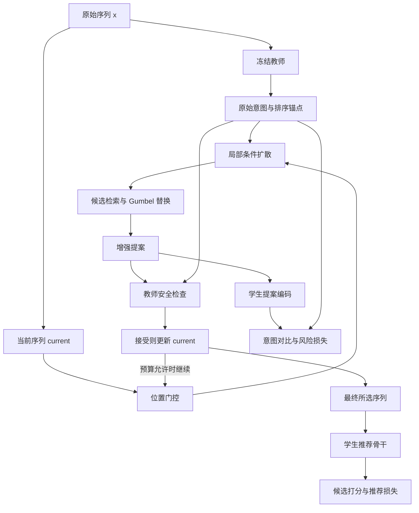

# DCDRec-2 当前架构与训练方案记录

> 整理日期：2026-10-13。  
> 代码目录：[experiment/DCDRec-2](../../experiment/DCDRec-2/)。  
> 记录对象：当前已实现的预训练骨干微调、条件扩散增强、冻结教师约束及断点续训版本。  
> 状态说明：本笔记区分当前实现和讨论中的简化方案；当前代码仍包含门控概率约束与可微风险惩罚。尚未执行删除这两项损失的代码修改。
>
> 版本边界：本笔记记录同日效率优化前的方案。后续代码已将默认 batch 调为 512、删除初始缓冲阶段和部分命令行细节参数、加入教师检索缓存及自动 AMP，并改为仅启用 `--resume` 时保存续训快照。最新运行行为与固定参数见 [项目 README](../../experiment/DCDRec-2/README.md)；以下内容保留为历史版本记录。

## 1. 研究目标与当前定位

任务是根据用户交互历史预测下一物品。研究目标是在已有预训练序列推荐骨干上，通过语义受控的数据增强改善微调效果，同时控制增强引入的意图漂移和排序退化。

当前架构由五部分构成：

1. **可选择的预训练推荐骨干**：作为可训练学生，负责最终推荐。
2. **冻结教师骨干**：提供原始意图、当前上下文和排序分布参照。
3. **条件扩散编辑器**：为局部物品替换生成连续表示方向。
4. **可学习增强策略**：决定替换位置、保留或替换，以及替换候选。
5. **安全筛选与递进控制**：接受符合条件的提案，限制累计编辑。

当前的“意图”是骨干最后一层最后有效位置的表示。扩散编辑作用于局部物品嵌入，扩散轨迹没有被解析为多个层次的意图，也没有用于双分支扩散意图对比。

推理只使用学生骨干和共享物品嵌入推荐头。教师、扩散和增强策略只在训练阶段使用。

## 2. 总体数据流



每个 batch 从原始输入重新初始化 `current`。原始教师锚点在本批增强过程中固定；当前序列只有在提案被接受后才更新。增强结果不写回数据集，不作为下一 epoch 的永久输入。

## 3. 输入、骨干和推荐头

### 3.1 数据组织

文本数据格式为 `user_id item1 item2 ...`，物品编号为正整数，0 用于 padding。至少保留四次交互的用户。

- 训练：使用排除最后两次交互后的前缀预测下一物品。
- 验证：预测倒数第二个物品。
- 测试：预测最后一个物品。
- 输入左侧补零、右侧对齐，默认只保留最近 50 个物品。
- 训练流行度仅统计训练部分，供增强候选过滤和尾部先验使用。

### 3.2 可选择骨干

| `backbone` | 建模方式 | 默认层数 | 默认嵌入维度 |
| --- | --- | ---: | ---: |
| SASRec | 因果自注意力 | 2 | 64 |
| GRU4Rec | GRU 循环网络与输出投影 | 1 | 64 |
| FMLPRec | 频域滤波与前馈层 | 4 | 64 |

GRU 内部隐藏维度默认 128，输出映射回物品嵌入维度。骨干参数名称和结构与所附预训练权重兼容。

默认预训练路径：

```text
experiment/DCDRec-2/src/weight/{backbone}-{data_name}-original.pt
```

加载时检查完整骨干键名和张量形状。骨干层缺失或物品表维度不一致时直接报错。权重和数据的物品编号语义仍需一致；仅凭参数形状不能证明映射一致。

### 3.3 表示与打分

设学生编码器为 $f_\theta$、物品嵌入表为 $E_\theta$：

$$
h_\theta(x)=f_\theta(x)_{\text{last valid}},
\qquad s_\theta(x,i)=h_\theta(x)^\top E_\theta[i].
$$

推荐头直接使用候选物品嵌入，不先计算全物品 logits 再切片。输入嵌入和打分嵌入共享参数。

教师为学生骨干的独立副本。加载预训练后初始化教师；可选缓冲训练结束后再次同步，随后固定参数并关闭 dropout。教师没有通过 EMA 持续跟随学生更新。

## 4. 局部条件扩散

### 4.1 条件构造

对当前序列 $c$ 的位置 $j$，读取教师物品嵌入，构造排除该位置的平均物品上下文 $\bar e_{-j}(c)$，并使用固定的原始教师意图 $h_T(x)$：

$$
e_0=\sqrt d\,\operatorname{norm}(E_T[c_j]),
$$

$$
q_j=\sqrt d\,[\operatorname{norm}(\bar e_{-j}(c));
\operatorname{norm}(h_T(x))].
$$

这里的平均上下文来自物品嵌入；增强门控和候选策略另外使用教师骨干的逐位置上下文表示。

### 4.2 去噪训练

每个样本随机选择一个有效位置，随机采样时间步 $t$：

$$
e_t=\sqrt{\bar\alpha_t}e_0+\sqrt{1-\bar\alpha_t}\epsilon,
\qquad \epsilon\sim\mathcal N(0,I).
$$

去噪器是带时间步编码和条件输入的残差 MLP，直接预测干净表示：

$$
\hat e_0=e_t+g_\phi(e_t,t,q_j),
\qquad L_{\mathrm{diff}}=\mathbb E\|\hat e_0-e_0\|_2^2.
$$

教师目标和条件停止梯度。每个 batch 只执行一次去噪训练损失，并更新一次预测残差的 EMA 均值和方差。

### 4.3 编辑采样

实际增强从原物品表示加噪开始，再执行确定性 DDIM 反向编辑。默认反向步骤数为 8，由 `diffusion_steps` 设置；没有固定为单步，也没有样本级自适应深度选择。

同一批递进增强复用预生成的噪声张量。随着 `current` 更新，干净输入和局部条件会变化，因此复用噪声不代表所有提案具有完全相同的扩散状态。

编辑后的表示 $\hat e_{\mathrm{edit}}$ 用于候选得分和策略特征。其相对原物品的 RMS 偏移经过残差 EMA 标准化，再映射到有界难度信号。该信号影响门控的目标替换率，当前不能解释为经过校准的不确定性概率。

## 5. 可学习增强策略

### 5.1 替换位置与门控

门控网络输入当前物品嵌入、教师逐位置上下文和尾部特征，输出保留／替换 logits，并叠加由 `aug_prob` 和增强递增进度构造的先验。

在预算内按替换软概率选择位置。位置 `topk` 是离散选择，没有直接梯度；保留／替换决策使用 Gumbel-Softmax 直通估计。

### 5.2 候选检索和替换

检索查询由原位置教师物品嵌入和教师上下文组合。候选全集限制为训练中出现过的物品，并过滤原始可见历史、当前可见历史、当前预测目标、原物品以及特殊编号。

默认检索最多 64 个候选。候选得分：

$$
a_i=
\frac{\operatorname{cos}(q_\psi,E_\theta[i])}{\tau_p}
+\gamma\operatorname{cos}(\hat e_{\mathrm{edit}},E_\theta[i])
+\eta\operatorname{TailPrior}(i).
$$

其中 $q_\psi$ 为可学习策略网络的输出，$\gamma$ 为扩散引导强度，$\eta$ 为尾部先验权重。候选替换也使用 Gumbel-Softmax。

前向嵌入等于实际离散决策对应的嵌入；反向保留软概率梯度。没有合法候选时保持原物品。

### 5.3 当前门控辅助目标

设门控替换软概率为 $p_{\mathrm{replace}}$，标准化编辑难度为 $u\in(0,1)$：

$$
p_{\mathrm{target}}=\texttt{policy\_target\_rate}\,(1-0.25u),
$$

$$
L_{\mathrm{policy}}=
\operatorname{mean}_{\text{有合法候选}}
(p_{\mathrm{replace}}-p_{\mathrm{target}})^2.
$$

该项使门控接近人为设定的替换率，属于增强强度辅助约束。当前代码保留该项，默认权重为 0.1。

## 6. 安全筛选与递进增强

### 6.1 编辑预算

对于有效长度为 $\ell$ 的输入：

$$
B=\min\left(\lfloor\rho\ell\rfloor,\max(0,\ell-\texttt{min\_keep})\right).
$$

默认 $\rho=0.2$，`min_keep=2`；每次最多编辑 3 个位置，最多递进 2 次。预算取下整，默认有效长度不足 5 时没有编辑预算。反复编辑同一位置也消耗累计操作预算。

### 6.2 接受条件

对实际离散提案 $z$，使用冻结教师计算：

| 条件 | 表达式或判断 | 默认值 |
| --- | --- | --- |
| 意图距离 | $d_T(x,z)=(1-\cos(h_T(x),h_T(z)))/2\le\delta$ | 初始 $\delta=0.1$ |
| 目标保持 | $\log p_T(y\mid x)-\log p_T(y\mid z)\le\epsilon_y$ | 0.2 |
| 排序保持 | $D_{KL}(p_T(\cdot\mid x)\Vert p_T(\cdot\mid z))\le\epsilon_{KL}$ | 0.1 |
| 局部相似度 | 相对原始序列，所有变化位置的物品余弦相似度达到下限 | 0.0 |
| 预算 | 累计编辑操作及相对原始序列的变化位置数量均不超过预算 | $B$ |

目标概率和 KL 都在该样本的训练推荐候选集上计算。目标保持条件使用的是**对数概率下降**，不是概率的绝对下降幅度。

### 6.3 递进规则

1. 保存原始教师锚点，初始化 `current=x`。
2. 从当前已接受序列生成新提案。
3. 全部安全条件通过：更新 `current`、学生编码缓存和教师编码缓存。
4. 有实际替换但被拒绝：保留上一个已接受状态，停止该样本本批递进。
5. 没有发生替换：保留当前状态，在剩余次数内允许重试。
6. 预算耗尽或达到递进上限：结束。
7. 最终复用 `current` 的学生编码计算推荐损失。

### 6.4 动态阈值

每轮收集通过其他安全条件的提案意图距离，取分位数后平滑：

$$
\delta_{e+1}=\operatorname{clip}
\left(\mu\delta_e+(1-\mu)Q_q(d_T),\delta_{\min},\delta_{\max}\right).
$$

默认 $q=0.7$、$\mu=0.9$、范围 $[0.02,0.2]$。每个 epoch 更新一次；没有可用距离时不更新。校准集合不要求已通过意图距离条件，避免只依据当前已接受样本估计阈值。

## 7. 意图对比、推荐损失与梯度

### 7.1 意图对比

正样本对为原始教师意图 $h_T(x_u)$ 与增强提案学生意图 $h_\theta(z_u)$。使用余弦相似度和对称 InfoNCE，默认温度为 0.2。

其他用户的提案表示提供负例；同一用户不同前缀之间的非对角配对被屏蔽。对比是在本次产生真实替换的提案子批次中计算，参与用户过少时负例信号可能较弱。

实际发生替换的提案即使被安全筛选拒绝，仍参与意图对比与可微风险损失。原始锚点不随递进更新。

### 7.2 推荐与蒸馏

最终选中的序列 $c^*$ 参与监督推荐：

$$
L_{\mathrm{rec}}=-\log p_\theta(y\mid c^*).
$$

每个样本使用一个正例、最多 100 个不重复负例，过滤可见历史及目标；物品不足时用屏蔽占位。未接受任何提案的样本有 $c^*=x$。

当前不额外叠加原始分支推荐 CE。原始序列会为教师锚点、去噪训练和学生初始缓存提供输入，但监督推荐只针对最终所选序列。

排序蒸馏保持最终学生分布接近原始教师分布：

$$
L_{\mathrm{KD}}=D_{KL}
\left(p_T(\cdot\mid x)\Vert p_\theta(\cdot\mid c^*)\right).
$$

### 7.3 当前可微风险项

对于真实提案，以学生输出计算：

$$
L_{\mathrm{risk}}=
\mathbb E\left[
\operatorname{ReLU}(d_{T,\theta}(x,z)-\delta)
+\operatorname{ReLU}(\log p_T(y\mid x)-\log p_\theta(y\mid z)-\epsilon_y)
\right].
$$

该项提供意图与目标保持的连续梯度。硬安全检查则使用教师对真实离散序列的输出，两者作用位置不同。

### 7.4 当前六项联合损失

$$
L=L_{\mathrm{rec}}
+0.05L_{\mathrm{intent}}
+0.2L_{\mathrm{diff}}
+0.05L_{\mathrm{KD}}
+0.1L_{\mathrm{policy}}
+0.1L_{\mathrm{risk}}.
$$

上述为默认权重。各项仍参与训练，日志只隐藏分项显示。

推荐、对比及蒸馏损失可以经学生骨干、直通替换嵌入影响策略和扩散模块；风险项为提案额外提供纠正信号。教师、候选检索和硬安全判断不接收梯度，位置 `topk` 也不直接可微。

## 8. 分阶段训练

| 阶段 | 默认轮数 | 可训练模块 | 目标 |
| --- | ---: | --- | --- |
| 初始缓冲 | 0 | 学生骨干 | 原始序列推荐 CE |
| 扩散预热 | 2 | 扩散模型 | 教师表示去噪重建 |
| 联合微调 | 后续轮次 | 学生、扩散、增强策略 | 六项联合损失 |

联合阶段默认用 4 轮将增强先验逐步提高到设定上限。当前增加的是增强概率，损失权重不随轮次递增。

一个 AdamW 优化器包含三个参数组，每个 batch 反向传播一次、更新一次；默认骨干学习率 `5e-5`，扩散和策略均为 `3e-4`，梯度裁剪为 5.0。没有学习率调度器。

## 9. 关键默认参数

| 参数 | 默认值 | 含义 |
| --- | --- | --- |
| `backbone` / `data_name` | SASRec / Beauty | 骨干与数据集 |
| `hidden_size` / `max_seq_length` | 64 / 50 | 表示维度与最大序列长度 |
| `batch_size` / `epochs` | 256 / 100 | 批大小与目标总轮数 |
| `num_negatives` | 100 | 每样本最多推荐负例数 |
| `initial_buffer_epochs` | 0 | 骨干缓冲轮数 |
| `diffusion_warmup_epochs` | 2 | 扩散预热轮数 |
| `augmentation_ramp_epochs` | 4 | 增强概率递增轮数 |
| `aug_prob` | 0.4 | 门控替换先验上限 |
| `max_replacement_ratio` | 0.2 | 样本累计编辑比例上限 |
| `max_aug_ops` / `max_refinement_steps` | 3 / 2 | 单次编辑上限与递进次数 |
| `min_keep` | 2 | 至少保留的原始位置数 |
| `augmentation_candidate_size` | 64 | 增强候选数量上限 |
| `retrieval_chunk_size` | 256 | 检索查询分块大小 |
| `gumbel_temperature` / `policy_temperature` | 0.7 / 0.2 | 采样和策略打分温度 |
| `policy_target_rate` | 0.65 | 门控辅助目标的基准替换率 |
| `tail_prior_weight` / `diffusion_guidance_scale` | 0.1 / 1.0 | 尾部先验和扩散引导强度 |
| `diffusion_steps` | 8 | 扩散调度和编辑步数 |
| `beta_start` / `beta_end` | 0.0005 / 0.04 | 线性噪声调度端点 |
| `diffusion_residual_ema_decay` | 0.95 | 残差统计 EMA 衰减 |
| `intent_distance_threshold` | 0.1 | 初始意图距离上限 |
| `intent_distance_min` / `intent_distance_max` | 0.02 / 0.2 | 动态意图阈值边界 |
| `threshold_quantile` / `threshold_ema_decay` | 0.7 / 0.9 | 阈值分位数和平滑系数 |
| `max_target_logprob_drop` | 0.2 | 目标对数概率最大下降 |
| `max_distribution_kl` | 0.1 | 教师分布 KL 上限 |
| `min_item_similarity` | 0.0 | 局部物品相似度下限 |
| `weight_decay` / `grad_clip` | 0.00001 / 5.0 | 优化器衰减与梯度裁剪 |
| `patience` | 10 | 联合训练早停耐心 |
| `seed` / `num_workers` | 2026 / 4 | 随机种子与加载工作进程数 |
| `output_folder` / `model_idx` | optimized / 0 | 输出文件夹和实验编号 |

全部参数定义以 [main.py](../../experiment/DCDRec-2/src/main.py) 为准。每次实际运行会把解析参数及数据规模、设备、数据指纹、输出路径等运行时参数完整写入日志。

## 10. 评估、日志与断点

验证和测试只输入原始序列，运行学生骨干进行全物品排序，过滤完整已见历史但保留当前目标。指标为 `HIT@5`、`NDCG@5`、`HIT@20`、`NDCG@20`。

以验证集 `NDCG@20` 选择最佳模型。第 0 轮预训练基线也可以成为最佳模型，避免把微调退化误当作改善；仅联合训练阶段的未改善轮次累加早停计数。

输出布局：

```text
experiment/DCDRec-2/output/{backbone}-{data_name}/{output_folder}/
├── {backbone}-{data_name}-{model_idx}.txt
├── {backbone}-{data_name}-{model_idx}.pt
└── {backbone}-{data_name}-{model_idx}_resume.pt
```

日志参数按 `参数名 : 值` 对齐，保留训练、验证和测试进度条。每轮输出总损失与验证指标，最终记录测试指标；不显示或写入分项损失、策略梯度和增强统计明细。

最佳模型用于评估；续训快照保存当前模型、优化器、教师同步标记、EMA、动态阈值、早停计数、历史最佳模型，以及主进程和采样器随机状态。第 0 轮验证后和每个完整训练验证周期后原子保存。

续训从最近完成的 epoch 后开始。中断时未完成的 epoch 会重新执行；`--epochs` 表示目标总轮数。快照自包含最佳权重，续训不依赖原始预训练文件或外置最佳模型。

## 11. 运行命令

新实验：

```powershell
python F:\recsys-research-training-zhangxinyu\experiment\DCDRec-2\src\main.py --data_name Beauty --backbone SASRec --output_folder experiment-1 --model_idx 0 --epochs 100 --batch_size 256
```

同一实验续训到最多 150 轮：

```powershell
python F:\recsys-research-training-zhangxinyu\experiment\DCDRec-2\src\main.py --data_name Beauty --backbone SASRec --output_folder experiment-1 --model_idx 0 --resume --epochs 150
```

仅评估最佳模型：

```powershell
python F:\recsys-research-training-zhangxinyu\experiment\DCDRec-2\src\main.py --data_name Beauty --backbone SASRec --output_folder experiment-1 --model_idx 0 --do_eval
```

允许通过 `--resume_checkpoint` 指定续训文件，通过 `--checkpoint` 指定评估文件。`--output_dir` 是 `--output_folder` 的别名，只接受单层文件夹名。

## 12. 讨论中的损失简化方案：尚未实施

本轮讨论认为可以删除门控概率约束和可微风险损失，保留四项：

$$
L_{\mathrm{proposed}}=L_{\mathrm{rec}}
+\lambda_{\mathrm{intent}}L_{\mathrm{intent}}
+\lambda_{\mathrm{diff}}L_{\mathrm{diff}}
+\lambda_{\mathrm{KD}}L_{\mathrm{KD}}.
$$

| 拟删除项 | 简化动机 | 需要关注的代价 |
| --- | --- | --- |
| 门控概率约束 | 减少人为替换率对策略的干预 | 门控可能趋向少替换；长期无提案时任务梯度不足 |
| 可微风险惩罚 | 减少与意图对比、蒸馏及硬安全条件的重复约束 | 拒绝提案失去目标保持的直接风险纠正梯度 |

删除这两项损失不意味着删除门控、增强策略或安全条件。推荐、对比和蒸馏仍可能通过 Gumbel 直通嵌入提供增强梯度；实际拒绝提案不参与最终推荐 CE 和最终蒸馏，但仍有意图对比信号。

该方案是否改善推荐指标尚未验证。当前记录保留六项已实现目标，四项目标仅作为后续修改建议。

## 13. 已完成检查与待验证问题

此前会话已执行并通过 5 项 CPU 自动检查：连续训练与跨阶段断点恢复的一致性、参数与进度及精简日志、无需预训练文件的快照迁移续训、非法续训拒绝、固定输出目录约束。整理笔记时检查文件发现该测试脚本已不在当前代码目录中；此处保留历史验证记录，不表示当前仍可直接运行该脚本。

这些检查验证实现行为，不证明增强提高了真实数据集推荐指标，也不构成多个数据集、多个随机种子的研究结论。当前采用高效 CUDA 后端，固定种子仍不保证跨硬件逐位一致。

后续需要验证：增强接受率是否足够、门控是否退化为保留、冻结教师误判是否限制有效增强、候选安全检查能否代表全排序质量、对比子批次是否提供足够负例，以及六项目标是否存在过强约束。删除两项辅助损失后的效果不能在实现和评估前认定。

## 14. 代码映射

| 文件 | 当前职责 |
| --- | --- |
| [main.py](../../experiment/DCDRec-2/src/main.py) | 参数、预训练加载、分阶段入口、日志、最佳模型与续训快照 |
| [modules.py](../../experiment/DCDRec-2/src/modules.py) | 三种骨干、末位置意图、对称 InfoNCE |
| [models.py](../../experiment/DCDRec-2/src/models.py) | 学生、冻结教师、候选打分、局部条件、残差 EMA |
| [diffusion.py](../../experiment/DCDRec-2/src/diffusion.py) | 加噪、干净表示预测、局部 DDIM 编辑 |
| [augmentation.py](../../experiment/DCDRec-2/src/augmentation.py) | 门控、候选检索、扩散重排、Gumbel 替换 |
| [trainers.py](../../experiment/DCDRec-2/src/trainers.py) | 阶段冻结、递进增强、安全筛选、损失、评估 |
| [datasets.py](../../experiment/DCDRec-2/src/datasets.py) | 训练前缀及验证测试留出 |
| [utils.py](../../experiment/DCDRec-2/src/utils.py) | 数据、历史矩阵、流行度、指标、随机状态保存恢复 |
| 历史验证记录 | 此前执行过 5 项训练与日志检查，测试脚本当前不在代码目录中 |

项目运行说明见 [DCDRec-2 README](../../experiment/DCDRec-2/README.md)。本文是日期版本的设计记录，后续代码改变后应追加新版本记录。
